# Changes from the Original

[← back to the README](README.md)

Mousiki Plus started as a Windows port of [itzender5820/mousiki v1.0](https://github.com/itzender5820/mousiki) and grew a lot of features on top. This file collects what had to change for the port and every addition and modification since, newest first. For an overview with screenshots see [Features at a glance](README.md#features-at-a-glance) in the README; for how everything is used, the [user manual](Mousiki_User_Manual/Mousiki_User_Guide.md).

## What had to change for the Windows port

Around thirteen files needed direct `#ifdef _WIN32` branches; a similar number needed changes that apply on every platform but were only ever exposed by something Windows does differently (mostly the UTF-8 path handling below). Everything else compiled and ran unmodified. Due to the fast modifications, it became to hard to track what has changed compared the original version. This adjusted code also builds on macOS/Linux again, additions included (`setup.sh`), so that they can eventually be added to the original branch of this fork. The Linux/macOS side has seen less testing than Windows so far; feedback from other users is welcome.

### Console & terminal I/O

POSIX raw mode (`termios`), key polling (`read()` off `STDIN_FILENO`), window size (`ioctl(TIOCGWINSZ)`), and even `wcwidth()` for East-Asian character width have no Windows equivalent. All of it is replaced by Win32 Console API calls behind a small platform shim (`win_compat.h`/`.cpp`, new in this fork) — `SetConsoleMode`, `_kbhit`/`_getch` (with its own extended-key scan codes translated to match the POSIX escape-sequence path, so the rest of the app never has to know which platform it's on), `GetConsoleScreenBufferInfo`, and a hardcoded East-Asian-width table for `wcwidth`, since MSVC's CRT doesn't ship one at all.

Rendering initially used `SetConsoleOutputCP(CP_UTF8)`, which turned out to be unreliable across console hosts — box-drawing and other multi-byte glyphs could still come out as mojibake depending on the terminal. `win_compat.cpp` now converts to UTF-16 and writes through `WriteConsoleW` directly, which removes the ambiguity.

### Filenames, paths, and non-ASCII text

This was the deepest rabbit hole, and the one most likely to still bite on an untested edge case. MSVC's `std::filesystem::path::string()` converts through the process's **ANSI code page** — and a character with no mapping in that code page (which, for the vast majority of Windows installs, includes almost anything outside Western European Latin script) doesn't get substituted, it throws `std::system_error`. A library with any Japanese, Korean, Cyrillic, or similar filenames would crash outright the moment such a file scrolled into view, with no way to work around it from inside the app.

The fix is a small header, `path_utf8.h` (new), providing `path_utf8()` / `path_from_utf8()` as the only sanctioned way to convert between `fs::path` and the UTF-8 `std::string`s the rest of the codebase already speaks — UTF-16⇄UTF-8 conversion on Windows, a plain passthrough everywhere else. Every `.string()` call and every `fs::path(some_std_string)` construction across the tree (about twenty call sites, in `app.cpp`, `local_source.cpp`, `metadata_probe.cpp`, `settings.cpp`, `cache_manager.cpp`, `youtube_source.cpp`, `lyrics_fetcher.cpp`, `native_duration.cpp`, `console_log.cpp`) was audited and routed through it. A handful of related fixes came out of the same pass:

- `waveform.cpp`'s use of `miniaudio`'s narrow file-open API silently failed (and fell through to a much slower `ffmpeg` decode) for any non-ASCII path — switched to `ma_decoder_init_file_w` on Windows.
- Case-insensitive matching (search, extension checks) used to fold text byte-by-byte with `std::tolower`, which corrupts multi-byte UTF-8 sequences under a single-byte locale. Replaced with ASCII-only folding that leaves every non-ASCII byte untouched.
- The cache filename sanitizer kept only `[A-Za-z0-9]`, so any track with no Latin characters in its title collapsed to a generic `untitled` filename, and every such track collided on the same name. Non-ASCII codepoints are now kept verbatim (they're legal in NTFS filenames; the characters Windows actually forbids are all ASCII, and were already excluded).

### Subprocess execution

The original shells out to `ffprobe`, `ffmpeg`, `yt-dlp`, and Python for a handful of tasks. POSIX quoting/spawning and Windows' `CreateProcess`/command-line quoting rules are entirely different beasts, so `process_util.cpp` gained a full Windows implementation: an sh-compatible tokenizer that parses the POSIX-style quoted command string the rest of the app already builds, then re-serializes each argument using the (unintuitive, backslash-doubling) rules `CreateProcessW` actually expects. `CreateProcess`'s handle inheritance also turned out to be racy across concurrent spawns in a way POSIX's `posix_spawn` isn't — mousiki spawns several subprocesses from different threads at once by design (a background metadata sweep, a track's own `ffprobe`/`ffmpeg`, yt-dlp resolution, the lyrics helper), so every spawn now gets an explicit `PROC_THREAD_ATTRIBUTE_HANDLE_LIST` instead of inheriting every handle open in the process.

### Native audio-file parsing

`native_duration.cpp` reads MP4/OGG/MP3 headers directly (no subprocess) for fast duration lookups. It leaned on `pread()`, `off_t`, and `open()` — none of which exist as such on Windows. Replaced with `_wopen()` (taking the native wide path, with `_O_BINARY` so the CRT doesn't mangle binary audio data by translating CRLF sequences inside it), `_fstat64`, and a `pread` emulation built on `OVERLAPPED` I/O. `off_t` is 32-bit under MSVC, so every offset in this file is a plain `long long` now instead.

### The playback thread

Track switches used to spin up a fresh OS thread per track to call into WASAPI. WASAPI's COM objects are apartment-affine to whichever thread created them, which a fresh thread per track violates outright. Playback now runs through one persistent device-worker thread for the whole session, which made `Player` genuinely concurrent with the main thread for the first time — it gained an internal mutex (`player.h`/`.cpp`) to guard against the two actually racing.

### Locale

`main()` calls `setlocale(LC_ALL, "")` to get correct character handling for the active locale — inherited from the original, not Windows-specific. What's Windows-specific is the consequence: that call also sets `LC_NUMERIC`, and on a comma-decimal Windows locale (German, French, ...), every `std::stod()` call in the app — settings parsing, `ffprobe`/JSON duration, lyric timestamps — silently truncated at the first `.` with no exception thrown. `LC_NUMERIC` is now pinned back to `"C"` immediately after, independent of whatever the rest of the locale is doing.

### Thread-safety net

Every background `std::thread` (metadata sweep, decode, lyrics fetch, waveform pass, search, playlist add, the device worker) is now wrapped so an exception escaping it becomes a log line instead of an immediate, silent `std::terminate()` — the default behavior for an uncaught exception in a detached thread, and on Windows that means the whole process vanishes with no message at all. Several of the bugs above were originally diagnosed by their symptom being exactly this: total, silent process death with nothing to go on.

### Python helper scripts

`scripts/fetch_lyrics.py` and `scripts/lrc.py` are unchanged in what they fetch, but gained a UTF-8 stdout/stderr reconfiguration at startup. Python picks a text encoding for a redirected pipe from the OS locale; Linux desktop sessions inherit a UTF-8 `LANG` down to every child process automatically, Windows has no equivalent, so Python fell back to the ANSI code page — meaning a lookup for a Japanese, Cyrillic, or otherwise non-Latin track title could crash the script outright the instant it tried to print that title back (even just to report "no lyrics found"), which looked from the app's side identical to the script not existing at all. `scripts/fast_yt_search.py` — present upstream but never actually called from the C++ side — is now wired in as the default online search path (see below), with the same UTF-8 safeguard applied on principle.

## Added Features Beyond the Port

Below is a list of major and minor addition on top of the original v1.0. The design remained untouched.

### Major Additions / Modifications

- **Audio book mode:** a **third mode** next to the music player and the radio (`SHIFT` + `+` / `SHIFT` + `-` switch to the next / previous mode; Settings → ON/OFF → TRANSLITERATION (JAP./KOR./CHIN.): which modes are used, their order, the start mode; Settings → PATHS → *Audio Book Path*). It has its own look (`audiobook_config.txt`: colours, theme, visualizations, borders, play mode), its own cheat-sheet category, help-wizard pages and a chapter in the manual.
  - **Books and chapters:** the library pane lists the books (folders, as a folder tree), the queue pane is the chapter pane. `n` / `b` and the end of a chapter walk the chapters, seeking accelerates while the key is held. The music player leaves the book folder out of its lists.
  - **Cover and animation:** the book's cover (a picture file in its folder or the art inside the first audio file) is shown as a real image with Sixel or Kitty graphics, optionally under the colour wave (*Book Cover*, *Book Gradient Wave*); without a cover, a picture of a woman reading (braille where the terminal has no image support). While no book is loaded, a stack of books builds itself up.
  - **Meta data and tag editor:** the meta block shows book, author, narrator, chapter, publisher, genre, length and how much was heard. `SHIFT+m` edits the tags of a chapter or of the whole book; the chapter number always goes in front of the file name, so chapters never get mixed up when sorted alphabetically (a number at the end is moved to the front after a question). Renames carry the bookmarks, notes and chapter marks along.
  - **Time stamps:** an *auto-mark* is saved every few seconds, any number of *bookmarks* (`SHIFT+b`) and *notes* (`SHIFT+n`, written in the field or the full-screen notes overlay `SHIFT+l`, saved as `<folder>_notes.txt`, export / import). Opening a chapter asks *continue where you left?* or offers the Resume choices (on the spot, 10 / 20 / 30 / 60 s before, start). `SHIFT+k` lists all stamps with type and date (sort by date or by book / progress, convert an auto-mark to a bookmark, discard, play), and `CTRL+SHIFT+u` undoes the last deletions. The note editor wraps long lines on the screen, marks with `SHIFT`+arrows and `CTRL+SHIFT`+arrows (words), and copies / cuts / pastes with `CTRL+c/x/v` (also copies a shown note). After saving, `,` writes the note again and `.` puts it away (the view from before comes back); `SHIFT+s` / `k` / `m` / `l` switch between the library, time stamp, tag and notes overlays directly; exported notes go to a `notes` folder inside the book folder. The audio book player no longer writes the music player's session file, so a book chapter is never restored in the player.
  - **Chapter marks and cutting:** `ALT+l` opens a full-screen editor to mark chapter points in a long file; `c` cuts the file losslessly into numbered parts, keeps the original as a backup and moves the stamps to the new parts; `t` in the question also trims blank audio at the edges of the parts down to 2 s.
  - **Library overlay and reading history:** `SHIFT+s` shows the books with their chapters, `SHIFT+h` the reading history (top chapters / books).
  - **Mode default theme** *Rose Pine*; the book folder may not be the same as a music folder.
- **Album covers in the music player** (Settings → ON/OFF → *Album Cover*, *Cover Mode*, *Cover Search*): the cover of the playing track takes the disk's place, from the picture inside the file or from a picture in its folder whose name is close to the title or album tag (a fuzzy match, so a folder can hold the covers of several albums; *Cover Contrast* adds contrast; *Cover Search* picks the order: default, folder first, within file first, folder only, file only). Looks: just the cover, the cover in the disk's gradient, or the grey cover in full resolution behind the turning disk with the disk's braille dots as pinholes the cover shines through (further looks: the dots themselves turning, and the disk's full animation, the dots that come and go); a real image with Sixel or Kitty, braille dots without; shown on the phone remote too; every regular picture format (jpg, png, webp, bmp, gif, tiff, avif, heic, jxl ...) in the folder, in the audio book mode as well.
- **Cover fetch** (`ALT+c`, `HKeyCoverFetch`, music player): an overlay with an *ALBUM LIBRARY* tab (search bar with `f:`, folders that open to the album names without duplicates, missing covers highlighted, filters *no cover* / *one cover* / *several covers*, the album's art and a list of pictures to choose its default from) and a *FETCH LIST* tab that fetches the **front** cover of every listed album once from MusicBrainz / the Cover Art Archive (`scripts/fetch_cover.py`, lightweight JPEG preferred) into a `fetched_covers` folder inside every folder holding the album. Every Cover Search option except *Within File Only* looks into that folder. In the meta editor the cover shows under the fields and a *Cover Options* button opens an overlay (automatic / no cover / pictures of the file, folder, `fetched_covers` and album, delete, search by file name); a choice for a track goes before the album's default and before the Cover Search setting. Code in `src/cover_store.cpp`, `src/app_coverfetch.cpp`, `src/app_metacover.cpp`. `[t]` in the overlay switches the cover between braille (ASCII) and full resolution (also in the meta editor's *Cover Options* overlay, whose preview is a real picture in Kitty / Sixel terminals when full resolution is on), `[r]` lists the recently fetched albums with the matched release; `SHIFT+d` removes a wrong album title (pending edit of the meta editor); Cover Contrast only applies to the gradient / behind-disk looks; `[p]` lists the albums a fetch found nothing for (remembered, hidden otherwise). Two more Cover Modes, *Cover ASCII* and *Cover ASCII with Gradient* (braille dots on any terminal); the oscilloscope's image style works next to the pixel cover looks; *Cover Contrast* in the audio book settings, *Chapter Display* removed there (always on).
- **new-version notice** (once a day Mousiki asks GitHub for the latest release; a small overlay shows it once per version, `ESC` closes it, `o` opens the release page; Settings → ON/OFF → *Update Notice*, `UpdateCheck=`), **media keys and Now Playing** (Linux MPRIS, macOS Now Playing, Windows system media transport controls; play / pause / next / previous / seek / volume for the player and the radio; `MediaKeys=`), **playlist editor**: the library list sorts with `SHIFT+t` (folder order, file names, titles, artists, albums A-Z, also for search results), `/f:` searches folders, and `CTRL+SHIFT+U` first asks for a *New* or an *Existing* playlist; **meta editor**: `SHIFT+↑↓` page and `CTRL+↑↓` first / last row, `ESC` removes a missing-tag filter and clears the search before it closes, `/f:` folder search, titles of tracker modules (`.mod .xm .s3m .it .mptm`) can be saved, legends use one space between commands; text fields: the block cursor and backspace handle double-width characters and combining marks (Japanese `ば` written as は + mark) without breaking the pane borders; the test program no longer aborts at exit; `app.cpp` was split (`app_settings.cpp`, `app_settings_tables.h`, `app_internal.h`). Project side: weekly check of the vendored libraries, an SBOM with every release, non-blocking cppcheck / clang-tidy runs, vendored versions detected automatically, the README dependency table generated by a script. Details in the entries below.
- a much more precise oscilloscope for oscilloscope music: in Osci music mode the **CRT beam** draws every sample exactly once, smoothed between the samples, and adds light by the time the beam spends on a spot -- clean figures without the lines of the jumps between shapes, soft trails on moving parts, equally bright at any frame rate and Decay (Decay about 0.10, Image resolution full and Image detail high give the look of osci-render); the scope window does the same. **Black Background** (Settings → ON/OFF → TRANSLITERATION (JAP./KOR./CHIN.), on by default, `BlackBackground=`): the terminal's background is black while Mousiki runs and gets its own colour back on exit. Ten new built-in colour themes (Catppuccin Mocha, Tokyo Night, Rose Pine, Everforest, Kanagawa, Vaporwave, Outrun, Ember, Glacier, Lavender Haze); the theme list scrolls a page at a time with `SHIFT+↑`/`SHIFT+↓`, shows a scrollbar and names your own themes in the header colour. New `SHIFT+o` rows: **Beam** (CRT / classic, with and without music mode), **Dwell brightness**, **Low-rate blanking** (files below 96 kHz), **Rough mode** (edge clipping as in Mousiki 2.x; braille default) and **Image detail** (pictures up to 1024 px wide); Trace Length up to 8192. **Share Profiles** (Settings → ON/OFF → TRANSLITERATION (JAP./KOR./CHIN.), off by default, `ShareProfiles=`): the radio uses the player's oscilloscope and spectrogram settings; its own values are kept as a backup and come back when the switch is turned off (colours and themes are never shared). **Theme preview:** `SHIFT+p` in CHOOSE THEME (player and radio) shows a still copy of the main screen in the highlighted theme; the list's scrollbar uses the border gradient colour. **Remote control:** `mousiki --cmd next|prev|play-pause|play|pause|stop|shuffle|mute|unmute|toggle-mute|live|switch-mode|quit`, `mousiki --cmd volume 60`, `mousiki --cmd seek -30` and `mousiki --status` control a running player or radio; bind any keys in your operating system to these commands (GNOME/KDE, i3/sway, AutoHotkey, macOS Shortcuts), so keyboards without media keys work too. **Remote app for Android** (or any phone browser; Settings → ON/OFF → TRANSLITERATION (JAP./KOR./CHIN.) → **Remote App**, off by default, PIN-protected, home network only): the phone shows a narrow Mousiki screen drawn by Mousiki itself in the colours of your theme -- the spinning braille disk, meta data, waveform, working dummy buttons (seek, play/pause), prev / random / next, volume, mute, playback mode, **LISTS** (the local list -- tap a title to play it -- and the saved playlists -- tap one to queue it --, a page at a time, and CLEAR QUEUE), manual and the switch between player, radio and audio books (the audio book mode has its own look on the phone, with the cover or the default picture at full resolution (`GET /api/image`); LISTS is the library as a folder tree, tap a chapter to play it; new remote commands `book-open <n>` and `switch-mode -1`); the radio shows its ON AIR sign, station, live / timeshift state, its own controls and **STATIONS**, the whole station list (tap to tune). The REMOTE APP overlay shows the address, a QR code to scan, port and PIN, the other network addresses and a hint when a VPN is on; on Windows `[f]` opens the port in the firewall (`remote_app/`; the APK is built by the GitHub workflow *Remote app (Android)*). New remote commands `playback-mode`, `wizard`, `playlist <n>`, `track <n>`, `tune <n>`, `clear-queue`, `mousiki --cmd --help`, `mousiki --help`, `mousiki --version`, `mousiki --remote-info`. **Universal colours:** the built-in themes only use the fixed colours 16-255, so they look the same in CMD, PowerShell and every terminal colour scheme (1-15 and empty colours depend on the terminal); with Black Background on, uncoloured text takes the theme's list colour. **The queue plays in its order** in every play mode: `n` and the end of a track take its next title; only `#` picks a random title of it (shuffle mode only shuffles the list). Meta editor: `SHIFT+d` / `SHIFT+DEL` empties the fetch list (pending edits stay). **Upgrade backup:** the first save by a new version keeps the previous `config.txt` / `radio_config.txt` as `.bak`. **Automated tests** (91 tests: also the JSON reader, lyrics text helpers, saved playlists and the listening history of player and radio; `cmake -DMOUSIKI_BUILD_TESTS=ON`, then `make mousiki_tests && ./mousiki_tests`; the GitHub workflow *Tests* runs them on Linux, macOS and Windows) and shared code for the player and the radio (text editor, fuzzy search, oscilloscope, terminal graphics).
- **Radio mode** in the same program (see [Radio mode](README.md#radio-player)): online radio with a tuning-dial look, ON/OFF AIR sign, 16-slot presets, Radio Browser search, station lists, recording to MP3, sleep timer, listening history, own oscilloscope/sphere and its own settings. `SHIFT` and `+` (the `*` character) switches between player and radio; the radio is closed completely when you leave it, the player waits in the background (paused) so it is back instantly. The cheat sheet shows the switch key for your keyboard layout (detected automatically, `MOUSIKI_KEYBOARD` overrides it - NOT TESTED YET IF IT FULLY WORKS).

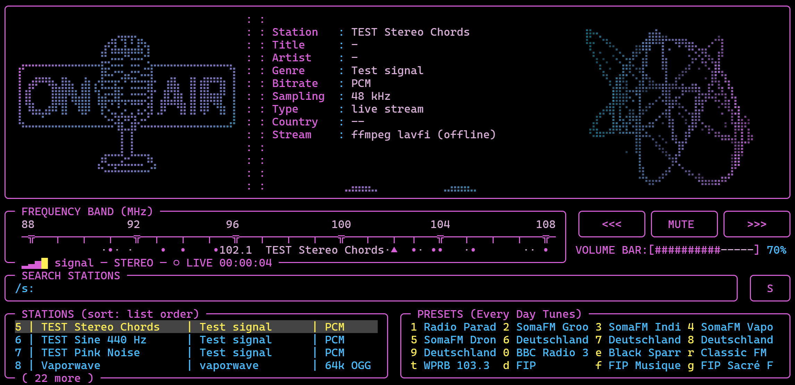

- **Port on linux/macOS** I adjusted the code so the current version also runs on the initial platforms again. I haven't tested this yet and there might be adjustments in the future. Note that macOS has no ALT key. When installing on macOS all cheat sheet and command legends will be adjusted accordingly.
- **Setup/portable (x64)** included in the latest release (for Windows, and for Linux/macOS) as an alternative to building the app yourself. Setup size for windows is currently ~80MB and results in a ~250MB build (might optimize in the future), the portable .zip has ~100MB.
- **YX mode oscilloscope** as alternative to the lyrics ball. Parameters such as decay can be changed in an overlay menu via `SHIFT+o`. Besides the braille style there is an **image style** (Osci style: image): a real pixel picture with glow, drawn by the terminal itself via the Kitty graphics protocol (Kitty, WezTerm, Ghostty, Konsole …) or Sixel (Windows Terminal 1.22+, foot, xterm …); without either the braille scope stays. `MOUSIKI_GFX=kitty|sixel|off` forces a protocol, `MOUSIKI_CELLPX=10x20` the cell size (otherwise asked from the terminal). Frame rate 30 / 45 / 60 / 90 / 120 / 165 (only the screen lines that changed are sent, so the high rates stay within what a terminal can take). **Osci music mode** (`SHIFT+o`) for oscilloscope music: the scopes get the decoded signal before EQ / normalization / limiter / volume, at a fixed scale and without the phase portrait. **Beam** (`SHIFT+o`, per style, with and without music mode): **CRT** draws every sample since the last frame exactly once, smoothed between the samples, and the beam adds light by the time it spends on a spot -- in music mode the fast jumps between shapes nearly vanish, parts that stand still stay crisp and moving parts leave a soft trail, equally bright at any frame rate and Decay; **classic** is the look from before (the newest *Trace Length* samples with a fading tail). With the CRT beam, *Dwell brightness* (off = every stroke equally bright, the jump lines show) and, in music mode, *Low-rate blanking* (files below 96 kHz: their rounded-off jumps are faded out; on by default) can be switched separately; without music mode, *Rough mode* brings back the automatic size of Mousiki 2.x, where sudden louder beats clip along the edges of the square (edge clipping). Defaults: braille = classic beam with Rough mode, image = CRT beam with Dwell brightness. For oscilloscope music, Decay about 0.10, Image resolution full and Image detail high give the look of osci-render; the scope window follows the beam settings and adds a finer beam and stronger interpolation. The Sixel encoder is written for speed (about 13x faster than before: one pass per 6-row band, only the colours that occur, run-length coded), a picture is only sent when there is a new one (the text frame moves the cursor over its cells instead of overwriting them), and **Image resolution** (full / half / third, default half) draws the picture smaller and lets Kitty / the Sixel encoder enlarge it (in Windows Terminal via the Sixel pixel aspect ratio), so high frame rates stay smooth. **Image detail** (normal / high, `OsciImageDetail=`) sets the widest picture drawn: 560 or 1024 pixels across, for sharper thin lines. The oscilloscope can also be open in an extra window showing it in the screens currently set Hz.

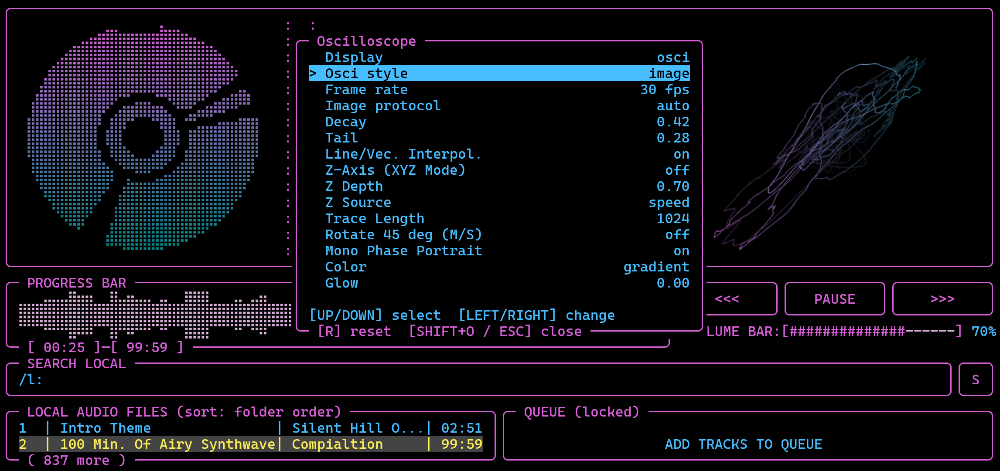

- **Spectrogram** (player: lyrics area via `.`; radio: scope block). Made like Audacity's spectrogram view with Audacity's defaults: 2048 Hann window (scaled to 0 dB for a full-scale sine), zero padding 2, Mel scale 0–20 000 Hz, gain 20 / range 80 dB, strongest bin per pixel row, the Roseus colour map, stereo as two stacked channels; from the decoded signal (volume / EQ independent). Image style (Kitty / Sixel, sent as tiles: in *sweep* motion only the strip being written) or braille. `SHIFT+i` options (all of Audacity's scales, frequencies, gain, range, frequency gain, window size and zero padding (recomputed at once from the last minute of audio), colours roseus / classic on black / grayscale / gradient, channels, time span 5–60 s in steps of 5), `SHIFT+u` full screen with frequency labels and time ruler.
- **Spectrogram scroll in Windows Terminal.** With Sixel in Windows Terminal, *scroll* lets the terminal shift the picture by one cell and sends only the newest cell column: ~60 KB/s instead of ~2 MB/s for a full screen, so it no longer arrives in chunks. Steps are one cell wide; a shorter time span makes it more fluid. It uses DECCRA (copy rectangular area), which Windows Terminal applies to Sixel pictures; `MOUSIKI_SIXEL_SHIFT=0/1` overrides it. It can also be shown full screen (`SHIFT+u`) and in its own window (`(`). 

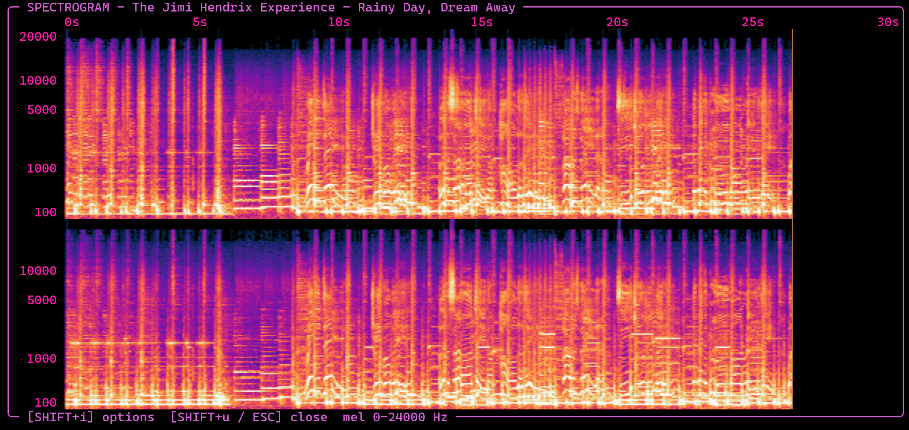

- **More keys are rebindable** (Settings → REFERENCE): *Rescan Library* (`HKeyRescan`, `SHIFT+r`), *Fetch Missing Tags* (`HKeyFetchTags`, `SHIFT+b`; also used in the meta editor), *Lyrics Timing Overlay* (`HKeyLyricsTiming`, `ALT+L`), *Read Lyrics Overlay* (`HKeyReadLyrics`, `CTRL+L`), *Undo Clear Queue* (`HKeyQueueUndoClear`, `CTRL+SHIFT+Z`) and *Save Queue As Playlist* (`HKeyQueueToPlaylist`, `CTRL+SHIFT+U`). A combination is entered by pressing it while the key is edited and is stored by name. Entries are checked now: something that is not a key (`foo`) and the reserved `*` / `ESC` are refused, an empty field unbinds, the conflict message names the command, and the legends and the cheat sheet follow the binding. The `HKeySearchOnline` / `HKeySearchPlaylist` / `HKeySearchFolder` lines were removed (the `s:` `p:` `f:` prefixes are typed in the search box and were never configurable); two labels that ran into the colon were shortened (*Lyrics Cycle Forward / Backward*). The legends of the equalizer, oscilloscope, normalization and spectrogram overlays, the cheat sheet footer and the related status texts show the key that is bound now, and the history overlay and the cheat sheet also close with their rebound key.
- **Karaoke: Japanese / Chinese / Korean in big letters.** The sizes 2-5 used to fall back to normal text for any line the built-in 5x7 pixel font could not draw. Such lines (and Cyrillic / Greek) are now rasterised from a font installed on the system with `stb_truetype` (`third_party/stb_truetype.h`, `src/glyph_raster.*`) and drawn in braille like the pixel font. Their steps are different (16 / 24 / 32 / 40 dots high = 4 / 6 / 8 / 10 rows for the sizes 2-5, full-width characters as wide as high), lines without spaces wrap where the row is full, and a line that would be taller than the screen steps down a size, or ends as normal text. At sizes 4 and 5 the side pictures are left out (the lyrics take the whole width) while the lyrics contain CJK text, because the letters did not fit between them and silently fell back to the smaller sizes. System fonts are searched on Windows, macOS and Linux (bold sans faces first); `MOUSIKI_CJK_FONT` names a font file explicitly. Without a CJK font the old fallback (normal text) remains.
- **READ LYRICS: search every lyrics file** (`CTRL+s` in the reader): a SEARCH LYRICS FILES panel lists all `.lrc` / `.txt` files of the library's `lyrics` folders (next to each track folder, the music folders and the download cache) and filters them by file name as you type (all words, any order); `ENTER` shows the file in the reader instead of the playing track's lyrics and `t` translates it like any other. `CTRL+L` / `ESC` close the reader, which opens on the playing track again next time.
- **Marquee scrolling on / off** (Settings → ON/OFF → *Marquee Scrolling*, `MarqueeScrolling=` in `config.txt`; the radio has its own row and `MarqueeScrolling=` in `radio_config.txt`): off, a name that is too long for its column no longer scrolls anywhere (list rows, Name / Artist / Album of the metadata block, playlist editor lists, the radio's station lists and tuned preset) and is cut off with `...` instead. Default is on, as before.
- **YT mode oscilloscope** (`SHIFT+o` → **Scope mode**, `OsciMode=xy|yt|overlap|row|col` in `config.txt` / `radio_config.txt`; also in the radio): besides the XY figure (left = horizontal, right = vertical) the scope can draw the classic time-domain trace -- the signal's amplitude over time across the whole width, with a rising-zero-crossing trigger so a steady tone stands still -- alone, **on top of the XY figure** (*XY + YT (overlap)*, the YT trace slightly dimmer) **in two rows** (*XY + YT (row)*: XY above, YT below) or **in two columns** (*XY + YT (col)*: XY left, YT right). The scope window follows the mode (in its dot style). Afterglow, dot threshold, line interpolation, trace length (= how many samples fit across the width, 128 – 8192), palette, braille / image style and Osci music mode (fixed scale) all work with it; Z axis, rotation and the mono phase portrait belong to the XY figure.
- **Oscilloscope full screen** (`SHIFT+0` -- the `=` key; player and radio): like the spectrogram's `SHIFT+u`, but both pictures at once, **YT on the left and XY on the right**, both as equally sized, square-looking boxes (the horizontal grid lines of the two line up; the boxes keep their shape when the terminal is resized and sit in the middle of the screen), each with its name centred above it (time span, axes), the keys in the bottom border. `SHIFT+a` turns **axes / a grid** over both pictures on and off (`ScopeGrid=`, on by default), `SHIFT+v` adds the **axis values** (percent on the vertical axes, milliseconds below YT, percent below XY; `ScopeValues=`), `SHIFT+c` opens a small window to set the grid colour by typing 0-255 (`ScopeGridColor=`; default: the colour of inactive list elements), `SHIFT+p` opens a small window for the **grid metrics** of YT and XY separately (time unit ms / samples / divisions, number of divisions, and steady readouts in the picture's name: RMS level and peak hold in dB, L/R correlation and balance; averaged, refreshed twice a second; `ScopeYt*` / `ScopeXy*` keys), `SHIFT+o` opens the oscilloscope options on top. Both pictures follow the oscilloscope's **Osci style**: braille dots, or -- with *image* on a Kitty / Sixel terminal -- two real pixel pictures with the grid drawn as thin pixel lines (panels such as `SHIFT+o` cut a hole into them). Both pictures have a solid frame; the axis values are always percent of the picture's scale, and a line under each box says so (100 % = the loudest part with the automatic size, full scale in Osci music mode). The note on the Settings ANIMA/VIZ tab now reads "[SHIFT+u/0] opens a big overlay of both". In the radio the plain `=` is no longer a second volume-up key.
- **Settings ON/OFF and ANIMA/VIZ cleaned up.** New master switch **Viz/Lyrics Field** (`VizLyricsField=`): `false` removes the whole field right of the meta data, which then gets its width. The switches of the field no longer fight each other: choosing a view that is off (Lyrics/Viz Default, No-Lyrics Viz) turns its **Use ...** switch on, and switching a **Use ...** switch off moves the picks that pointed at it on to the next visual that is on instead of turning the switch back on by itself (the oscilloscope could not be switched off while it was the No-Lyrics pick). **Use Lyrics** is now **Use Lyrics Engine** and replaces the separate *Lyrics Engine* row (the `.` key shows the lyrics live; *Lyrics/Viz Default* sets what the field starts with: a view, or `last used`). **No-Lyrics Viz** has a fourth value, `none`. **Visualizer** is now **Spectrum Bars** (the bars below the meta data; rows *Bars Fluidity / Degradation / Viscosity*), **WaveForm** is **Progress Waveform** (the config keys stay). **Show meta data only** now also applies to the Queue pane (the ON/OFF row is gone again: `SHIFT+n` does it). The note at the bottom of ANIMA/VIZ is two rows long. Player and radio.
- **Classic green** oscilloscope colour (`SHIFT+o` → Color, `Palette=green`): one phosphor green, only the beam brightness varies. The axis values of the oscilloscope overlay (`ScopeValues`) are on by default.
- **Help wizard: new text, now a plain file.** The pages live in `Mousiki_Help_Wizard.txt` (`[[New Page]]`, `[[Header]]`, `[KEY]` markup; chapters I-III: overview, music player, radio), compiled into `src/wizard_text.inc` by `tools/wizard_to_inc.py`; `MOUSIKI_WIZARD_FILE=...` tries a changed file without a rebuild. The top border names the chapter, `t` jumps to the table of content (centred), `←`/`→` stay inside the main chapter of the page (the table of content is the way to another one), a page taller than the terminal scrolls with `↑`/`↓` (`SHIFT+↑`/`SHIFT+↓` a whole page) and shows a gradient scrollbar, every page has an empty line at its start and end, `[[Header_line]]` colours a whole line, and both welcome pages spin the disk (speed 0.1) to the left of the text; the tool warns when a welcome line is wider than 72 columns.
- **Meta editor, live on the main screen**: Name / Artist / Album / Year (and the scope/spectrogram window titles) now show the pending meta edits of the playing track at once -- typed or fetched in the editor via `SHIFT+n` -- and keep the values after `CTRL+s`. The first line is labelled **Title** or **File** and follows `SHIFT+n` like the list rows do (Title: the title tag, or the file name if there is none; File: the file name, including a pending FILE rename).
- **Meta editor**: `SHIFT+f` (library pane) adds the whole filtered list to the fetch list; `SHIFT+c` (Fetch List tab) cancels a running AcoustID fetch (the helper is killed, arrived results stay as pending edits, the rest stays on the list). Closing the editor leaves a fetch running in the background; quitting or switching to the radio now cancels it instead of waiting for the end of the batch.
- **Saving many meta data edits** (`CTRL+s` → `Y`) no longer looks like a freeze: the files are written in short slices, the status line counts `saving 37 / 412 ...`, and after about a second a centered *Please wait, this may take a few seconds* panel with a progress bar appears. `ESC` stops after the current file (the rest stays pending). The pending list shrinks while it runs and is saved to the backup file every 2 seconds, so even a crash half-way loses nothing.
- **COLORS tab** has a `TAB_NAMES` row (current / other tab name, `ColorTabCurrent` / `ColorTabOther`) like the radio; the playlist editor's name field (25 characters) sits in the tab strip.
- **READ LYRICS** (`CTRL+L`): a full-screen reader for the saved lyrics of the playing (else the hovered) track, centered with two blank rows above and below. Two one-line panes on top: **READ LYRICS** (the track's lyrics files: embedded / fetched / older copies, `←/→` choose) and **TRANSLATION** (the translations saved for that file; `←/→` choose which one is shown, `d` / `DEL` deletes it after a `y`); `TAB` moves the keys between the panes. `t` opens the **translate overlay**: service (Google Translate's unofficial key-less endpoint or MyMemory), language to translate into and language the lyrics are in (auto-detect, or set by hand when it guessed wrong); `ENTER` there fetches the translation (online service, needs `scripts/translate_lyrics.py` and Python 3) -- the only place that fetches. It takes a while and runs in the background: closing the overlay, choosing another file or even leaving READ LYRICS does not stop it, and asking for a second one while it runs gives a warning. `SHIFT+t` never fetches: it shows the translation in `( )` below each original line, steps to the next saved one when there are several, and hides them again. Translations are saved per language in `<track folder>/lyrics/translations/`. Settings: `TranslateService`, `TranslateTo`, `TranslateFrom`. (LibreTranslate was dropped: it needs a paid API key.) `CTRL+L` used to be a second way to open the lyrics timing overlay; that is `ALT+L` only now.
- **Pane focus indicator**: the pane that has the keys on the main screen (search box while typing, file list, queue) is marked with a small `◀` after its title, as already in the meta and playlist editors (it replaces the queue's old `(focused)` note). Its colour is the new **FOCUS** row of the COLORS tab (`ColorFocus`, shared by all those places); every built-in theme sets it to the theme's header colour, themes of your own get their header colour, and a `config.txt` without the key follows `ColorHeader`. The settings pane is one row taller (it ends on the second-to-last terminal row, like the radio's), so the COLORS tab's 22 rows fit at 120x30; all tabs use the same height. The radio has the same option (its own `ColorFocus` in `radio_config.txt`, FOCUS row of its COLORS tab; default = the radio's header colour). Colours stay separate per mode: a theme picked in the player never changes the radio and vice versa, and a theme made in the radio stores its colours as `Radio.` keys so the player's look of it is untouched.
- **Listening history** has *Listening by hour* and *Listening by weekday* in the HABITS tab; the playlist and history menus use the settings-style tab strip; the COLORS tab shows a colour swatch next to each value.
- **Sleep timer** with several options to choose from incl. fade-out mode (open via `SHIFT+z`). Can be turned off again. Timer resets after restart of the app and "off" is set as default.
- **Creator** (`^`, `HKeyCreator`): a new overlay that turns a text (pixel font or an installed font) into a WAV and plays it. *Oscilloscope (XY)* traces the outlines (threshold, marching squares, simplification, nearest-neighbour path order) and draws them as oscilloscope music with optional motion (spin, tumble, pulse); *Spectrogram* reads the text as a spectrogram and plays it with an additive synthesizer restricted to the notes of a musical scale (polyphony limit, noise floor, soft envelopes, reverb), so it sounds pleasant. After *Create* a full-screen **looping preview** opens (XY scope in music mode, or the spectrogram, as pictures on Kitty / Sixel terminals) with its own scope / spectrogram instance and settings, so `SHIFT+o` / `SHIFT+i` are untouched; `ESC` closes it and the song that played before comes back. *Created files...* lists the saved files and opens one in the preview. The creator's folder is marked (`.mousiki-creator`) and left out of the library scan, so the files are only played from *Created files...*. `SPACE` is off in the overlay except for typing in the text field. Core in `src/creator.cpp` (covered by 15 tests), panel and preview in `app.cpp`. A second creator mode, **Microphone**, uses the new `src/mic_capture.cpp` (miniaudio capture device + lock-free stereo ring, covered by 2 tests): the big preview shows the live input as spectrogram, XY scope or YT scope, `ENTER` records to `mic_<date>_<time>.wav` in the creator folder, `V` changes the view. The scope grid can be switched off (row *Scope grid*, `G` in the preview) for the text-to-scope preview as well.
 

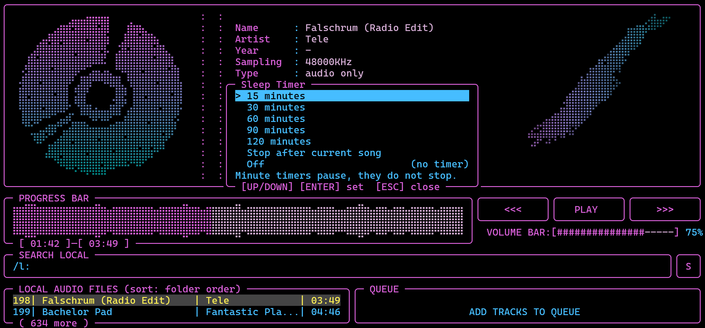

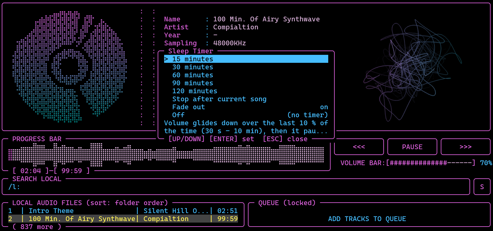

- **Adjust lyrics timing** menu where an offset of max. +/-120s can be added to the lyrics. This is specially helpful when songs where downloaded from youtube, where a video version includes scenes before the actual song starts etc.

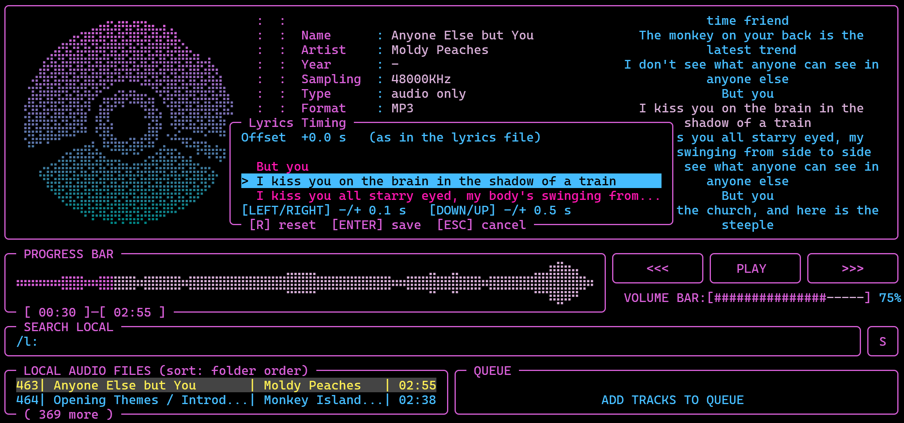

- **10 band EQ** overlay with 12 presets which can be opend in the main playback UI via `SHIFT+e`. Custom presets can be created, saved and deleted. Built in presets can't be deleted. 

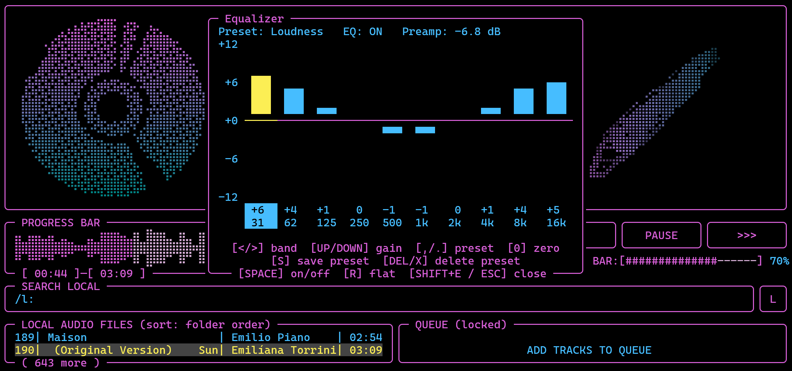

- **Track and queue list overlay** for the playback UI: `SHIFT+L` opens an enlarged list pane, `SHIFT+K` an enlarged queue pane (kept off `q` on purpose, so you cannot quit by accident), `SHIFT+↑/↓` scroll page-wise, `ESC` or the same key closes. Playback keys keep working inside the overlays. Queues are locked by default (a played track moves to the end instead of disappearing; unlock with `!` and it leaves the queue) and the queue can be saved as playlist (moving to the playlist menu). Several other commands such as add to end and move to top/bottom are also added
 

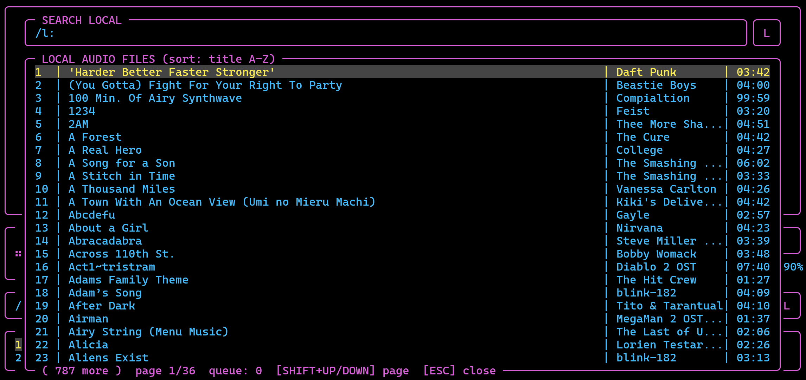

- **Playlist manager** - Via `SHIFT + p` or `P` respectively a playlist menu can be entered and playlists from local files can be created; search in main UI via `/p:`, hit `Enter` and its titles are added to the current queue.

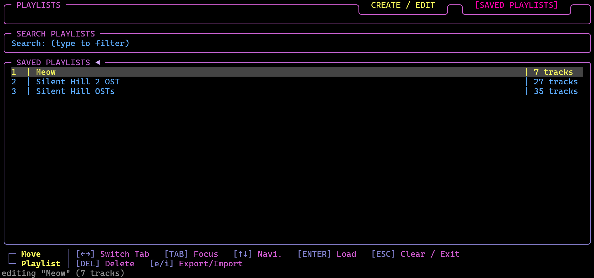

- **Meta/tag editor incl. fetch via AcoustID** (`SHIFT+M`, rebindable as `HKeyMetaEditor`) — a second full-screen overlay shaped similar to the playlist menu (tab strip, boxed panels, search field, hint/status footer) for changing a file's **name**, **artist**, **title**, **album** and **year**:
  - `TAB` cycles search field → library list → the field rows, where typing edits the hovered field directly; `←/→` switches between the **EDIT** tab and the **FETCH LIST** tab (in the search field only until something is typed there; in a field row they move the caret and `SHIFT+←/→` marks text).
  - Every field that was touched — typed *or* filled in by a lookup — stays drawn in the **header colour**, and the matching **file rows in the LIBRARY panel are drawn in that same header colour** (with an `[ N edited ]` count in the panel's footer), so "which files does this session touch, and what exactly will be written?" is answerable at a glance.
  - sorting of the library pane for titles without any meta data (`x`) with missing title (`SHIFT+t`), missing artist (`SHIFT+a`), missing album (`SHIFT+l`) and missing year (`SHIFT+y`) is possible for better overview; `r` toggles the edited files to the top; `SHIFT+p` plays the hovering track (library pane and fetch list). `DEL`/`d` removes a title from the fetch list.
  - **AcoustID fetch (audio fingerprint)**: `SHIFT+B` (*Fetch missing tag*) looks up the hovered title and fills in **only its empty tags** (`Browse` list or inside the menu), `SHIFT+N` (*Fetch all tags*, meta editor only) does the same but overwrites all tags, `a` queues a title for the batch like the queue's add key, `ENTER` on the FETCH LIST tab (*Fetch full list*) runs the whole batch with the ticked options. Single titles are fetched with exactly these two keys; for any other combination (e.g. only the year) add the title to the fetch list, tick the boxes and press `ENTER`. Each fetch asks the disclaimer *"Fetching meta data via AcoustID and MusicBrainz; not always accurate. Only empty tags are filled in; existing tags stay as they are. Continue?"* (or *"Existing tags are overwritten."* for `SHIFT+N`) first (Yes/No/ESC) and results only ever land **in the edit session**, never directly in the files. The lookup identifies the *audio*, not the text in the file name: `scripts/fetch_meta.py` runs `fpcalc` — a drop-in rebuild of Chromaprint's own tool, compiled by CMake from the vendored [Chromaprint](https://github.com/acoustid/chromaprint) 1.6.1 sources in `third_party/chromaprint/` (`tools/fpcalc.cpp` drives the library, ffmpeg does the decoding, so no prebuilt binary ships) — to fingerprint the first ~120 s of the file, sends fingerprint + duration to the AcoustID web service (paced to its 3 requests/second limit) and takes **artist + title** from the best-matching recording — confidence below 0.5 is reported as "no match" rather than written as a wrong tag, and among equally confident recordings the one whose duration is closest to the file wins. Progress shows as `3/7 …` while it runs.
  - **What gets fetched (fetch options)**: the **FETCH LIST** tab has an option line in its header, `Fetch: [x] missing only  [ ] all  [ ] artist  [ ] title  [ ] album  [ ] year`, with one **checkbox per option**. `TAB` moves the focus between the list and the option line, `←/→` move the cursor over the boxes, `SPACE` ticks or unticks one. **`missing only`** (default) and **`all`** exclude each other and every single-tag box (ticking one unticks the others); the four tag boxes combine freely (e.g. just artist + album), and at least one box always stays ticked. `ENTER` on the list fetches **every track in the list**, and only the ticked tags. **`missing only` fills in just the tags that are empty** and never touches a value that exists (a pending edit counts as a value); **`all`** and ticked tags overwrite existing tags. A title with nothing to fetch is skipped (*"nothing to fetch"*). The boxes are stored in the session and apply to the fetch list only; `SHIFT+b` / `SHIFT+n` ignore them. The Edit tab has no fetch row anymore. The search itself always works from the audio fingerprint only; the tags already in the file are not used for the lookup.
  - **Album and year via MusicBrainz**: when album or year is wanted, the recording found by AcoustID is looked up at MusicBrainz (max. 1 request/s). Its releases are grouped into **candidates** (e.g. *Album* and *Album (Remastered)*; singles and compilations only if nothing better exists), best first. The first candidate goes into the field; the colour tells what is left to do: **header colour** = fetched with a single candidate, typed or confirmed (like any edit); **legend colour** (in the field *and* on the file row in the LIBRARY pane) = several candidates, a choice is waiting. `ENTER` on such a field opens the **choice overlay** (`↑/↓`, `ENTER` picks, `DEL`/`d` discards the fetched value and all options, `ESC` closes). Picking an album also sets the year that belongs to it while the year is still a fetched suggestion. Choices are part of the autosaved session; `CTRL+s` warns when some are still open (the first candidate is then saved).
  - **API key**: every AcoustID request is signed with an application key that is hard-coded as `API_KEY` at the top of `scripts/fetch_meta.py` — deliberately *not* a setting, because an AcoustID key belongs to one registered application rather than to a user, and the account-key/application-key mix-up is exactly what the service answers with *"invalid API key"*. A highly modified or rebranded build should maybe register its own application (its free!) at <https://acoustid.org/new-application> and change that one line; an invalid key fails with a status line that says so (`NO_KEY`) instead of guessing from the file name.
  - **Always-autosaved session**: the pending edits are written to `~/.cache/mousiki/meta_session/session.json` after every keystroke, so ESC, quitting or crashing keeps them as a backup — the audio files themselves are *never* touched by merely editing.
  - `CTRL+S` applies the session (asks *"Want to save?"*) — tags go through an `ffmpeg -c copy` remux into a temp file that is renamed over the original (audio stays bit-for-bit identical), a name edit becomes a plain rename; `CTRL+SHIFT+X` throws the pending edits away (asks *"Want to discard changes?"*). Failed entries stay in the session so they can be retried. These two are deliberately **not** rebindable: they are modifier combinations, which a hotkey string cannot express — the same reason `SHIFT+B` is matched directly too.
 

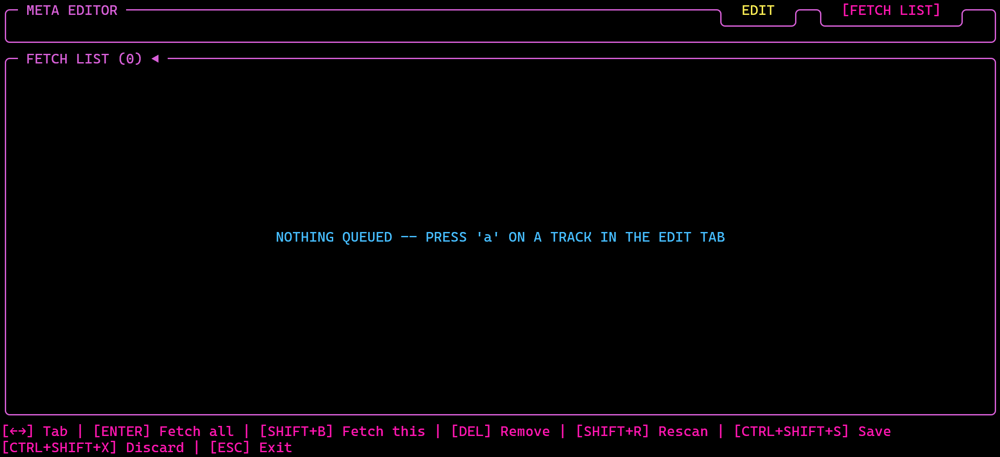

- **New Screen when no title loaded in Playmode "stop" mode** Added an Braille-Ascii music cassette and centered the statement that no track is currently loaded. Not thaaat of major change, but since it adds a design feature, which I didn't do before, I listeded here.

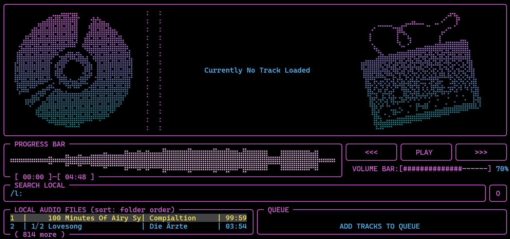

- **Playlist folder copy**: when the playlist path is changed in the settings, the existing playlists are copied to the new folder (nothing is moved or deleted; the music and download folders are never copied).
- **Editable path lists in the settings panel** — Settings → PATH now has a **LOCAL PATH**, **DOWNLOAD FOLDER** section and a **PLAYLIST PATH** section, the local paths one row per configured path ending in a `(+ new path)` row that appends a new empty line to type into (Enter on it opens the field immediately). Emptying a line removes that path. `LocalMusicPath=`/`PlaylistsPath=` in config.txt still work identically. Paths in those lists:
  - are *live*: committing a local path rescans the library on the spot instead of waiting for the next launch;
  - the playlist folder is a single path (one row, no "+ new path"); changing it copies the existing playlists over (see above).
  - yt-dlp download folder can now be set in the Setting; only one folder is possible and the folder will automatically be added to local paths, so no extra path adding necessary

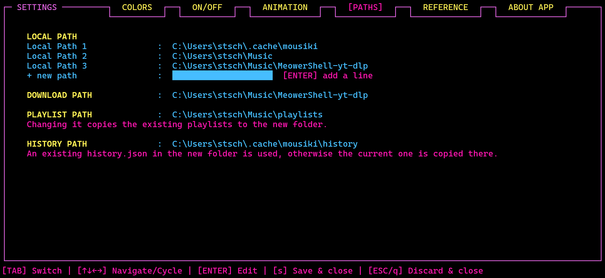

- **Listening history** via `SHIFT+h` including the last 100 tracks that had been played, the duration of titles where resorting can be done via the `r` key (default sort is "most played tracks on top" second sort is "least played title on top"), and tracking listening habits containing average session length, time music has been played per day, tracks per session, number of skips, replays and completion rates (how many times did a song finish).
  - top tracks (top 10 / 25 / 50 / 100) can be added to the queue in the second menu tab (`TAB` switches pane, `Enter` adds). Tabs are switched with `1`–`4`.
  - **TOP PLAYLISTS** tab: the top 5 saved playlists of the week, month, quarter, year and overall in one pane (plays are counted for the playlist they were queued from; plays from before this tab existed carry no playlist).

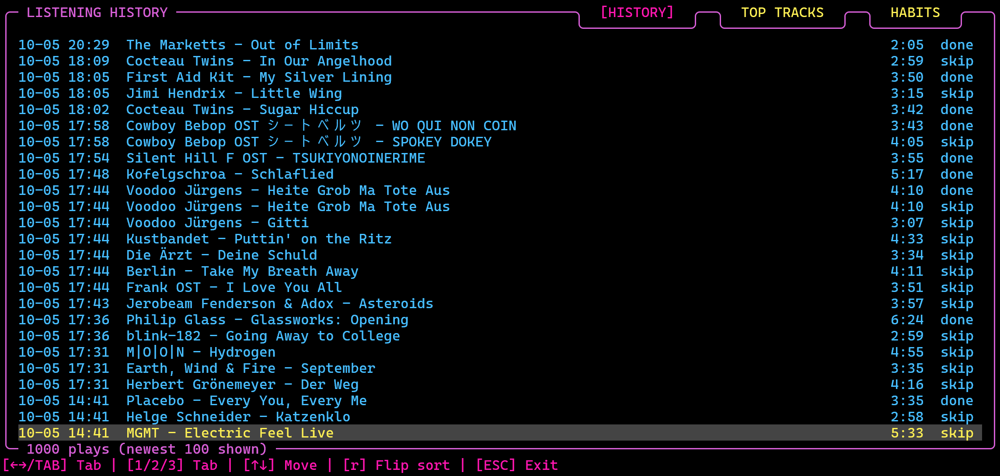

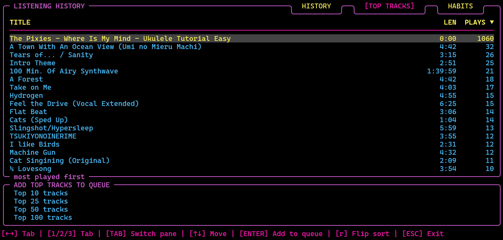

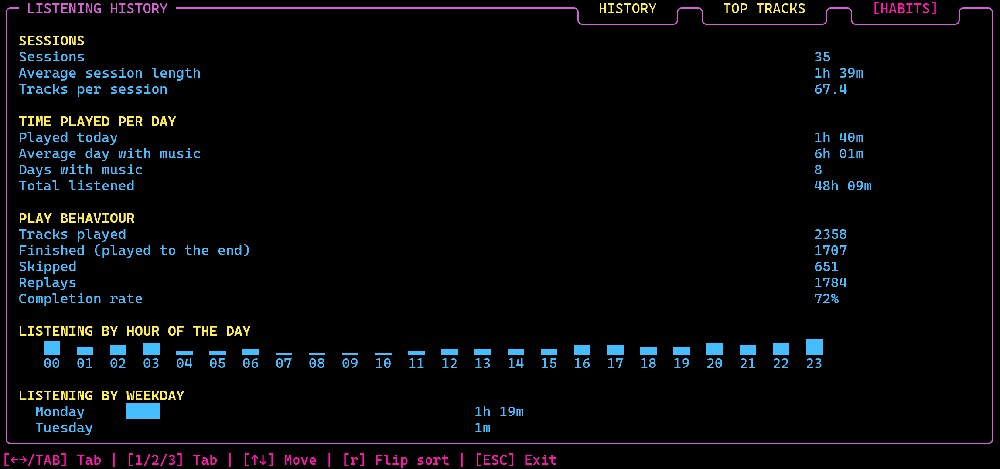

- **Stereo Playback** - Can be toggled in the settings menu. Visualizations rely on a the usual duplicate mono channel.
- **Loudness Normalization** - Parameters can be set in the config.txt and toggled on and off via `v` and in the overlay menu tab via `SHIFT+v`, where parameters can be adjusted.

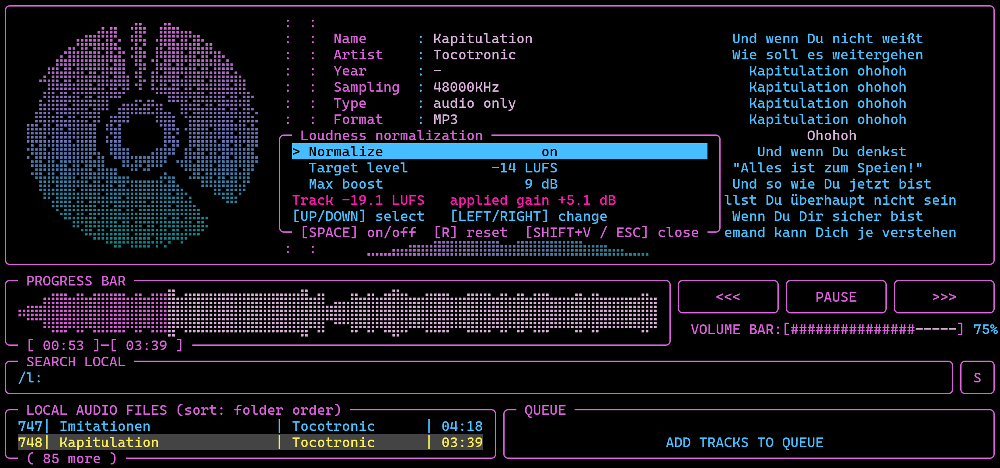

- **File conversion overlay** - `SHIFT+c` opens a menu to convert high resolution files (FLAC, WAV, ALAC ...) to MP3 and other lighter formats: search bar, pre-filter (file type, minimum bitrate, hi-res only), `SPACE` marks files, `←/→` picks the target (MP3 320 / V0 / 192, AAC 256, Opus 128), `f:` / `p:` in its search bar pick a folder or a saved playlist (`ENTER` shows only its files, `/` goes back to the full search), `ENTER` converts in the background with ffmpeg (`c` cancels). Files go to the new **Settings → PATHS → CONVERSION EXPORT PATH** (default: `conversion-export` in the download folder, `ConversionExportPath=` in `config.txt`); the originals are never touched, tags and cover are kept. `SHIFT+c` used to seek forward like the right arrow: typed `SHIFT+a`…`d` are no longer confused with the arrow keys.
- **Big folder overlay** - `SHIFT+f` opens a folder tree of the library with a search bar (LOCAL AUDIO FILES FOLDER pane): `ENTER` opens a folder (subfolders and files appear indented), `CTRL+p` plays the highlighted file, `SHIFT+↑/↓` scrolls a page, `f` on a folder or a file shows that folder in the LOCAL AUDIO FILES pane and closes the overlay. The folder name in the LOCAL AUDIO FILES title is now shortened with `...` when it would break the border.
- **Smooth border gradient** - the frame now fades row by row from `ColorBorderTop` to `ColorBorderBottom`; a new SMOOTHNESS row under BORDER_COLOR (both modes, `BorderGradient=smooth|rough`) switches back to the old look where only the bottom border line takes the bottom colour. The THEME row moved to the top of the Colors tab.
- **Unsaved-changes warnings, edit current theme (`e`)** - leaving the settings (`ESC` / `q`) or the CREATE THEME editor with changes now asks first (`s` save, `d` discard, `ESC` keep editing; player and radio). `e` on the Colors tab opens the theme in use in the editor: a theme of your own can be overwritten (its name is already in the NAME field; saving asks "Do you want to overwrite theme ...?"), a built-in one needs a new name. Names are at most 25 characters. `SHIFT+d` in the CHOOSE THEME list deletes a theme of your own (after a "Do you want to delete theme?" question; built-in themes cannot be deleted).
- **Theme export / import** - `SHIFT+e` / `SHIFT+i` on the Colors tab (player and radio) export the colors as a `.theme` file / import theme files from a folder. The theme pickers mark the applied theme (or the chosen template) with the dot only; the "(yours)" label is gone.
- **Colour themes** - (the text colour of the edited text and the cursor is a dark grey, 236, in every theme, so the cursor block is visible on a black terminal) the Colors tab (player and radio) starts with a **THEME** row: 30 ready-made themes (soft, cyberpunk, greyscale, three colour-blind-friendly ones, ...) plus `SeriousMeowerShell(Default)` (the default of the music player) and `MeowerShell` (the radio starts with `Dracula`) (the colours of the default config.txt), and **CREATE THEME** for your own (name, optional template, any color cell). Themes live in `themes.txt` next to `config.txt`. The focus triangle `◀` now also shows in the meta editor's search field and the playlist editor's name and search fields.
- **Colour numbers are palette numbers everywhere** - any number `1`-`255` works in any colour field (text, background, gradient ends); `0` / empty = the terminal's own. Before, `30`-`37` / `90`-`97` (text) and `40`-`47` / `100`-`107` (background) were plain 16-colour codes - typing `104` as a border colour painted a bright-blue background bar. Older `config.txt`, `radio_config.txt` and `themes.txt` are converted once on load (`ColorCodes=palette`, themes `# format: 6`); black is now `16`.
- **Playlist import, search pane** - `i` on the Saved Playlists list (the legend reads `[e/i] Export/Import`) on the Saved Playlists tab opens an **IMPORT PLAYLISTS** overlay: pick a folder (default: the export / playlist folder), mark `.m3u` / `.m3u8` files with `SPACE` (`a` = all) and `ENTER` imports them as native playlists. The Saved Playlists search row now has its own **SEARCH PLAYLISTS** pane using the search colors.
- **Karaoke, smart history, M3U8 export** - `k` opens a karaoke overlay (lyrics over the whole screen with a braille karaoke picture in the disk colours; Refresh UI moved to `r`, old configs are migrated). The history's queue pane is now **ADD SMART HISTORY TO QUEUE** with 16 lists in four columns (top N, top of the week / month / quarter / year, time of day, newly added and least played); `TAB` no longer switches the history tabs, `←/→` do. `e` on the playlist editor's Saved Playlists tab exports a playlist as M3U8 / M3U; the export folder is a new single path under Settings → PATHS (`PlaylistExportPath=`).

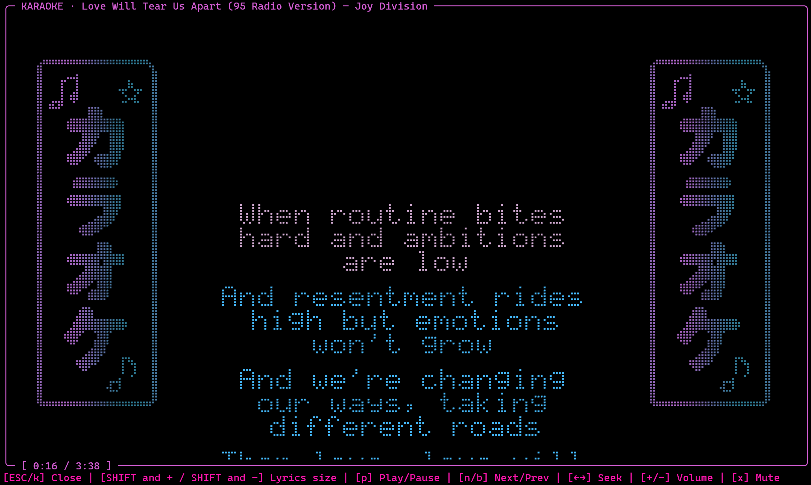

### Minor Additions / Modifications

- **Latin letters (`"` / `SHIFT+'`):** Japanese kana, Korean Hangul and Chinese characters are shown as romaji / Revised Romanization / pinyin (titles, tags, file names, lyrics, karaoke, READ LYRICS); Chinese characters are only read as pinyin when the text is known to be Chinese (characters only Chinese uses, the track's other tags, the artist's other tracks); in Japanese text and where it is unknown they stay. Names written both ways show their Latin part; a reading dictionary (built in + `kanji_readings.txt`) names kanji words. The search finds such titles by their Latin spelling. The pinyin table comes from pypinyin (MIT), see `THIRD_PARTY_LICENSES.txt`.
- **Learned Latin names:** artist names written in Chinese characters / kana get their Latin spelling from the folder and file names of your own library (3+ agreeing tracks) and from `Name (名前)` tags; kept in `kanji_readings_learned.txt`. Optional **Latin Name Lookup** (Settings → ON/OFF → TRANSLITERATION (JAP./KOR./CHIN.), `LatinNameLookup`, off by default) asks MusicBrainz in the background (`scripts/lookup_artist_name.py`, one name at a time) and sends only the artist names.
- **Latin + original name:** `Kaneko Ayano カネコアヤノ`, `HAKU ハク。 (Jap.)`, `Anri 杏里` (no brackets) show the Latin part (checked against the kana, learned from artist tags for kanji); の / を after a kanji start a new word; decomposed kana marks (ト+゛) are joined.
- **Meta editor folder view:** `f` groups the FILE LIBRARY by folder (header rows, files numbered per folder); `a` on a folder header adds the whole folder to the fetch list, `ENTER` closes / opens it.
- **Playlist editor columns:** Filename | Title | Artist | **Album** (the Filename column is half as wide as before); on the hovering row every column scrolls as a marquee when too long (unless Marquee Scrolling is off).
- **Console: status messages pane:** the console (`t`) has a second pane (8 rows) with the timestamped history of the status messages (main screen, Settings, overlays); TAB switches panes, both scroll (arrows, SHIFT = page, HOME / END).
- **Kanji readings (optional):** with the separate package pykakasi installed (`pip install pykakasi`; GPL-3.0, so neither bundled nor downloaded by the build), kanji in Japanese texts are read in the background by `scripts/kanji_reading.py` while the Latin letters are on; results cached in `kanji_readings_cache.txt`.
- **Kanji reader fix:** `kanji_reading.py` and `lookup_artist_name.py` now force UTF-8 output (on Windows the piped output used the console code page and the Japanese readings could not be printed, so nothing was ever read); a failing reader now says why on the status line, retries and gives up after three failures instead of silently marking the titles as unreadable.
- **Fixes:** the Latin switch no longer overflows the stack on text that keeps kanji (`愛してる`); the session snapshot is set aside (`snapshot.json.prev`) instead of deleted after a restore, so a crash before the next autosave no longer loses the queue (given back once); a folder shared by several artists is never taken as an artist's Latin name; conversions are cached.
- **Cover pane in the meta editor:** full-resolution picture by default (`t` toggles ASCII, shared with the cover fetch menu); dark areas of a cover behind the disk are lifted locally so the disk's silhouette stays visible.
- **Consistent keys** - Volume is `+` / `-` in both modes (was `1` / `2` in the player), the lyrics area cycles with `.` (was `+`). Existing configs that still carry the old default keys are moved over automatically; keys you rebound yourself are kept. The playlist editor, the meta data editor and the radio's station lists menu switch tabs with `←/→` (`ALT+←/→` still works everywhere) and save with `CTRL+S`; in a text box the arrows move the caret once something was typed there, and `ESC` leaves the box before it closes the menu. The legends show which of the two the arrows do right now. In the Settings of both modes every field being edited (colours included, which had no caret in the radio) uses `←/→` for the caret and keeps `TAB`, until `ENTER` or `ESC`. `CTRL+S` needs the terminal's XON/XOFF flow control off, which Mousiki now does in raw mode. Also fixed: `ALT+L` / `CTRL+L` shared their key code with a hidden second mode switch (`CTRL+SHIFT+M`) and opened the radio instead of the lyrics timing overlay; that second switch is gone, `SHIFT` and `+` (the `*` character) is the only mode switch. In the radio, `.` now switches the scope block between oscilloscope and sphere, like the lyrics-area cycle in the player (`o` no longer does this). The settings of both modes show ``Unsaved changes! Save with `s` or discard with `ESC`.`` while something is not saved yet. Two commands start the app: `mousiki` and `lala` (installer, `.deb`, `.pkg`, portable zips, `setup.sh`, `setup.ps1`).
- **Categorized** Key commands in Reference tab within the Settings. The header color is no longer hardcoded: the COLORS tab has an **`HEADER`** field (config.txt: `ColorHeader=`, default `10` = palette index 10 of 256) which drives both those category titles and the path-list titles described below.
 
  
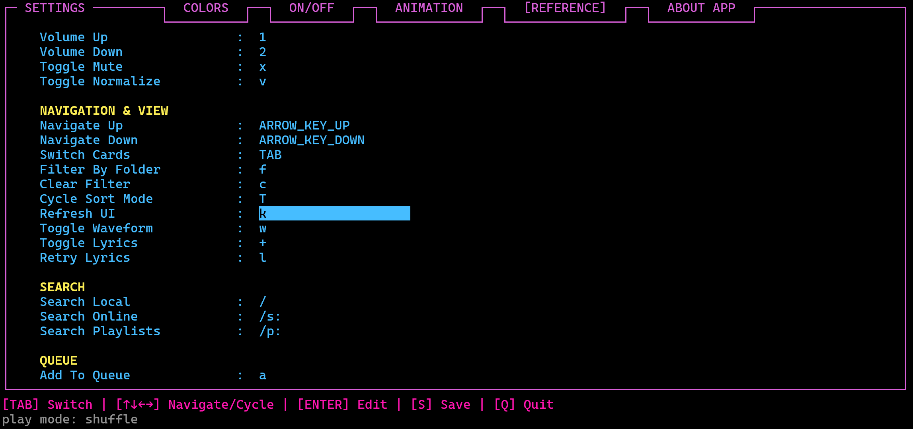

- **Categorized cheat sheet** available via `?`.

  
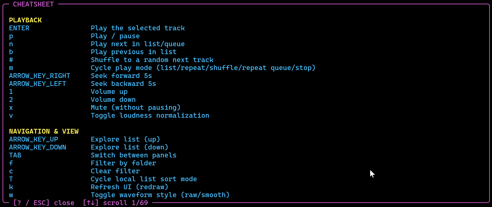

  
- **Full resizing of main playback UI** and menus when size of terminal is changed, e.g. fullscreen
- **Search Folder by Name via `/f:`** hit `Enter` and the content is shown in the local audio pane, similar using `f`; use `c` or `ESC` to clear. 
- **Folder Order and Sorting** `f` shows only the titles in a folder of the hovering track in the list. It now shows which folder. `SHIFT+n` was added in the past to toggle between showing the file name and the meta data track name in the local audio files list. I adjusted the sorting algorithm now sorts what is shown in the respective column, adapting to the set `SHIFT+n` mode. 
- **Copy/Paste/Cut in Search and Path Fields** All search fields now allow copy/paste/cut and the necessary marking. Same for fields to add local path.
- **Clear QUEUE** In the main UI `SHIFT+x` can now be used to clear the queue incl. a warning message that pops up. 
- **Fetched Lyrics Folder** is now placed in an extra folder such that lyrics of song_a in folder_a are located in folder_a/lyrics/ and are not placed directly next to track files. Note that changing the name of the file may trigger a new lyrics fetch process (did not find a reasonable solution for that since filenames can eventually also be changed via the Windows explorer or other programs such as Midnight commander or Yazi... Hard to keep track of...
- **Lyrics versions** — `l` now opens an overlay with the lyrics in use on top (embedded in the file / fetched / older copies; `SPACE` switches) and the retry form below. Lyrics embedded in a file are used before anything is fetched. `ENTER` (**Refetch**) fetches again but keeps the previous copy as `lyrics/<name>.v<date>.<source>.lrc` (max 10), so timing changes you saved are not overwritten. Cheat sheet: `.` / `,` moved to **VISUALIZATIONS AND LYRICS (MAIN UI)**, followed by the **LYRICS & KARAOKE** category.
- **Search Engine Optimization** - Added fuzzy search ("X-Files" didn't show up when searched "X Files", i.e. without dash) and optimized speed for also searching through meta data (not only file titles), which in Windows took >2-3 min. after the app was started to be available (cache cap was also an issue and a bunch of subprocess handling via ffprobe, which remains as a fallback method in case the newly included ID3v2.3/2.4 frame-walker that reads TIT2/TPE1/TALB directly out can't handle the tag layout of a file for some reason...). The speedup currently covers MP3 handling FLAC (Vorbis comments), OGG/Opus, and M4A/AAC. 
- **Shuffle-to-next** (`#`) — a manual one-off jump to a random track, independent of the persistent Shuffle play mode.
- **Special letters** (see above) — Fixed displaying and typing special letters like Umlaute (ä, ö ü) or accents á, à, Japanese letters etc. Emojis also work, but some 3-byte Emojis may mess up the UI when shown (can be turned off in settings)... 
- **Meta editor search field** — `ESC` first clears the query and only a second `ESC` closes the editor (legend: `[ESC] Clear/Exit`); `/f:` searches folders like in the playlist editor (shared `filter_local_or_folders()`).
- **Sort "recently added":** `SHIFT+t` in the main UI gets a fourth mode after artist A-Z: *recently added*, newest first, by the later of a file's modification and creation / change time (`apply_local_sort()`, `file_added_time()`). The playlist editor's library sort (`SHIFT+t`) gets *Recently added* as a sixth mode, and the meta editor's library pane gets `n` (*recently added first*, next to `r` *recently edited first*).
- **Switching between overlays:** the oscilloscope and spectrogram options overlays switch to each other (`SHIFT+o` / `SHIFT+i`) and to the other one's full screen (`SHIFT+0` / `SHIFT+u`) without closing first; the folder overlay switches to the big list / queue overlay (`SHIFT+l` / `SHIFT+k`), and they switch to it.
- **Track buffer setting and scrollbars in Settings:** new `TrackBufferMB` (Settings → ON/OFF → MAIN UI / AUDIO → *Track Buffer (MB)*, default 256, 64 - 16384, with a *Set back to default* button): tracks whose decoded audio is smaller are held whole in RAM, bigger ones use the 2-minute window (`StreamingPcm::reserve_for_seconds`); the limit now compares the audio itself, without the 25 % reservation headroom. The tabs of the settings screen that scroll (ON/OFF, ANIMA/VIZ, PATHS, REFERENCE, About) show the wizard's scrollbar instead of the little arrows.
- **Update notice and new default keys:** the notice now says the configuration stays the same when updating by installing the newer version; a command that is new to a config and whose default key the user already uses for something else is left unbound (the user's key wins) instead of sharing the key (`load_settings()`). The notice also has a note for the portable versions: keep `portable.txt` (and the `data` folder) when updating.
- **Add a track straight to a playlist, `a` only for the library pane, aligned search results:** new rebindable `HKeyAddToPlaylist` (`SHIFT+a`) adds the highlighted library track to a new or an existing playlist with the overlay of *Queue to playlist*, saves the playlist at once and does not open the playlist editor; an online track is downloaded into the download folder in the background first (`track_to_playlist()`, `poll_pending_atp()`). `a` does nothing while the queue pane is focused. The cheat sheet search shows the key and description columns like the table (player and radio).
- **Bulk add and refetch lyrics from anywhere; text boxes; search in the cheat sheet and the wizard:** new rebindable `HKeyBulkAdd` (`SHIFT+g`) opens the bulk-add panel from any pane (it is listed under QUEUE in the cheat sheet); the refetch-lyrics form opens with the lyrics engine off too (the fetched lyrics serve karaoke / READ LYRICS) and shows a note then; the link field of bulk add and the text fields of the refetch form use the shared single-line editor (caret, marking, HOME / END, DEL, `CTRL+c` / `x` / `v`), and a typed capital A / B no longer jumps between the fields. `SHIFT+s` searches the cheat sheet (player and radio) and the help wizard (both modes) with `src/help_search.h`: words in any order, typo tolerant, related words, matches marked; the wizard shows chapters with text fragments and `ENTER` opens the chapter at the matching line (`wizard::search_key()`). The cheat sheet, the wizard and the manual now say that bulk add only queues the titles and downloads nothing.
- **Volume Indicator (Settings -> ON/OFF, below Progress Waveform):** the VOLUME BAR of the main UI can be drawn with `#` (as before), `⠶`, `⣿` or `⡾⣽`; the last is a fixed, not repeating row of 20 braille characters (`⣾⣳⢯⡿⣷⣟⡾⣽⢯⣟⡾⣟⡾⣽⢯⣟⡾⣽⣳⣻` at 100%), of which the first N are shown. config.txt: `VolumeIndicator=` (`volume_bar_fill()` in `settings.h`). A fifth look, `disk`, follows the braille effect of the disk animation (a strip of dots turned around a centre two cells in from the left, `volume_bar.h`; shown as two moving braille blocks in the settings row). The Colors tab previews follow the choice, and the radio has the same setting (ON/OFF -> Volume indicator, `VolumeIndicator=` in its config). Right of the look sits a second value, `gradient` / `no gradient` (`VolumeGradient=`): with gradient the filled bar takes the VIZ colours from left to right (the radio: the oscilloscope colours), like the oscilloscope; LEFT / RIGHT switch between the two values, ENTER changes the lit one; the Colors previews show no gradient. The phone page keeps `#`.
- **Library rescan updates the playlists and the queue; `/p:` always focuses the playlists pane:** `App::refresh_playlists_after_rescan` also finds moved queue titles again and re-reads their tags; ENTER on a `/p:` search clears the queue focus. It points moved tracks of all saved playlists at their new path (and rewrites those files) and re-reads the tags of every playlist track.
- **Playlists find moved files:** a playlist track whose file is gone from the stored path is looked up by file name in the library folders (`App::relocate_missing_tracks`); the update notice also says that configs and everything else are not overwritten.
- **Playlists follow renamed files; tags of playlist tracks outside the library:** a rename in the meta editor now rewrites the paths in the saved playlists (`PlaylistManager::rename_paths`) and in the open editor, and the playlist editor reads the tags of its tracks in the background, so files from a download folder no longer show the folder name as artist and `-` as title.
- **Queue to playlist asks first** — `CTRL+SHIFT+U` opens a small overlay: *New playlist* (as before: editor with the name field focused) or *Existing playlist* (search field plus the list of saved playlists; the queue's local tracks are appended without duplicates and the editor opens on that playlist, still to be saved with `CTRL+S`).
- **Playlist editor library: sort and folder search** — `SHIFT+t` cycles the LIBRARY list through folder order, *Filenames A-Z*, *Title A-Z*, *Artist A-Z* and *Album A-Z* (also applied to search results; shown in the LIBRARY title; uses the `HKeyCycleSortMode` key, only while nothing was typed in the search box), `/f:` in the search box lists the tracks of the matching folders. The legend got a third row (*Sort*), the LIBRARY pane is two rows taller and TRACKS three rows shorter (two for the library, one for the legend row).
- **Metadata-only / filename list rows** — `SHIFT+N` (the former ON/OFF row was removed) swaps every (search-)list row between the long-standing *filename + metadata* presentation and *metadata only*, i.e. the embedded title tag instead of the filename stem. Untagged files (and rows whose tags haven't been probed yet) keep their filename, so an untagged library never turns into a blank list. Applies to the main list, its search results, and both lists in the playlist editor. Also applies to the field between the disk animation and lyrics/sphere. Rebindable like every other hotkey (`HKeyToggleMetaOnly`; use `g` instead if you'd rather not rely on Shift).
- **Scrollable settings panel** —  REFERENCE now scroll with the cursor instead of growing past the panel, so the tab stays usable on a short terminal (32 rows and below).
- **Fast online search.** `scripts/fast_yt_search.py` hits YouTube's internal search endpoint directly instead of shelling out to `yt-dlp` for every keystroke-triggered search — `yt-dlp` is a general-purpose extractor for hundreds of sites and pays for that generality in startup time. `yt-dlp`'s own search is the fallback whenever the fast path comes back empty for any reason (script missing, network hiccup, or a genuine zero-result query), so nothing regresses if the fast path is ever unavailable. It approximates `yt-dlp`'s old `duration >= 90s` result filter (dropping shorts and live streams) but can't replicate the `categories *= 'Music'` half without a second request per result, which would defeat the point.
- **Long tracks need little memory.** A track whose decoded audio would take more than about 190 MB (an hour of 48 kHz stereo is 1.4 GB as 32-bit float) is held as a 2-minute window around the playing position instead of whole: the decoder stays ahead of playback and keeps 30 s behind it, a seek outside the window decodes from the new position (MP3 with a seek table, WAV/FLAC directly, FFmpeg formats with a fast `-ss` seek), and loudness and waveform come from a separate pass that keeps only the figures. Same samples, same rate, no quality loss -- a 200 MB file now takes ~50 MB instead of gigabytes. The 48 kHz limit for files over 20 minutes is gone.
- **Sound quality.** Files play at their own sample rate (up to 96 kHz) instead of everything being converted to 44.1 kHz with a linear converter; unavoidable conversions (files above 96 kHz, internet radio to 48 kHz, a device that cannot take the rate) use long, sharp filters (FFmpeg `aresample` with 64 taps, miniaudio's steepest low-pass).
- **SoundCloud (`/sc:`) and Bandcamp (`/b:`)** next to YouTube (`/s:`): search, play, queue and download, through yt-dlp (Bandcamp's search by `scripts/bandcamp_search.py`, as yt-dlp has none). Their tracks are kept in their own format (no second lossy conversion); SoundCloud's 30-second preview-only tracks are filtered out of the results.
- **Per-style oscilloscope settings:** the braille and the image scope keep everything separately, frame rate, osci music mode and beam included (`OsciFrameRate` / `OsciImageFrameRate`, `OsciMusicMode` / `OsciImageMusicMode`, `OsciCrtBeam`, `OsciDwellBrightness`, `OsciLowRateBlanking`, `OsciRoughMode` and their `OsciImage…` twins; an old `FrameRate` is taken over for both).
- **No-Lyrics Viz** (Settings → ANIMA/VIZ → MODES; `NoLyricsViz=sphere|osci|spectro`): which visual the lyrics area shows while the lyrics view is on but no lyrics are available (before: the view `.` had been on before the lyrics). Picking a visual that is switched off under *Use Oscilloscope* / *Use Spectrogram* turns that switch on, and it cannot be switched off while it is the pick. The *Lyric Viz* row is now called **Lyrics/Viz**.
- **Settings reorganised:** the ON/OFF tab has the categories **MODES** (Playback, and the new **Start Mode**: open Mousiki with the player or with the radio; `StartMode=` in `config.txt`, shared by both modes) and **ON/OFF**. The ANIMATION tab is now **ANIMA/VIZ** with LYRICS, DISK, WAVE (Wave Fluidity / Degradation / Viscosity, Waveform Style), MODES (Lyrics/Viz Default, No-Lyrics Viz) and VIZ/LYRICS ORDER, plus a note about `SHIFT+o`, `SHIFT+i`, `SHIFT+u`, `)` and `(`; it scrolls on a short terminal. The radio's ON/OFF and ANIMA/VIZ tabs follow the same layout. The cheat sheet's search part is split into SEARCH LOCAL (MAIN UI) and SEARCH ONLINE (MAIN UI); new local search prefixes `/r:` (artists only) and `/a:` (albums only).
- **Default visual:** the oscilloscope in XY mode (ASCII-Braille, 30 Hz); order of the visuals: sphere, oscilloscope, spectrogram, lyrics (Lyrics/Viz Default = osci; radio: OsciSphere = osci). The oscilloscope and spectrogram overlays no longer have a *Display* row (`.` switches the visual).
- **Search:** `↑/↓` while typing then `Enter` plays the highlighted track directly; the radio highlights the station under the cursor while searching. `SHIFT+u` (full-screen spectrogram) works whatever **Use Spectrogram** says -- that switch only concerns the field in the main screen.

- **Settings → ON/OFF: Use Lyrics / Use Oscilloscope / Use Spectrogram / Use Sphere** (radio: Use oscilloscope / Use spectrogram): takes a view out of the main screen's lyrics area / scope block, so `.` only cycles through the rest (e.g. just lyrics and sphere). The sphere stays on while it is the *No-Lyrics Viz* pick. **Viz Order 1..4** (`VizOrder=sphere,osci,spectro,lyrics`) sets the order of the views in the player's `.` cycle: each row names the view at that place, and `←/→` swaps it with the view that was there. The full screen (`SHIFT+u`) and the windows (`(` / `)`) always work. `UseLyrics=`, `UseOscilloscope=`, `UseSpectrogram=` in the config files.
- **Scope window shows the braille style too:** with *Osci style = braille* in the `SHIFT+o` overlay the extra window draws the terminal's braille dot grid (every dot a square, same afterglow and colours), so it can also be seen fullscreen; with *image* it is the smooth analog scope as before.
- **Scope window** (`)`: German `SHIFT+9`, English `SHIFT+0`; player and radio). The oscilloscope in its own window, drawn by the graphics card (SDL2, loaded at run time; zlib licence) like an analog scope: every sample is drawn once as a soft beam with phosphor afterglow and bloom, at the monitor's refresh rate, with automatic brightness. It follows the image style's settings (decay, glow, palette, Z axis, rotation, mono phase portrait, and the beam: CRT / classic, dwell brightness, low-rate blanking, rough mode), shows the track / station as its title, remembers position, size, fullscreen (`F`) and always-on-top (`T`), and stays open across the player / radio switch. It runs as a second process (`mousiki --scope-window`) fed through a pipe, so neither a driver problem nor dragging the window can stall the music or the terminal.
- **Tracker modules and chiptunes.** MOD / XM / IT / S3M and 20+ other tracker formats (via FFmpeg's libopenmpt), NES / SNES / Game Boy / Sega console music (`.nsf`, `.spc`, `.gbs`, `.vgm` … via FFmpeg's libgme) and C64 SID tunes (via the external `sidplayfp`, rendered once to a cached WAV; length `SidPlayLength` in `config.txt`, default 180 s) play like any other file, with the module title / SID name, author and year as metadata. Nothing is linked into Mousiki, so the licences of these libraries stay separate.
- **Radio timeshift.** The radio keeps the last 5–60 minutes (Settings → ON/OFF → *Timeshift buffer*, default 30) of the tuned station in a rolling buffer on disk (~11.5 MB per minute, in `~/.cache/mousiki/`, deleted on exit): `SPACE` pauses live radio, `[` / `]` jump 30 s, `{` 5 min back, `}` returns to live; the jump is shown in the scope block for 4 s and the dial shows `PAUSED` / `TIMESHIFT -m:ss`. `y` opens a RECORD overlay that freezes the moment it was pressed and can start the recording up to 30 minutes in the past ("save the last 5 minutes"). The buffer is written by the stream thread only, so the interface does not slow down.

- **Long-title handling.** The metadata panel shows **Name, Artist, Album, Year**, sampling, type, format, file size and location. Name, Artist and Album each keep exactly **one row**: when a value is wider than the column it scrolls as a marquee (restarting with every new track), so the block never grows and the visualizer rows below it can never be affected; only Location may use a second row, and only if one is free. The local list marquee-scrolls the hovered row the same way — both width-aware for wide (CJK) characters, not just byte-counted.
- **A Lyrics Engine toggle that actually gates fetching**, not just the panel's visibility (`.` to toggle, or Settings → On/Off) — previously the fetch ran and hit the network every single track regardless of whether the panel was shown. Toggling it off now shows the sphere visualization in that space instead of leaving it blank.
- **Pasting no longer runs commands (Windows).** Windows Terminal and the console paste with CTRL+V, SHIFT+INSERT or a right click as a burst of ordinary key presses; outside a text field every pasted letter ran as a hotkey (a pasted `C:\...` opened the file conversion overlay). A burst of several different printable keys within one poll is now ignored outside text fields; in text fields pasting works as before.
- **New-version notice, media keys, Settings split out of `app.cpp`.** At start-up Mousiki checks the project's releases page (background thread, `scripts/check_update.py`, at most once a day) and shows a small **New version** window **once per version** (`ESC` Close, `o` Go to release; player and radio); it never installs anything (Settings -> ON/OFF -> MODES -> *Update Notice*, `UpdateCheck=`; the answer is kept in `update_check.txt`). **Media keys:** `src/media_session.cpp` hands what the status already publishes to the system and takes the system's play / pause / next / previous / stop / seek / volume requests back as the same commands `mousiki --cmd` knows, so the player and the radio get it together. Linux: **MPRIS** over D-Bus (`media_session_mpris.cpp`; `libdbus-1` is opened with `dlopen` at run time, nothing to install, and no session bus means the feature stays off). macOS: **Now Playing** and the media keys (`media_session_mac.mm`, MediaPlayer framework). Windows: the **System Media Transport Controls** through C++/WinRT (`media_session_win.cpp`, MSVC + Windows SDK; MinGW builds without it; `-DMOUSIKI_WINDOWS_SMTC=OFF` switches it off at build time). Settings -> ON/OFF -> MODES -> *Media Keys*, `MediaKeys=`. `src/app.cpp` is split further: the Settings screen (all its tabs, the colour themes, the PATHS and REFERENCE rows) is now `src/app_settings.cpp` (about 2,250 lines moved as they were), its tables are in `src/app_settings_tables.h`; `app.cpp` has about 12,250 lines left. **CI additions:** the weekly workflow `vendored-watch` compares the libraries in `third_party/` (list in `third_party/VENDORED.json`; the version of each library is read from its own files, so a library update needs no edit there; `third_party/README.md` has the checklist of what to do after an update) with the newest upstream releases and opens / updates / closes one issue; every release gets an **SBOM** (`Mousiki-<version>-sbom.cdx.json`, CycloneDX, made by `tools/make_sbom.py` from `VENDORED.json` and `packaging/pins.json`; it is in `SHA256SUMS.txt` and attested like the installers); the non-blocking workflow `static-analysis` runs cppcheck and clang-tidy (reports in the run summary). Thirteen new tests (version comparison, state file, status -> now-playing mapping, request -> command mapping, the two new settings).

## Spelling of Japanese in Latin letters

The Latin-letters view now writes Japanese the way English and German readers find easiest: long vowels spelled out (`koohii`, `kienuyou`) and the particle を as `o`. Two ON/OFF rows (Settings → ON/OFF → TRANSLITERATION (JAP./KOR./CHIN.), `LatinMacrons=`, `LatinWo=`) switch to macrons (`kōhī`) and to `wo`. The big karaoke font gained the macron and caron letters (ā ē ī ō ū, ǎ ě ǐ ǒ ǔ, š č ž ř), and `"` now also works inside the karaoke and READ LYRICS overlays.

The Windows installer has an optional, unticked task that downloads pykakasi (and jaconv, deprecated, wrapt) from PyPI into `pylib` with `scripts/install_kanji_reader.py`; `setup.sh --with-kanji` and `setup.ps1 -WithKanji` do the same with pip. pykakasi is still not shipped with Mousiki.

Lyrics searches that find nothing now try other spellings of the names (`LyricsNameVariants=`, Settings → ON/OFF → TRANSLITERATION (JAP./KOR./CHIN.), on by default): the Latin-letters spelling, the title / artist without the Latin or Japanese part, the title alone. The pykakasi task of the Windows installer is ticked by default; the README names the internet need of all dependency downloads.

Settings: `SHIFT+↑/↓` pages through every scrollable tab (legend `[SHIFT+↑↓] Page`); the status message of a change is no longer hidden by the "Unsaved changes" notice (it shows with `(unsaved)` after it); new category TRANSLITERATION (JAP./KOR./CHIN.), MODE SWITCH renamed UI MODE SWITCH.

The pykakasi download of the installer is pinned: `release.py pin` writes the exact wheels (pykakasi, jaconv, deprecated, wrapt - pure Python, one file each for every platform) and their SHA-256 to `scripts/kanji_pins.json`; `scripts/install_kanji_reader.py` accepts nothing else (without the file it falls back to the newest PyPI files with a warning).

The radio mode has the Latin-letters key (`"`, the same switch as the player's; `LatinLetters=` is written to `config.txt`): station names, the title that plays now, the lists, presets and the radio browser follow it; the player takes the state over when you switch modes. `LatinHanziDefault=japanese` (next to `leave` and `chinese`): characters that could be Japanese or Chinese are treated as Japanese, so the optional kanji reader is asked for them.

Downloads that are pinned are checked before anything is installed: `install_kanji_reader.py` downloads all files first, tries a damaged one a second time, installs nothing and leaves no folder behind on a mismatch, and prints the expected and the received SHA-256 (exit code 3); `setup.sh` (sidplayfp), `setup.ps1` (SDL2) and `release.py` give the same kind of message. New: `mousiki --selftest-fetch` (`scripts/selftest_fetch.py`), a fetch health check of the lyrics sources, MusicBrainz / Cover Art Archive, the update check, ffmpeg / ffprobe / yt-dlp / fpcalc, the helper scripts and the pinned downloads (`--offline`, `--verify-pins`, `--only`, `--json`). The Windows uninstaller also removes the optional `pylib` folder.

More tests: `tests/ui_smoke.py` (the real program in a pseudo terminal: first-run wizard, lists, overlays, every settings tab, meta editor and its cover options in a Kitty-graphics terminal, radio Latin-letters key, quit), `tests/test_install_kanji_reader.py` (installer checksum handling against a local web server) and the offline fetch self-test; all three run under `ctest`, the screen test needs `pip install pyte`, and the GitHub workflow builds the player and runs them on Linux and macOS. The cover options overlay of the meta editor follows `[t]` (picture or braille dots).

`app.cpp` (13,500 lines) was split by feature into `app_library.cpp`, `app_playback.cpp`, `app_session.cpp`, `app_remote.cpp`, `app_keys.cpp`, `app_rowmeta.cpp`, `app_panels.cpp`, `app_playlist.cpp`, `app_metasession.cpp`, `app_overlays.cpp`, `app_convert.cpp`, `app_queue_overlay.cpp`, `app_menus.cpp`, `app_eq.cpp`, `app_render.cpp`, `app_scope.cpp` and `app_creator.cpp`; what is left in `app.cpp` (about 1,300 lines) is the constructor, the hotkey tables, shared colour helpers, `run()` and `shutdown()`. The code was moved unchanged; the few helpers that several files use sit in `app_internal.h`.

Static analysis (cppcheck / clang-tidy report): fixed a read one past the hiragana table in the transliteration (ゕ ゖ now map to "ka" / "ke"), an unlocked read of the result flag in the lyrics-reading poll, two unaligned `float*` casts in the scope and spectrogram windows (now copied), several `substr` self-assignments and duplicate assignments, a hotkey lookup-then-insert and a few small things. The workflow now ignores `third_party` in cppcheck and reports clang-tidy only for the project's own headers (all 40 clang-tidy warnings were in the bundled `stb_truetype.h`). Left as they are on purpose: by-value parameters that are moved into threads or callbacks, and the `paths.erase` finding in the settings (a false positive).

Settings -> ON/OFF -> TRANSLITERATION has a new row **Translit. Kanji** (`Leave` / `Chin.` / `Jap.`, default `Leave`): the same switch as `LatinHanziDefault=` in `config.txt`, now also in the settings (it applies at once, in the player and the radio). `PgUp` / `PgDn` turn a page wherever `SHIFT+↑` / `SHIFT+↓` do (they are reported as that key), and the pages that had no paging now have it: the main list and queue, the cheat sheet, the history, the playlist editor and manager, the audio book chapter list and the lists of the radio (stations, browser, saved lists, history, cheat sheet). In the audio book notes editor they move the caret ten rows. `SHIFT+↑` / `SHIFT+↓` stay as the redundant keys for keyboards where PgUp / PgDn need `FN` or a terminal handles `FN` badly (manual, Help Wizard and cheat sheet say so).

The legends of the cheat sheet (player and radio), the history and both playlist tabs now show `[SHIFT+↑↓] Page` (PgUp / PgDn do the same).

Settings → REFERENCE: the group LYRICS & KARAOKE is called VIZ, LYRICS & KARAOKE there, and its two keys are "Viz./Lyrics Cycle Forward" / "Viz./Lyrics Cycle Backward" (they cycle the lyrics / visualization field). The cheat sheet keeps its own names.

Rebindable (Settings → REFERENCE): **Next Mode** / **Previous Mode** (default `*` / `_`, `HKeyModeNext` / `HKeyModePrev`; the radio reads them from the same `config.txt`) and **Karaoke Lyrics Bigger / Smaller** (`HKeyKaraokeBigger` / `HKeyKaraokeSmaller`, only active inside the karaoke overlay, so each pair may share its keys with the other). `*` is no longer a reserved key; the cheat sheets, the karaoke legend and the phone legend show the bound keys.

New settings (ON/OFF → MODES): **Terminal Size** (columns × rows, default 120 × 32, with a "Set back to default" button), two number fields; `0` = leave the terminal alone; at least 100 × 28, at most what fits on the screen) and **Full Screen** (overrides the size). Mousiki only *asks* the terminal (xterm window sequences; under Windows Terminal it presses the window's F11 while the window is in front): xterm, GNOME Terminal, iTerm2, Terminal.app and recent Windows Terminal versions usually obey, Konsole, kitty, Alacritty, tmux and tiling window managers ignore it. Done once at start (not at every mode switch) and when the setting is changed. `config.txt`: `TerminalCols=`, `TerminalRows=`, `FullScreen=`.

New switch **Use Terminal Settings** (`UseTerminalSettings=`, default false): true leaves the terminal alone and ignores Terminal Size and Full Screen. The default terminal size is 120 × 32 now (four rows in the list and queue panes); a size you saved earlier stays.

[b] (Play Previous) with the focus in the queue pane plays the previously played queue song while the queue is locked (`!`); on an unlocked queue it does nothing there. The Track Buffer (MB) field takes 6 digits at most. In the help wizard a chapter that opens a part (9, 13) shows the part's intro page instead of jumping to 9.1 / 13.1. The radio's station search also looks at the Latin spelling (`with_latin_spelling`, like the music player); the online Radio Browser search is done by the server and cannot.

macOS: the default key of the lyrics timing overlay (and the audio book's chapter marks, `HKeyLyricsTiming`) is `SHIFT+j` instead of `ALT+L`, so it does not need the OPTION key (Windows and Linux keep `ALT+L`). Only a fresh config gets the new default; an existing `config.txt` keeps its binding.

The default keys for the next / previous mode and the karaoke text size (`HKeyModeNext` / `HKeyModePrev`, `HKeyKaraokeBigger` / `HKeyKaraokeSmaller`) are `'` / `;` on a US / UK style keyboard (detected as for the cheat sheets) and stay `*` / `_` on German-style and unknown layouts. Only fresh configs get the new default; saved keys stay.

New setting **Rate Cap at 96 kHz** (Settings → ON/OFF → PLAYBACK group, `RateCap96=`, default true): true brings a track above 96 kHz down to 96 kHz (as before); false plays it at its own rate (up to 768 kHz) - more RAM, and the audio device has to accept the rate. The next track that is loaded uses it.

READ LYRICS: synced lyrics in the enhanced LRC form `<time>word<time>word` (no spaces in the file, e.g. a-ha - Take On Me) showed their words run together ("Talkingaway"); a word tag now counts as a word boundary, as in the karaoke view.

Karaoke: the lyrics timing overlay (`HKeyLyricsTiming`, default `ALT+L`; `SHIFT+j` on macOS) opens on top of the karaoke screen again (it did nothing there) and ESC / ENTER bring the karaoke screen back; the karaoke legend lists the key. It works with the main screen's lyrics field switched off too, because the karaoke overlay loads the lyrics itself.

- **macOS cover fetch key.** On macOS the cover fetch menu opens with `SHIFT+q` by default (other platforms keep `ALT+C`), so the terminal's "Option as Meta" setting is no longer needed for it. Only fresh `config.txt` files get the new default. While the menu's search field is engaged a plain-letter binding is typed text instead of closing the menu.

- **Cheat sheets show only the keys of their mode.** The music player's cheat sheet no longer lists the AUDIO BOOK MODE category (the audio book player and the radio already had their own, mode-specific lists). New categories give a better overview. Music player: BASIC KEYS (ESC, ENTER, arrows, Y/N), SOUND (normalization), SLEEP TIMER, CREATOR, BIG OVERLAYS (folder / list / queue), COVER FETCH, and the meta editor in three groups (META EDITOR, LIBRARY PANE, FETCH LIST AND TAGS). Radio: the long PLAYBACK list is split into PLAYBACK, SOUND (normalization, equalizer), VISUALIZATIONS, RECORD AND SLEEP TIMER and OVERLAYS AND MENUS.

- **Security hardening (CodeQL findings).** `mousiki --selftest-fetch` no longer builds a shell command line: Python is started directly with an argument list (fork/exec, `_spawnvp` on Windows), so neither the script path nor an option can inject a command. The `MOUSIKI_SCRIPTS_DIR` override (player and radio) is now checked before use: it has to be an absolute path to an existing folder without `..` parts, and the script has to be a regular file in it (`src/scripts_env.h`); a relative value is refused.

- **Test fix (CI).** `settings_mode_keys_are_read_from_the_config` expected `*` / `_` as the mode keys, but the default is `'` / `;` on a US-style keyboard layout, which the GitHub runners have: the test now compares with the layout's own default (`default_size_mode_key`).

- **Test fix (macOS CI).** `tests/ui_smoke.py`: writing a key to the pseudo terminal of a program that had just ended raised `OSError: Input/output error` on macOS (the quit test sends a "y" while the program is on its way out); the harness now treats that as "nothing left to send to".

- **Test fix (CI timing).** `tests/ui_smoke.py`: the Kitty cover options check waits up to 10 s for the preview picture instead of 1.5 s (the picture is decoded in the background and a slow runner missed it), and the karaoke timing check retries the key until the lyrics are loaded.
