# Mousiki User Guide v4.4.0 (Windows · Linux · macOS) – music player and radio

## Welcome: a quick tour

Mousiki Plus is a music player and an internet radio that live **inside your terminal**. You control everything with the keyboard, you see your music as colours, braille pictures and an oscilloscope, and you can steer it from your phone. This page gives you the short version; the chapters after it explain every key.

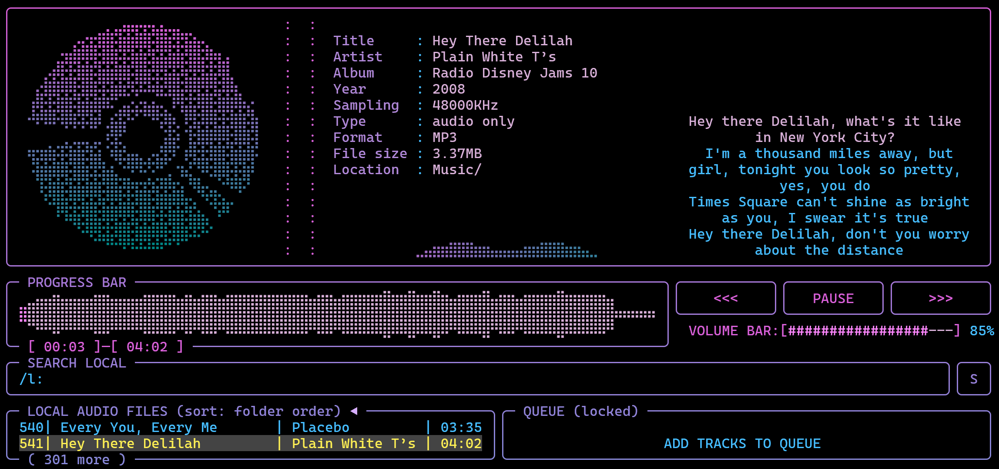

### What you can do with it

- **Play your music:** add your music folders and Mousiki builds a fast library with **fuzzy search** over file names and tags (`/`). Plays MP3, FLAC, WAV, M4A, OGG, OPUS, tracker modules, console and C64 music and more.
- **Play the web:** search, stream and download from **YouTube, SoundCloud and Bandcamp**, or add a whole YouTube playlist in one go.
- **Listen to the radio:** press the `*` key and the program becomes an **online radio** with a tuning dial, tens of thousands of stations (Radio Browser), presets, timeshift (pause and rewind live radio) and recording.
- **See your music:** an **oscilloscope** (made for oscilloscope music) and a **spectrogram**, as braille pictures or as real images in Kitty / Sixel terminals, in the main screen, full screen or in their own window.
- **Sing along:** **synchronized lyrics** fetched for you, word by word, with translations and a big-letter **karaoke mode**.
- **Organize:** a **queue**, saved **playlists**, a **tag editor** that finds missing titles by audio fingerprint, a **listening history** with top lists and smart lists, a 10-band **equalizer**, loudness normalization and a sleep timer.
- **Make it yours:** 32 **colour themes** plus your own, and almost every key can be rebound.
- **Control it from afar:** use your **phone as a remote** (scan a QR code), or bind global media keys with `mousiki --cmd`.

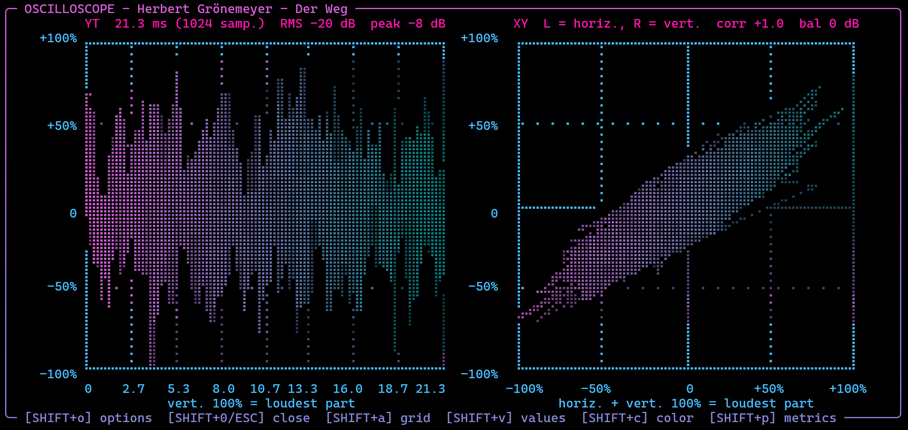


### Your first five minutes

1. **Start it.** Open a terminal (on Windows use **Windows Terminal**) and type **`mousiki`** or **`lala`**. The help wizard opens by itself on the first start (`ENTER` goes on, `ESC` closes it); `SHIFT+w` opens it again any time.
2. **Add your music.** Press **`s`** (Settings), go to the paths tab and add your music folder. Press **`s`** again to save. Your titles appear in the list.
3. **Play something.** Move with `↑` / `↓`, press **`ENTER`** to play the highlighted title, **`p`** to pause and resume, **`n`** / **`b`** for the next and previous title, `→` / `←` to jump 5 seconds, `+` / `-` for the volume.
4. **Find things.** Press **`/`** and type a few letters of a title, artist or folder; typos are forgiven.
5. **Try the extras.** **`k`** starts the karaoke mode, **`SHIFT+o`** opens the oscilloscope settings, **`SHIFT+p`** the playlist editor, **`SHIFT+h`** your listening history, **`SHIFT+e`** the equalizer.
6. **Switch to the radio.** Press the key that types `*` (`SHIFT` and `+` on a German keyboard, `SHIFT+8` on an English one). Press it again to come back; your music waits where you left it.
7. **Lost?** **`<`** (German keyboard; `SHIFT+,` on an English one) lists **every menu and overlay** by category with its key: pick one with the arrows and press `ENTER` to open it. **`?`** shows the cheat sheet with every key you have bound, **`SHIFT+w`** the wizard, and **`q`** quits.

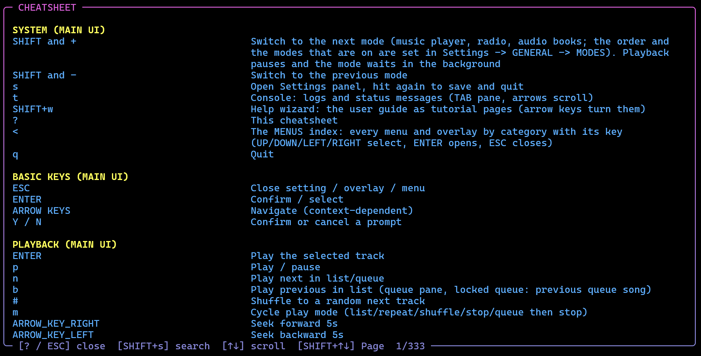

### Use your phone as a remote

Switch on **Settings → ON/OFF → MODES → Remote App**, scan the QR code that appears and your phone shows a small Mousiki screen: the spinning disk, meta data, play, next, volume, your lists and playlists, and the radio with its stations. It needs a PIN and works in your home network only; the details are in [chapter 12](#12-remote-control-and-key-bindings).

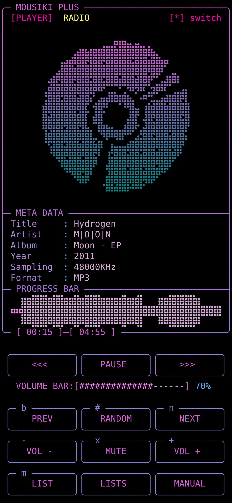

### How this guide is organised

Mousiki TUI player is two programs in one: a terminal **music player** (chapters 1 to 10) and an **online radio** (chapter 11), including visualizations such as an oscilloscope and a spectrogram, as well as a Karaoke mode, making use of its lyrics fetching capabilities, to just name some of the integrated features. Press `SHIFT` and `+` on a German keyboard (`SHIFT+8` on an English one: the key that types `*`) to switch between radio and music player mode (see [Two modes in one program](#two-modes-in-one-program) and [Keyboard layouts](#keyboard-layouts-german-and-english)).

Chapter 12 describes the phone remote and the command-line remote, chapter 13 the automated tests and chapter 14 how upgrades treat your settings.

The music player chapters walk through **every entry of the in-app cheat sheet** (`?`) and explain what each command does. Some settings that can only be changed in the config.txt are also discussed at the end of chapter 10. The radio chapter only describes what is new in the radio; everything both modes have in common (equalizer, oscilloscope, loudness normalization, sleep timer …) is explained once in the player chapters.
The key shown for each command is the **default binding**. Your own bindings may differ if you changed them in `config.txt` or under **Settings → Reference**; the cheat sheet always shows the keys you actually have.

---

## Contents

- **[Welcome: a quick tour](#welcome-a-quick-tour)**
  - [What you can do with it](#what-you-can-do-with-it)
  - [Your first five minutes](#your-first-five-minutes)
  - [Use your phone as a remote](#use-your-phone-as-a-remote)
  - [How this guide is organised](#how-this-guide-is-organised)
- **[Before you start](#before-you-start)**
  - [Starting Mousiki: `mousiki` or `lala`](#starting-mousiki-mousiki-or-lala)
  - [Rebindable vs. fixed keys](#rebindable-vs-fixed-keys)
  - [`ALT` on macOS (`Option`)](#alt-on-macos-option)
  - [Uppercase letters](#uppercase-letters)
  - [Keyboard layouts (German and English)](#keyboard-layouts-german-and-english)
  - [Menus with tabs and text boxes](#menus-with-tabs-and-text-boxes)
  - [Two modes in one program](#two-modes-in-one-program)
  - [What can Mousiki play? Audio formats, tracker modules and chiptunes](#what-can-mousiki-play-audio-formats-tracker-modules-and-chiptunes)
  - [The main screen](#the-main-screen)
  - [Play mode letter](#play-mode-letter)
- **[The Help Wizard (`SHIFT+w`)](#the-help-wizard-shiftw)**
- **[1. System (main UI)](#1-system-main-ui)**
- **[2. Playback (main UI)](#2-playback-main-ui)**
  - [Sound quality: sample rate and resampling](#sound-quality-sample-rate-and-resampling)
  - [Equalizer overlay (`SHIFT+e`)](#equalizer-overlay-shifte)
  - [The five play modes (`m`)](#the-five-play-modes-m)
- **[3. Navigation & view, lyrics and visualizations (main UI)](#3-navigation--view-lyrics-and-visualizations-main-ui)**
  - [How the sort mode and `SHIFT+n` work together](#how-the-sort-mode-and-shiftn-work-together)
  - [How the lyrics form (`l`) works](#how-the-lyrics-form-l-works)
  - [Lyrics timing overlay (`ALT+L`)](#lyrics-timing-overlay-altl)
  - [READ LYRICS overlay (`CTRL+L`)](#read-lyrics-overlay-ctrll)
  - [The oscilloscope (lyric visual)](#the-oscilloscope-lyric-visual)
  - [Oscilloscope tuning overlay (`SHIFT+o`)](#oscilloscope-tuning-overlay-shifto)
  - [Oscilloscope full screen (`SHIFT+0`)](#oscilloscope-full-screen-shift0)
  - [Scope window (`)`: German `SHIFT+9`, English `SHIFT+0`)](#scope-window--german-shift9-english-shift0)
  - [Spectrogram window (`(`: German `SHIFT+8`, English `SHIFT+9`)](#spectrogram-window--german-shift8-english-shift9)
  - [Spectrogram (`SHIFT+i`, `SHIFT+u`)](#spectrogram-shifti-shiftu)
  - [Loudness normalization overlay (`SHIFT+v`)](#loudness-normalization-overlay-shiftv)
  - [Karaoke overlay (`k`)](#karaoke-overlay-k)
  - [Sleep timer overlay (`SHIFT+z`)](#sleep-timer-overlay-shiftz)
  - [Creator overlay (`^`)](#creator-overlay-)
- **[4. Search (main UI)](#4-search-main-ui)**
  - [Big list overlay (`SHIFT+l`)](#big-list-overlay-shiftl)
  - [Big folder overlay (`SHIFT+f`)](#big-folder-overlay-shiftf)
  - [File conversion overlay (`SHIFT+c`)](#file-conversion-overlay-shiftc)
- **[5. Queue (main UI)](#5-queue-main-ui)**
  - [Big queue overlay (`SHIFT+k`)](#big-queue-overlay-shiftk)
  - [Locked queue (`!`)](#locked-queue-)
  - [Undo clear (`CTRL+SHIFT+z`)](#undo-clear-ctrlshiftz)
  - [Queue to playlist (`CTRL+SHIFT+u`)](#queue-to-playlist-ctrlshiftu)
  - [Clear queue prompt (`SHIFT+x`)](#clear-queue-prompt-shiftx)
  - [Bulk add (`a` with the queue focused)](#bulk-add-a-with-the-queue-focused)
- **[6. Playlists](#6-playlists)**
  - [What `ENTER` does in the playlist editor](#what-enter-does-in-the-playlist-editor)
  - [Exporting a playlist (M3U8 / M3U)](#exporting-a-playlist-m3u8--m3u)
  - [Leaving](#leaving)
- **[7. Meta editor](#7-meta-editor)**
  - [What `ENTER` does in the meta editor](#what-enter-does-in-the-meta-editor)
  - [Using the AcoustID lookup](#using-the-acoustid-lookup)
  - [Choosing what is fetched: the fetch options](#choosing-what-is-fetched-the-fetch-options)
  - [Album and year: MusicBrainz and the choice overlay](#album-and-year-musicbrainz-and-the-choice-overlay)
- **[8. History](#8-history)**
  - [The four tabs](#the-four-tabs)
  - [ADD SMART HISTORY TO QUEUE](#add-smart-history-to-queue)
- **[9. Downloads](#9-downloads)**
- **[10. Settings (individual tabs)](#10-settings-individual-tabs)**
  - [Moving around and editing (all tabs)](#moving-around-and-editing-all-tabs)
  - [Tab 1: COLORS](#tab-1-colors)
    - [Border gradient (SMOOTHNESS)](#border-gradient-smoothness)
    - [Colour themes](#colour-themes)
  - [Tab 2: ON/OFF](#tab-2-onoff)
  - [Tab 3: ANIMA/VIZ](#tab-3-animaviz)
  - [Tab 4: PATHS](#tab-4-paths)
  - [Tab 5: REFERENCE](#tab-5-reference)
  - [Tab 6: ABOUT APP](#tab-6-about-app)
  - [Settings that exist (only) in `config.txt`](#settings-that-exist-only-in-configtxt)
- **[11. Radio mode](#11-radio-mode)**
  - [11.1 Switching between player and radio](#111-switching-between-player-and-radio)
  - [11.2 The radio screen](#112-the-radio-screen)
  - [11.3 Keys on the main screen](#113-keys-on-the-main-screen)
  - [11.4 What the radio shares with the player](#114-what-the-radio-shares-with-the-player)
  - [11.5 Searching: stations, station lists and `p:`](#115-searching-stations-station-lists-and-p)
  - [11.6 PRESETS menu (`SHIFT+p`)](#116-presets-menu-shiftp)
  - [11.7 RADIO BROWSER menu (`SHIFT+s`)](#117-radio-browser-menu-shifts)
  - [11.8 STATION LISTS menu (`SHIFT+k`)](#118-station-lists-menu-shiftk)
  - [11.9 Big STATIONS overlay (`SHIFT+l`)](#119-big-stations-overlay-shiftl)
  - [11.10 Timeshift and recording (`SPACE`, `[`, `]`, `{`, `}`, `y`)](#1110-timeshift-and-recording-space-----y)
  - [11.11 Listening history (`h`)](#1111-listening-history-h)
  - [11.12 Radio settings](#1112-radio-settings)
  - [11.13 The radio's files](#1113-the-radios-files)
  - [11.14 Not done yet](#1114-not-done-yet)
- **[12. Remote control and key bindings](#12-remote-control-and-key-bindings)**
  - [12.1 The remote app (Android / phone browser)](#121-the-remote-app-android--phone-browser)
- **[13. Automated tests](#13-automated-tests)**
- **[14. Upgrades and your settings](#14-upgrades-and-your-settings)**
- **[About this app](#about-this-app)**
  - [Original developer of v1.0](#original-developer-of-v10)
  - [Windows port, incl. extensive modifications up to v4.4.0 (including the radio mode)](#windows-port-incl-extensive-modifications-up-to-v440-including-the-radio-mode)
  - [Third-party software and licences](#third-party-software-and-licences)
  
---

## Before you start

### Starting Mousiki: `mousiki` or `lala`

Mousiki starts with either of two commands in a terminal: **`mousiki`** or the shorter **`lala`**. Both open the same program.

- **Installer / packages:** the Windows installer puts both on your `PATH` when the task *Add Mousiki to PATH* is ticked (`mousiki.cmd` and `lala.cmd`), the Linux `.deb` installs `/usr/bin/mousiki` and `/usr/bin/lala`, the macOS `.pkg` `/usr/local/bin/mousiki` and `/usr/local/bin/lala`. The portable `.zip` contains both launchers (`mousiki` / `lala`, on Windows `mousiki.cmd` / `lala.cmd`).
- **Built yourself:** `setup.sh` (Linux / macOS) creates both commands in `~/.local/bin`, `setup.ps1` (Windows) in `%LOCALAPPDATA%\Mousiki\bin` and adds that folder to your user `PATH` (open a new terminal afterwards). Pass `--no-install` / `-NoInstall` to skip that.

### Rebindable vs. fixed keys

- **Rebindable keys** have an action name like `HKeyPlay` in `config.txt` and appear under **Settings → Reference**. Change them in either place.
- **Fixed keys** are written as literal key names in the cheat sheet (for example `ESC`, `ENTER`, the arrow keys, `*`, `Y` / `N` in prompts, `CTRL+s`, `CTRL+SHIFT+x`, or the keys inside the playlist and meta editors). These cannot be rebound; *why* is listed under *Settings → REFERENCE*.

### `ALT` on macOS (`Option`)

This guide writes the modifier as `ALT` (`ALT+L`, `ALT+←` / `ALT+→`). On a Mac that is the **Option (⌥)** key: a macOS build of Mousiki shows `OPTION+L` / `OPTION+LEFT/RIGHT` in the cheat sheet, everything else is identical. Two things to know:

- `OPTION+L` (the lyrics timing overlay) only works if the terminal sends Option as Meta (Terminal.app: *Use Option as Meta key*; iTerm2: *Esc+* for the left Option key). `CTRL+L` is not an alternative any more: it opens the READ LYRICS overlay. `OPTION+←` / `OPTION+→` (the optional tab switch of the playlist editor, the meta editor and the radio's station lists, see *Menus with tabs and text boxes* below) work in Terminal.app and iTerm2 without it, because they send the standard word-movement codes.
- **Option+←/→** (tab switch) is sent as `ESC b` / `ESC f` by Terminal.app and iTerm2 out of the box, and Mousiki understands both that and the xterm form, so it works without any terminal setting.

### Uppercase letters

Several commands use **Shift + letter** (`T`, `N`, `M`, `P`, `H`, `X`) because the plain lowercase letter already does something else. Where this guide writes `SHIFT+t`, it means the uppercase `T` (the cheat sheet writes it the same way).

### Keyboard layouts (German and English)

Mousiki reacts to the **character** a key types, not to the key itself. Most commands are letters, digits or arrows and sit in the same place everywhere, but a few symbols are typed with different keys on a German (QWERTZ) and an English (US / UK QWERTY) keyboard. This guide writes those keys as the **character** and, where it matters, names both combinations. The cheat sheets name the switch key and the window keys for the layout Mousiki detects (`MOUSIKI_KEYBOARD=us|gb|de|…` overrides the detection).

| Character | Command | German keyboard | English keyboard (US / UK) |
|---|---|---|---|
| `*` | Switch player ↔ radio (fixed); karaoke overlay: lyrics bigger | `SHIFT` and `+` | `SHIFT+8` |
| `_` | Karaoke overlay: lyrics smaller | `SHIFT` and `-` | `SHIFT` and `-` |
| `(` | Spectrogram window | `SHIFT+8` | `SHIFT+9` |
| `)` | Scope window | `SHIFT+9` | `SHIFT+0` |
| `=` | Oscilloscope full screen | `SHIFT+0` | the `=` key |
| `+` | Volume up | the `+` key | `SHIFT` and `=` |
| `-` | Volume down | the `-` key | the `-` key (the radio also takes `_` as long as it is not rebound) |
| `?` | Cheat sheet | `SHIFT` and `ß` | `SHIFT` and `/` |
| `<` | Menus index (all menus and overlays) | the `<` key | `SHIFT+,` |
| `/` | Search | `SHIFT+7` | the `/` key |
| `:` | In the search prefixes (`/r:`, `/a:`, `/s:`, `/sc:`, `/b:`, `/p:`, `/f:`) | `SHIFT` and `.` | `SHIFT` and `;` |
| `#` | Shuffle next / random channel | the `#` key | US: `SHIFT+3`; UK: the `#` key (`SHIFT+3` is `£`) |
| `!` `$` `%` | Queue lock / move to top / to bottom | `SHIFT+1` / `SHIFT+4` / `SHIFT+5` | the same |
| `<` `>` | Equalizer: previous / next preset (also `,` / `.`) | the `<` key / `SHIFT` and `<` | `SHIFT` and `,` / `SHIFT` and `.` |
| `[` `]` | Radio: 30 s back / forward (timeshift) | `ALT GR+8` / `ALT GR+9` | the `[` / `]` keys |
| `{` `}` | Radio: 5 min back / back to live | `ALT GR+7` / `ALT GR+0` | `SHIFT` and `[` / `SHIFT` and `]` |

`.` (lyrics area / scope block cycle), `,`, the letters, digits and arrows are the same on both. A US Mac keyboard is like the US column; on a German Mac `[ ] { }` are `OPTION+5 / 6 / 8 / 9`. Every rebindable key can be moved to one that suits your keyboard (Settings → REFERENCE).

### Menus with tabs and text boxes

The **playlist editor** (`SHIFT+p`), the **meta editor** (`SHIFT+m`) and the radio's **STATION LISTS** menu (`SHIFT+k` in the radio) all follow the same rule:

- `←` / `→` **switch the tab**. This also works while a text box (playlist name, search box) has the focus, as long as **nothing has been typed into it yet**.
- As soon as you type or edit something in a text box (a character, `BACKSPACE`, `DEL`, `HOME` / `END`, `SHIFT+←/→`, `CTRL+V` …), the box is **in use**: `←` / `→` now move the caret inside it. The legend at the bottom changes from `[←→] Switch Tab` to `[←→] Cursor` and from `[ESC] Exit` to `[ESC] Leave field`, so you can always see which of the two is active.
- `ESC` **leaves the box** (the text stays) and `←` / `→` switch tabs again. `TAB` (next pane) and `ENTER` leave it as well. Only an `ESC` *outside* a text box closes the menu; if there are unsaved changes (for example a name you typed for a new playlist) it first asks `Save changes to "…" before exiting?`.
- `ALT+←` / `ALT+→` switch the tab from everywhere, also while you are typing.
- `CTRL+s` **saves** (the playlist, the station list, or the meta editor's pending edits after a Yes/No question). It works from every pane, also while typing.

The meta editor's **field editor** (FILE, ARTIST, TITLE, ALBUM, YEAR) is a text box you enter on purpose with `ENTER`, so there `←` / `→` always move the caret; `ESC` (or `ENTER`) takes you back to the library.

**Settings** (both modes) keep `TAB` as the tab switch and `←` / `→` for cycling a value or picking a colour cell. While a field is being edited there (after `ENTER`: a colour, a path, a value or a key), `←` / `→` move the caret and `TAB` does nothing; only `ENTER` (apply) or `ESC` (cancel) leave the field. See [Settings](#10-settings-individual-tabs).

### Two modes in one program

| | Music player | Radio |
|---|---|---|
| What it plays | Your local files and YouTube, SoundCloud and Bandcamp streams | Internet radio stations |
| Settings file | `config.txt` | `radio_config.txt` |
| Guide | Chapters 1 to 10 | Chapter 11 |

The key that types `*` switches between the two, in both directions: `SHIFT` and `+` on a German keyboard, `SHIFT+8` on an English (US / UK) one. The `+` key on its own is **volume up** in both modes (`-` is volume down). The player is **paused and kept in memory** while the radio runs, so coming back is instant; the radio is **closed completely** when you leave it. The cheat sheet of both modes shows the switch key as its first line, adapted to your keyboard layout (detected automatically, `MOUSIKI_KEYBOARD=us|de|fr|…` overrides it). It is a fixed key. `SHIFT+m` stays the meta editor.

### What can Mousiki play? Audio formats, tracker modules and chiptunes

Besides MP3, FLAC, WAV, OGG, Opus, M4A and the other usual formats, the player plays retro formats from your music folders. They show up in the list, the search and the queue like any other file:

| Kind | Extensions | What it needs |
|---|---|---|
| Tracker modules (Amiga / PC demoscene) | `.mod` `.xm` `.it` `.s3m` `.mptm` `.stm` `.669` `.mtm` `.med` `.okt` `.far` `.ult` `.ams` `.dbm` `.digi` `.dmf` `.dsm` `.gdm` `.imf` `.j2b` `.mdl` `.mt2` `.psm` `.ptm` `.umx` `.plm` | FFmpeg built with **libopenmpt** (most current builds are) |
| Game console music | `.nsf` `.nsfe` (NES), `.spc` (SNES), `.gbs` (Game Boy), `.vgm` `.vgz` (Sega and others), `.ay`, `.hes`, `.kss`, `.sap`, `.gym` | FFmpeg built with **libgme** |
| Commodore 64 SID tunes | `.sid` `.psid` `.rsid` | The **sidplayfp** program on the `PATH` (Linux: package `sidplayfp`; Windows has no official build: the easiest source is MSYS2, `pacman -S mingw-w64-ucrt-x86_64-sidplayfp` in its UCRT64 shell, then copy `sidplayfp.exe` and its DLLs into one folder such as `C:\tools\sidplayfp` and run `setup.ps1` again; `setup.sh` / `setup.ps1` install it or add it to the `PATH`) |

- The module's title (and for SID: name, author and year from the file header) is used as metadata; the TYPE column says *tracker module*, *game music* or *C64 SID (n tunes)*.
- A SID tune has no end, so it is rendered once for `SidPlayLength` seconds (default 180, see [Settings that exist only in `config.txt`](#settings-that-exist-only-in-configtxt)) into `~/.cache/mousiki/sid/` and then played from there; the next time it starts at once. Only the first sub-tune is played.
- `setup.sh` and `setup.ps1` take care of these tools: they upgrade an FFmpeg that is already installed (skip with `--no-upgrade` / `-NoUpgrade`), install or rebuild one with libopenmpt and libgme where the usual package lacks them, and install sidplayfp or put it on the `PATH`. On Windows the project publishes no sidplayfp build: unzip one anywhere and run `setup.ps1` again.
- If the required tool is missing, the status line says which one, and the track is skipped.
- Mousiki does not link any of these libraries: libopenmpt (BSD) and libgme (LGPL) are used through FFmpeg, sidplayfp (GPL) runs as a separate program.

### The main screen

The main screen has a **local/online/playlist list** on the left (titled `LOCAL AUDIO FILES`, `ONLINE RESULTS` or `SAVED PLAYLISTS`), a **Queue** panel, a metadata panel with lyrics or a visualizer, and a search box. Only one pane has **focus** at a time: the search box (while you type), the list or the queue. The focused pane is marked with a small **◀** after its title, in the **FOCUS** colour (Settings > COLORS). Focus decides where the arrow keys work (see `TAB` below).

**Window size.** The list and queue panes use every row the terminal has left under the metadata panel, progress bar and search box, so a maximised window is filled down to its last line. Resize at any time, also while a menu is open: Settings, Console, the playlist and meta editors and the listening history take the same height as the main screen, and the cheat sheet (`?`) uses the full terminal height. The playlist and meta editors keep a few rows at the bottom for their legend and status messages. The meta editor's legend is always four rows (plus the status row), at least 120 x 30 shows every key in full; on narrower terminals the labels get shorter (`Fetch missing tag` becomes `Missing`) and only below about 80 columns the last keys of a row are replaced by `…`. The same tree-table legend (`┌─ Label │ keys`, labels shortened on narrow terminals) is used by the playlist editor (Move / Tracks or Playlist), the CONVERT and big QUEUE overlays, the READ LYRICS overlay (Move / Translate / Session), the karaoke screen and, in the radio, the PRESETS menu, the station-list menu and the big stations overlay. The karaoke legend fills the last two terminal rows in two groups: *Overlay* (close, lyrics size, timing) and *Player* (play/pause, next/previous, seek, volume, mute). The cheat sheet and the listening history keep no empty rows. The history shows a status message in a row of its own only while there is one.

### Play mode letter

The small box next to the search bar shows the current play mode as a letter: `L` list, `R` repeat, `S` shuffle, `O` stop, `Q` queue then stop.

---

## The Help Wizard (`SHIFT+w`)

The user guide you are reading is also **inside the program**. `SHIFT+w` opens the **Mousiki Plus Help Wizard** in both modes (from every menu and overlay that is not taking typed text): a welcome page, a **table of content** and a page per subject, written in the order of this guide's chapters -- II **Music player mode** (main UI, search / filter / download, curating your files, lyrics and karaoke, visualizations, sound and sleep timer, history, settings and colour themes) and III **Radio player mode** (main UI, finding stations, timeshift / recording / history, radio settings).

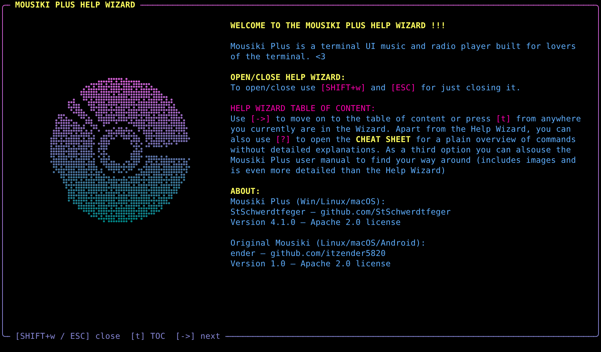

*The welcome page of the help wizard (`SHIFT+w`).*

It starts with a **welcome page** (with the spinning disk) and a **table of content**; after that come the pages of the chapters. `SHIFT+w` opens it again at any time.

| Key | What it does |
|---|---|
| `SHIFT+w` / `ESC` / `q` | Open / close the wizard |
| `→` / `←` | Next / previous page **inside the current main chapter**: from page 3.1 only the pages 3.x can be reached. The way to another chapter is the table of content. The welcome pages and the table of content count as one chapter. |
| `t` or `BACKSPACE` | Back to the **table of content** (`TOC` in the legend), with the entry of the current page highlighted |
| `↑` / `↓` | On the table of content: pick an entry (the page scrolls with it). On any other page that is taller than the terminal: scroll it one row; a scrollbar in the disk's gradient colours at the right edge shows that the page scrolls. |
| `SHIFT+↑` / `SHIFT+↓` | A whole page up / down (on the table of content: jump five entries) |
| `ENTER` | On the welcome page: to the table of content. On the table of content: open the highlighted entry. |

- The **top border** names the chapter: `MOUSIKI PLUS HELP WIZARD ─ II MUSIC PLAYER MODE ─ 3 CURATING YOUR FILES`; the bottom border lists the keys that work on the current page. Every page starts and ends with an empty line. The table of content is centred in the frame.
- Colours: headings use the **header colour**, everything in `[square brackets]` (the keys) the **legend colour**, the rest the list colour. The wizard is drawn in the **music player's colours in both modes** (`config.txt`), so it looks the same whichever mode you open it from.
- The keys the wizard names are the **shipped defaults**, like the cheat sheet's. A key you rebound yourself is shown under **Settings → REFERENCE**.
- Playback keeps running while it is open. The wizard takes every key until you close it, like the cheat sheet (`?`), which stays the quick, scrollable list of every key command.

**The text is a plain file**, `Mousiki_Help_Wizard.txt` in the repository: a page starts with a line `[[New Page]]`, `[[Header]]` colours the capitalised words in front of it, `[[Header_line]]` anywhere in a line colours the whole line, `[KEY]` is drawn in the legend colour, `{VERSION}` is the running version and lines starting with `=>>>` are notes to the author (see the top of the file). It is compiled into the program by `python3 tools/wizard_to_inc.py` (writes `src/wizard_text.inc`). To try an edit without rebuilding, start Mousiki with `MOUSIKI_WIZARD_FILE=/path/to/Mousiki_Help_Wizard.txt`.

## 1. System (main UI)

| Key | Action | What it does |
|---|---|---|
| `*` (German `SHIFT` and `+`, English `SHIFT+8`) | Switch to the radio | Switches to the radio mode (and back from there). The player is paused and waits in the background. See [Two modes in one program](#two-modes-in-one-program) and [Radio mode](#11-radio-mode). Fixed key. |
| `s` | Open Settings | Opens the Settings panel (see [Settings](#10-settings-individual-tabs) for every tab). Inside Settings, `s` again **saves to `config.txt` and closes**. `ESC` or `q` **discards** the changes made on the screen and closes. |
| `SHIFT+r` | Rescan library | Rescans the music folders, e.g. after files were copied or downloaded in the meantime or after coming back from the radio. Also works in the meta editor while the library pane or the fetch list has the focus. Fixed key. |
| `t` | Console / logs | Opens a read-only log view showing what the app has been doing (sort changes, filter changes, queue messages, load timings and so on). Close it with `ESC`, `t` or `T`. |
| `SHIFT+w` | Help wizard | Opens the [Help Wizard](#the-help-wizard-shiftw): this guide as tutorial pages. Arrow keys turn the pages, `t` shows the table of content, `ESC` closes. It opens by itself on the first start after an install. |
| `?` | Cheat sheet | (German `SHIFT` and `ß`, English `SHIFT` and `/`.) Opens the command list. Use `↑`/`↓` to scroll (the list is longer than most terminal windows). Close with `?` or `ESC`. |
| `<` | Menus index | (German: the `<` key, English: `SHIFT+,`.) Opens **MENUS & OVERLAYS**: a list of all menus and overlays, in categories (LYRICS, LISTS & LIBRARY, SOUND, VISUALS, CREATE, SYSTEM), each with its key next to the title. `↑`/`↓` select, `←`/`→` jump to the other column, `ENTER` opens the highlighted one, `ESC` or `<` closes. The keys shown are the ones you have bound (rebindable as *Menus / Overlays Index* in Settings → REFERENCE). |
| `q` | Quit | Quits the application from the main screen. Only the lowercase `q` quits: `SHIFT+q` does nothing, so it cannot quit by accident when you aim for `SHIFT+w` (the help wizard). |
| `ESC` | Close / back | Closes whatever is open (an overlay, a menu, a prompt; in Settings it discards the changes). On the **main screen** it returns to the *home view*: the full local library, with no search query and no folder filter, scrolled to the top. It does not change the sort mode. |
| `ENTER` | Confirm / select | Confirms the highlighted choice or starts the highlighted item. What it does depends on where you are (play a track, queue a playlist, commit a search and so on). |
| `ARROW KEYS` | Navigate | Move up and down through lists, left and right to seek or move a text caret. What they do depends on the current screen. |
| `Y` / `N` | Confirm or cancel a prompt | Answers Yes/No prompts such as "Want to clear queue?" or "Fetching metadata via AcoustID … Continue?". |


**Tips**

- Almost every overlay closes with `ESC`.
- Prompts swallow other keys while they are open, so nothing underneath can be triggered by accident.
**The cheat sheet (`?`)** is the screen this guide follows. The footer shows how far you have scrolled (`1/87`).


*The cheat sheet, opened with `?`. Scroll with `↑`/`↓`; `?` or `ESC` closes it.*


---

## 2. Playback (main UI)

The main screen while a track plays: the disk, the metadata panel, the visualizer and the lyrics area at the top, then the progress bar with its waveform, the volume bar, the search box, and the local file list and queue at the bottom. The box on the right of the search bar shows the play mode letter (here `S` for shuffle).

The metadata panel lists **Name, Artist, Album, Year**, sampling, type, format, file size and location. Name, Artist and Album always take exactly one row each; a value that is too long for the column scrolls as a marquee, so the visualizer below it is never moved or overwritten.


*Main screen with the lyrics engine on: the lyrics fill the right-hand area.*

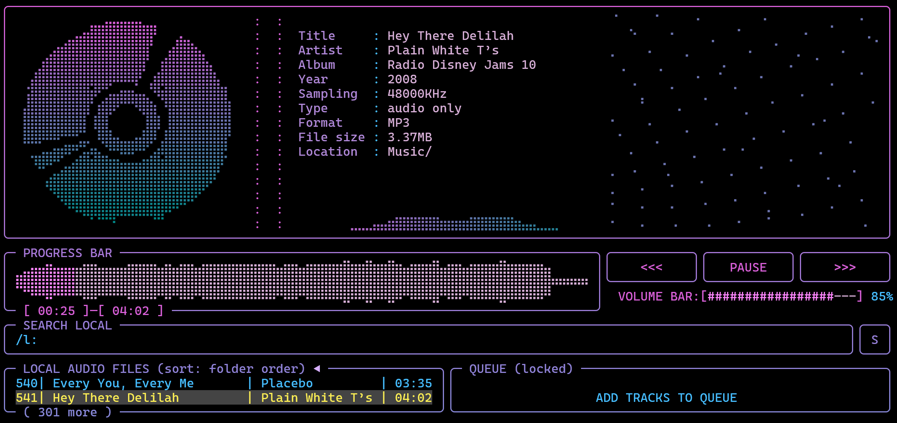

*Main screen with no lyrics shown: the audio-reactive **lyric ball** (sphere; Settings → ANIMA/VIZ → Lyrics/Viz Default) fills the area instead.*


| Key | Action | What it does |
|---|---|---|
| `ENTER` | Play the selected track | Starts the highlighted track. Pressing it again on the same track reloads it. On a **playlist row** it does not play. It queues every track in that playlist instead. With the focus on the **queue** (`TAB`, small pane or big overlay) it plays the highlighted queue item. |
| `p` | Play / pause | Pauses or resumes the current track. |
| `n` | Next | Plays the next track. If the **queue** has items, the next queue item plays. Otherwise the next track in the list plays (relative to what is *playing*, not where your cursor is). A manual skip always skips, even in repeat or stop mode. |
| `b` | Previous | Plays the previous track in the list. There is no queue equivalent, because a queue that has been consumed has no meaningful "previous". |
| `#` | Shuffle next | (US keyboard: `SHIFT+3`.) A one-off jump to a **random track from the current list**, independent of the shuffle play mode. **With a queue** it plays a random title of the queue instead. |
| `m` | Cycle play mode | Steps through the five play modes (see below). |
| `→` | Seek forward | Jumps forward **5 seconds**. |
| `←` | Seek backward | Jumps back **5 seconds**. |
| `+` | Volume up | (English keyboard: `SHIFT` and `=`.) Raises the in-app volume in steps of 5 (up to 100). Same key as in the radio. (Up to v3.0.0 this was `1`.) |
| `-` | Volume down | Lowers the in-app volume in steps of 5 (down to 0). Same key as in the radio. (Up to v3.0.0 this was `2`.) |
| `x` | Mute | Sets the volume to 0 without pausing. Pressing it again restores the previous volume. |
| `v` | Toggle loudness normalization | Turns loudness normalization on or off, so you can compare a track with and without it. When turned on, the status line shows the track's measured loudness and the correction applied. The target and maximum boost are set with the `SHIFT+v` overlay (see *Loudness normalization overlay* below) or in `config.txt`. |
| `E` (Shift+E) | Equalizer | Opens the **10-band equalizer** overlay with presets. The sound changes live while you adjust it. See *Equalizer overlay* below. |
| `V` (Shift+V) | Normalization tuning | Opens a small overlay to switch loudness normalization on or off and to change its target level and maximum boost **live**. See *Loudness normalization overlay* in chapter 3. |
| `^` | Creator | Turns a text into sound: oscilloscope music for the XY scope or a spectrogram sound, with a looping preview. See *Creator overlay* in chapter 3. (German keyboard: `^` is a dead key, press it and then `SPACE`.) |
| `Z` (Shift+Z) | Sleep timer | Opens a small overlay to pause playback after 15, 30, 60, 90 or 120 minutes, or to stop after the current song. See *Sleep timer overlay* in chapter 3. |


### Sound quality: sample rate and resampling

- **Every file plays at its own sample rate** (44.1, 48, 88.2, 96 kHz …): it is decoded at that rate and the audio device is opened with it, so nothing is converted on the way. Above 96 kHz the track is brought down to 96 kHz. (Up to v3.0.0 everything was converted to 44.1 kHz with a simple linear converter, which dulled the top end and softened the oscilloscope picture.)
- **Long and big files need little memory.** A short track is decoded completely into memory (32-bit float, 8 bytes per stereo sample pair). A track that would take more than about 190 MB that way (roughly: longer than 8 minutes at 96 kHz, 17 minutes at 48 kHz, 19 minutes at 44.1 kHz; an hour-long mix would take well over a gigabyte) is held as a **2-minute window** around the playing position instead: the decoder stays up to 90 s ahead of playback and keeps the last 30 s, so a short step back is instant. A seek outside the window decodes from the new position (WAV and FLAC directly, MP3 through a seek table, other formats through FFmpeg's fast seek) -- a fraction of a second of silence at most. Loudness normalization and the waveform come from a separate pass over the file that keeps only the figures. The audio is exactly the same (same rate, same 32-bit samples); a 200 MB file takes about 50 MB instead of gigabytes.
- Where a conversion is unavoidable it uses a long, sharp filter: FFmpeg's `aresample` with a 64-tap filter for files and for the radio (internet streams are brought to 48 kHz), and the steepest setting of the audio library when the sound device itself cannot take the rate (on Windows the system's own converter does that part).
- The **equalizer**, **normalization** and its **limiter** only work while they are on; with both off the samples reach the device unchanged apart from the volume. The scopes can get the signal before all of them (*Osci music mode*, `SHIFT+o`).

### Equalizer overlay (`SHIFT+e`)

Opens a window in the middle of the screen with a **10-band graphic equalizer**. Each band is a vertical slider from **−12 dB** to **+12 dB**, with the center line at 0 dB. The bands sit at **31, 62, 125, 250, 500 Hz, 1, 2, 4, 8 and 16 kHz**. The selected band is highlighted, and its gain and name are shown underneath. The top line of the window shows the current **preset**, whether the **EQ is ON or OFF**, and the **preamp** (see below). The key legend at the bottom of the window is drawn in the same color as the window's border.

The equalizer works on everything the player plays and changes the sound **while the music plays**, so you can adjust it by ear. Playback keeps running while the overlay is open, but its keys are the only ones that react until you close it. The overlay opens on every main screen.

| Key | Action |
|---|---|
| `←` / `→` | Select the previous / next band (wraps around) |
| `↑` / `↓` | Raise / lower the selected band by 1 dB |
| `,` or `<` | Previous preset |
| `.` or `>` or `TAB` | Next preset (the built-in presets first, then your custom presets) |
| `0` | Set the selected band to 0 dB |
| `SPACE` | Switch the equalizer on / off. The gains stay as they are. |
| `R` | Reset all bands to **Flat**. The on / off state is not changed. |
| `S` | **Save** the current curve as a **custom preset**. A *Save as:* prompt opens under the sliders (see *Custom presets* below). |
| `DEL` or `X` | **Delete** the selected custom preset. Press it twice to confirm. |
| `ESC` or `SHIFT+e` | Close the overlay. The settings are **saved to `config.txt`** when it closes. |

**Switching on.** Moving a band or choosing a preset also turns the equalizer on, so what you change is always what you hear. Use `SPACE` to compare against the original sound.

**Presets.** The preset keys cycle through the list below in this order, and then through your own custom presets (see below), in the order you saved them. If the gains do not match any preset exactly (for example after you moved a band), the top line shows **Custom**. Stepping to the next or previous preset then continues from the last preset you used.

| Preset | Gains in dB, 31 Hz → 16 kHz |
|---|---|
| Flat | `0, 0, 0, 0, 0, 0, 0, 0, 0, 0` |
| Bass Boost | `+6, +5, +4, +2, +1, 0, 0, 0, 0, 0` |
| Treble Boost | `0, 0, 0, 0, 0, +1, +2, +4, +5, +6` |
| Vocal | `-2, -3, -3, +1, +3, +4, +3, +2, 0, -1` |
| Rock | `+4, +3, +2, -1, -2, -1, +1, +3, +4, +4` |
| Pop | `-1, +1, +3, +4, +3, 0, -1, -1, -1, -1` |
| Jazz | `+3, +2, +1, +2, -2, -2, 0, +1, +2, +3` |
| Classical | `+4, +3, +3, +2, -1, -1, 0, +2, +3, +3` |
| Electronic | `+5, +4, +1, 0, -2, +2, +1, +1, +4, +5` |
| Hip-Hop | `+5, +4, +2, +3, -1, -1, +2, 0, +2, +3` |
| Acoustic | `+4, +4, +3, +1, +2, +2, +3, +3, +3, +2` |
| Loudness | `+6, +4, +1, 0, -1, -1, 0, +1, +4, +5` |

**Custom presets.** Shape the sliders the way you like, then press `S` to keep the curve as a preset of your own.

- A **Save as:** prompt replaces the line under the sliders and the legend changes to the prompt's keys. Type a name (up to **16 characters**) and press `ENTER` to save it, or `ESC` to cancel. Only the prompt closes on `ESC`; the equalizer stays open. The usual text keys work in the prompt: `←` / `→`, `HOME` / `END`, `SHIFT+←` / `SHIFT+→` to mark, and `CTRL+C` / `CTRL+X` / `CTRL+V`.
- The new preset is added **after the built-in presets** and appears on the top line under its name whenever the sliders match it. It is written to `config.txt` **immediately**, not only when the overlay closes.
- If you moved a band away from one of your custom presets, the prompt starts with that preset's name, so `ENTER` alone **updates** it. A name that already belongs to a custom preset (capital letters don't matter) **replaces** that preset.
- The names of the built-in presets and the word *Custom* cannot be used. The characters `=`, `{` and `}` are replaced by `-`, because the configuration file uses them. You can keep up to **24** custom presets.
- To **delete** one, select it with `,` / `.` so that the top line shows its name, press `DEL` (or `X`), and press it again within the overlay to confirm. Any other key cancels the deletion. The built-in presets cannot be deleted. The sliders keep their current values after a deletion and show **Custom**.
- Short messages such as *Saved "My Mix"*, *Updated "My Mix"* or *Deleted "My Mix"* appear on the line under the sliders and disappear with the next key press.

**Preamp.** Boosting bands makes the whole signal louder and can push it into distortion. The player therefore lowers the level automatically by the height of the loudest point of your curve. The **Preamp** value on the top line shows this (for example `-7.1 dB` for Bass Boost). The sound will be slightly quieter with a strong boost than without the equalizer, and that is intended. Raise the volume if you need it louder. The equalizer is bypassed completely when it is off or all bands are 0 dB.

**Good to know.**
- On a track with a low sample rate (22.05 kHz, for example) the top band is too close to the limit of the signal and is skipped.
- **Loudness normalization** (`v`) measures the track *before* the equalizer. With a strong boost or cut a track can therefore end up a little louder or quieter than the normalization target.
- The window is 21 rows high (15 on a terminal with fewer than 24 rows, see the next point), so it still fits on a 24-row terminal.
- On a terminal with fewer than 24 rows the sliders are drawn in steps of 4 dB instead of 2 dB, so the window fits. The gains themselves still change in steps of 1 dB.

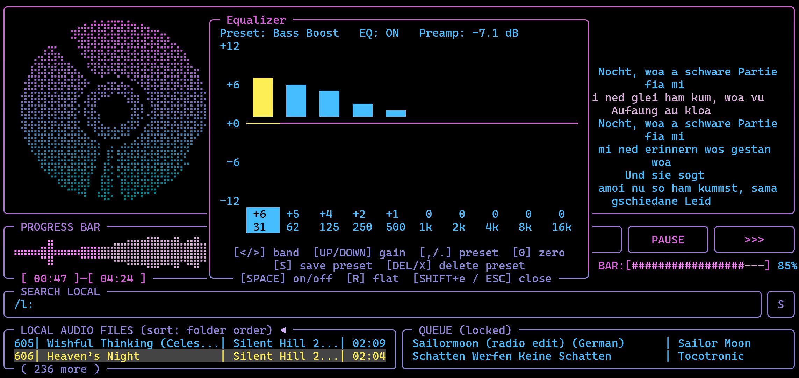

**In radio mode** the same overlay opens on the same key (`SHIFT+e`) with the same keys and presets. The radio keeps its own curve and its own custom presets in `radio_config.txt`, independent of the player's (see [11.4](#114-what-the-radio-shares-with-the-player)).

### The five play modes (`m`)

Each press moves to the next mode in this order: **list → repeat → shuffle → stop → queue then stop → list …**

| Mode | Letter | Behavior when a track finishes |
|---|---|---|
| List | `L` | Plays the next track in the list (the queue takes priority when it has items). |
| Repeat | `R` | Replays the same track again. |
| Shuffle | `S` | Plays a random track of the list. The queue is not shuffled: it always plays in its order (only `#` picks a random title of it). |
| Stop | `O` | Plays the track and then stops, with no automatic advance. The "no track loaded" screen with the cassette is shown. |
| Queue then stop | `Q` | Plays the queue **once**, then stops. It never falls through to the library: when the queue is used up, playback ends (like Stop mode), also when the queue was empty to begin with and a library track finishes. With the queue **locked** (default) each item goes to the back as it is played and the pass ends after the last unplayed item, so the queue is back in its original order afterwards. Tracks you add during the pass (`a`, `e`, bulk add) still play before it ends. Unlocked, played items leave the queue and it stops when it is empty. `n` always skips on, also after the pass is over (it starts a new one). |

---

## 3. Navigation & view, lyrics and visualizations (main UI)

The cheat sheet splits these keys into groups: **NAVIGATION & VIEW** (the lists and what they show), **FILE CONVERSION** (the conversion overlay and its keys), **LYRICS & KARAOKE** and **VISUALIZATIONS** (oscilloscope and spectrogram). The loudness normalization and sleep timer overlays are listed under **PLAYBACK** (chapter 2); their detailed descriptions follow further down in this chapter.

**Navigation & view** (cheat sheet: NAVIGATION & VIEW)

| Key | Action | What it does |
|---|---|---|
| `↑` | Explore list up | Moves the highlight up in the focused panel (list or queue). |
| `↓` | Explore list down | Moves the highlight down in the focused panel. |
| `TAB` | Switch between panels | Moves focus between the **list** and the **queue**. This decides which panel the up/down arrows, `d` (remove), `4`/`5` (move) and `a` (add / bulk add) act on. |
| `f` | Filter by folder | Narrows the local list to the **folder of the highlighted track**. It also switches the sort back to *folder order*. The pane title then shows `sort: folder order, folder: <name> [c] clear`. The filter stacks on top of an active search. |
| `c` | Clear filter | Removes the folder filter. It leaves the sort mode alone. |
| `T` (Shift+T) | Cycle local list sort mode | Cycles the sort of the local list through three modes: **folder order → title A-Z → artist A-Z**. The current mode is shown in the pane title (see below). |
| `N` (Shift+N) | Toggle metadata-only track list | Switches every list row between **filename** and **metadata title** (the embedded title tag). The first line of the metadata block follows it and is labelled **File** or **Title** accordingly. Files with no title tag, or whose tags have not been read yet, keep showing their filename. This also switches what "title A-Z" sorts by (see below). Also available in **Settings → ON/OFF**. |
| `w` | Toggle waveform style | Switches the waveform between **raw** and **smooth**. |
| `r` | Refresh UI | Forces a full redraw. Use it when a terminal resize or a switch of terminal session left the screen torn or stale. (Up to v3.0.0 this was `k`, which opens the karaoke overlay now; `SHIFT+r` stays the library rescan.) |

**Lyrics & karaoke** (cheat sheet: LYRICS & KARAOKE)

| Key | Action | What it does |
|---|---|---|
| `.` / `,` | Cycle lyrics area forward / backward | Cycles the lyrics area through four views: **sphere → oscilloscope → spectrogram → lyrics → sphere …** by default (`,` walks the same order backwards); the order is set with **Viz Order 1..4** on Settings → ON/OFF, and views switched off there with **Use Lyrics / Use Oscilloscope / Use Spectrogram / Use Sphere** are skipped. The three visuals are the lyrics engine's *off* states: no lyrics are fetched from the network while one of them is shown, and the view stays until you change it again (the view Mousiki starts with is **Lyrics/Viz Default**). Coming back to the lyrics fetches them for the current track right away. (Up to v3.0.0 this was `+`, which is volume up now.) |
| `l` | LYRICS REFETCH AND VERSION CONTROL | Opens the lyrics overlay. The upper part fetches lyrics again with a **manual title and artist**; `ENTER` (**Refetch**) keeps the lyrics in use as an older version (`lyrics/<name>.v<date>.<source>.lrc`, max 10), so timing you saved is never overwritten. The lower part, **LYRICS IN USE**, lists the lyrics embedded in the file, the fetched copy and older copies (three rows, scrolls with `↑`/`↓`; reach it with `↓` or `TAB` from the form); `SPACE` switches to the highlighted one, `d` deletes a saved copy after you confirm with `y` (lyrics embedded in the file cannot be deleted). Lyrics embedded in a file are used before anything is fetched. |
| `ALT+l` | Adjust lyrics | Opens a small overlay menu for live adjustment of the lyrics timing. |
| `k` | Karaoke overlay | Shows the lyrics of the playing track over the whole screen, karaoke style. It fetches the lyrics itself when the lyrics engine is off on the main screen (that setting is left alone). See *Karaoke overlay* below. |

**Visualizations** (cheat sheet: VISUALIZATIONS) -- the oscilloscope and the spectrogram in the lyrics area, full screen and in their own windows; the lyrics area itself is switched with `.` above.

| Key | Action | What it does |
|---|---|---|
| `O` (Shift+O) | Oscilloscope tuning | Opens a small overlay to change the oscilloscope **live**: style (braille / image), frame rate, music mode, afterglow, line thickness, tail, glow, Z axis, rotation, colours and more -- each style keeps its own values. See *The oscilloscope* below. |
| `I` (Shift+I) | Spectrogram options | Opens the spectrogram overlay (style, motion, scale, frequencies, gain, range, window, colours …). See *Spectrogram* below. |
| `U` (Shift+U) | Spectrogram full screen | The spectrogram over the whole screen, with frequency labels and a time ruler. `ESC` or `SHIFT+u` closes it. |
| `=` (German `SHIFT+0`, English the `=` key) | Oscilloscope full screen | The oscilloscope over the whole screen: the **YT** trace on the left, the **XY** figure on the right, values in the border, optional grid. `ESC` or the same key closes it. See *Oscilloscope full screen* below. |
| `)` (German `SHIFT+9`, English `SHIFT+0`) | Scope window | Opens / closes the oscilloscope in **its own window**, drawn by the graphics card at the monitor's refresh rate. See *Scope window* below. (The key is the character `)`.) Works always, also while the oscilloscope is switched off on the ON/OFF tab. |
| `(` (German `SHIFT+8`, English `SHIFT+9`) | Spectrogram window | Opens / closes the spectrogram in **its own window**, scrolling smoothly at the monitor's refresh rate. See *Spectrogram window* below. Works always. |


### How the sort mode and `SHIFT+n` work together

The sort mode in the pane title always tells you what is being sorted on:

| Sort mode | Pane title shows | Sorted by |
|---|---|---|
| Folder order | `sort: folder order` | The order the files were found on disk |
| Title A-Z, `SHIFT+n` **off** | `sort: file name A-Z` | The file name |
| Title A-Z, `SHIFT+n` **on** | `sort: title A-Z` | The embedded title tag (falling back to the file name where there is none) |
| Artist A-Z | `sort: artist A-Z` | The artist tag (falling back to the artist guessed from the parent folder) |

Toggling `SHIFT+n` re-sorts the list immediately and keeps your cursor on the same track. In **metadata-only** mode the order can shift slightly right after startup, while the background scan is still reading tags.

A **search** always ranks by match quality, so while a query is active the sort mode is not used. It applies again once the query is cleared.

### How the lyrics form (`l`) works

| Key in the form | Function |
|---|---|
| `TAB` / `↓` | Next field |
| `↑` | Previous field |
| `SPACE` | Tick or untick a checkbox (slowed, ultra-slowed, sped up, reverb, remix, other). Slowed, ultra-slowed and sped up are mutually exclusive. |
| Typing | Fills the text fields |
| `ENTER` | Fetch lyrics with these settings (works from any field) |
| `ESC` | Cancel |

`l` only works while the lyrics engine is on (`.`).

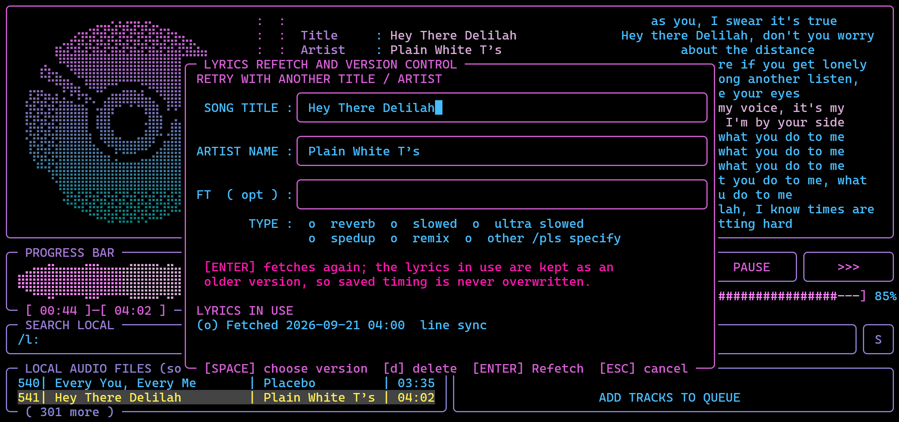

### Lyrics timing overlay (`ALT+L`)

For tracks whose synced lyrics run ahead of or behind the music. The overlay shifts **all** lines (and, for word-synced lyrics, all words) of the playing track by the same amount. The change is visible **live** while the music plays, in the lyrics area and in the three lines shown in the overlay itself (previous, current and next line, with the current one highlighted). `ALT+L` opens only while synced lyrics are loaded for the track; otherwise the status line says so. It opens **from the main screen and from inside the karaoke overlay** (`k`); opened from there, the panel floats over the big lyrics and closing it goes back to karaoke.

| Key | What it does |
| :--- | :--- |
| `→` / `←` | Lyrics **later** / **earlier** by 0.1 s |
| `↑` / `↓` | Lyrics **later** / **earlier** by 0.5 s |
| `SHIFT+→` / `SHIFT+←` | **Seek** the running track forward / back by 5 s, to hear a passage again while re-timing it |
| `R` | Back to 0 (the timing as it is in the lyrics file) |
| `ENTER` or `S` | **Save** the offset into the track's lyrics file and close |
| `ESC` or `ALT+l` | Cancel: the offset from before the overlay was opened comes back (back to karaoke when it was opened from there) |

- A **positive** offset (`+0.3 s`) means the lyrics appear later than their timestamps say, so use it when the lyrics are **too early**. A negative offset makes them appear earlier. The range is ±120 s.
- Saving writes a standard `[offset:...]` tag at the top of the track's `.lrc` file (in the `lyrics` folder next to the track, in milliseconds, with the usual LRC sign convention: positive = earlier). The timestamps themselves are not changed. The offset is read back whenever the lyrics are loaded from that file, and other players that know the tag use it too. Saving `0` removes the tag.
- The offset belongs to **one track's lyrics file**. Fetching the lyrics again with `l` (retry) only overwrites the file when the fetched text **and** offset are identical to it; if the text or the offset differs (for example because you re-timed the lyrics), your current copy is kept as an older version. If there is no lyrics file for the track, the offset still applies until the track changes, but saving reports that it could not be saved.
- While the overlay is open, `SHIFT+←` / `SHIFT+→` seek the running track, so you can re-time the lyrics against the music.
- Playback keeps running while the overlay is open; only its keys react.

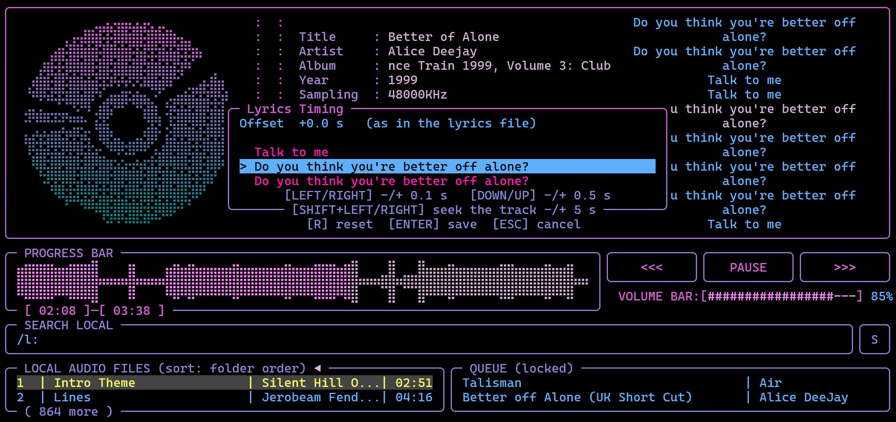

### READ LYRICS overlay (`CTRL+L`)

Reads the lyrics saved for the **playing** track (when nothing plays: the track hovered in the list) as plain text, and translates them on request. It is a full-screen overlay; playback keeps running.

| Key | What it does |
| :--- | :--- |
| `TAB` | Move the keys between the two top panes: **READ LYRICS** (the lyrics files) and **TRANSLATION** (the saved translations). The pane that has them carries a `◀` |
| `←` / `→` | Choose in the pane that has the keys: the lyrics file, or the translation (the chosen translation is shown) |
| `d` / `DEL` | In the TRANSLATION pane: **delete** the chosen translation (asks for `y`) |
| `↑` / `↓` | Scroll one row. `SHIFT+↑` / `SHIFT+↓` (or `SPACE` / `b`): one page up / down. `HOME` / `END`: top / bottom |
| `t` | Opens the **translate overlay**: service, language to translate into, language of the lyrics. `ENTER` there **fetches** the translation, `ESC` closes it. This is the only place that fetches |
| `SHIFT+t` | **Show / toggle / hide** the saved translations. It never fetches: hidden → first translation → next translation … → hidden |
| `CTRL+s` | **Search the lyrics files** (see below): every lyrics file of the library by file name, as an alternative to the lyrics of the playing track |
| `ESC`, `q` or `CTRL+L` | Close |

**Search lyrics files (`CTRL+s`).** Opens a small **SEARCH LYRICS FILES** panel over the reader. It lists every `.lrc` / `.txt` file in the `lyrics` folders of your library: the `lyrics` folder inside each folder that holds your tracks, inside each music folder from Settings → PATHS and inside the download cache. The list is read when the panel opens. Type to filter by **file name** (every word you type has to be in the name, in any order, upper / lower case does not matter), `↑` / `↓` pick (`HOME` / `END` jump), `ENTER` shows the file in the reader, `BACKSPACE` deletes a letter, `ESC` or `CTRL+s` closes the panel. A row shows the file name and, in brackets, the folder it belongs to. The chosen file is read like a track's own lyrics: plain text, centred, and `t` translates it (the translation is saved in `translations/` of that file's own lyrics folder, and found there again). It stays until you close the reader with `ESC` or `CTRL+L`; opening the reader again shows the lyrics of the playing track.

- The **READ LYRICS pane** is one line with the lyrics files of the track: the lyrics embedded in the audio file, the fetched copy in use (marked `●`) and the older copies that a refetch put aside (see *How the lyrics form works*). The line scrolls sideways when the files do not fit; `◀` / `▶` show that there are more.
- The **TRANSLATION pane** is one line with the translations saved for the chosen file, e.g. `● English (Google Translate) | French (MyMemory)`; `●` marks the one that is shown. A file has one translation per language. Below the pane, the border says how many there are, or that one is being fetched.
- The text below is the plain lyrics: timestamps, word timings and tags such as `[ar:…]` are removed and runs of empty lines become one. The lyrics are **centered**, with two blank rows above and below them.
- **Translating (`t`).** Use `↑` / `↓` to pick a row of the overlay and `←` / `→` to change it (a letter jumps to the next language starting with it); `ENTER` fetches, `ESC` closes (the choice is saved in `config.txt`).
  - **Service** – *Google Translate* (default): the key-less web endpoint of Google Translate. It is unofficial and rate limited; the lyrics are sent in a few large requests and a `429` ("too many requests") is retried with growing pauses. If it still answers `429`, wait a minute or pick another service. *MyMemory*: free and key-less, about 5000 characters a day per address (set the environment variable `MOUSIKI_MYMEMORY_EMAIL` to raise that); it translates line by line and is slower. (LibreTranslate was dropped: it needs a paid API key.)
  - **Translate into** – the target language (about 60 are listed). Default: English.
  - **Lyrics are in** – *Auto-detect* (default; the service finds out the language) or a language of your choice. Set it by hand when the detection was wrong, for example for short lyrics or mixed languages.
  - Python 3 and an internet connection are required (the helper is `scripts/translate_lyrics.py`). Lyrics that are already in the target language are reported as such and nothing is saved.
- **A translation takes a while** and runs in the background: opening or closing the translate overlay, choosing another file or closing READ LYRICS does **not** stop it, and it is saved when it is done (the main screen tells when READ LYRICS is closed). While it runs, pressing `ENTER` for another one shows a **warning** instead of starting it. The translation is shown in `( )` **right below the original line**.
- Translations are saved in the lyrics folder, in an extra `translations` folder: `<folder of the track>/lyrics/translations/<name>.<language>.txt` (one file per lyrics file and target language, for example `.en.txt` and `.fr.txt`). Next time they are read from there, without a connection; delete one in the TRANSLATION pane. When the lyrics are fetched again, a saved translation no longer fits and is ignored.
- `CTRL+L` used to be a second way to open the lyrics timing overlay. That overlay opens with `ALT+L` only now.

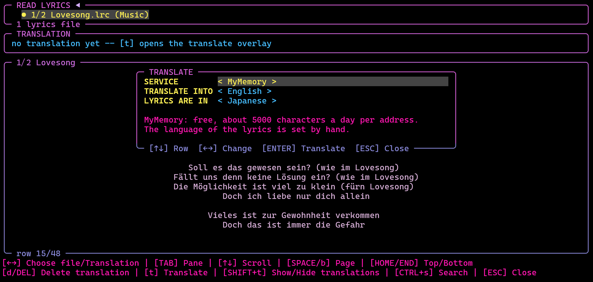

*READ LYRICS with a translation shown below the lines.*

### The oscilloscope (lyric visual)

When there are no lyrics to show (lyrics engine off, nothing found, or the fetch is still running) the lyrics area is filled by a **lyric visual**. Messages such as *fetching lyrics ...* or *No synchronized lyrics found* appear for a moment as a **small box over the bottom of the visual**, which keeps its full size (it no longer shrinks by a row, so a spectrogram does not jump). With Settings → ANIMA/VIZ → **Lyrics/Viz Default** (or **No-Lyrics Viz**, while the lyrics view has no lyrics) set to `osci` (or after pressing `.` to the oscilloscope view) that visual is an **XY oscilloscope** instead of the sphere.

**What it can do, in short:**
- **XY oscilloscope** of the music (left channel = horizontal, right = vertical), with an automatic **phase portrait** for mono tracks, a **45° mid/side view** and an automatic or (in *osci music mode*) fixed scale -- the mode for **oscilloscope music**, which then gets the decoded signal before EQ, normalization and volume.
- A **YT mode** next to the XY figure: the classic time-domain scope (amplitude over time, triggered), alone, **on top of the XY figure** (*XY + YT (overlap)*), **below it in a row of its own** (*XY + YT (row)*) or **next to it in a column of its own** (*XY + YT (col)*, XY left, YT right) -- overlay row *Scope mode*. A full-screen view shows both side by side (`SHIFT+0`, below).
- Two **styles**: **braille** characters in any terminal, or an **image** -- a real pixel picture with a glowing beam -- in terminals with Kitty graphics or Sixel (Windows Terminal 1.22+, WezTerm, Kitty, foot …).
- A **phosphor** look: afterglow (Decay), a bright head and a fading tail, smooth anti-aliased lines between the samples (or only the sample dots), a **Z axis** that dims the beam by speed or brightens it by level, a trace length of 128 – 1024 samples.
- **Nine colour schemes**: the VIZ gradient of the settings, palettes that follow the beam speed (a rough "pitch" colour: temperature, aurora, magma, ice, neon, spectrum …), and **classic green**: one phosphor green for the whole picture, only the brightness of the beam varies, like an old scope.
- **30 – 165 frames per second**, and all values kept separately for each style.
- A separate **scope window** (`)`, German `SHIFT+9`, English `SHIFT+0`) drawn by the graphics card at the monitor's refresh rate, which draws every sample.

**How it draws.** Like a real scope in X-Y mode, the **left channel moves the beam horizontally and the right channel moves it vertically**. A track with a wide stereo image fills the area with a cloud, a pure tone with a phase shift between the channels draws an ellipse, and out-of-phase material leans the other way. The picture is drawn into the largest centred square of the lyrics area, so circles stay circles. A quiet track is boosted automatically, so it still fills the area.

**Mono tracks.** In a true XY scope a mono signal (left = right) can only draw a diagonal line. When a track is (nearly) mono, the scope therefore fades over to a *phase portrait* of the signal instead (the signal against its own rate of change), which draws loops and circles whose shape follows the sound. The switch is smooth, so a track hovering near the limit does not flicker.

**Look.** The trace is drawn with smooth, anti-aliased lines. Like the phosphor of an old oscilloscope it leaves a short **afterglow** that fades out, and the newest part of the trace is brighter than the oldest. The colour is the **VIZ** gradient (Settings → Colors → VIZ) running left to right, dimmed where the beam is weaker, so the fading trail also fades in colour.

### Oscilloscope tuning overlay (`SHIFT+o`)

Opens a window in the middle of the screen where the look of the oscilloscope can be changed **while the music plays**. It sits clear of the lyrics area, so you can watch the scope while you adjust it. The same overlay exists in the radio (on the same key).

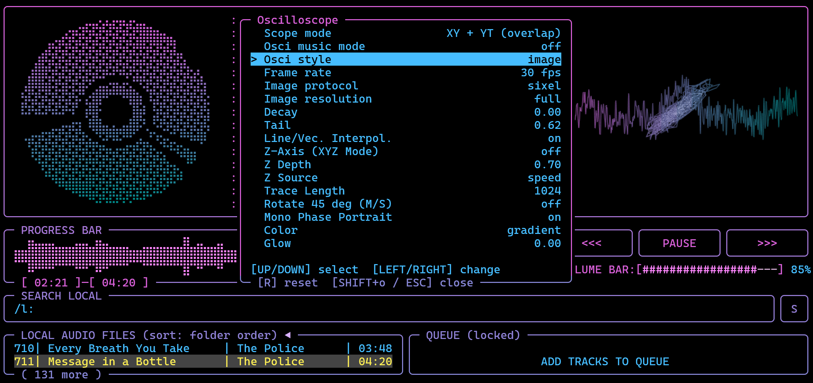

| Key | Action |
|---|---|
| `↑` / `↓` | Select a row (wraps around) |
| `←` / `→` | Decrease / increase the selected value, or step through its choices |
| `R` | Reset the rows of the style in use to their defaults |
| `ESC` or `SHIFT+o` | Close the overlay. The values are **saved to `config.txt`** when it closes. |

Playback keeps running while the overlay is open, but its keys are the only ones that react until you close it. The overlay opens on every main screen. The rows are:

| Row | Choices / range | What it does |
|---|---|---|
| Scope mode | XY / YT / XY + YT (overlap) / XY + YT (row) / XY + YT (col) | Which picture the scope draws (`OsciMode=` `xy`, `yt`, `overlap`, `row` or `col`; one setting for both styles). **XY**: the beam figure described above. **YT**: the classic time-domain scope -- the signal (left and right mixed) runs from left to right, amplitude up and down, and a **trigger** (a rising zero crossing, with a small noise guard) starts every picture at the same point of the wave, so a steady tone stands still instead of crawling. The **Trace Length** row sets how many samples fit across the width (fewer = zoomed in, a few periods of a bass note; more = a longer stretch). **XY + YT (overlap)** draws the YT trace *on top of* the XY figure in the same buffer, the trace a little dimmer, with one shared afterglow and palette. **XY + YT (row)** gives each its own half of the area: the XY figure in the top half, the YT trace in the bottom half. **XY + YT (col)** does the same side by side: the XY figure in the left half, the YT trace in the right half. Decay, Dot threshold, Line/Vec. Interpol., Color, Glow, the style (braille / image), the frame rate and Osci music mode (fixed scale instead of automatic size) apply to every picture; Tail, Z-Axis, Rotate 45 deg and Mono Phase Portrait only shape the XY figure. The scope window (`SHIFT+9`) follows the mode too (see *Scope window*). |
| Osci style | braille / image | **braille**: the scope is drawn with Braille characters. **image**: a real pixel picture with glow, drawn by the terminal itself (see *Image style* below). |
| Frame rate | 30 / 45 / 60 / 90 / 120 / 165 fps | Kept **per style**: the braille and the image scope each have their own frame rate (and all their other values), and the one of the style in use applies. How often the screen (and the scope) is redrawn. Only the lines that changed are sent, so 120 and 165 work in a fast terminal (Windows Terminal, WezTerm, Kitty, Alacritty …) on a monitor with that refresh rate; a terminal never shows more frames than its monitor does. At 165 fps the radio's screen is about 2.3 MB/s of output and about a quarter of one CPU core; if the terminal lags behind, step down. The image style sends at most 60 pictures per second whatever the frame rate (see below). |
| Osci music mode | on / off | Kept per style (braille and image each have their own). For **oscilloscope music** (tracks composed so that the scope draws pictures, e.g. Jerobeam Fenderson's): the scopes get the **decoded signal itself**, before the equalizer, normalization, limiter, volume and the mono fold (what you hear does not change); the picture keeps a **fixed scale** (full level = the edge) instead of adjusting its size to the loudness; the mono phase portrait is off. The scope window (which follows the *image* style's setting) then also smooths more between the samples and draws a finer beam (see *Scope window*). The XY figure is then drawn like a real CRT: **every sample since the last picture** is drawn exactly once (a figure is never cut to Trace Length and broken into dots), the curve between the samples is smoothed, and the beam **adds its light** to the phosphor in proportion to the time it spends on a spot: slow strokes and corners are bright, the fast jumps between shapes nearly vanish (so Line/Vec. Interpol. adds no extra lines), parts that stand still stay crisp and moving parts leave a soft trail. The afterglow then fades per sample, not per frame; the picture is equally bright at any frame rate, and parts that stand still are equally bright at any Decay (Decay only sets how long a moving figure trails). Files **below 96 kHz** (44.1 / 48 kHz) round the jumps between shapes off over a few samples; with *Low-rate blanking* on (the default) moves faster than any stroke are faded out as jumps -- the small wiggles a 48 kHz file has along sharp corners are part of the file and stay. All of this is the **CRT** *Beam*; set it to **classic** for the look from before (the newest Trace Length samples, max-blended, with the occasional line around the edges) -- the braille style starts with *classic*. For the look of osci-render, set **Decay to about 0.10** in this mode, **Image resolution to full** and, if the terminal keeps up, **Image detail to high**. For the full effect, play lossless files (FLAC / WAV): MP3, AAC, Opus and internet radio round off corners and blur lines. |
| Beam | CRT / classic | Kept per style (`OsciCrtBeam=` / `OsciImageCrtBeam=`), with and without Osci music mode. **CRT** (default of the image style): every sample is drawn once and adds light by the time the beam spends on a spot -- in music mode clean figures without jump lines, with ordinary music a glowing core where the beam lingers and faint fast strokes around it. **classic** (default of the braille style): the look from before -- the newest *Trace Length* samples with the *Tail* fade, max-blended, straight lines between the samples; busier, with the jumps between shapes drawn as lines. The scope window follows it. |
| Dwell brightness | on / off | Only shown with the CRT beam (with or without music mode), kept per style (`OsciDwellBrightness=`, on by default). **on**: the beam's light follows the time it spends on a spot -- slow strokes bright, the fast jumps between shapes nearly invisible. **off**: every stroke is equally bright, so the jump lines (often a frame around the edges of the picture) show again, while the rest of the CRT beam (every sample once, soft trails) stays. Also in the scope window. |
| Low-rate blanking | on / off | Only shown in Osci music mode with the CRT beam, kept per style (`OsciLowRateBlanking=`, on by default). For files below 96 kHz (44.1 / 48 kHz): moves faster than any stroke are faded out as jumps between shapes. Files at 96 kHz and above are never touched. Also in the scope window. |
| Rough mode | on / off | Only shown without Osci music mode, kept per style (`OsciRoughMode=` / `OsciImageRoughMode=`; on by default for braille, off for image). The automatic size follows the *previous* picture's loudest point only, as in Mousiki 2.x: when a beat suddenly gets louder, the new picture is too big and the beam is clamped to the edges, so it runs along the border of the square for a moment -- the rougher, livelier look of the old scope (the overlay shows *on (edge clipping)*). Off, the picture's own loudest point counts at once and nothing is clipped. Best seen with the classic beam (the CRT beam dims the clipped stretches). Also in the scope window and the radio. |
| Image protocol | auto / kitty / sixel / off | Image style only: which terminal graphics protocol is used. |
| Image resolution | third / half / full | Image style only: the picture is drawn at a third, half or the full resolution of the screen area and enlarged on the way to the terminal. Lower = much less work and data per picture (half: about a quarter of the drawing work and half the Sixel data) and a smoother scope at high frame rates; the beam gets softer and a little wider. Default `half`. |
| Image detail | normal / high | Image style only (`OsciImageDetail=`): the widest picture that is drawn. **normal** = up to 560 pixels across (640 per picture in the big overlay), **high** = up to 1024 (1280): thinner, sharper lines and finer small figures, best together with *Image resolution* full. High means up to about three times the pixels per picture -- easy for Kitty, but with Sixel (Windows Terminal) lower the frame rate if the picture stutters. |
| Decay | 0.00 – 0.99 | The **afterglow**. Each frame the picture is dimmed by this factor, so higher values leave longer trails. `0.00` shows only the current trace. Values near `0.99` smear for a long time. |
| Dot threshold | 0.01 – 1.00 | Braille style only. How bright a point must be before it is drawn. **Lower** values give a thicker, softer line with a long fade. **Higher** values give a thin, sharp core, but fast parts of the trace can break into gaps. |
| Tail | 0.00 – 1.00 | The brightness of the **oldest** part of the trace compared with the newest (`1.00`). Low values give a comet with a bright head and a fading tail, `1.00` makes the trace uniformly bright. |
| Glow | 0.00 – 1.00 (step 0.05) | Image style only: how strongly the line glows. |
| Line/Vec. Interpol. | on / off | Connects the sample points with smooth lines. |
| Z-Axis (XYZ Mode) | on / off | Lets the beam brightness follow a third signal, like a real XYZ scope. |
| Z Depth | 0.00 – 1.00 (step 0.05) | How strongly the Z signal dims the beam. |
| Z Source | speed / level | `speed`: the faster the beam moves, the dimmer it gets (like a CRT). `level`: the further from the centre, the brighter. |
| Trace Length | 128 – 1024 samples (step 128), then 2048 / 4096 / 8192 | How much of the signal is drawn at once. In the YT picture it is the time span (1024 samples = 21 ms at 48 kHz, 8192 = 170 ms); in the XY picture, how much of the recent path is drawn. Longer traces take more time to draw. |
| Rotate 45 deg (M/S) | on / off | Rotates the picture by 45°, so mid/side (mono/stereo difference) lies on the axes. |
| Mono Phase Portrait | on / off | Fades a (nearly) mono signal over to a *phase portrait* (see *The oscilloscope*). Off draws the plain diagonal line. |
| Color | gradient, settings, temperature, aurora, magma, ice, neon, spectrum, classic green | `gradient` uses the VIZ colours of **Settings → COLORS**. The palettes in the middle follow the beam speed. **classic green** is a single phosphor green (`Palette=green` in the config files) with the brightness of the beam as the only variation -- the look of an old analog scope. |

**Each style keeps its own values.** The braille and the image style have separate sets of every row -- Frame rate, Osci music mode, Decay, Tail, Glow and all the others (Image protocol and Image resolution exist only for the image style) -- so switching the style does not lose your tuning; `R` resets only the style in use (its frame rate stays). Decay, threshold and tail move in steps of 0.01 (tail 0.02).

Two starting points for the braille style: for a crisp, "real oscilloscope" look try Decay `0.65`, Dot threshold `0.35`, Tail `0.60`. For a glowing, dreamy look try `0.90`, `0.20`, `0.25`.

**Image style.** The terminal draws the picture itself, via the **Kitty graphics protocol** (Kitty, WezTerm, Ghostty, Konsole …) or **Sixel** (Windows Terminal 1.22+, foot, xterm …). Without either, the braille scope stays. `MOUSIKI_GFX=kitty|sixel|off` forces a protocol and `MOUSIKI_CELLPX=10x20` sets the cell size (otherwise it is asked from the terminal). In Windows Terminal a smaller Sixel picture is stretched vertically through the Sixel pixel aspect ratio (see below); `MOUSIKI_SIXEL_ASPECT=1` uses that in another terminal too (only useful where the terminal honours the aspect ratio). The scope sends at most as many pictures per second as the **Frame rate**, and never more than 60 with Kitty, 60 with Sixel at `half` / `third` resolution and 30 with Sixel at `full`. A picture is only sent when there is a new one: the text around it is drawn without touching the picture's cells. With Sixel, a smaller picture is enlarged by repeating its pixels (in Windows Terminal the rows through the Sixel pixel aspect ratio, so they are not sent twice); Kitty terminals scale the picture themselves. If the scope stutters, lower **Image resolution** or **Frame rate** first. Small overlays that reach into the scope area hide the covered part of the picture, full-screen menus remove it.

**In radio mode** the overlay is the same, with the radio's own values in `radio_config.txt`, and the environment variables are the same `MOUSIKI_GFX` and `MOUSIKI_CELLPX` (the older names `MOUSIKI_RADIO_GFX` / `MOUSIKI_RADIO_CELLPX` still work; see [11.4](#114-what-the-radio-shares-with-the-player)).

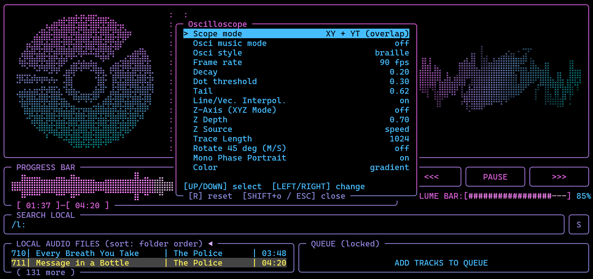


### Oscilloscope full screen (`SHIFT+0`)

The oscilloscope over the whole screen, like the spectrogram's full screen (`SHIFT+u`), but with **both pictures at once**: the **YT** trace (amplitude over time) on the **left**, the **XY** figure (left channel horizontal, right channel vertical) on the **right**. Each has its own phosphor buffer, so both keep their own afterglow, but they show the same audio. The key is the character `=`: **`SHIFT+0` on a German keyboard** (on an English one the `=` key itself; `SHIFT+0` there types `)`, the scope window). It is a normal key binding (`HKeyScopeBig` in the player, `ScopeBig` in the radio), so it can be changed on the REFERENCE tab. In the radio the plain `=` no longer raises the volume (it used to be a second `+`); `+` still does.

- **Layout.** The two pictures are **boxes of the same size** that look square on screen (a character cell is about twice as high as wide, so a box has twice as many columns as rows): the horizontal grid lines of YT and XY are on the same screen rows. When the terminal is resized the boxes shrink or grow but keep their shape and stay in the middle; what is left over is empty margin. The title is the track (radio: station and song). The name of each picture is centred above its box, kept short so it never reaches into the other picture's field (*samp.*, *horiz.*, *vert.*; when the terminal is narrow the least important parts drop out first): the YT time span in the chosen unit, and what the XY axes are (left / right channel, or side / mid with *Rotate 45 deg*), plus the measurements picked in `SHIFT+p`. The bottom border only lists the keys (`SHIFT+a` grid, `SHIFT+v` values, `SHIFT+c` color, `SHIFT+p` metrics; on a narrow terminal the compact form `SHIFT+a/v/c/p`).
- **Look.** The overlay follows the **Osci style** of the `SHIFT+o` overlay and uses that style's own values (braille: Decay, Dot threshold, Trace Length, Line/Vec. Interpol., Color, Osci music mode ...; image: the glow, palette ... of the image style). With **braille** both pictures are drawn in braille dots. With **image** on a terminal that speaks the **Kitty graphics protocol** or **Sixel** (see *Image style* above) both pictures are real **pixel images**: smooth beams with glow, the grid, frame and axes as thin pixel lines under the beam (so they are not made of dotted characters), the axis values and names as text around them. Image resolution, Image protocol and the frame rate rule apply as in the main screen (the two pictures count double for Sixel, so lower *Image resolution* first if it stutters). The small windows (`SHIFT+o`, `SHIFT+c`, `SHIFT+p`) cut a hole into the pictures where they cover them. Without Kitty / Sixel the overlay draws braille, whatever *Osci style* says. *Scope mode* does not matter here: the two pictures are always YT and XY.
- **`SHIFT+o`** opens the oscilloscope options on top of it, so the look can be tuned while watching both pictures. `ESC` closes the options first, the overlay with the next `ESC` (or the overlay key again).
- **`SHIFT+a`** turns the **axes / grid** on or off (`ScopeGrid=` in the config files; **on by default**). Both pictures are drawn as a **box with a solid frame** (straight lines on all four sides at +-100 %): YT gets a solid zero line, dotted lines at every amplitude division and every time division; XY gets the two axes through the centre and dotted lines at every division. The number of divisions is set in `SHIFT+p`. The grid only shows where the trace is not, so it never changes how the trace looks.
- **`SHIFT+v`** adds the **axis values** (`ScopeValues=`, **on by default**, works with or without the grid): a column on the left of each box with the vertical axis (`+100%` ... `0` ... `-100%`, one value per division), and a row below it with the horizontal axis -- **milliseconds** under YT (0 to the full time span), **percent** under XY (-100 to +100). The values are not an AM modulation depth: they are **percent of the picture's scale**. With the automatic size (the default) 100 % is the loudest part of the signal, with *Osci music mode* it is full scale (what the converter can output). Each picture says it in a line below its box. The boxes become a little smaller to make room for the values. They use the grid colour.
- **`SHIFT+c`** opens a **small window** for the **grid colour**: type a number from **0 to 255** (the 256-colour palette; the window shows a swatch of the colour), `ENTER` accepts, `ESC` cancels, an empty value goes back to the default, which is **the colour of inactive list elements** (the list text colour of your colour scheme). It is saved as `ScopeGridColor=`.
- **`SHIFT+p`** opens a **small window for the grid metrics**, separately for the YT and the XY picture (`UP/DOWN` select a row, `LEFT/RIGHT` change it, `R` resets everything, `SHIFT+p` or `ESC` close; every change is saved at once):

  | Picture | Row | Choices |
  |---|---|---|
  | YT | Time unit | **milliseconds** (default), **samples**, **divisions** (the name then shows *ms/div*) |
  | YT | Time divisions | 4, **8**, 10, 16 (vertical grid lines) |
  | YT | Value divisions | 2, **4**, 8, 10 (horizontal grid lines) |
  | YT | Info | off, **RMS level** (the average loudness), **peak hold** (the highest peak of the last two seconds), or **both** (default) -- in dB, shown in the picture's name |
  | XY | Divisions | 2, **4**, 8, 10 (grid lines per axis) |
  | XY | Info | off, **correlation** (`corr`, +1 = both channels identical / mono, 0 = unrelated, -1 = opposite phase), **balance** (`bal`, which channel is louder, e.g. `L+2 dB`), or **both** (default) |

  **The axis values are always percent** of the picture, and each picture says so in a line below its box: *100% = loudest part* (the picture is scaled automatically so the loudest part of the signal fills the box) or, with *Osci music mode*, *100% = full scale*. They never change while the music plays, only when the grid settings change. (Earlier versions could show the values as a fraction or as 16-bit numbers; those moved with the automatic size all the time and were removed, and so were the frequency and Lissajous-ratio readouts, which jump around on music.)

  **The readouts are made to be read, not to flicker:** RMS level, correlation and balance are averages over about a second, the peak is held for two seconds, and what is shown is refreshed only twice a second and rounded (whole dB, correlation to 0.1). Levels are in dBFS: 0 dB is the loudest a file can be (a full-scale sine has an RMS of -3 dB), typical music sits at about -20 to -10 dB RMS with peaks around -3 dB; `-- dB` means silence. They do not depend on the automatic size of the picture. Correlation tells how mono the sound is (values near +1 mean the picture is a thin diagonal in XY; near 0 a wide cloud; negative values are a mono-compatibility warning), balance whether the sound is leaning to one side. Config: `ScopeYtTimeUnit`, `ScopeYtTimeDiv`, `ScopeYtValueDiv`, `ScopeYtInfo` (`off|rms|peak|both`), `ScopeXyDiv`, `ScopeXyInfo` (`off|corr|balance|both`).
- The usual playback keys keep working. `SHIFT+u` (the spectrogram's full screen) replaces this overlay, and the other way round.


*The big oscilloscope overlay with YT and XY pictures.*

### Scope window (`)`: German `SHIFT+9`, English `SHIFT+0`)

The key that types `)` opens the oscilloscope in **its own window** next to the terminal (again: closes it). It is drawn by the graphics card, like an analog scope: **every sample** that is played is drawn once as a soft beam, the phosphor keeps an afterglow, dense parts of the trace glow brighter and a bloom lies around the beam. It runs at the refresh rate of your monitor (60, 120, 144 Hz …), independent of the terminal and of **Frame rate**. Integrated graphics are plenty; a dedicated card is not needed.


| Key (in the window) | Action |
|---|---|
| `F`, `F11` or double-click | Fullscreen on / off |
| `T` | Always on top on / off |
| `ESC`, `Q` or the key of `)` (`9` on a German, `0` on an English keyboard, with or without `SHIFT`) | Close the window (the `)` key in the terminal does the same) |

- **The window follows the style of the `SHIFT+o` overlay.** With **Osci style = image** it is the smooth analog scope described above and uses the values of the *image* style: Decay (afterglow), Glow (bloom), Color palette, Z-Axis / Z Depth / Z Source, Rotate 45 deg, Mono Phase Portrait and Line/Vec. Interpol. (off = sample dots). Trace Length and Tail have no meaning there, because the window draws every sample exactly once. All scope modes (XY, YT, overlap, row, col) are drawn at the **full resolution of the window** as one smooth picture. They get their own brightness lift (`kImageBrightness` in `scope_window_app.cpp`, next to `kBeamAddLight`; higher = brighter).
- **The scope mode follows too.** With *Scope mode* set to YT, *XY + YT (overlap)*, *XY + YT (row)* or *XY + YT (col)* in the `SHIFT+o` overlay the window draws that picture over its whole width (YT is a wide picture), in the dot style: in the *image* style the dots are simply finer and touch each other, because the smooth GPU beam only knows the XY figure -- so there the glow is missing in these four modes.
- **Braille style in the window.** With **Osci style = braille** the window shows the *braille* scope instead: the same dot grid as in the terminal (2 × 4 dots per cell, the same afterglow, brightness steps and colours), but every lit dot is a square on the screen -- so the braille look can be seen as large as the window, or the whole screen in fullscreen, goes. It uses the braille style's own values from the overlay: Decay, Dot threshold, Tail, Trace Length, Line/Vec. Interpol., Z-Axis, rotation, mono phase portrait, Color and Osci music mode. Changing the style in the overlay switches the open window at once. (The overlay itself is opened in the terminal; the window has no menu of its own.)
- **Smooth curves:** the window interpolates between the samples (Lanczos, to about 192 000 points per second, 384 000 in *Osci music mode*), like the output filter in front of a real scope, so fast strokes become curves and not small polygons. With **Line/Vec. Interpol.** off it draws only the real samples as dots.
- **Osci music mode** (`SHIFT+o`): the unprocessed signal, a fixed scale, no phase portrait, the finer beam and the stronger smoothing above, and -- as in the terminal -- the beam's light follows the time it spends on a spot, so the fast jumps between shapes nearly vanish and slow strokes stay bright: for oscilloscope music the figures come out as sharp as the file allows. Decay about 0.10 gives the look of osci-render.
- **Brightness** adjusts itself: a tone that retraces the same figure all the time would otherwise burn white, quiet sparse music would be faint.
- **Title**: the playing track (radio: station and song).
- The window remembers its position, size, fullscreen and always-on-top in `~/.config/mousiki/scope_window.txt` (on Windows `%USERPROFILE%\.config\mousiki\`). It stays open when you switch between player and radio and closes with Mousiki.
- **Needs SDL2** (2.0.18 or newer, zlib licence), which Mousiki loads when the window opens; nothing else in Mousiki needs it. The Windows installer and portable zip include `SDL2.dll`, and `setup.ps1` puts it next to `mousiki.exe` when you build yourself (or download `SDL2-<version>-win32-x64.zip` from [github.com/libsdl-org/SDL/releases](https://github.com/libsdl-org/SDL/releases) and copy `SDL2.dll` there). On Linux / macOS the system's SDL2 is used: the `.deb` recommends `libsdl2-2.0-0`, `setup.sh` installs it (`libsdl2-2.0-0`, `SDL2`, `sdl2`, `brew install sdl2`), and for the portable zips install it yourself (Ubuntu: `sudo apt install libsdl2-2.0-0`, macOS: `brew install sdl2`). Without it, the window keys (`)` / `(`) say what is missing.
- The window is a second copy of Mousiki (`mousiki --scope-window`) that gets the audio through a pipe. A graphics driver problem can therefore only close the window, never the player, and dragging the window never stalls the music or the terminal. If the window cannot start, the status line shows why (the reason is also in `~/.cache/mousiki/scope_window_error.txt`).

### Spectrogram window (`(`: German `SHIFT+8`, English `SHIFT+9`)

The key that types `(` opens the **spectrogram in its own window** (again: closes it), drawn by the graphics card like the scope window. This is the way to a **perfectly smooth** scrolling spectrogram: a terminal can only move a picture by whole pixels or cells, and only as often as it can take the data, while the window redraws at the monitor's refresh rate (60, 120, 165 Hz …) and moves the picture by fractions of a pixel.

- **The same spectrogram:** the analysis is the one of the terminal spectrogram (Audacity's way, the decoded signal before EQ, normalization and volume), with the options of the `SHIFT+i` overlay -- scale, frequencies, gain, range, frequency gain, window size, zero padding, colours (also *gradient*), channels, time span, labels and motion (*scroll* = the newest column on the right, moving smoothly; *sweep* = a page at a time with a playhead). Changes show up in the window at once.
- **Frequency labels** on the left (Audacity's round numbers), when **Labels** is on.
- Keys in the window: `F`, `F11` or double-click fullscreen, `T` always on top, `ESC`, `Q` or the key of `(` (`8` on a German, `9` on an English keyboard, with or without `SHIFT`) close.
- It works whatever the lyrics area / scope block shows and also while the spectrogram is switched off on the ON/OFF tab (so does the full screen, `SHIFT+u`: the switch only concerns the field in the main screen). It can be open at the same time as the scope window.
- Title: the playing track (radio: station and song). Position, size, fullscreen and always-on-top are kept in `~/.config/mousiki/spectro_window.txt`; it stays open when you switch between player and radio and closes with Mousiki.
- Needs SDL2, like the scope window. It is a second copy of Mousiki (`mousiki --spectro-window`) that gets the audio through a pipe; if it cannot start the status line says why (also in `~/.cache/mousiki/spectro_window_error.txt`).


### Spectrogram (`SHIFT+i`, `SHIFT+u`)

The third visual for the lyrics area (and the radio's scope block): a **spectrogram** made the way **Audacity** makes its spectrogram view, with Audacity's default settings and colours -- time runs from left to right, the frequency goes up, the colour shows how strong each frequency is. A stereo track is drawn as two channels above each other (left on top), like a stereo track in Audacity. For a perfectly smooth picture open it in its own window with `(` (German `SHIFT+8`, English `SHIFT+9`; see *Spectrogram window*). Switch to it with `.` (sphere → oscilloscope → spectrogram → lyrics) or with **Lyrics/Viz Default** = `spectro` (radio: **Osci/sphere** = `spectro`). The default visual is the oscilloscope; the spectrogram is drawn in the image style (the overlays no longer have a *Display* row: switching the visual is the `.` key's job).


**What it can do, in short:**
- **Audacity's spectrogram** with Audacity's defaults and colours (below), of the decoded signal, so volume, EQ and normalization never change the picture; stereo as two channels (or one mix).
- All of Audacity's **frequency scales** (linear, logarithmic, mel, bark, erb, period), a free **frequency range**, **gain**, **range**, **frequency gain**, **window size** and **zero padding** -- changed live, and the last minute is computed again at once, so a change shows immediately.
- Four **colour schemes**: Roseus (Audacity), classic, grayscale, and a gradient from your own VIZ / OSCI colours.
- **5 – 60 s** across the width, moving as **sweep** (page by page with a playhead) or **scroll** (the newest on the right).
- Three places to show it: the **lyrics area** (radio: the scope block), **full screen** with frequency labels and a time ruler (`SHIFT+u`), and its own **window** drawn by the graphics card, perfectly smooth at the monitor's refresh rate (`(`, German `SHIFT+8`, English `SHIFT+9`).
- Two **styles**: an **image** (Kitty graphics / Sixel), and **braille** for any terminal.

**Exactly like Audacity (3.x defaults):** a 2048-sample **Hann** window scaled so that a full-scale sine reads 0 dB, **zero padding 2**, the power of every frequency bin in dB, the **Mel** frequency scale from **0 to 20 000 Hz**, **gain 20 dB** and **range 80 dB** (colour = (level + gain + range) / range: −20 dB and louder is the top colour, −100 dB and quieter the bottom one), frequency gain 0 dB per decade, every pixel row shows the strongest frequency bin it covers, and the colour map **Roseus** ("Color (Roseus)", Audacity's default). It analyses the decoded audio itself (before equalizer, normalization and volume), as Audacity analyses the file, so the volume does not change the picture.

**Two styles** (overlay row *Style*):
- **image**: a real picture drawn by the terminal (Kitty graphics or Sixel, like the oscilloscope's image style), pixel for pixel like Audacity. It works whatever style the oscilloscope uses and follows the oscilloscope overlay's **Image protocol** row (`auto` asks the terminal). Where the terminal speaks neither protocol, the braille version is shown and the *Style* row says `image (no Sixel/Kitty here)`.
- **braille**: in any terminal. Every text cell is 2 × 4 braille dots; the louder a spot, the more dots and the brighter the colour.

**Motion:** *sweep* (default) writes the newest column from left to right with a thin playhead line and a short dark gap ahead of it (so the new page and the rest of the old one never run into each other), a page at a time like Audacity follows playback. In the image style only the strip being written is sent -- up to 30 times a second -- which keeps it smooth and light even in full screen. *scroll* keeps the newest column on the right and moves everything. Every pixel column stays tied to one moment of the track, and the picture moves on an even clock (not in the audio's buffer-sized bursts). How the image style moves it depends on the terminal:
- **Sixel in Windows Terminal** (also from WSL): the terminal itself shifts the picture already on screen one cell to the left (DECCRA, "copy rectangular area", which Windows Terminal applies to Sixel pictures too), and only the newest cell column is sent -- a few KB per step instead of the whole picture, so even full screen keeps up. It moves in steps of one cell (about 10 pixels): with the default time span of 30 s a full-screen picture of ~230 columns takes ~8 steps a second; a shorter **Time span** (10–15 s) makes it run faster and look more fluid. `MOUSIKI_SIXEL_SHIFT=0` switches this off; `=1` tries it in another terminal (only useful where copying a rectangle also moves the picture).
- **Other Sixel terminals:** the whole picture is sent again each time it moves, at most ~3 MB/s: a small picture moves on every pixel, a full-screen one in even steps of a few pixels -- and a terminal that draws Sixel slowly shows it in jumps.
- **Kitty graphics:** the whole picture, compressed, like other Sixel terminals.
For the smoothest picture anywhere use *sweep* (only the strip being written is sent), or *scroll* in the braille style.

While an overlay (`SHIFT+i`, `SHIFT+o` …) covers part of the picture, the rest -- above, below and beside it, also the columns right next to its edges -- keeps running; the covered part is drawn again when the overlay closes. When the picture goes away (another view, a menu, the settings) its cells are blanked, so nothing of it is left on the next screen.

**Full screen (`SHIFT+u`)**: the spectrogram over the whole screen, with the track (radio: station and song) as its title, **frequency labels** on the left like Audacity's ruler (both channels), a **time ruler** on top and the scale and range in the bottom line. `SHIFT+i` opens the options on top of it, `ESC` or `SHIFT+u` closes it. Playback keys keep working.

**Options (`SHIFT+i`)** -- `↑`/`↓` select, `←`/`→` change, `R` puts everything back to Audacity's defaults (style and motion stay), `ESC` or `SHIFT+i` closes and saves:

| Row | Choices | Default |
|---|---|---|
| Style | braille / image | image |
| Motion | sweep / scroll | sweep |
| Scale | linear / logarithmic / mel / bark / erb / period (Audacity's scales) | mel |
| Min frequency | 0, 20, 50, 100, 200, 300, 500, 1000, 2000 Hz | 0 Hz |
| Max frequency | 1000 … 24000 Hz (never above half the sample rate) | 20000 Hz |
| Gain (dB) | −20 … 100 | 20 |
| Range (dB) | 10 … 200 (steps of 5) | 80 |
| Frequency gain | 0 … 60 dB per decade (brightens the highs; 0 dB at 1 kHz) | 0 |
| Window size | 256, 512, 1024, 2048, 4096, 8192 samples: how many samples one column analyses. **Bigger** = sharper, thinner frequency lines (good for tones and voices), but short sounds smear in time; **smaller** = crisp clicks and drum hits, but the frequencies get blurry. The picture is computed again at once from the last minute of audio, so you see the difference immediately. | 2048 |
| Zero padding | 1, 2, 4, 8: the window is padded with silence to a longer FFT, which draws the same information on a finer frequency grid (smoother, less blocky low end, especially with the Mel scale). It costs memory and time, not detail. Also recomputed at once. | 2 |
| Colors | roseus (Audacity's default), classic (Audacity's "Color (classic)" colours, but from black instead of light grey), grayscale (black to white), gradient (black, then the **VIZ** colours of **Settings → COLORS**, radio: the **OSCI** colours -- like the oscilloscope's *gradient*) | roseus |
| Channels | left + right (stacked, like Audacity) / mix | left + right |
| Time span | 5 … 60 s across the width, in steps of 5 s (also recomputed at once) | 30 s |
| Frequency labels | on / off (full screen) | on |

The settings are stored as `Spectro<Name>=` lines in `config.txt` (radio: `radio_config.txt`). The spectrogram only starts with the picture: it shows what was played since it became visible.

### Loudness normalization overlay (`SHIFT+v`)

Opens a small window in the middle of the screen where loudness normalization can be switched on and off and tuned **while the music plays**. What you change is what you hear: the level glides to the new value within about a second, so there is no click. (The plain `v` key still toggles normalization on and off without opening anything.)

| Key | Action |
|---|---|
| `↑` / `↓` | Select a row (wraps around) |
| `←` / `→` | On the **Normalize** row: switch off / on. On the other two rows: decrease / increase the value by 1. |
| `SPACE` or `v` | Switch normalization on / off from any row |
| `R` | Reset **Target level** and **Max boost** to their defaults. The on / off state is not changed. |
| `ESC` or `SHIFT+v` | Close the overlay. The values are **saved to `config.txt`** when it closes. |

Playback keeps running while the overlay is open, but its keys are the only ones that react until you close it. The overlay opens on every main screen.

| Row | Range | Step | Default | What it does |
|---|---|---|---|---|
| Normalize | off / on | | on | Loudness normalization on or off. Same switch as the `v` key and **Settings → ON/OFF → Normalize Volume**. |
| Target level | -40 – 0 LUFS | 1 | -16 | The loudness every track is measured against and played at. `-16` leaves more headroom, `-14` matches YouTube and Spotify. A lower number is quieter overall. |
| Max boost | 0 – 24 dB | 1 | 9 | The most a quiet track may be raised. Loud or heavily compressed tracks are lowered regardless. |

**Live line.** Below the three rows a grey line shows what is happening with the track that is playing right now: its measured loudness and the gain that is applied to it (`+` = raised, `-` = lowered). If a quiet track would need more than **Max boost**, the applied gain stops at that limit, so this line is the quickest way to see whether the boost limit is holding a track back. For the first seconds of a track it shows *measuring loudness* until enough audio has been analysed.


**In radio mode** the overlay and its range are the same. A live stream has no end, so the loudness is measured **since you tuned in** (see [11.4](#114-what-the-radio-shares-with-the-player)).

### Karaoke overlay (`k`)

Fills the whole screen with the lyrics of the track that is playing: the line being sung sits in the middle, the words already sung are drawn in the active-word colour (Settings → COLORS → LYRICS) and the word being sung is underlined (bold in the big sizes), the lines before and after it are dimmed. Lines are centred and separated by an empty row. The track's title and artist are on the top border, the position and length (`[ 1:23 / 3:45 ]`) on the bottom border.

The karaoke picture sits on **both sides**, with four empty columns between each picture and the lyrics, so the lyrics stay centred. It is drawn in the **disk colours** (Settings → COLORS → DISK, top → bottom colour) with a colour wave that runs across it from the left to the right edge, like the radio's ON AIR sign.

**Lyrics size.** `SHIFT` and `+` makes the lyrics bigger, `SHIFT` and `-` smaller, in steps of 1 from **1 to 5**. Only the lyrics change, the pictures stay as they are. Size 1 is normal text. From size 2 on the letters are drawn with Mousiki's own pixel font in braille dots, each step one pixel bigger (a letter is 3 x 2 cells at size 2, 6 x 4 at size 3, up to 12 x 8 at size 5); long lines wrap between words. The built-in font covers the Latin letters, digits, punctuation, the German umlauts and ß and the common accented letters. **Japanese, Chinese, Korean (and Cyrillic, Greek)** lines are drawn big too: their glyphs are taken from a font installed on your computer and drawn in the same braille dots. These characters need more dots to stay readable, so their steps are different: a letter is 16 / 24 / 32 / 40 dots high, that is **4 / 6 / 8 / 10 rows** for the sizes 2 / 3 / 4 / 5, and a full-width character is as wide as it is high (8 / 12 / 16 / 20 columns). A line with no spaces, like a Japanese line, wraps wherever the row is full, and a line that would be taller than the screen steps down a size by itself (down to normal text if even size 2 is too tall). With only about 50 columns between the two pictures, big letters of sizes 4 and 5 would hardly fit two or three to a row, so **at sizes 4 and 5 the two pictures are left out and the lyrics take the whole width** whenever the song's lyrics contain Japanese / Chinese / Korean text. Mixed lines (Latin and Japanese) are drawn with the system font as a whole. Mousiki looks for the font itself: Windows (Yu Gothic, Meiryo, MS Gothic, Microsoft YaHei, Malgun), macOS (Hiragino, PingFang, Apple SD Gothic) and Linux (Noto Sans CJK, Source Han Sans, WenQuanYi, Droid Sans Fallback, IPA / Takao, Unifont in the font folders; install e.g. `fonts-noto-cjk` if there is none). Bold faces are preferred, thin strokes would vanish. To use a particular font, set the environment variable `MOUSIKI_CJK_FONT` to its file (`.ttf`, `.otf` or `.ttc`). Without any such font, and for emoji, a line is shown in normal text as before. The bottom border briefly shows `[ lyrics size n / 5 ]`, and the size is saved to `config.txt` (`KaraokeLyricsSize=`) when the overlay closes. The keys are the characters `*` and `_`: on a German keyboard `SHIFT` and `+` / `SHIFT` and `-`, on an English (US / UK) keyboard `SHIFT+8` / `SHIFT` and `-`; the legend names them for your keyboard.

**Resizing.** The layout is worked out again for every frame, so it follows the terminal size: the lyrics re-wrap to the width between the pictures, the pictures are cropped evenly at the top and bottom on a short terminal, and when the lyrics would get narrower than 30 columns the pictures are left out and the lyrics take the whole width.

| Key | What it does |
|---|---|
| `ESC` or `k` | Close the overlay |
| `*` / `_` (German `SHIFT` and `+` / `SHIFT` and `-`, English `SHIFT+8` / `SHIFT` and `-`) | Lyrics bigger / smaller (1 - 5) |
| `p`, `n` / `b`, `#`, `←` / `→`, `+` / `-`, `x`, `m`, `v` | Work as on the main screen (play/pause, next/previous, shuffle next, seek, volume, mute, play mode, normalization) |
| `ALT+L` | Opens the [lyrics timing overlay](#lyrics-timing-overlay-altl) **over the karaoke screen**, which is the easiest place to judge an offset: the big lyrics move live while you adjust it. Closing it (save or cancel) returns to karaoke, not to the main screen. |

- The overlay always uses the lyrics engine, **also when it is off on the main screen** (`.`, Settings → ON/OFF → Use Lyrics Engine): it then fetches the lyrics of the playing track itself -- and again after a track change while it is open -- without changing that setting, so the main screen keeps its visual. While they are being fetched, or when none were found, the overlay says so.
- Synced lyrics follow the timing correction of the lyrics timing overlay, which `ALT+L` opens **from here as well** (see the key table above). Lyrics without timestamps are scrolled along with the song.

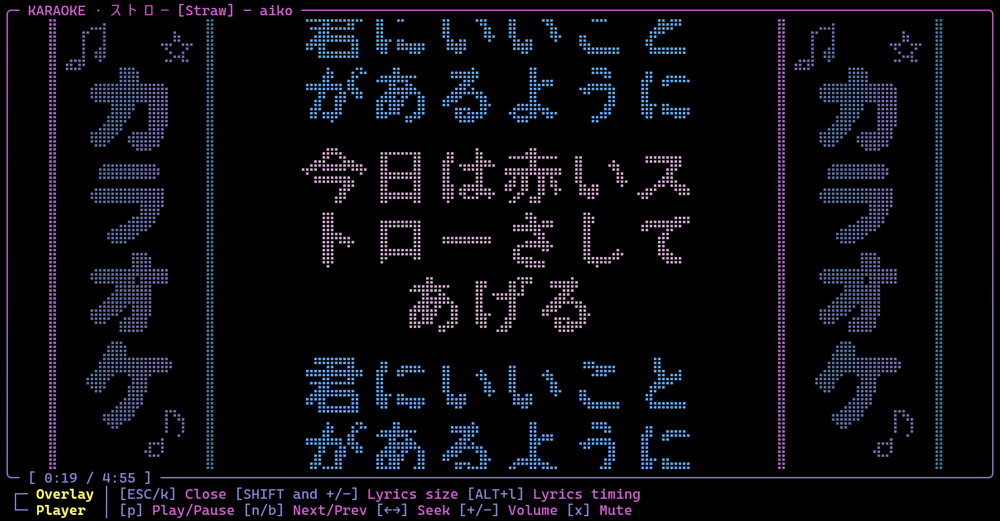


### Sleep timer overlay (`SHIFT+z`)

A small overlay for falling asleep to music. Playback keeps running while it is open.

| Key | What it does |
| :--- | :--- |
| `↑` / `↓` | Pick an entry: **15 / 30 / 60 / 90 / 120 minutes**, **Stop after current song**, **Fade out** or **Off**. |
| `ENTER` | Set the picked entry and close the overlay. Picking the running minute entry again restarts its countdown. On the **Fade out** row it switches the fade on or off instead, and the overlay stays open. |
| `ESC` or `SHIFT+z` | Close the overlay without changing anything. |

- While a timer is armed the remaining time (or `after song`) is shown in the title of the search bar, e.g. `SEARCH LOCAL  [SLEEP 24:10]`.
- When a minute timer runs out, playback is **paused**, not stopped: the position is kept and `p` resumes it.
- **Fade out** (on by default, `SleepFade` in `config.txt`): over the last 10 % of the time (at least 30 seconds, at most 10 minutes) the volume glides down, so the music fades away instead of stopping abruptly. It multiplies your volume setting and is undone when the timer is cancelled.
- **Stop after current song** ends playback when the song that is playing ends, even if the queue still has tracks or the play mode is Repeat. It needs a playing song to attach to.
- The two kinds of timer exclude each other: setting one replaces the other. The timer is **not saved** and is gone after a restart.
- **Stop play mode:** the sleep timer never changes the play mode (`m`). *Stop after current song* is a one-shot on top of it, so with the Stop mode already on it is simply redundant, and your play mode is unchanged afterwards.


**In radio mode** the timer works the same way with the minute entries and the fade-out, but when it runs out the stream is **stopped** and there is no *Stop after current song* entry, because a radio has no song to wait for (see [11.4](#114-what-the-radio-shares-with-the-player)).


### Creator overlay (`^`)

The creator has two modes, chosen in the first row (**Creator mode**): **Text to sound** and **Microphone**.

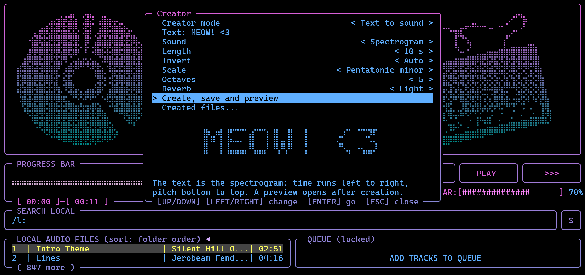

#### Mode: Text to sound

The creator **makes music out of a text**. It renders a WAV file, saves it, plays it and shows it in a full-screen preview. Two kinds of sound are possible:

- **Oscilloscope (XY)** – *oscilloscope music*. The left channel is the horizontal and the right channel the vertical position of a beam; the outlines of your text are drawn again and again, 30 to 120 times a second (that is also the hum you hear). The preview shows it at once.
- **Spectrogram** – the text **is** the spectrogram: time runs from left to right, pitch from bottom to top and brightness is loudness. To make this always sound pleasant, only the notes of a **musical scale** are played (pentatonic minor by default, so every combination sounds harmonious), at most 12 notes sound at once, notes glide softly into each other and a light reverb joins them. *Exact* plays every pitch instead (more like the text, less like music).

| Row | What it does |
| :--- | :--- |
| **Text** | The field. Typing, caret, selection and clipboard work as everywhere. `\|` starts a new line. Text is drawn with Mousiki's pixel font (Latin letters) or an installed font (Japanese, Cyrillic …). `ENTER` moves on. The small braille picture under the rows shows what will be used. |
| **Sound** | Oscilloscope (XY) or Spectrogram. |
| **Length** | 5, 10, 20, 30 or 60 seconds. |
| **Invert** | **Auto**, **On** or **Off**. *On* makes the background loud instead of the letters. |
| Oscilloscope rows | **Frame rate** (30 / 60 / 90 / 120 per second), **Motion** (None, Spin, Tumble, Pulse – the text moves while it plays) and **Detail** (Low, Medium, High: how exactly the outline is followed). |
| Spectrogram rows | **Scale** (pentatonic minor / major, major, minor, whole tone, chromatic, exact), **Octaves** (3 to 6, from the low C2 upwards) and **Reverb** (Off, Light, Hall). |
| **Scope grid** | On / Off: the grid of the oscilloscope preview (only for *Oscilloscope*; `G` switches it in the preview too). |
| **Create, save and preview** | Renders and saves the WAV, plays it and opens the preview. |
| **Created files...** | Lists the files made so far (newest first). `ENTER` plays the picked file and opens its preview; `ESC` goes back. This is the only place where the created files can be played. |

Keys: `↑` / `↓` or `TAB` pick a row, `←` / `→` or `ENTER` change a value, `ENTER` on *Create* creates, `ESC` closes (`^` again closes it too, except while you type in the text field). **`SPACE` does nothing in this overlay** (it only types a space inside the text field), so a stray space, e.g. from a dead key on a German keyboard, can never create a file.

- **The preview:** after *Create* (or after opening a file from *Created files...*) a full-screen **preview** opens and the file plays in a loop. For *Oscilloscope* it shows the XY scope in oscilloscope-music mode (as a real picture on terminals with Kitty graphics / Sixel, else in braille); for *Spectrogram* it shows the spectrogram, with a line that sweeps across it. The preview has **its own settings**: it neither uses nor changes what you set with `SHIFT+o` and `SHIFT+i`. It loops until you stop it: `ESC` closes the preview and takes you back to the creator overlay (a second `ESC` closes that); the song that was playing before comes back (from its start; if nothing was playing, playback just stops), `SPACE` pauses.

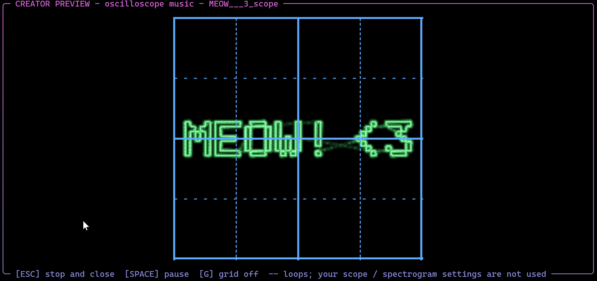

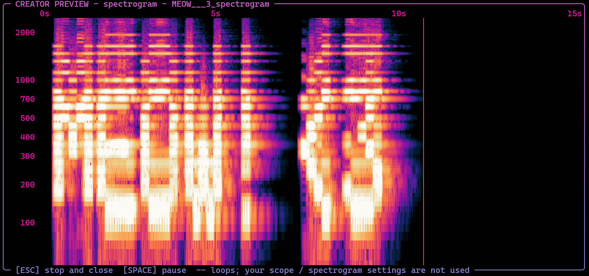

- The file is saved as `<your first music folder>/creator/<name>_scope.wav` or `…_spectrogram.wav` (`~/Music/creator` when no music folder is set; an existing name gets a number). The folder is marked with a small file (`.mousiki-creator`), so **its files are not part of your library**: they do not show up in the file list, the search or the queue, and you listen to them only through *Created files...* in this overlay (they are ordinary WAV files, so you can still copy or share them from the folder).
- **Tips for the scope:** short words, or several short lines with `|`, give big letters. Many small details make the beam slow, so the picture flickers; *Detail: Low* or a bigger frame rate helps.
- **Tips for the spectrogram:** the text becomes a melody-like pattern; short words are most readable in the preview.
- Rendering runs while the overlay waits and takes a moment for long clips (at most a few seconds).
- In the radio the creator is not available; the player plays the files like any other file (they are in your library).
- The key is `HKeyCreator` in `config.txt` (default `^`).

#### Mode: Microphone

Shows your **microphone live** in the big preview and records it on request (also the groundwork for a karaoke mode with singing scores).

| Row | What it does |
| :--- | :--- |
| **Live view** | **Spectrogram** (default), **Oscilloscope (XY)** (left against right channel) or **Oscilloscope (YT)** (the wave over time). |
| **Scope grid** | On / Off (both oscilloscope views). |
| **Start the microphone preview** | Opens the big preview. A song that is playing stops (the microphone would hear it) and comes back when you close the preview. |
| **Created files...** | As above; recordings are listed here, too. |

In the preview: `ENTER` starts a **recording** (the title shows `REC m:ss`) and stops and saves it (`mic_YYYYMMDD_HHMMSS.wav` in the creator folder, at most 5 minutes); `V` changes the view, `G` the grid, `ESC` closes the preview and returns to the overlay (a running recording is saved). Recordings are played from *Created files...* like everything else the creator makes. A microphone with one channel shows the same signal left and right, so *XY* draws a diagonal line; *YT* and the spectrogram are the useful views then. If no microphone can be opened (or the system refuses access), the overlay says so; on macOS and Windows you may have to allow microphone access for your terminal.

## 4. Search (main UI)

The cheat sheet (`?`) lists these under two headings: **SEARCH LOCAL (MAIN UI)** (`/`, `/r:`, `/a:`, the playlist and folder searches) and **SEARCH ONLINE (MAIN UI)** (`/s:`, `/sc:`, `/b:`).

| Key | Action | What it does |
|---|---|---|
| `/` | Search local folder | (German `SHIFT+7`.) Opens the search box. The list updates **live as you type**. Press `ENTER` to keep the result, or `ESC` to cancel and restore the previous view. |
| `/r:` + query | Search artists only | Local search limited to the **artist**: the artist tag, or the artist folder when a file has no tag. `/r:miles` lists only tracks by artists matching "miles", not tracks that merely have it in the title. The search bar is labelled **SEARCH ARTISTS**. |
| `/a:` + query | Search albums only | Local search limited to the **album** tag. The bar is labelled **SEARCH ALBUMS**. (Album tags are resolved in the background after a scan, so a freshly added folder may need a moment.) |
| `/s:` + query | Search online (YouTube) | Type `s:` followed by your query, then press `ENTER`. Online searches only run on `ENTER`, never per keystroke. |
| `/sc:` + query | Search SoundCloud | The same for **SoundCloud** (through yt-dlp). `ENTER` on a result plays it, the queue keys queue it, the download key saves it to the download folder. The audio is kept as SoundCloud sends it (no second conversion). Tracks SoundCloud only plays as a **30-second preview** (Go+ and some label releases) and tracks that cannot be played at all are **left out** of the results; to tell them apart each result is looked at in full, so a SoundCloud search takes a few seconds longer than a YouTube one. |
| `/b:` + query | Search Bandcamp | The same for **Bandcamp** tracks (the search is asked from Bandcamp by `scripts/bandcamp_search.py`, the download is done by yt-dlp). Bandcamp streams the free 128 kbit/s MP3; the full-quality files are for buyers on Bandcamp itself. |
| `↑` / `↓`, then `ENTER` | Play from the search | Moving through the results with `↑` / `↓` while typing and pressing `ENTER` **plays the highlighted entry right away** (the search stays as the list's filter and the list keeps the highlight). Without moving, `ENTER` only keeps the search, as before. |
| `/p:` + query | Search saved playlists | Type `p:` followed by part of a playlist name. The playlist list filters live. `ENTER` on a playlist row queues all of its tracks. |
| `/f:` + query | Search folders | Type `f:` followed by part of a folder name (or of `<parent folder> <folder>`, e.g. `beatles abbey`). The folder list filters live. `ENTER` on a folder row opens it in the LOCAL AUDIO FILES pane and lists all of its files, exactly like the `f` filter (`c` clears it again). |
| `L` (Shift+L) | Big list overlay | Floats a larger version of the list pane (LOCAL AUDIO FILES) over the main UI. See below. |
| `F` (Shift+F) | Big folder overlay | A folder tree of the library with a search bar, floated over the main UI. See below. |
| `C` (Shift+C) | File conversion overlay | Convert high resolution files to MP3 / AAC / Opus. See below. |


**In radio mode** the search works the same way (fuzzy, live, `ESC` clears; the station under the cursor is highlighted while you type, and `ENTER` tunes it); it searches stations, and `p:` the saved station lists (see [11.5](#115-searching-stations-station-lists-and-p)).

**Local search details**

- The search is **fuzzy**. For example "X Files" also finds "X-Files".
- It matches the file name, the artist, the embedded title tag and the album tag. Files whose tags have not been read yet can still be found by file name.
- Results are ranked purely by match quality, best first.
- While the search box is open, `↑`/`↓` move through the live preview. `←`/`→` move the text caret, and `SHIFT+←/→` marks text.
- A folder filter (`f`) keeps applying to search results.

### Big list overlay (`SHIFT+l`)

Opens a large window, styled like the lyrics form (`l`), that shows the same list as the small pane (LOCAL AUDIO FILES, or the online / playlist results) with many more rows. It shares the cursor with the small pane, so both always point at the same track.

| Key | Action |
|---|---|
| `SHIFT+↓` / `SHIFT+↑` | Next / previous **page** (faster scrolling). At the end of the list the cursor jumps to the last / first entry. |
| `↑` / `↓` | Move one row |
| `ESC` or `SHIFT+l` | Close the overlay |

Everything else keeps working from inside the overlay: `ENTER` plays, `T` cycles the sort mode, `f` / `c` set / clear the folder filter, `/` searches (the search bar is part of the overlay), `a` adds to the queue, `n` / `b` / `p` / seek / volume as usual, and `l` opens the lyrics form on top of it. The queue pane is hidden while the overlay is open, so its footer shows the current queue size (`queue: N`) together with a page counter. Full-screen menus (Settings, Playlists, ...) hide the overlay while they are open and it returns when they close.

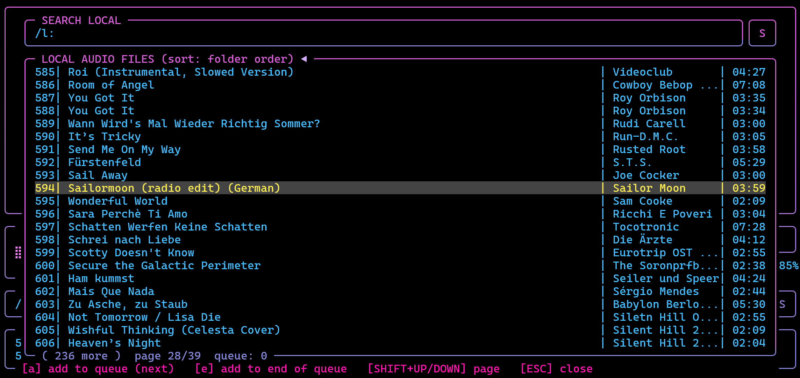

*Big list overlay can be opened via `SHIFT+l` and closed via the same command or `ESC`. Fast scrolling (scroll per page) is possible via `SHIFT+↑/↓`.*

### Big folder overlay (`SHIFT+f`)

A large window with a search bar and the **LOCAL AUDIO FILES FOLDER** pane: a tree of all folders of your library (the folders of the PATHS tab and the download folder, with the number of tracks in each). `ENTER` opens a folder; its subfolders and files appear slightly indented below it, and `ENTER` closes it again.

| Key | Action |
|---|---|
| `↑` / `↓`, `SHIFT+↑` / `SHIFT+↓` | Move one row / one page |
| `ENTER`, `→` / `←` | Open / close the folder (`←` on a closed folder or a file jumps to its parent folder) |
| `f` | On a **folder**: show that folder in the LOCAL AUDIO FILES pane, exactly like `f` on a track (folder order, `c` clears it again). On a **file**: the same for the file's folder, with the file highlighted. Both close the overlay. |
| `CTRL+p` | **Play** the highlighted file (the overlay stays open, so you can keep browsing); on a folder it only shows a hint |
| `/` or `TAB` | Type in the search bar: only folders and files whose name matches (all words) stay in the tree, with the way down to them opened. `ENTER`, `TAB` or `ESC` hand the keyboard back to the tree. |
| `ESC` or `SHIFT+f` | Close the overlay |

Playback keys (pause, next / previous, seek, volume, mute, normalize) keep working. The key can be changed with `HKeyFolderOverlay` in `config.txt`. The overlay and the big list / queue overlays exclude each other.

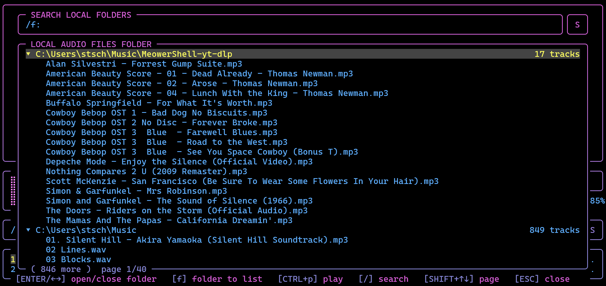

*The folder overlay (`SHIFT+f`).*

### File conversion overlay (`SHIFT+c`)

Turns high resolution files into lighter ones. A large window with a search bar and the list **FILES TO CONVERT**: every file of the library with its format, sample rate / bit depth, bitrate, size and the estimated size after the conversion. The first line inside the list holds the pre-filter and the target, the second shows the export folder, the progress of a running conversion or the result of the last one.

| Key | Action |
|---|---|
| `↑` / `↓`, `SHIFT+↑` / `SHIFT+↓` | Move one row / one page |
| `SPACE` | Mark / unmark the highlighted file (and move on) |
| `a` | Mark everything that is shown, or unmark it again when all of it is marked |
| `t` / `SHIFT+t` | Pre-filter **type**, forward / backward: all files, lossless (FLAC, WAV, ALAC), FLAC, WAV, M4A, OGG, OPUS, AAC, MP3 |
| `r` / `SHIFT+r` | Pre-filter **minimum bitrate**: any, 320, 500 or 1000 kbps |
| `h` | Pre-filter **hi-res only**: more than 16 bit or more than 48 kHz |
| `←` / `→` | The **target**: MP3 320 kbps, MP3 V0 (about 245 kbps, variable), MP3 192 kbps, AAC 256 kbps (`.m4a`), Opus 128 kbps |
| `/` or `TAB` | Type in the search bar (folder and file name, all words must match); `TAB` or `ESC` hand the keyboard back to the list, `ENTER` too (in a plain file search) |
| `f:` / `p:` in the search bar | Same as in the main search: typing `f:` turns the bar into `/f:` and the list into the **folders** that hold files (filtered by what you type after it), `p:` turns it into `/p:` and lists the saved **playlists**. `ENTER` on a folder or playlist narrows **FILES TO CONVERT** to just its files (a folder: the files directly in it, like `f` in the main list; the pre-filter still applies, the info line says how many match). The search then works inside that selection. Typing `/` in the bar goes back to the full search (and drops the selection); `BACKSPACE` on an empty `/f:` or `/p:` removes the prefix; `ESC` leaves the folder / playlist list, then the selection, then closes the overlay. |
| `ENTER` | Convert the marked files (the highlighted one when nothing is marked) |
| `c` | Cancel the running conversion |
| `CTRL+p` | Play the highlighted file (the overlay stays open) |
| `ESC` or `SHIFT+c` | Close the overlay. A running conversion goes on in the background and reports on the status line. |

The files are read with `ffprobe` in the background right after the overlay opens (the list says `reading 12/340` meanwhile); filters that need those details (hi-res, minimum bitrate, lossless M4A) show a file as soon as it has been read. The converted files go to the **CONVERSION EXPORT PATH** (Settings → PATHS; by default the `conversion-export` folder inside the download folder), in the same sub folders as the originals below your library folder, with the new extension. **The originals are never changed or deleted.** A file that already exists in the export folder is skipped (so converting the same song to a second MP3 preset needs the old file moved away first). Tags and the cover picture are copied (not to Opus); sample rates above 48 kHz become 44.1 or 48 kHz, more than two channels become stereo. The export folder is left out of the list. Needs `ffmpeg` with `libmp3lame` and `libopus`; the installers and `setup.sh` / `setup.ps1` provide it. The key can be changed with `HKeyConvertOverlay` in `config.txt`.

## 5. Queue (main UI)

The queue is a list of tracks that play **before** the normal list continues. Press `TAB` to move focus into the queue panel when you want the arrow keys or `d`, `4`, `5`, `SHIFT+4`, `SHIFT+5` to work on it.

| Key | Action | What it does |
|---|---|---|
| `a` | Add hovering track as **next** | With the **list** focused, puts the highlighted track at the **front** of the queue, so it plays next. Pressing `a` on several tracks in a row keeps their order: A, B, C play as A, B, C. On a playlist row it queues all of the playlist's tracks at the end instead. With the **queue** focused, `a` opens the **bulk-add** panel (see below). |
| `e` | Add hovering track to the **end** | With the **list** focused, adds the highlighted track to the end of the queue. On a playlist row it queues the whole playlist at the end. With the queue focused it only reminds you to focus the list first. |
| `d` | Remove hovering track from queue | Removes the highlighted queue item. Focus the queue with `TAB` first. |
| `4` | Move hovering queue item up | Moves the highlighted queue item one place up. Focus the queue first. |
| `5` | Move hovering queue item down | Moves the highlighted queue item one place down. Focus the queue first. |
| `$` (Shift+4) | Move to top | Moves the highlighted queue item to the very top of the queue. |
| `%` (Shift+5) | Move to bottom | Moves the highlighted queue item to the very bottom of the queue. |
| `!` | Lock / unlock the queue | The queue is **locked by default**: a played track moves to the end of the queue. Unlocked, it leaves the queue. See *Locked queue* below. |
| `X` (Shift+X) | Clear the whole queue | Asks "Want to clear queue?" first. See below. |
| `CTRL+SHIFT+z` | Undo the last queue clear | Brings back the queue that `SHIFT+x` cleared. See *Undo clear* below. |
| `CTRL+SHIFT+u` | Queue to playlist | Saves the queue's local tracks as a playlist. See *Queue to playlist* below. |
| `K` (Shift+K) | Big queue overlay | Floats a larger version of the QUEUE pane over the main UI. See below. |


### Big queue overlay (`SHIFT+k`)

The same idea as the big list overlay, for the queue: a large window that shows the QUEUE pane with many more rows. It is on `SHIFT+k` (and not on `q`) so that you cannot quit the app by accident. It shares the cursor with the small queue pane, and the queue is automatically focused while it is open, so the arrow keys move through the queue.

| Key | Action |
|---|---|
| `SHIFT+ARROW_DOWN` / `SHIFT+ARROW_UP` | Next / previous **page**. At the end the cursor jumps to the last / first entry. |
| `ARROW_UP` / `ARROW_DOWN` | Move one row |
| `4` / `5` (default) | Move the hovered track up / down in the queue |
| `SHIFT+4` / `SHIFT+5` (default) | Move the hovered track to the top / bottom of the queue |
| `!` (default) | Lock / unlock the queue |
| `d` | Remove the hovered track from the queue |
| `a` | Open the bulk-add panel (paste a playlist link), as with the queue focused |
| `SHIFT+x` | Clear the whole queue (asks first) |
| `CTRL+SHIFT+z` | Undo the last queue clear |
| `CTRL+SHIFT+u` | Save the queue as a playlist (opens the playlist editor) |
| `ESC` or `SHIFT+k` | Close the overlay (the previous focus is restored) |

Only one of the two overlays can be open at a time: `SHIFT+k` while the list overlay is open switches to the queue overlay, and vice versa. Pressing `/` closes the queue overlay, because the search filters the list underneath. Playback keys (`n`, `b`, `p`, seek, volume) keep working. The bottom border of the frame shows the page counter and the number of tracks. All commands of the overlay are listed in a gray **legend below the frame** (`[d] delete`, `[SHIFT+x] clear all`, `[4/5] move up/down`, `[SHIFT+4/5] move to top/bottom`, `[!] lock` / `[!] unlock`, `[CTRL+SHIFT+u] queue to playlist`, `[CTRL+SHIFT+z] undo clear`, `[SHIFT+UP/DOWN] page`, `[ESC] close`).

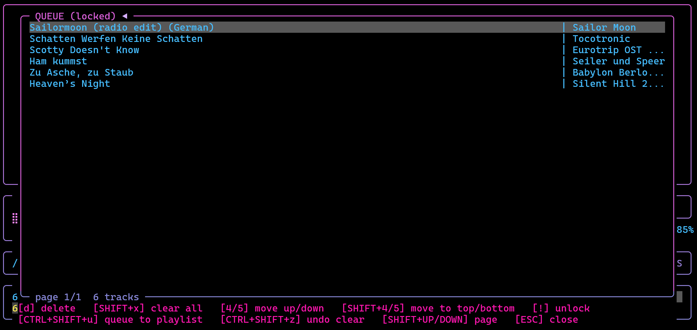

*Big queue overlay can be opened via `SHIFT+k` and closed via the same command or `ESC`. Fast scrolling (scroll per page) is possible via `SHIFT+↑/↓`.*

### Locked queue (`!`)

The queue is **locked by default**. A locked queue keeps all its tracks: when a track is played (by auto-advance or by `n`) it **moves to the end of the queue**, so the queue loops instead of draining, and the next track is always the one at the top, also in shuffle mode: `n` and the end of a track always take the next title of the queue, only `#` picks a random one (it is sent to the end the same way). `d` and `SHIFT+x` still remove tracks, locking only stops tracks from disappearing by themselves. The panel title shows `QUEUE (locked)`.

Press `!` to **unlock**: a track then **leaves the queue** once it is played, and the queue runs empty. Press `!` again to lock it. The lock state is part of the saved session, so a session saved by an older version keeps the state it was saved with (press `!` once if it comes back unlocked). The play modes do not change this, with one exception: in `Q` (queue then stop) a locked queue is played through once and playback then stops instead of looping.

### Undo clear (`CTRL+SHIFT+z`)

Brings back the queue that was cleared last with `SHIFT+x`. The restored tracks go in **front of** anything that was queued after the clear. There is **one** level of undo: after it is used (or before anything was cleared) the status line says that there is nothing to undo.

### Queue to playlist (`CTRL+SHIFT+u`)

Opens the playlist editor (see [Playlists](#6-playlists)) with the queue's tracks already in the new playlist and the **name field focused**: type a name and press `CTRL+s` to save (the editor stays open, `ESC` leaves the name field, a second `ESC` leaves the editor). Playlists hold local files only, so **online (streamed) queue items are left out** and counted in the status line; duplicate files are added once. With an empty queue, or a queue with online tracks only, nothing opens and the status line says so.

### Clear queue prompt (`SHIFT+x`)

The prompt starts on **No**, so an accidental `ENTER` never wipes the queue.

| Key | Result |
|---|---|
| `←` | Highlight Yes |
| `→` | Highlight No |
| `TAB` | Toggle between Yes and No |
| `ENTER` | Take the highlighted answer |
| `y` | Yes: clear the queue |
| `n`, `ESC` or any other key | No: cancel |

If the queue is already empty, the status line just says so. A cleared queue can be brought back with `CTRL+SHIFT+z` (see above).

### Bulk add (`a` with the queue focused)

Paste a YouTube playlist link to queue tracks from it.

1. **Type or paste the link** and press `ENTER` to fetch it (`ESC` cancels).
2. Once the results appear: `↑`/`↓` move, `SPACE` stars or unstars a row, `a` queues **all** of them, and `ENTER` queues **only the starred** ones.
3. `ESC` throws everything away.

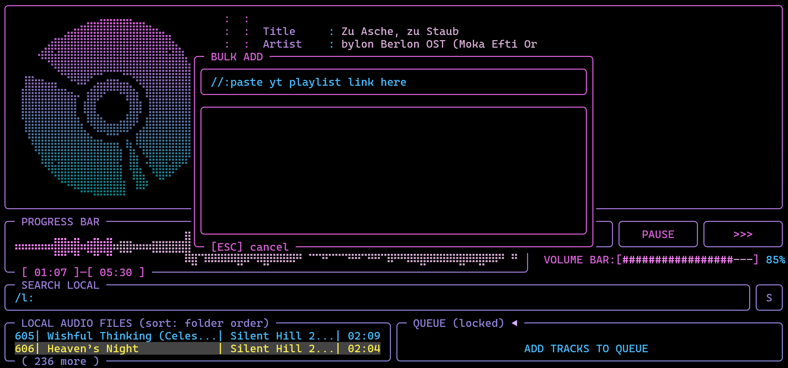

*Bulk add with the fetched results.*

---

## 6. Playlists

`P` (Shift+P) opens the **playlist editor**, a full-screen overlay for building playlists from your local (or downloaded) tracks. It has two tabs: **Create/Edit** and **Saved Playlists**. Playlists are used from the main screen with `/p:` (see [Search](#4-search-main-ui)). The editor uses the same tab strip as the settings: the title and, on the Create/Edit tab, the **name field** (25 characters) sit on its top line, the tab names on the right.

Playlists are stored in **one** folder, set under **Settings → PATHS → PLAYLIST PATH**. Without it, the first local path plus `/playlists` is used. Changing the playlist path **copies** the existing playlists to the new folder; nothing is moved or deleted.

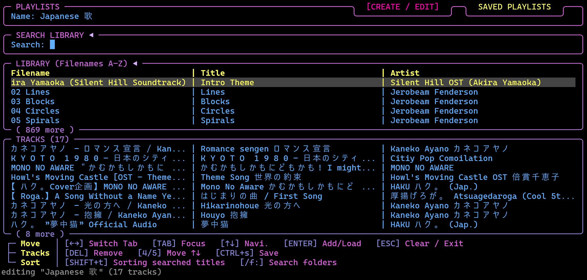

***Create / Edit** tab: the name field, the library picker with its search (`/`), and the tracks of the playlist being built.*

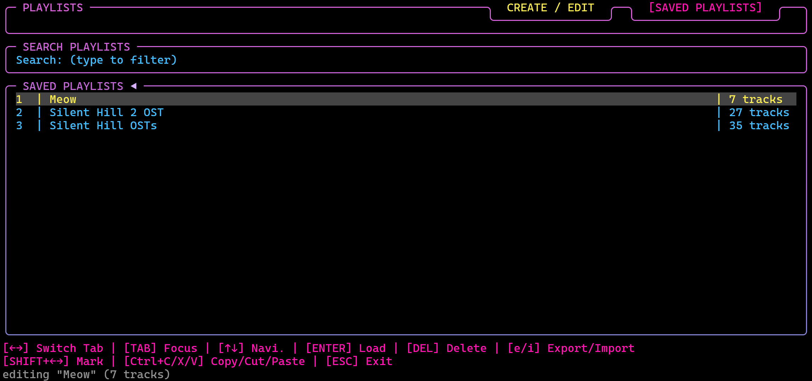

***Saved Playlists** tab: the search field and the list of saved playlists with their track counts.*


| Key | What it does |
|---|---|
| `P` | Open Playlists (create / manage) |
| `←` / `→` | Switch between the Create/Edit tab and the Saved Playlists tab. In the name field or a search box they move the caret instead **once you have typed something there**; `ESC` leaves the box and gives them back to the tab switch (see [Menus with tabs and text boxes](#menus-with-tabs-and-text-boxes)). |
| `ALT+←` / `ALT+→` | Switch the tab from every pane, also while typing. |
| `TAB` | Cycle focus. On Create/Edit: name field → library picker → track list. On Saved Playlists: search box ↔ list. |
| `↑` / `↓` | Move through the focused list or picker |
| `ENTER` | Depends on focus. See the table below. |
| `4` / `5` | Move the highlighted track up or down in the playlist you are building |
| `D` / `DEL` / `BACKSPACE` | Remove the highlighted track (track list focused). On the Saved Playlists tab, `DEL` deletes the selected playlist after a Yes/No confirmation. |
| `e` | On the Saved Playlists tab (list focused): **export** the selected playlist as an **M3U8** (default) or **M3U** file. See *Exporting a playlist* below. |
| `i` | On the Saved Playlists tab (list focused): **import** `.m3u` / `.m3u8` files from a folder (default: the playlist export folder, else the playlist folder). `SPACE` marks a file, `a` marks all, `TAB` switches between folder field and list, `ENTER` imports the marked files (or the highlighted one), `ESC` cancels. Missing files and stream URLs are skipped and counted in the status line. |
| `CTRL+s` | Save the playlist (from every pane of the Create/Edit tab, also while typing) |
| `SHIFT+←` / `SHIFT+→`, `HOME` / `END` | Mark text / jump to the start or end in the name and search fields |
| `CTRL+C` / `CTRL+X` / `CTRL+V` | Copy, cut and paste text in those fields |

### What `ENTER` does in the playlist editor

| Where | Result |
|---|---|
| Name field | Confirms the name and jumps to the library picker |
| Library picker | Adds the highlighted track to the playlist. (Typing in this pane filters the library live.) |
| Saved Playlists, search box | Moves focus to the list |
| Saved Playlists, list | Loads the selected playlist into the editor |

### Exporting a playlist (M3U8 / M3U)

On the **Saved Playlists** tab, select a playlist in the list and press `e`. A small overlay opens:

| Row | What it is |
|---|---|
| Folder | Where the file goes. It starts as **Settings → PATHS → PLAYLIST EXPORT PATH** (or, while that is empty, the playlist folder) and can be changed right here for this one export. The usual text keys work (`←`/`→`, `SHIFT+←/→`, `HOME`/`END`, `CTRL+C/X/V`); `~` is your home folder. A folder that does not exist yet is created. |
| Format | **M3U8** (the default, UTF-8) or **M3U**. `←`/`→` or `SPACE` switch while the row is selected. |
| File | The file name that will be written: the playlist name plus `.m3u8` / `.m3u`. An existing file of that name is replaced. |

`TAB` or `↑`/`↓` move between Folder and Format, `ENTER` (or `CTRL+s`) exports, `ESC` cancels. The file is an *extended M3U*: `#EXTM3U`, the playlist name, and per track an `#EXTINF` line (`Artist - Title`, length unknown = `-1`) followed by the track's absolute path. Both formats are written as UTF-8, which current players expect for `.m3u` too. Tracks whose file no longer exists are left out; the status line says how many were exported and how many were missing.

### Leaving

In a text box you typed into, the first `ESC` only leaves the box (the text stays). The next `ESC` closes the editor. If there are unsaved changes on the Create/Edit tab (a typed name counts), it asks `Save changes to "…" before exiting?`: `y` saves, `n` discards and leaves, `ESC` cancels the question and keeps editing.

---

## 7. Meta editor

`M` (Shift+M) opens the **meta/tag editor** for changing a file's **file name**, **artist**, **title**, **album** and **year**, and for looking up missing tags with AcoustID (an audio-fingerprint service) and, for album and year, MusicBrainz.

**Important safety rules**

- Editing never touches your files directly. All changes go into a **pending edit session**, which is autosaved after every keystroke to `~/.cache/mousiki/meta_session/`. Closing the editor, quitting, or even a crash keeps the session.
- **The main screen follows the editor live.** The first line (`Title` / `File`) and the `Artist` / `Album` / `Year` lines of the metadata block (and the track title in the oscilloscope / spectrogram windows) show the pending edits of the track that is playing right away, typed by hand or fetched in the editor with `SHIFT+n` / `SHIFT+b`, before anything is saved. The first line is labelled **Title** or **File** and follows `SHIFT+n` like the list rows do: **Title** is the title tag (the file name if the file has none), **File** is the file name (a pending FILE rename shows there). Edits left over from an earlier run appear as soon as the track starts. `CTRL+s` writes them, and the screen keeps showing the saved values. Sampling, Type, Format, File size and Location are read from the file and are not affected.
- Touched fields and the matching library rows are drawn in the **header colour**, so you can see what will be written.
- Only `CTRL+s` writes to the files, and it asks first.

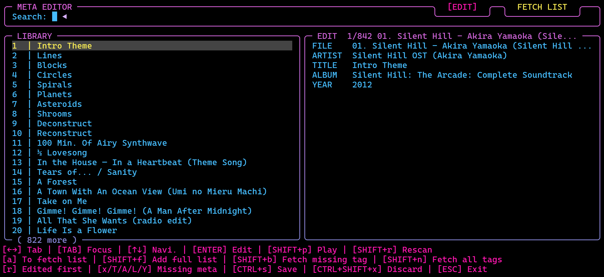

***Edit** tab (the search field sits on the second line of the tab strip, left of the tab names): the search field, the library on the left, and the five fields (FILE, ARTIST, TITLE, ALBUM, YEAR) of the highlighted file on the right. The footer lists every key as a small tree table: one row per group (Move, Fetch, View, Session), the group name on the left, its keys on the right.*

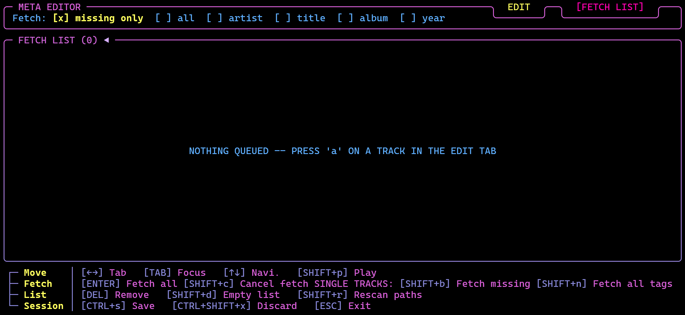

***Fetch List** tab: the titles queued for an AcoustID lookup. The status line below the footer confirms what was added.*


| Key | What it does |
|---|---|
| `M` | Open the meta editor |
| `←` / `→` | Switch between the **Edit** tab and the **Fetch List** tab. In the **search field** they move the caret instead once you have typed something there (`ESC` gives them back to the tab switch); in the **field editor** they always move the caret. |
| `ALT+←` / `ALT+→` | Switch the tab from everywhere, also while typing. |
| `TAB` | Cycle panels on the Edit tab: search field → library → field editor |
| `↑` / `↓` | Move through the focused list, or between the five fields in the field editor |
| `ENTER` | Depends on focus (see below). On the **Fetch List** tab it fetches the full list (with the ticked options). On a field with several fetched options it opens the choice overlay. |
| `SHIFT+←` / `SHIFT+→` | Mark text in the search field and the field editor |
| `CTRL+C` / `CTRL+X` / `CTRL+V` | Copy, cut, paste in the search field and the field editor |
| `a` | Add the highlighted file to the **fetch list** (library focused). Add a single title and tick the boxes on the Fetch List tab to fetch just some tags of it |
| `SHIFT+f` | **Add full list**: adds every title the library pane shows right now to the fetch list (library focused). The search and the missing-tag filter (`x`, `SHIFT+t/a/l/y`) are applied, titles already on the list are skipped, the status line says how many were added. Typical use: filter for `SHIFT+l` (missing album), press `SHIFT+f`, switch to the Fetch List tab and press `ENTER` |
| `r` | Toggle **edited files on top** of the library pane |
| `x` | Filter the library to files missing **any** metadata (library pane focused; press again to clear) |
| `SHIFT+t` | Filter the library to files missing a **title** (press again to clear) |
| `SHIFT+a` | Filter the library to files missing an **artist** (press again to clear) |
| `SHIFT+l` | Filter the library to files missing an **album** (press again to clear) |
| `SHIFT+y` | Filter the library to files missing a **year** (press again to clear) |
| `SHIFT+p` | **Play** the hovering track (library pane and fetch list) |
| `SHIFT+b` | **Fetch missing tag**: look up the highlighted title via AcoustID and fill in only its empty tags (asks first) |
| `SHIFT+n` | **Fetch all tags**: the same, but all tags are fetched and overwrite the existing ones (library pane or fetch list focused; asks first) |
| `SHIFT+c` | **Cancel the running fetch** (Fetch List tab). The lookup stops at once. What had already arrived stays as pending edits; the titles that were not fetched yet (and the failed ones) stay on the fetch list, so you can start them again later |
| `DEL` / `d` | Remove the highlighted title from the **fetch list**. It only takes a title off that list: it never deletes the file and does not touch pending edits. If the title is not on the fetch list, the status line says `not on the fetch list`. |
| `CTRL+s` | Apply all pending edits to the files (asks first). Every file is rewritten through ffmpeg (the audio is copied, not re-encoded), so hundreds of edits take a while. The program stays alive: the status line counts `saving 37 / 412 ...`, and when it lasts longer than about a second a **Please wait, this may take a few seconds** panel with a progress bar appears. `ESC` stops after the current file; what is not saved yet stays pending, and so does a file that failed |
| `SHIFT+d` / `SHIFT+DEL` | **Empty the whole fetch list** (fetch list tab; asks first). Only the list: pending edits -- the tags already fetched included -- stay until `CTRL+s` saves or `CTRL+SHIFT+x` discards them. Not while a fetch runs (`SHIFT+c` stops it). |
| `CTRL+SHIFT+x` | Discard all pending edits, fetched tags included, **and** empty the fetch list (asks first) |
| `SHIFT+r` | Rescan the library (library pane or fetch list focused), e.g. after new files arrived |
| `ESC` | In the field editor: back to the library. In a search field you typed into: leave the field. Otherwise: close the editor (the session is kept). |

### What `ENTER` does in the meta editor

| Where | Result |
|---|---|
| Search field | Keeps the filter and moves to the library list |
| Library list | Starts editing the highlighted file's fields |
| Field editor | Finishes editing this field and goes back to the library (`ESC` does the same). On a field with several fetched options: opens the choice overlay. |
| Fetch List tab | **Fetch full list**: every title in the list, only the ticked tags (asks first) |

### Using the AcoustID lookup

- `SHIFT+b` (**Fetch missing tag**) looks up one title and fills in only its empty tags. It works from the meta editor and also directly from the **main list** (only for local files). `SHIFT+n` (**Fetch all tags**, meta editor) overwrites all its tags. Neither uses the fetch-option boxes; for other combinations add the title to the fetch list and tick the boxes there.
- `a` collects titles into the fetch list (`SHIFT+f` adds the whole filtered library pane at once), and `ENTER` on the Fetch List tab runs them as a batch.
- A running batch is **not** stopped by leaving the meta editor: it continues in the background, the progress (`AcoustID: 3/12 ...`) shows in the status line of the main screen, and the results arrive as pending edits (open the editor again to review them). `SHIFT+c` on the Fetch List tab stops it. Quitting Mousiki (or switching to the radio) cancels a running batch too and keeps what had arrived.
- Before anything is fetched you get a disclaimer that the result is not always accurate and that only `all` or ticked tags overwrite existing tags. Answer with `y`, `n` or `ESC`.
- Results only land in the **edit session**, never directly in the files. Low-confidence matches are reported as "no match" rather than written as wrong tags.
- Applying (`CTRL+s`) writes the tags without re-encoding the audio. A file name edit becomes a plain rename.

### Choosing what is fetched: the fetch options

The header of the **Fetch List** tab has an option line with one checkbox per option:

`Fetch: [x] missing only  [ ] all  [ ] artist  [ ] title  [ ] album  [ ] year`

| Key | What it does |
|---|---|
| `TAB` | move the focus between the list and the option line (`◀` marks the focus) |
| `←` / `→` | move the cursor over the boxes (on the option line) |
| `SPACE` | tick or untick the box under the cursor |
| `ENTER` | fetch **every track in the list**, only the ticked tags |

| Option | Fetches |
|---|---|
| `missing only` (default) | only the tags that are **empty**; anything that already has a value, typed or in the file, stays as it is |
| `all` | artist, title, album and year, **overwriting** what is there |
| `artist` / `title` / `album` / `year` | the ticked tags only, overwriting them; these four combine freely |

`missing only` and `all` exclude each other and the four tag boxes: ticking one of them unticks the others, and ticking a tag box unticks `missing only` / `all`. At least one box always stays ticked. The choice is saved with the session and applies to the fetch list (`ENTER`); `SHIFT+b` / `SHIFT+n` do not use it. A title with nothing to fetch is skipped with the message *nothing to fetch*. The lookup itself uses the audio fingerprint only; tags that are already there are not part of the search.

### Album and year: MusicBrainz and the choice overlay

Album and year belong to one specific release, so a song often has several answers (the album, its remaster, ...). They come from MusicBrainz (one request per second). The first answer is put into the field; the colour shows what is left to do:

| Colour | Meaning |
|---|---|
| Header colour | like any edit: typed by you, fetched with only one candidate, or a choice you made |
| **Legend colour** | several candidates: a choice is waiting. The matching **file row in the LIBRARY pane** uses the same colour |

`ENTER` on a field with several candidates opens the **choice overlay**: `↑`/`↓` select, `ENTER` takes the highlighted one, `DEL` or `d` discards the fetched value together with all options (the field goes back to what the file has), `ESC` closes it. Choosing an album also sets the year of that release while the year is still a fetched suggestion. Open choices are part of the autosaved session. `CTRL+s` mentions them in its question; if some are still open, the first candidate is what gets saved.

---

## 8. History

`H` (Shift+H) opens the **listening history** overlay, with four tabs. Nothing you do here changes your music.

| Key | What it does |
|---|---|
| `H` | Open the history (and close it again). `ESC` and `q` also close it. |
| `←` / `→` | Switch the tab (not while the ADD SMART HISTORY TO QUEUE pane has the focus, see below) |
| `1` – `4` | Jump to the tab: **1 History**, **2 Top Tracks**, **3 Top Playlists**, **4 Habits** |
| `↑` / `↓` | Move the cursor in History and Top Tracks. On Top Playlists and Habits they scroll. |
| `r` | On **Top Tracks**: flip between *most played first* and *least played first* |
| `TAB` | On **Top Tracks**: switch between the track list and the **ADD SMART HISTORY TO QUEUE** pane. `TAB` never switches tabs. |
| `ENTER` | On a track in **History** or **Top Tracks**: **play it right away** (the overlay stays open and the footer says `playing: …`). A local file that no longer exists is reported instead. In the ADD SMART HISTORY TO QUEUE pane: queue the highlighted list. |
| `ESC` | In the ADD SMART HISTORY TO QUEUE pane: give the focus back to the track list. Otherwise: close the history. |

### The four tabs

- **History**: the last 100 plays. `ENTER` plays the hovered one.
- **Top Tracks**: one row per title with its artist (separated from the title by ` | `, as in the playlist editor), its length and play count, sorted by play count. `ENTER` plays the hovered title.
- **Top Playlists**: the five most played saved playlists of the **week**, **month**, **quarter**, **year** and **overall**, all in one pane (two columns on a wide terminal), with the number of plays and the time listened, plus a small summary (playlists played, plays from playlists, share of all plays). A play counts for a playlist when the track was queued from it (`ENTER` or `a` on a playlist row in the main list, or a queue restored from the last session). Tracks you picked one by one count for no playlist, and plays from before this tab existed carry no playlist, so the lists fill up from now on. Week, month, quarter and year are the last 7, 30, 91 and 365 days, like the smart lists below.
- **Habits**: listening statistics, including average session length, listening time per day, tracks per session, skips, replays and completion rates.

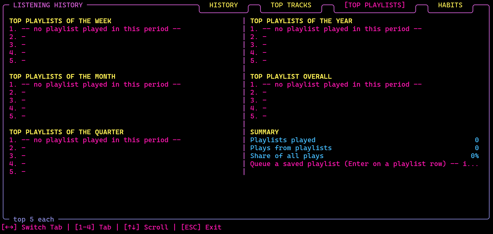

*TOP PLAYLISTS tab.*

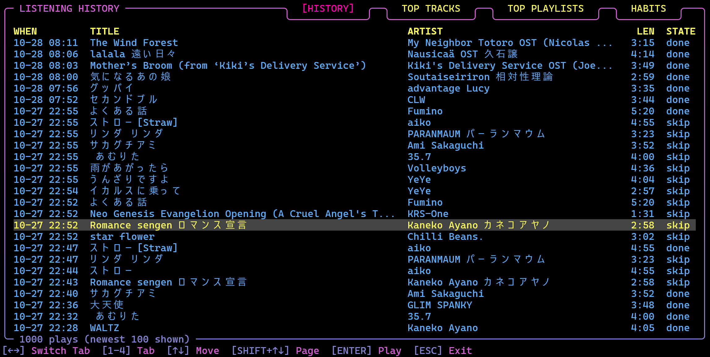

***History** tab: when each track was played, its title and artist (in separate columns, laid out like on the Top Tracks tab), its length and its state (`PLAY` = playing now, `done` = played to the end, `skip` = skipped).*

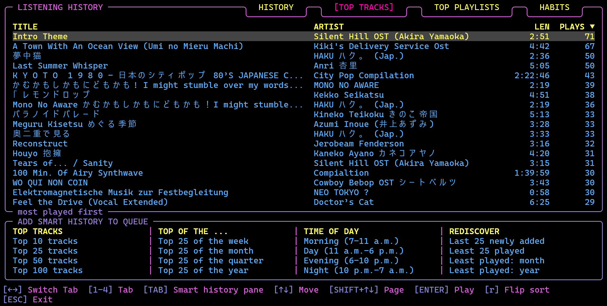

***Top Tracks** tab: titles by play count, with the queue pane underneath (now called **ADD SMART HISTORY TO QUEUE**, see below; the screenshot shows the older version).*

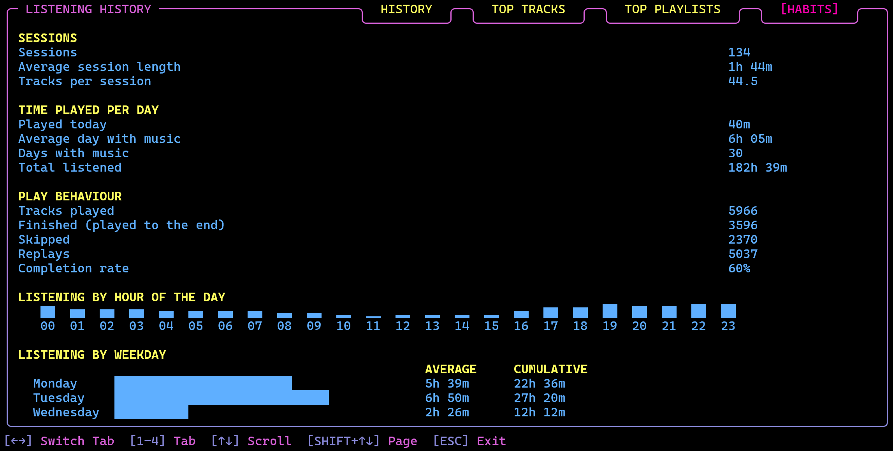

***Habits** tab: sessions, time played per day, and play behaviour.*


The list cursor behaves like the one of the local file list: the column header stays in place and the window only scrolls when the cursor leaves it.

The history is stored in `history.json`. The folder is set under **Settings → PATHS → HISTORY PATH** (one folder). If the new folder already holds a `history.json` it is used, otherwise the current one is copied there.

**In radio mode** the radio has its own history of channels, see [11.11](#1111-listening-history-h).

### ADD SMART HISTORY TO QUEUE

The pane under the Top Tracks list holds **sixteen ready-made lists** in four columns, separated by `|` in the border colour:

| TOP TRACKS | TOP OF THE ... | TIME OF DAY | REDISCOVER |
|---|---|---|---|
| Top 10 tracks | Top 25 of the week | Morning (7-11 a.m.) | Last 25 newly added |
| Top 25 tracks | Top 25 of the month | Day (11 a.m.-6 p.m.) | Least 25 played |
| Top 50 tracks | Top 25 of the quarter | Evening (6-10 p.m.) | Least played: month |
| Top 100 tracks | Top 25 of the year | Night (10 p.m.-7 a.m.) | Least played: year |

1. Press `2` (or `→`) for Top Tracks.
2. Press `TAB` to move into the pane (a `◀` appears behind its title).
3. Pick a list with the arrow keys. **While the pane has the focus, `←` / `→` move between its columns and do not switch tabs.**
4. Press `ENTER` to add the list to the end of the queue. `ESC` (or `TAB`) takes you back to the track list.

What the lists contain:

- **Top 10 / 25 / 50 / 100:** the most-played titles of all time. "Top N" always means the N most-played titles, even if you flipped the list above with `r`. While fewer titles have been played, the number in brackets shows how many there are.
- **Top 25 of the week / month / quarter / year:** the 25 titles played most in the last 7 / 30 / 91 / 365 days.
- **Morning / Day / Evening / Night:** the 25 titles you play most at that time of day (by the time a play started): morning 7-11 a.m., day 11 a.m.-6 p.m., evening 6-10 p.m., night 10 p.m.-7 a.m.
- **Last 25 newly added:** the 25 files that arrived in your music folders most recently (by the time the file was created / copied there, or its modification time if that is newer). Taken from the local library, played or not.
- **Least 25 played:** 25 tracks of your local library with the fewest plays; tracks never played count as 0. Tracks with the same count come in a random order every time, so this is a good way to rediscover forgotten music.
- **Least played: month / year:** among the titles played in the last 30 / 365 days, the 25 played least often.

Files that have been moved or deleted since they were played are skipped, and the status line reports how many tracks were queued (and how many were missing, or that fewer were available). Online tracks are queued as online tracks.

The history keeps the newest 1000 plays one by one and folds older ones into lifetime totals per title. From v3.1.0 on those totals also remember the day and the time of day of every play, so the period and time-of-day lists stay exact over years. Plays folded by an older version only count for the all-time lists.

---

## 9. Downloads

| Key | Action | What it does |
|---|---|---|
| `y` | Save stream | Saves the **currently playing streamed track** -- from YouTube (`/s:`), SoundCloud (`/sc:`) or Bandcamp (`/b:`) -- into your download folder (**Settings → PATHS → DOWNLOAD PATH**, or `~/.cache/mousiki` if none is set). The file is named `Title - Artist.ext`, the cached copy is removed, and the library refreshes so the file appears as a local track. The file keeps the format the site delivered: Opus for YouTube, MP3 / Opus / AAC for SoundCloud, the 128 kbit/s MP3 stream for Bandcamp. |

Status messages:

- `saved to <path>`: success
- `already saved: <name>`: a file with that name is already in the folder
- `not a cached stream`: the current track is a regular local file, so there is nothing to download

---

## 10. Settings (individual tabs)

Press `s` on the main screen to open **Settings**. It has six tabs: **COLORS**, **ON/OFF**, **ANIMA/VIZ**, **PATHS**, **REFERENCE** and **ABOUT APP**. Settings always open on the first tab. The footer shows `[TAB] Switch | [↑↓←→] Navigate/Cycle | [ENTER] Edit | [s] Save | [ESC/q] Discard`, and the line below it reports what just changed. While there are changes that are not saved yet, that line shows a green ``Unsaved changes! Save with `s` or discard with `ESC`.`` note. While a field is being edited the footer changes to `[ENTER] Apply | [ESC] Cancel | [←→] Cursor | [SHIFT+←→] Mark | [HOME/END] Jump | [Ctrl+C/X/V] Copy/Cut/Paste`.

### Moving around and editing (all tabs)

| Key | What it does |
|---|---|
| `TAB` | Next tab (wraps from ABOUT APP back to COLORS). The cursor returns to the first row. Not while a field is being edited. |
| `↑` / `↓` | Previous or next row. On ABOUT APP they scroll the text. |
| `←` / `→` | On a row with a fixed list of values (switches, sliders, choices), steps through the values and applies the change **immediately**. On COLORS they move between the first and second cell of a row instead. |
| `ENTER` | Edits the value in place as free text. Not available on ABOUT APP or on the read-only rows of REFERENCE. On PATHS it edits the selected path, or adds one on a `+ new path` row. |
| `s` | **Saves to `config.txt` and closes** Settings. |
| `ESC` / `q` | **Discards** every change made since Settings were opened (they are put back as they were) and closes Settings. |

**Good to know**

- Every change is **live**. It takes effect as soon as you make it, so you can see and hear it while you are still in Settings.
- Only `s` writes the changes to `config.txt`. If you leave with `ESC` or `q` instead, everything you changed on the screen, including paths, is put back as it was when you opened Settings. The radio's settings work the same way (see [11.12](#1112-radio-settings)).
- **Text editing** (after `ENTER`, in every field: colours, paths, values, keys): `←`/`→` move the caret, `SHIFT+←/→` mark text, `HOME`/`END` jump, `DEL`/`BACKSPACE` delete, `CTRL+C/X/V` copy, cut and paste. `TAB` and the arrows never leave the field: only `ENTER` (confirms) or `ESC` (cancels and discards the edit) do. Ordinary fields hold up to 18 characters, folder paths up to 240.

### Tab 1: COLORS

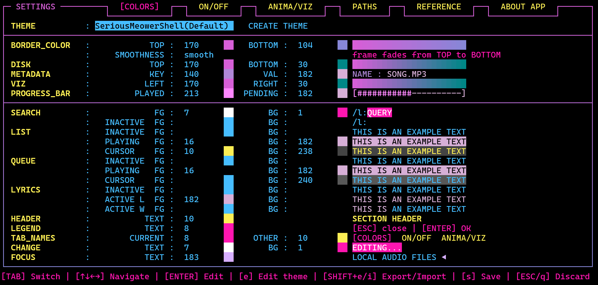

*The COLORS tab with the live preview on the right.*

#### Border gradient (SMOOTHNESS)

The row under BORDER_COLOR switches the frame gradient between **smooth** (default: the border lines fade row by row from the TOP colour to the BOTTOM colour) and **rough** (only the bottom border line of each pane takes the BOTTOM colour). `←→` or `ENTER` toggle it; config key `BorderGradient=smooth|rough` (music player and radio each have their own). The smooth gradient also colours the frames of the floating overlays (big list, queue, folder, conversion and the other panels), not only the main screen.

#### Colour themes

The first row of the COLORS tab (music player **and** radio) is **THEME**. `ENTER` on the theme name opens a list of ready-made colour schemes with swatches; `ENTER` applies one (the field shows `(custom)` when the colors match none). Two themes carry the Mousiki look: `SeriousMeowerShell(Default)` (the default of the music player; the colors of the default config.txt) and `MeowerShell`. The default of the radio is `Dracula`. Thirty more ship with it: Soft Pastel, Cyberpunk, Greyscale, Nord, Dracula, Solarized Dark, Gruvbox, Monokai, Ocean, Forest, Sunset, Matrix, Amber Terminal, Sakura, Midnight, three colour-blind-friendly schemes (Deuteranopia, Protanopia, Tritanopia), High Contrast, Coffee, and (new in v4.2.0) Catppuccin Mocha, Tokyo Night, Rose Pine, Everforest, Kanagawa, Vaporwave, Outrun, Ember, Glacier and Lavender Haze. Themes you made yourself are listed after the built-in ones, with their names in the header colour. The list scrolls with `↑` `↓` (`SHIFT+↑` / `SHIFT+↓` a page at a time) and `HOME` `END` when there are more themes than fit on the screen; a scrollbar on the right shows where you are. The template picker of CREATE THEME works the same way. A theme only changes the Colors tab, and like any change it is kept when you save with `s` and dropped with `ESC`.

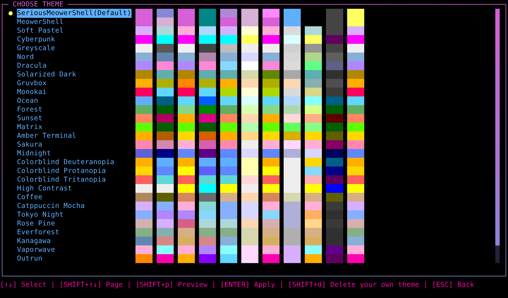

*CHOOSE THEME: every theme with its colours; `SHIFT+p` shows the main screen in the highlighted one.*

`→` to **CREATE THEME** and `ENTER` opens a full-size editor: type a name on top (27 characters at most), optionally press `ENTER` on **CHOOSE THEME AS TEMPLATE** to start from an existing theme, then edit any color cell like on the tab (with the live preview). `s` stores the theme and applies it; `ESC` throws it away -- but with anything changed it **asks first** (*Unsaved theme!* `s` save it, `d` discard it, `ESC` keep editing), so a theme is not lost by forgetting `s`. If the name is already a theme of your own, `s` asks **"Do you want to overwrite theme ...?"** (`y` overwrites, anything else goes back); a built-in theme can never be overwritten, its name is refused.

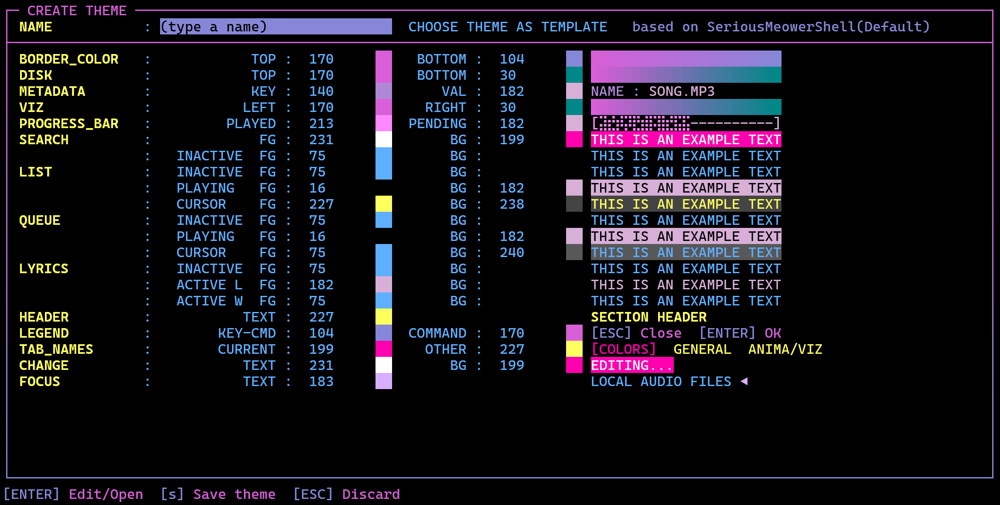

*CREATE THEME: name, template and every colour cell with its live preview.*

**Preview (`SHIFT+p`).** In the CHOOSE THEME list (player and radio) `SHIFT+p` shows a **still copy of the main screen** drawn with the highlighted theme; any key goes back to the list (nothing is applied). The list's scrollbar is drawn in the colour of the border gradient at its row.

**Colours that look the same everywhere.** Colour numbers 16-255 are fixed colours: every terminal shows them the same way. 1-15 are the terminal's 16 base colours and follow its colour scheme -- 10 is green in CMD's default scheme but may be yellow in yours -- and an empty text colour means the terminal's own text colour. The built-in themes therefore only use 16-255 (since v4.2.0; a config that still held the old SeriousMeowerShell / MeowerShell values is moved to the new ones once). With **Black Background** on, text that has no colour of its own takes the theme's LIST INACTIVE colour (the terminal's default text colour is set while Mousiki runs and given back on exit), so plain text looks the same in CMD, PowerShell, Windows Terminal or any other terminal.

**Colour-blind friendly themes.** *Colorblind Deuteranopia* and *Colorblind Protanopia* (red-green) build on blue / orange / yellow contrasts instead of red against green, *Colorblind Tritanopia* (blue-yellow) on red / cyan; *High Contrast* helps on dim screens. Each can be the template of a theme of your own.

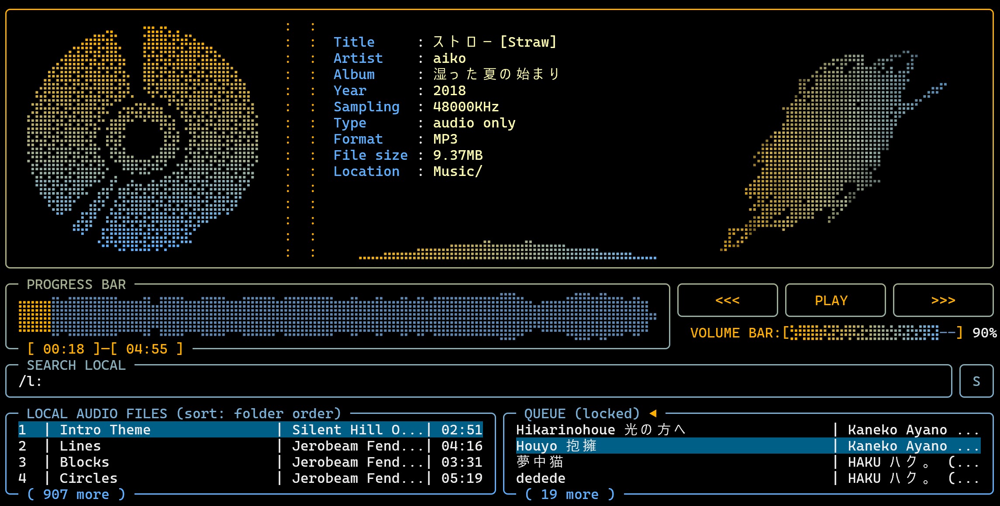

**Delete a theme (`SHIFT+d`).** In the CHOOSE THEME list `SHIFT+d` deletes the highlighted theme of your own, after the question *Do you want to delete theme "..."?* (`y` deletes, anything else keeps it). Built-in themes cannot be deleted. If the deleted theme is the one in use, its colors stay set until you pick another.

**Edit the theme in use (`e`).** On the Colors tab `e` opens the same editor on the colors currently set. If they are a theme of your own, its name is already in the NAME field: change the colors and press `s` to overwrite it (after the question above), or change the name to save a copy. For a built-in theme (or colors that match no saved theme) the name is empty: give it a new name. Theme names are at most 27 characters, as wide as the highlight in CHOOSE THEME.

**Leaving the settings.** `ESC` / `q` leave without saving, as before -- but if anything was changed, a line at the bottom asks *Unsaved changes!* `s` save and leave, `d` discard and leave, `ESC` keep editing (player and radio).

**Export / import:** `SHIFT+e` on the Colors tab opens **EXPORT THEME**: name (27 characters at most) and folder (default `~/.config/mousiki`), `s` writes the colors now set as `<name>.theme` (player and radio colors in one file). `SHIFT+i` opens **IMPORT THEMES**: pick a folder, `ENTER` imports the highlighted `.theme` / `.txt` file (it may hold several `[Name]` themes), `a` imports every file listed. An imported theme whose name exists gets ` (2)`, ` (3)` ... added; it then shows up in the THEME row.

Note: every colour number is a palette number, in every field -- text, background and the ends of a colour fade (`104` is palette colour 104 wherever you type it). Older `config.txt`, `radio_config.txt` and `themes.txt` files, which still used `30`–`37`, `90`–`97` (text) and `40`–`47`, `100`–`107` (background) as plain 16-colour codes, are converted once when they are loaded, so your colours look the same; the files then carry `ColorCodes=palette` (themes: `# format: 7`). Black is `16`, because `0` means "no colour".

All themes live in `themes.txt` next to `config.txt` (`~/.config/mousiki/`); player and radio share the file. Each theme is a `[Name]` line followed by `ColorXxx=value` lines using the keys of the config files (keys starting with `Radio.` are the radio's own values: `Radio.ColorHeader`, `Radio.ColorLegend`, `Radio.ColorFocus` in the built-in themes, and *every* colour of a theme made or saved in the radio). Built-in themes can be edited there.

**Player and radio can look different.** Each program keeps its own colours (`config.txt` / `radio_config.txt`) and picks its own theme: choosing a theme in one mode never changes the other. A theme made in the radio stores its colours as `Radio.` keys, so the player's look of that theme is not touched; a theme made in the player has no radio values of its own, so the radio shows the same colours for it (except the radio's header, legend and focus colours).


Sets the colours of the interface. Each row has a name (drawn in the **header colour**), one or two value cells, a colour swatch next to each value and a **live preview** on the right.

**Values** are numbers from the 256-colour terminal palette (`1`–`255`); any number works in any field. `0` or an empty field means "no colour", so the terminal's own default is used (black is `16`; `8` is the usual dim grey).

| Row | First cell | Second cell | What it colours |
|---|---|---|---|
| BORDER_COLOR | TOP | BOTTOM | The frame lines, fading from top to bottom. |
| DISK | TOP | BOTTOM | The spinning disk (gradient). |
| METADATA | KEY | VAL | The labels and the values in the metadata panel. |
| VIZ | LEFT | RIGHT | The visualizer bars (gradient). |
| PROGRESS_BAR | PLAYED | PENDING | The played and the remaining part of the progress bar. |
| LIST | INACTIVE FG | BG | Ordinary rows of the track list (text / background). |
| | PLAYING FG | BG | The row of the track that is playing. |
| | CURSOR FG | BG | The highlighted (hovering) row. |
| QUEUE | INACTIVE FG | BG | Ordinary rows of the queue. |
| | PLAYING FG | BG | The queue row that is playing. |
| | CURSOR FG | BG | The highlighted queue row. |
| LYRICS | INACTIVE FG | BG | Lyric lines that are not active. |
| | ACTIVE L FG | BG | The active line. |
| | ACTIVE W FG | BG | The active word. |
| HEADER | TEXT | none | The section titles in Paths and Reference. Text colour only, no background. |
| LEGEND | KEY-CMD | COMMAND | The key command legends: the hint lines such as `[ESC] close` at the bottom of the Settings, the big list and queue overlays (`SHIFT+l` / `SHIFT+k`), the playlist editor, the meta editor and the listening history, plus the small `< ↔ >` and note hints inside the Settings. **KEY-CMD** colours the keys in `[square brackets]` (default `199`), **COMMAND** the descriptions behind them (in both MeowerShell themes the TOP border colour, the list text colour in the others; KEY-CMD there is the BOTTOM border colour, "just the other way round"); the row labels of the tree-table legends (`Move`, `Fetch` ...) keep the HEADER colour, while the tree lines left of them fade from the HEADER colour in the first row to the KEY-CMD colour in the last. One-line legends use the same two colours. A legend of several lines under a big overlay (`SHIFT+l`, `SHIFT+f`, `SHIFT+k`, `SHIFT+c`) is centred on the main screen's bottom border line (with three rows the second one lies on it); the tree lines of those follow the border colour as a smooth gradient. The option overlays (oscilloscope `SHIFT+o`, spectrogram `SHIFT+i`, loudness `SHIFT+v`, equalizer `SHIFT+e`; in the radio too) draw their legend in the bottom border colour and centred on the panel's bottom border line the same way (two rows: one inside, one on the line; three rows: the second one on the line, the third below the panel). Text colours only, no background; `0` = the terminal's own text colour. Also available as `ColorLegend=` and `ColorLegendCommand=` in `config.txt` (the radio keeps its own values in `radio_config.txt`). |
| SEARCH | FG | BG | The text the user typed into a search bar (the `/` box, the meta editor's, the playlist editor's SEARCH LIBRARY and `Search:` rows). Only highlighted behind the length of the query, and only once something was typed. Empty = same as LIST INACTIVE. Also `ColorSearchFg=` / `ColorSearchBg=` in `config.txt`. |
| | INACTIVE FG | BG | The rest of the search bar (prefix, placeholder, empty field). Empty FG = same as LIST INACTIVE; empty BG = no background, so only the query is highlighted. Also `ColorSearchInactiveFg=` / `ColorSearchInactiveBg=`. |
| TAB_NAMES | CURRENT | OTHER | The tab names of Settings and of the playlist, meta and history menus: the current tab (drawn as `[NAME]`) and the others. Text colour only. Also `ColorTabCurrent=` / `ColorTabOther=` in `config.txt`. |
| FOCUS | TEXT | — | The pane focus indicator **◀** after the title of the pane that has the keys (main screen: search box, list or queue; also the meta and playlist editors). Defaults to the header colour; every theme sets it to its header colour. |

`FG` is the text colour, `BG` the background. Use `←`/`→` to pick the cell, then `ENTER` to type a new number.

### Tab 2: ON/OFF

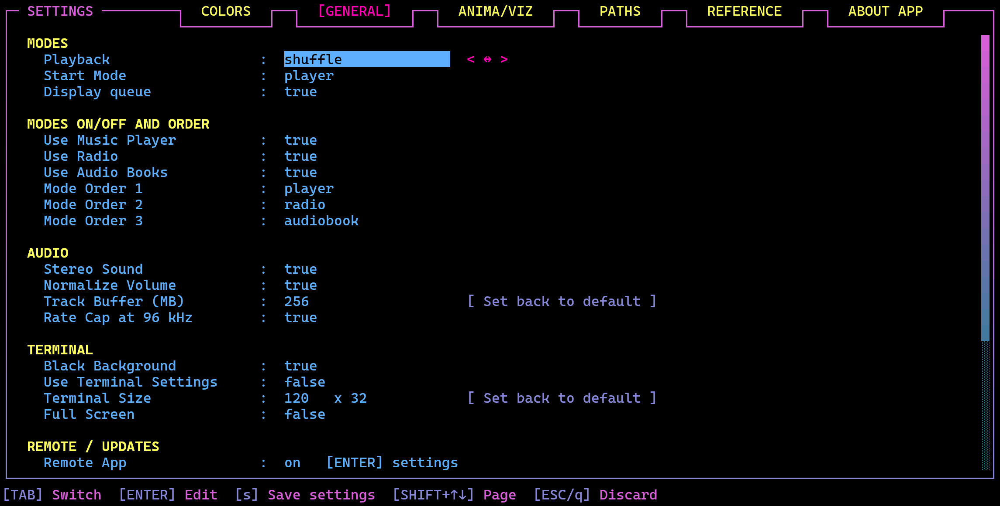

*The ON/OFF tab: the MODES and the ON/OFF categories. (The folder settings are on the PATHS tab; the screenshot is from before the categories.)*


The tab has two categories (in the header colour); change a row with `←`/`→`:

**MODES**

| Setting | Values | What it does |
|---|---|---|
| Playback | list, loop, shuffle, stop, queue then stop | The play mode. Same as the `m` key (`loop` is the mode shown as *repeat*). (`PlaybackMode=`) |
| Start Mode | player, radio | Which of the two Mousiki **opens with**: the music player or the radio. Picked in either mode's Settings; it is one value, stored as `StartMode=` in the player's `config.txt`, so it is the same whichever mode you set it in. `Start Mode` only decides the start: you can still switch between the two at any time with `*`. (`StartMode=`) |
| Black Background | true, false | Default **true**: while Mousiki runs, the terminal's background is **black** and text without a colour of its own takes the theme's LIST INACTIVE colour (Mousiki sets the terminal's default background with the standard OSC 11 sequence). On exit -- quitting, `Ctrl+C`, closing by a signal -- the terminal gets its own background back: Mousiki asks the terminal for its colour the first time (Linux / macOS) and resets it (OSC 111). One value for the player and the radio (`BlackBackground=` in the player's `config.txt`; the radio's row writes that line). Most terminals support it (Kitty, WezTerm, foot, Alacritty, xterm, GNOME Terminal, iTerm2, Windows Terminal); one that does not simply keeps its colour. `false` leaves the terminal's background alone. |
| Share Profiles | true, false | Default **false**. **true**: the radio uses the player's oscilloscope and spectrogram settings (the `SHIFT+i` / `SHIFT+o` screens) instead of its own, so both modes look the same. The radio's own values are **not lost**: they are kept as a backup in `radio_config.txt` (lines starting with `## own `) and come back unchanged when you turn the switch off. While it is on, the radio's visual settings are shown but changes there change the player's values. Stored as `ShareProfiles=` in the player's `config.txt`; the row exists in both modes' Settings. The colours and themes are **never** shared by this switch. |
| Remote App | `[ENTER] settings` | Opens the **REMOTE APP** overlay (12.1): on / off (default **off**), port, PIN, the address and a QR code for the phone. One value for the player and the radio (`RemoteApp=`, `RemoteAppPort=`, `RemoteAppPin=` in the player's `config.txt`). |

**ON/OFF** -- switches, most of them true/false. (The folder settings are on the PATHS tab; **Lyrics/Viz Default**, **No-Lyrics Viz** and the **Viz Order** rows are on ANIMA/VIZ.)

| Setting | What it does |
|---|---|
| Eliment Disk | Shows or hides the spinning disk in the player area. |
| Dummy Buttons | Shows or hides the three decorative buttons next to the progress bar. |
| Queue Display | Shows or hides the Queue panel. |
| Progress Waveform | Shows or hides the braille **waveform inside the progress bar** (the whole track as a wave). With it off, a plain `[####----]` bar is drawn instead. (`ElimentWaveForm=`) |
| Spectrum Bars | Shows or hides the **spectrum bars below the meta data** (the live frequency bars; before: *Visualizer*). With it off the meta data get the two rows. Their motion is set on ANIMA/VIZ → SPECTRUM BARS. (`Visualizer=`) |
| Stereo Sound | On plays in stereo (about twice the memory per loaded track), off folds left and right into mono. Turning it **off** is immediate. Turning it **on** applies from the next track. |
| Normalize Volume | Loudness normalization on or off. Same as the `v` key. Target and boost are set with the `SHIFT+v` overlay. |
| Replace Emoji | An emoji in a title is drawn as a single `?`, so the frame borders stay aligned. Off draws the real emoji. (`ReplaceEmoji=` in `config.txt`.) |
| Marquee Scrolling | On (default): a name that is too long for its column scrolls -- the row under the cursor in the lists, Name / Artist / Album of the metadata block, the playlist editor's lists. Off: nothing scrolls anywhere and a too long text is cut off with `...`. (`MarqueeScrolling=` in `config.txt`.) |
| *VIZ/LYRICS FIELD* | |
| Viz/Lyrics Field | The master switch of the **field right of the meta data** (lyrics, sphere, oscilloscope, spectrogram). `false`: the field is gone, the meta data and the spectrum bars take its width, no lyrics are fetched for it and `.` says so. The big overlays and the windows still work. Default `true`. (`VizLyricsField=`) |
| Use Lyrics Engine | `false` switches the lyrics off **entirely**: they are never fetched and `.` skips them (the field then only shows the visuals). `true` lets the field show the lyrics (fetched from the net when it does; turning it on while a track plays fetches them at once); whether the field starts with them is set by **Lyrics/Viz Default**, and `.` switches the view while Mousiki runs. Default `true`. (`UseLyrics=`; this replaces the former *Lyrics Engine* row, which did the same) |
| Use Oscilloscope | `false` leaves the oscilloscope out: `.` and the **Lyrics/Viz Default** row skip it, and the picks that pointed at it (Lyrics/Viz Default, No-Lyrics Viz) move on to the next visual that is on. The scope window (`)`) still works. (`UseOscilloscope=`) |
| Use Spectrogram | `false` leaves the spectrogram out of the lyrics area: `.` skips it. Full screen (`SHIFT+u`) and the spectrogram window (`(`) still work. (`UseSpectrogram=`) For example: Use Oscilloscope and Use Spectrogram `false` = `.` only switches between the lyrics and the sphere. |
| Use Sphere | `false` leaves the sphere out of the `.` cycle (it used to be always there). Picks that pointed at it move on to the next visual that is on; picking it in **Lyrics/Viz Default** or **No-Lyrics Viz** turns it on again. (`UseSphere=`) |

**How these switches work together.** No combination is left contradicting itself: choosing a view that is switched off (in Lyrics/Viz Default or No-Lyrics Viz) **turns its Use switch on**; switching a Use switch off **takes its dependents with it** instead of being undone -- Use Lyrics Engine off stops the field showing the lyrics, Use Oscilloscope / Spectrogram / Sphere / Lyrics Engine off moves Lyrics/Viz Default and No-Lyrics Viz to the next view that is on (No-Lyrics Viz to `none`, an empty field, when none is left). The status line says what moved. Earlier versions turned the oscilloscope (or the spectrogram) back on by themselves while it was the No-Lyrics pick, so it could not be switched off.

### Tab 3: ANIMA/VIZ

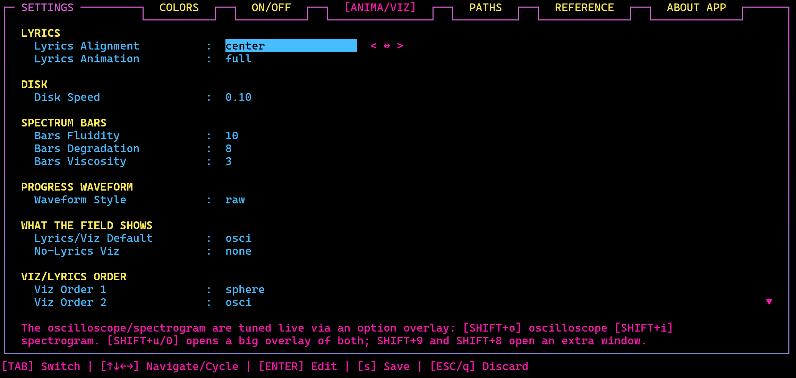

*The ANIMA/VIZ tab (the screenshot shows its predecessor, the ANIMATION tab). The `< ↔ >` hint shows that `←`/`→` cycle the value.*

The tab collects everything about the **animations and the visualizations**, in five categories (in the header colour, with a blank line before each). All rows are cycled with `←`/`→` (or typed after `ENTER`). If the terminal is too short, the tab **scrolls with the cursor** (▲ / ▼ show that there is more) while the note at the bottom stays in place.

**LYRICS**

| Setting | Values | What it does |
|---|---|---|
| Lyrics Alignment | left, center, right | Where lyric lines sit in their area. |
| Lyrics Animation | full, word by word, line by line, letter by letter, active line only, active word only | How lyrics are revealed and highlighted as the song plays. |

**DISK**

| Setting | Values | What it does |
|---|---|---|
| Disk Speed | 0.01, 0.05, 0.10, 0.17, 0.25, 0.50, 0.75, 1.00 | How fast the disk spins. Default `0.10`. |

**SPECTRUM BARS** -- the bars under the meta data (ON/OFF → Spectrum Bars; before: *WAVE*, *Wave Fluidity* …).

| Setting | Values | What it does |
|---|---|---|
| Bars Fluidity | 1–10 | How the spectrum bars **rise**. It affects only the rising motion. Default `10`. |
| Bars Degradation | 1–10 | How quickly bars **fall**. `1` is a slow, VU-meter-like fade, `10` a near-instant cutoff. Default `8`. |
| Bars Viscosity | 1–10 | How strongly the bar motion is damped and smoothed between neighbouring bars. Default `3`. |

**PROGRESS WAVEFORM** -- the braille waveform in the progress bar.

| Setting | Values | What it does |
|---|---|---|
| Waveform Style | raw, smooth | Waveform drawing style of the progress bar. Same as the `w` key. |

**WHAT THE FIELD SHOWS**

| Setting | What it does |
|---|---|
| Lyrics/Viz Default | The view the field **starts with when Mousiki opens**: `sphere` (the audio-reactive ball), `osci` (the XY oscilloscope, see *The oscilloscope* above), `spectro` (the spectrogram, see *Spectrogram*) `lyrics`, or **`last used`**. The `.` key changes the view while Mousiki runs, but that is not remembered: the next start begins with the chosen view again (picking a value here also shows it at once). With `last used` it is remembered after all: Mousiki opens with the view it was closed on. Default `osci`. With the lyrics view on and no lyrics found, **No-Lyrics Viz** below decides what is shown. The sphere and the oscilloscope's *gradient* palette use the **VIZ** colors (Settings → Colors → VIZ); the spectrogram has its own colour schemes. The oscilloscope's look is tuned with `SHIFT+o`. (`VizDefault=sphere\|osci\|spectro\|lyrics\|last` in `config.txt`) |
| No-Lyrics Viz | What the lyrics area shows while the **lyrics view is on but there are no lyrics** (nothing found, still fetching, track without lyrics): `sphere`, `osci` (default), `spectro` or `none` (an empty field). Before this row existed the area showed whatever view `.` had been on before the lyrics. If the visual you pick is switched off in **Use Sphere** / **Use Oscilloscope** / **Use Spectrogram**, picking it turns that switch **on**; switching the switch off later moves this pick on to the next visual that is on. (`NoLyricsViz=`) |

**VIZ/LYRICS ORDER**

| Setting | What it does |
|---|---|
| Viz Order 1 … 4 | The order of the four views (`sphere`, `osci`, `spectro`, `lyrics`) when you press `.` / `,`. Each row says which view comes at that place; `←` / `→` puts another view there, and the view that was there takes the place it left, so every view stays in the list. The status line shows the whole order, e.g. `"." cycle: osci > lyrics > spectro > sphere`. (`VizOrder=osci,lyrics,spectro,sphere`) |

**Note at the bottom of the tab.** *The oscilloscope/spectrogram are tuned live via an option overlay: [SHIFT+o] oscilloscope [SHIFT+i] spectrogram. SHIFT+u opens the big overlay of the spectrogram; SHIFT+9 and SHIFT+8 open an extra window.* (The window keys are named for your keyboard; on a German one they are `SHIFT+9` and `SHIFT+8`.)

### Tab 4: PATHS

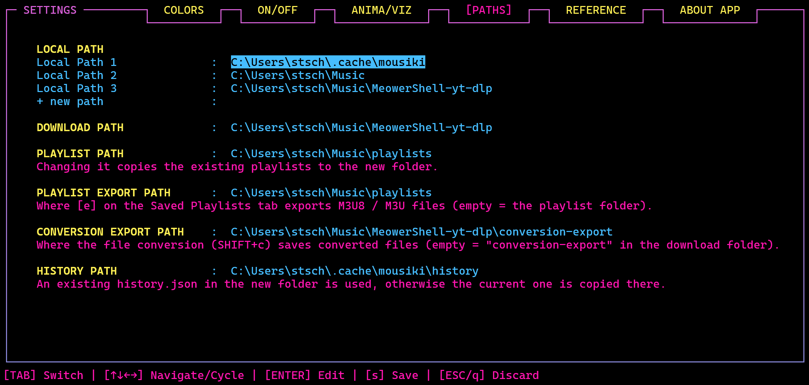

*The PATHS tab: the folders Mousiki reads music from, downloads to, and keeps playlists and the history in. (The screenshot is from before the PLAYLIST EXPORT PATH row was added.)*

Five sections, each under its header in the header colour. Move onto a row and press `ENTER` to edit it. The tab scrolls with the cursor, so a short terminal is fine.

| Section | Rows | What it does |
|---|---|---|
| LOCAL PATH | `Local Path 1`, `2`, … plus `+ new path` | The folders scanned for music. `ENTER` edits one. `+ new path` (`ENTER`) adds an empty line and opens it for typing. Committing a change **rescans the library immediately**. |
| DOWNLOAD PATH | one row | Where `y` (Save stream) puts downloaded tracks. Until you set one it shows the default cache folder (`~/.cache/mousiki`). It is added to the scanned folders automatically, so you do not repeat it as a local path. The radio uses the same folder by default. |
| PLAYLIST PATH | one row | The **one** folder playlists are loaded from, saved to and deleted in. If none is set, the first local path plus `/playlists` is used. Under the path a note says that changing it copies the existing playlists to the new folder. |
| CONVERSION EXPORT PATH | one row | The **one** folder the file conversion overlay (`SHIFT+c`) writes its converted files to. Empty = the `conversion-export` folder inside the download folder (the row shows the folder in effect). Changing it only affects the next conversion. (`ConversionExportPath=`) |
| PLAYLIST EXPORT PATH | one row | The **one** folder `e` on the playlist editor's Saved Playlists tab exports M3U8 / M3U files to (see [Exporting a playlist](#exporting-a-playlist-m3u8--m3u)). Empty = the playlist folder. Nothing is copied or moved when it changes. |
| HISTORY PATH | one row | The **one** folder that holds the listening history (`history.json`). Under the path a note says that an existing `history.json` in the new folder is used, otherwise the current one is copied there. |

**Shared download archive.** Every YouTube track Mousiki downloads is also written as `youtube <video id>` to `<download folder>/history/downloaded_history.txt`, the file format of yt-dlp's `--download-archive`. Use the same file for downloads you make in a terminal, e.g. `yt-dlp -x -P <download folder> --download-archive <download folder>/history/downloaded_history.txt <playlist-url>`: yt-dlp then skips what Mousiki already fetched and Mousiki's downloads are known to the next terminal run. Changing DOWNLOAD PATH copies this file to the new folder's `history/` (the old one stays; an existing one in the new folder is kept). Mousiki only appends to the file and never skips a download because of it. An existing `downloaded_history.txt` lying directly in the download folder is moved into `history/` the first time Mousiki records a download. Do not put `--download-archive` into yt-dlp's own config file: Mousiki's yt-dlp would then refuse to fetch a song whose file you deleted.

DOWNLOAD PATH, PLAYLIST PATH, PLAYLIST EXPORT PATH, CONVERSION EXPORT PATH and HISTORY PATH are single paths: their name sits on the row itself, followed by `:` and the folder, and there is no `+ new path` line. Paths accept `~` and `%USERPROFILE%` shortcuts, and both slash directions on Windows. Emptying a path line and pressing `ENTER` removes that path (for the single paths: resets it to the default). Changed folders only take effect for good when you save with `s`; with `ESC` or `q` they are put back.

### Tab 5: REFERENCE

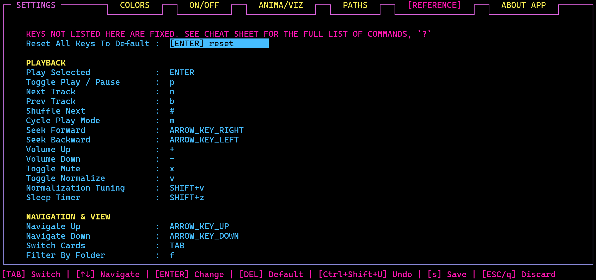

*The REFERENCE tab: the rebindable hotkeys (scroll for the rest).*

The longest tab. It scrolls as one list and has two parts: the hotkeys, then the font map.

**Hotkeys** (editable). A note at the top says that keys not listed here are fixed and points to the cheat sheet (`?`), and the rebindable commands are listed under the headers PLAYBACK, NAVIGATION & VIEW, LYRICS & KARAOKE, VISUALIZATIONS, SEARCH, QUEUE, PLAYLISTS, META EDITOR, HISTORY, EQUALIZER, DOWNLOADS, LIBRARY and SYSTEM (the same groups as in the cheat sheet). Each row shows a label and the key currently bound to it.

- Press `ENTER` on a row, type the new key, and press `ENTER` again.
- A key is written as the character itself (`n`, `T`, `#`, `+`; a capital letter means `SHIFT` + the letter) or as a name: `ENTER`, `TAB`, `SPACE`, `BACKSPACE`, `ARROW_KEY_UP`, `ARROW_KEY_DOWN`, `ARROW_KEY_LEFT`, `ARROW_KEY_RIGHT` (any case is accepted; `UP`, `DOWN`, `LEFT`, `RIGHT` work as well).
- A combination cannot be typed as a character. **Press it while the field is being edited** and its name is entered: `ALT+L` (`OPTION+L` on a Mac), `CTRL+L`, `CTRL+SHIFT+U`, `CTRL+SHIFT+Z`. These four are the combinations that can be bound; in `config.txt` they are written by name, e.g. `HKeyReadLyrics="CTRL+L"`.
- An empty field **unbinds** the command (it then shows `-` in the cheat sheet and legends). `DEL` on a row restores its default.
- Something that is not a key (`foo`) is refused with `NOT A KEY -- …`; `*` (switches to the radio) and `ESC` (back to the home view) are reserved and refused.
- If the key is **already used by another action**, the change is refused with `KEY "x" ALREADY USED BY "<command>" -- try another key`, and you can type another one.
- The help wizard's key (`SHIFT+w`) is listed under SYSTEM and can be rebound like the others.
- Since this version the tab also lists **Rescan Library** (`SHIFT+r`), **Fetch Missing Tags** (`SHIFT+b`, also used inside the meta editor), **Lyrics Timing Overlay**, **Read Lyrics Overlay**, **Undo Clear Queue** and **Save Queue As Playlist**. They used to be fixed keys.
- Only `/` (opens the search) is a key. The prefixes typed *inside* the search box (`s:` `sc:` `b:` `p:` `f:` `r:` `a:`) are fixed and are no longer listed here; the cheat sheet describes them.

**What stays fixed, and why.** These are not listed on the tab because rebinding them would break something:

| Fixed key | Reason |
|---|---|
| `ESC`, `ENTER`, `TAB`, the arrow keys in menus | They mean the same in every overlay; `ESC` is the way out of anything. (The main screen's *Play*, *Switch Cards*, *Navigate Up / Down* and *Seek* are rebindable.) |
| `*` (the key that switches to the radio) | Depends on the keyboard layout and must be the same in the player and the radio. |
| `Y` / `N` in prompts, `CTRL+s`, `CTRL+SHIFT+x` | Confirmation keys must not collide with typed text or a rebound command. |
| Keys inside an overlay (playlist and meta editors, READ LYRICS `t` / `SHIFT+t` / `d`, conversion, history, equalizer, normalization, oscilloscope and spectrogram overlays, sleep timer, big folder / list / queue overlays, the windows' own `F` / `F11` / `T`) | They only exist while that overlay is open, are shown in its own legend, and share letters with the main screen on purpose. |
| Text editing: `SHIFT+←→`, `CTRL+C/X/V`, `HOME` / `END`, `DEL` | Terminal conventions for any text field. |
| Karaoke size `*` / `_` | Same layout dependence as the switch key. |
| `SHIFT+↑↓` (pages in the big overlays), `CTRL+p` (play in the folder / conversion overlay) | Modifier combinations that only mean something inside those overlays. |

**FONT / CHARACTER MAP** (read-only). Shows the `A = A, a` table from `config.txt`, which lets you re-font the interface with fancy Unicode letters without changing the terminal font. It cannot be edited here. Edit the `font_en={ … }` block in `config.txt` while the app is closed.

### Tab 6: ABOUT APP

The credits and versions of the original app and of this port, as text that scrolls with `↑` / `↓`. The text is built into the program (no longer part of `config.txt`, where it used to collect empty lines over time) and always shows the running version. An old `ClassTextAboutApp= { … };` block in an existing `config.txt` is ignored and disappears with the next save.

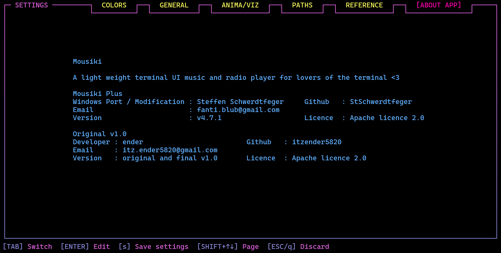

*The ABOUT APP tab.*

### Settings that exist (only) in `config.txt`

| Key in `config.txt` | What it does |
|---|---|
| `ReplaceEmoji` | `true` draws an emoji in a title as a single `?` so box borders stay aligned. `false` draws the real emoji. |
| `MarqueeScrolling` | `true` (default): too long names scroll like a marquee. `false`: they are cut off with `...` instead. Same as Settings → ON/OFF → Marquee Scrolling. |
| `VizLyricsField`, `ElimentLyrics`, `NoLyricsViz` (`sphere` / `osci` / `spectro` / `none`) | The field right of the meta data on / off; the field shows the lyrics now / the visual of `LyricViz`; what it shows while the lyrics view has no lyrics (Settings → ON/OFF and ANIMA/VIZ). Switches that depend on each other are brought in line when a row is changed or the file is loaded. |
| `UseLyrics`, `UseOscilloscope`, `UseSpectrogram`, `UseSphere` | `false` switches that view off entirely (Settings → ON/OFF → Use …): not in the `.` cycle; the windows (`(` / `)`) and the full screen (`SHIFT+u`) still work. |
| `VizOrder` | The order of the views in the `.` cycle: `sphere,osci,spectro,lyrics` in any order (Settings → ANIMA/VIZ → Viz Order 1..4). Missing names are appended. |
| `HKeyScopeBig` | The oscilloscope full screen, `"="` by default (`SHIFT+0` on a German keyboard). |
| `HKeySpectroWindow`, `HKeyScopeWindow` | The spectrogram / scope window keys, `"("` / `")"` by default (`SHIFT+8` / `SHIFT+9` on a German keyboard, `SHIFT+9` / `SHIFT+0` on an English one). An old `HKeyScopeWindow="W"` is moved to `")"`. |
| `ConsoleVerbosity` | `basic` logs every command the app runs and its raw output. `verbose` adds internal and OS-level events. |
| `AutoSave` | Resumes the exact song, position, queue and play mode at the next launch. |
| `AutoSaveIndicator`, `AutoSaveChr`, `AutoSaveIndicatorType`, `AutoSaveC1`, `AutoSaveC2` | The small autosave indicator: whether it shows, its character, `blink` or `color` style, and the two pulse colours. |
| `SpectroStyle`, `SpectroMotion`, `SpectroScale`, `SpectroMinFreq`, `SpectroMaxFreq`, `SpectroGain`, `SpectroRange`, `SpectroFrequencyGain`, `SpectroWindowSize`, `SpectroZeroPadding`, `SpectroColors`, `SpectroChannels`, `SpectroTimeSpan`, `SpectroLabels` | The spectrogram (see *Spectrogram*); normally changed with the `SHIFT+i` overlay. The defaults are Audacity's. |
| `OsciDecay`, `OsciDotThreshold`, `OsciTailBrightness` and the other `Osci<name>=` / `OsciImage<name>=` lines, `OsciMode` (`xy` / `yt` / `overlap` / `row` / `col`), `ScopeGrid` / `ScopeValues` / `ScopeGridColor` (the grid of the `SHIFT+0` overlay, its axis values and the grid colour, 0-255, empty = the colour of inactive list elements), `ScopeYtTimeUnit` / `ScopeYtTimeDiv` / `ScopeYtValueDiv` / `ScopeYtInfo` / `ScopeXyDiv` / `ScopeXyInfo` (its grid metrics, `SHIFT+p`), `OsciStyle`, `OsciImageProtocol`, `OsciImageResolution` (`full` / `half` / `third`), `OsciFrameRate` / `OsciImageFrameRate` (30 / 45 / 60 / 90 / 120 / 165) and `OsciMusicMode` / `OsciImageMusicMode` (`true` / `false`) | The oscilloscope's values, **all of them per style** (frame rate and music mode included; an old single `FrameRate=` is taken over for both styles) (afterglow 0.00 – 0.99, dot threshold 0.01 – 1.00, tail brightness 0.00 – 1.00, Z axis, trace length, palette …). `Osci…` belongs to the braille style, `OsciImage…` to the image style. Normally changed with the `SHIFT+o` overlay, which writes them here. Values outside the range are limited to it when the file is loaded. |
| `NormalizeVolume`, `NormalizeTargetLufs`, `NormalizeMaxBoostDb` | Loudness normalization on or off, its target level (-40 to 0 LUFS, default -16) and the most a quiet track may be raised (0 to 24 dB, default 9). Normally changed with the `SHIFT+v` overlay, which writes them here. Values outside the range are limited to it when the file is loaded. |
| `SidPlayLength` | How many seconds of a C64 SID tune are rendered and played (10 – 1800, default 180). SID tunes have no end of their own. |
| `SleepFade` | Whether the sleep timer fades the volume out over the last 10 % of its time (default `true`). |
| `WizardSeen` | Whether the [help wizard](#the-help-wizard-shiftw) (`SHIFT+w`) has already opened itself once (default `false`, set to `true` the first time it is closed). `false` makes it greet you again on the next start. The radio has the same line in `radio_config.txt`. |
| `KaraokeLyricsSize` | Lyrics size of the karaoke overlay, `1` (normal text, default) to `5`. Normally changed with `*` / `_` in the overlay (German `SHIFT` and `+` / `-`, English `SHIFT+8` / `SHIFT` and `-`). |
| `ConversionExportPath` | The folder the file conversion overlay writes to (one folder; unset = `conversion-export` in the download folder). |
| `PlaylistsPath`, `PlaylistExportPath`, `HistoryPath` | The playlist folder, the playlist export folder and the listening history folder (one each; a second `PlaylistsPath` line is ignored). Normally set under **Settings → PATHS**. |
| `ColorHeader`, `ColorLegend`, `ColorLegendCommand`, `ColorTabCurrent`, `ColorTabOther`, `ColorFocus` | The header, legend, tab-name and pane focus indicator colours (also on the COLORS tab). Without `ColorFocus` the indicator follows `ColorHeader`. |
| `AutoSaveDelayInSec` | How often the session snapshot is saved (default 30 seconds). |
| `UpperLeftCorner`, `Vertical`, `Horizontal`, `Seprator`, `ListSeparator` and the other border entries | The characters used to draw frames and the list column separator. |
| `EqualizerEnabled`, `EqualizerBands` | Whether the equalizer is on, and its ten band gains in dB (−12 to 12) for 31, 62, 125, 250, 500 Hz, 1, 2, 4, 8 and 16 kHz, for example `EqualizerBands=0,3,-2,0,0,0,0,0,0,0`. Normally changed with the `SHIFT+e` overlay, which writes them here. Values outside the range are limited to it. A line with fewer or more than ten valid numbers is ignored. |
| `EqualizerPreset` | One **custom preset** per line: the ten gains, a `\|`, then the name, for example `EqualizerPreset=4,3,1,0,-1,0,1,2,3,4\|My Mix`. The gains use the same band order as `EqualizerBands`. Created and deleted with `S` and `DEL` / `X` in the `SHIFT+e` overlay, which rewrites these lines. If you edit them by hand: a line without a `\|`, with an empty name, with the name of a built-in preset, with a name that appears twice, or with fewer or more than ten valid gains is ignored, and only the first 24 presets are used. |

---

## 11. Radio mode

Besides the music player, Mousiki contains an **online radio**. It is tuned like an old radio set: a frequency band with a needle, an **ON AIR** sign while a station is live, 16 quick-tune presets and a search for stations all over the world. The radio lives in the same program but has its **own audio path, its own settings (`radio_config.txt`) and its own files**; nothing is shared with the player's `config.txt`.

Chapters 1 to 10 describe the music player. **This chapter only describes what is new in the radio or different from the player.** Everything the two modes have in common (equalizer, oscilloscope, loudness normalization, sleep timer, text fields, the settings screen and so on) is explained once in the chapters above, and [section 11.4](#114-what-the-radio-shares-with-the-player) lists the few places where the radio behaves differently.

Requirements: `ffmpeg` (decodes the streams, also needed by the player), `curl` for the Radio Browser search, and a terminal of at least **120 x 30** characters.

### 11.1 Switching between player and radio

Press the key that types `*` to switch to the other mode, in the player and in the radio: `SHIFT` and `+` on a German keyboard, `SHIFT+8` on an English (US / UK) one. The first line of the cheat sheet (`?`) of both modes shows the combination that fits **your keyboard layout** (detected automatically, `MOUSIKI_KEYBOARD=us|de|fr|…` overrides it). The key is fixed and cannot be rebound.

- **Player → radio:** the player is **paused and kept in memory** with its queue, position and screen exactly as they were.
- **Radio → player:** the radio is **closed completely** (threads, audio device, buffers), so it only uses resources while you are in it. The player comes back instantly, without a loading screen.
- Files added to your music folders while you were in the radio are not known to the player yet: press `SHIFT+r` to rescan the library (see chapter 1).
- `q` (or `CTRL+c`) in the radio quits the program; both modes end.

### 11.2 The radio screen


*The radio's main screen with a test station tuned.*

From top to bottom:

- **Top pane.** The **ON AIR** sign (the **OFF AIR** sign while nothing is live) with a colour wave, the **station info** (station, title, artist, genre, bitrate, sampling rate, type, country, stream) and the **oscilloscope**, the audio-reactive **sphere** or the **spectrogram** on the right (`.` switches, see below). A spectrum analyser sits under the station info.
- **FREQUENCY BAND (MHz).** A tuning dial. The needle shows the tuned station, small dots mark the other stations of your list (each station may carry its own dial frequency). The line underneath shows the signal strength bars, `STEREO` or `MONO`, `LIVE` with the time since you tuned in (`‖ PAUSED -m:ss` while paused, `◑ TIMESHIFT -m:ss` while you listen behind live), and `REC mm:ss` while you record.
- **Volume bar** and the three decorative buttons next to the dial.
- **SEARCH STATIONS** with the **play mode letter** on its right (`S` shuffle or `L` list, `m` toggles; it only affects `b`).
- **STATIONS** (your station list) and **PRESETS** (the 16 slots of the active preset) side by side.

The frame is as tall as the terminal. A wider terminal widens the top pane and the search box, a taller one gives rows to STATIONS and PRESETS. With only four list rows the 16 presets switch to four columns.

### 11.3 Keys on the main screen

All of them are also in the radio's own cheat sheet (`?`, categorized and scrollable). Keys that are not hard coded can be rebound under **Settings → REFERENCE** (see [11.12](#1112-radio-settings)). Letters are **case sensitive** in the radio: `r` is a preset key, `R` reconnects.

| Key | Action |
|---|---|
| `↑` / `↓` | Move in the station list |
| `ENTER` | Tune the hovered station |
| `n` / `b` | Next / previous channel. `b` follows the mode letter: in `S` it goes back to the channel played before, in `L` to the one before it in the list. |
| `#` | A random channel (never the one already tuned) |
| `m` | Mode `S` shuffle ↔ `L` list (only affects `b`) |
| `1 2 3 4 5 6 7 8 9 0 e r t d f g` | Recall slot 1 to 16 of the active preset |
| `SHIFT+←` / `SHIFT+→` | Previous / next preset |
| `/` | Search (see 11.5) |
| `p` | Mute / unmute. With no channel loaded it tunes the hovered station like `ENTER`. |
| `+` / `-` | Volume |
| `R` | Reconnect the tuned station |
| `x` | Stop |
| `SHIFT+t` | Sort stations: list order ↔ name A-Z |
| `SHIFT+i` / `SHIFT+u` | Spectrogram options / spectrogram full screen (see chapter 3, *Spectrogram*) |
| `SHIFT+0` (the `=` key) | Oscilloscope full screen: YT left, XY right; inside it `SHIFT+a` grid, `SHIFT+v` axis values, `SHIFT+c` grid colour, `SHIFT+p` grid metrics, `SHIFT+o` options (see chapter 3, *Oscilloscope full screen*) |
| `.` | Scope block: oscilloscope → sphere → spectrogram, skipping what **Use oscilloscope / Use spectrogram** switch off on the ON/OFF tab (the same key that cycles the lyrics area in the player; up to v3.0.0 this was `o`, which no longer does anything; an old `HKeyScopeToggle=o` line in `radio_config.txt` is ignored and rewritten as `.`) |
| `v` / `SHIFT+v` | Loudness normalization on/off / its overlay |
| `SHIFT+e` | Equalizer overlay |
| `SHIFT+o` | Oscilloscope tuning overlay |
| `)` / `(` | Scope window / spectrogram window: the oscilloscope / the spectrogram in their own windows (see chapter 3). German `SHIFT+9` / `SHIFT+8`, English `SHIFT+0` / `SHIFT+9` |
| `SHIFT+z` | Sleep timer |
| `SPACE` | Pause / resume the station; the stream keeps buffering (see 11.10) |
| `[` / `]` | Jump back / forward 30 seconds in the timeshift buffer (German keyboard: `ALT GR+8` / `ALT GR+9`) |
| `{` / `}` | Jump back 5 minutes / back to live (German keyboard: `ALT GR+7` / `ALT GR+0`; English: `SHIFT` and `[` / `]`) |
| `y` | Record: opens the RECORD overlay, or stops a running recording (see 11.10) |
| `SHIFT+p` / `SHIFT+s` / `SHIFT+k` | PRESETS menu / RADIO BROWSER / STATION LISTS |
| `SHIFT+l` | Big STATIONS overlay |
| `h` | Listening history |
| `s` | Settings |
| `SHIFT+w` | [Help wizard](#the-help-wizard-shiftw): the same wizard, with the radio chapters (III) at its end |
| `?` | Cheat sheet |
| `<` (German; English `SHIFT+,`) | Menus index: every menu and overlay of the radio by category with its key (`↑↓←→` select, `ENTER` opens, `ESC` closes; rebindable as *Menus / Overlays Index*) |
| `*` (German `SHIFT` and `+`, English `SHIFT+8`) | Switch to the music player |
| `q` / `CTRL+c` | Quit |

### 11.4 What the radio shares with the player

The following features exist in both modes, with the same keys and the same overlays. They are described in the chapters named in the table; only the differences are listed here.

| Feature | Where it is described | What is different in the radio |
|---|---|---|
| **Equalizer** (`SHIFT+e`) | Chapter 2, *Equalizer overlay* | Same overlay, same 12 presets and keys. It is applied to the stream before volume and normalization and is stored separately in `radio_config.txt` (`EqualizerEnabled`, `EqualizerBands`, `EqualizerPreset=`), so the radio and the player can use different curves and custom presets. There is no conflict with the preset key `e`: the radio tells `e` and `SHIFT+e` apart. |
| **Spectrogram** (`SHIFT+i`, `SHIFT+u`) | Chapter 3, *Spectrogram* | The same spectrogram in the scope block (`.` or **Osci/sphere** = `spectro`), the same overlay and full screen; the stream is analysed as it arrives. Settings in `radio_config.txt`. |
| **Scope window** (`)`) and **spectrogram window** (`(`) | Chapter 3, *Scope window* / *Spectrogram window* | The same windows: they stay open when you switch modes and show the station and song as their title. |
| **Oscilloscope** (`SHIFT+o`) and the lyric visual | Chapter 3, *The oscilloscope* and *Oscilloscope tuning overlay* | Same scope, same overlay rows, braille and image style included. In the radio the scope sits right of the station info instead of in the lyrics area, and `.` switches between oscilloscope, sphere and spectrogram. The radio keeps its own values in `radio_config.txt` (`OsciStyle=`, `Osci<name>=`, `OsciImage<name>=`). The image-style environment variables `MOUSIKI_GFX` / `MOUSIKI_CELLPX` apply to both (the older `MOUSIKI_RADIO_GFX` / `MOUSIKI_RADIO_CELLPX` are still accepted). |
| **Loudness normalization** (`v`, `SHIFT+v`) | Chapter 2 and *Loudness normalization overlay* | Same overlay, range and gating. A live stream has no end, so the loudness is measured **since you tuned in** and the gain glides in over about a second. Settings: `radio_config.txt`. |
| **Sleep timer** (`SHIFT+z`) | Chapter 3, *Sleep timer overlay* | Same minute entries (15 / 30 / 60 / 90 / 120). When the time is up the stream is **stopped** (a radio has no song to wait for), and there is **no "Stop after current song"** entry. The fade-out works the same way. |
| **Search** | Chapter 4 | Fuzzy and typo tolerant like the player's. `-` `_` `.` `/` count as spaces. With a query the best match comes first; `SHIFT+t` (A-Z) overrides that order. The Radio Browser menu searches on the server and is not fuzzy. |
| **Text fields** | *Before you start* and the editors' chapters | Same editing keys in every field: `←/→` caret, `SHIFT+←/→` mark, `HOME/END`, `DEL` / `BACKSPACE`, `CTRL+C/X/V`. While a text field has the keyboard `CTRL+c` copies instead of quitting and `SHIFT+←/→` marks text instead of switching the preset. |
| **Lists** | Chapter 3 | The window only moves when the cursor leaves it. A hovered row that is too long scrolls as a marquee. |
| **Playlist-style menus** | Chapter 6 | The STATION LISTS menu is built like the playlist editor, the PRESETS menu is laid out like it. |
| **Listening history** | Chapter 8 | The radio has its own history with channels instead of tracks (see 11.11). |
| **Settings** | Chapter 10 | Same frame and tab strip, but its own file, `radio_config.txt` (see 11.12). |
| **Cheat sheet, rebinding** | Chapter 1 and *Settings → REFERENCE* | Own list of keys, rebindable under the radio's Settings → REFERENCE. |

### 11.5 Searching: stations, station lists and `p:`

`/` opens the search box under the frequency band. The list filters live as you type; `ENTER` tunes the hovered hit and `ESC` clears the search.

| Typed in the empty box | What it does |
|---|---|
| (a name, genre or country) | Filters the STATIONS pane |
| `s:` | Back to searching stations (the default) |
| `p:` | Searches the **saved station lists** (see 11.8): the STATIONS pane turns into STATION LISTS and filters live. `ENTER` fills the STATIONS pane with that list's stations **and tunes its first station**. |

While a list is shown, the pane title reads `STATIONS (LIST: name - ESC: all)` and its rows are numbered by position in the list. **`n`, `b` and `#` surf only through the stations of that list**, in the list's order. `ESC` clears a search that is still in the box; the next `ESC` returns to all stations, and surfing covers every station again. The station list itself is not affected by the search.

### 11.6 PRESETS menu (`SHIFT+p`)

A **preset** is a named set of 16 station slots on the keys `1 2 3 4 5 6 7 8 9 0 e r t d f g`. You can keep as many presets as you like. The active one is shown in the title of the PRESETS pane (`PRESETS (Morning)`), and `SHIFT+←/→` switches to the previous / next one from the main screen.

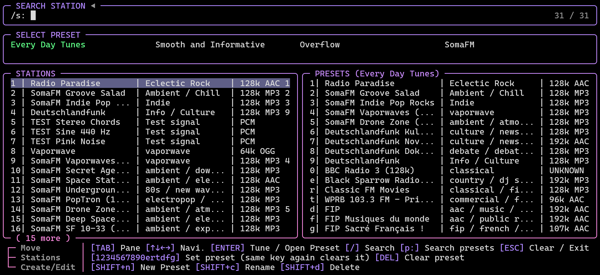

*The PRESETS menu (`SHIFT+p`): stations on the left, the slots of the selected preset on the right.*

The full-screen menu is laid out like the player's playlist menu, from top to bottom: **SEARCH STATION / SEARCH PRESET** (`s:` filters stations, `p:` presets), **SELECT PRESET** (names in four columns) and **STATIONS** beside **PRESETS** (the 16 slots of the active preset). A small `◀` behind a pane's title shows which pane has the keyboard.

| Key | Where | What it does |
|---|---|---|
| `TAB` | anywhere | Next pane: SEARCH → SELECT PRESET → STATIONS |
| `↑` `↓` `←` `→` (or `j` `k` `h` `l`) | SELECT PRESET / STATIONS | Move |
| `ENTER` | STATIONS | Tune the hovered station |
| `ENTER` | SELECT PRESET | Open the hovered preset **and tune its first filled slot** |
| `ENTER` | search | Tune the hovered station / open the hovered preset, then jump to that pane |
| `SHIFT+n` / `SHIFT+c` | SELECT PRESET | New preset / rename the hovered one (a small name box: `ENTER` applies, `ESC` cancels) |
| `SHIFT+d` | SELECT PRESET | **Delete** the hovered preset. Press it twice, any other key cancels. The last remaining preset cannot be deleted. |
| `1`…`0`, `e r t d f g` | STATIONS | Set the hovered station as that slot of the active preset. The same key again clears it. A station sits in one slot only, so it moves. |
| `DEL` / `BACKSPACE` | STATIONS | Remove the hovered station from the active preset |
| `/` | STATIONS / SELECT PRESET | Back to the search box |
| `SHIFT+←/→` | outside the search box | Previous / next preset |
| `ESC` | search | Clear the search; if it is already empty, close the menu |
| `ESC` | STATIONS / SELECT PRESET | Close the menu |

Names have 1 to 24 characters and must be unique (capital letters don't matter). Presets are saved on every change to `presets.txt`.

### 11.7 RADIO BROWSER menu (`SHIFT+s`)

Searches the public station directory [radio-browser.info](https://www.radio-browser.info/) and tunes or adds what it finds. Six input panes sit on top, **RESULTS** and **STATION INFO** (every detail of the hovered result) below.

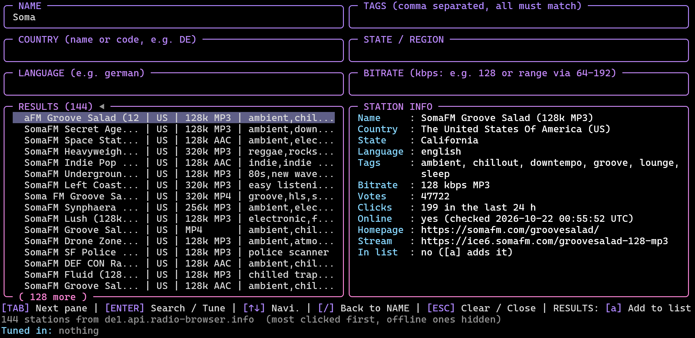

*The RADIO BROWSER with a search for "Soma". A dot in front of a result means it is already in your list.*

| Pane | What you type |
|---|---|
| NAME | Part of the station name |
| TAGS | Comma separated, **every** tag has to match (`rock, 80s`) |
| COUNTRY | A name (`Germany`) or a two-letter code (`DE`) |
| STATE / REGION | Part of the region name |
| LANGUAGE | As Radio Browser spells it (`german`) |
| BITRATE | In kbps: `128` = at least 128, `64-192` = range, `-192` = at most 192 |

| Key | What it does |
|---|---|
| `TAB` | NAME → TAGS → COUNTRY → STATE → LANGUAGE → BITRATE → RESULTS → NAME |
| `ENTER` | In a pane: search (focus jumps to RESULTS when the results arrive). In RESULTS: tune the hovered station. |
| `↑` / `↓` | In a pane: one pane row up / down (down from the last row: RESULTS). In RESULTS: move the cursor. |
| `a` | In RESULTS: **add the hovered station to your station list** (appended at the end, so presets keep their slots) |
| `/` | In RESULTS: back to NAME |
| `ESC` | In a pane: clear it. Empty pane or RESULTS: close the menu. |
| `?` / `CTRL+c` | Cheat sheet (RESULTS only) / quit (in a pane `CTRL+c` copies) |

Every search sends "hide broken streams" and sorts by clicks (most clicked first), with at most 200 results. Empty panes are left out. Results whose last check failed are dimmed and hidden by default. The line under the results shows what is tuned in right now, including the track title if the stream sends one. Tuning a station counts one click at Radio Browser, as their API asks. If `a` finds no `stations.txt` yet, it creates one from the built-in list plus the new station.

### 11.8 STATION LISTS menu (`SHIFT+k`)

Named, ordered collections of stations (a "jazz" list, a "morning" list …), built and managed like the player's playlist editor. Use `p:` in the search box (see 11.5) to open one on the main screen.

Two tabs, switched with `←` / `→` like the player's playlist editor (see [Menus with tabs and text boxes](#menus-with-tabs-and-text-boxes)): in the name field and the search boxes the arrows move the caret once you have typed something there, until `ESC`, `TAB` or `ENTER`. `ALT+←/→` (`Option` on macOS) switches from every pane, also while typing.

- **CREATE / EDIT.** The top pane holds the list's `Name:` field (25 characters, the field turns red while you type). Below it: SEARCH ALL STATIONS (name, genre, country), then STATIONS (all stations, or the search results) beside LIST CONTENTS (what you are building).
- **SAVED STATION LISTS.** The search field and the saved lists.

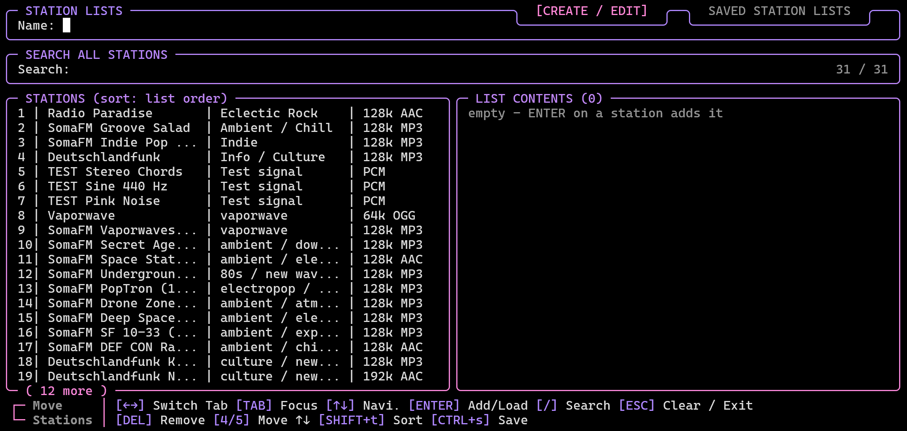

*CREATE / EDIT: name field, search, all stations on the left, the list being built on the right.*

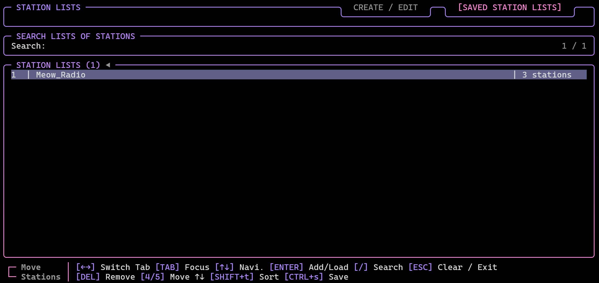

*SAVED STATION LISTS.*

| Key | Where | What it does |
|---|---|---|
| `←` / `→` | lists, and text boxes not typed in yet | Switch tab |
| `ALT+←/→` | anywhere | Switch tab |
| `TAB` | anywhere | Tab 1: name → search → STATIONS → LIST CONTENTS. Tab 2: search ↔ list. |
| `ENTER` | name | On to the search |
| `ENTER` | search, STATIONS | Add the hovered station to the end of the list (a station is in a list once) |
| `ENTER` | LIST CONTENTS | Tune the hovered station (to audition the list) |
| `SHIFT+t` | STATIONS | Sort: list order ↔ name A-Z (also sorts search results) |
| `4` / `5`, `DEL` / `BACKSPACE` / `d` | LIST CONTENTS | Move the hovered station up / down, remove it |
| `CTRL+s` | every pane of tab 1 | Save under the typed name and stay in the menu (the same name overwrites; an empty name: "enter a name first") |
| `ENTER` | tab 2 search / list | To the list / load the hovered list into tab 1 |
| `DEL` | tab 2 list | Delete the hovered list after a Yes/No question |
| `/` | STATIONS, LIST CONTENTS, tab 2 list | Back to the search box |
| `ESC` | a text box you typed in | Leave the box (the text stays; `←` / `→` switch tabs again) |
| `ESC` | search with text | Clear it |
| `ESC` | otherwise | Close. With unsaved changes on tab 1 it asks `Save changes to "x" before exiting? [Y]es [N]o [ESC] cancel`. |

`CTRL+s` saves from every pane, also while typing. As in the player, opening the menu starts a fresh list; an existing one comes back through tab 2 → `ENTER`. A dot behind a station in STATIONS means it is already in the list being built. Lists are stored in `stationlists.txt`; stations are matched by URL, then by name, and a station that has been removed from `stations.txt` is dropped when the list is read.

### 11.9 Big STATIONS overlay (`SHIFT+l`)

The STATIONS pane with the whole screen for its rows and an extra **PRESET NAME** column. It shares the search box and the state of the main screen (`/`, `p:`, `s:`, `SHIFT+t`; `ESC` clears the search, leaves a list, then closes). `ENTER` tunes the hovered station and `n` `b` `#` `p` `x` `+` `-` work as on the main screen. Keys that would open another menu are ignored while it is open.

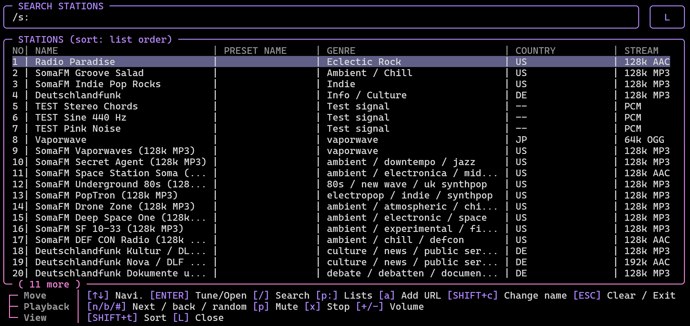

*The big STATIONS overlay with the PRESET NAME column.*

| Key | What it does |
|---|---|
| `a` | **Add a station by its stream URL.** `TAB` switches URL ↔ NAME, an empty NAME becomes the host name. The station is appended to the end (so the preset slots stay valid) and written to `stations.txt`. A stream that is already in the list is refused. |
| `SHIFT+c` | Give the hovered station a **preset name**: a shorter second name that is shown in the PRESETS pane instead of the station name (empty = the station's own name again). It is stored in `preset_names.txt` and the search also looks at it. |
| `SHIFT+l` / `ESC` | Close |

### 11.10 Timeshift and recording (`SPACE`, `[`, `]`, `{`, `}`, `y`)

**Timeshift.** From the moment a station is tuned, the radio keeps the last minutes of it in a rolling buffer on disk (**Timeshift buffer** on the ON/OFF tab: 5, 15, 30, 45 or 60 minutes, default 30). That lets you treat live radio like a recording:

| Key | Action |
|---|---|
| `SPACE` | Pause. The station keeps arriving in the buffer; `SPACE` again resumes exactly where you stopped, now behind live. |
| `[` / `]` | Back / forward 30 seconds |
| `{` | Back 5 minutes |
| `}` | Back to live |

- Every jump is shown for 4 seconds at the bottom of the oscilloscope / sphere block, for example `-0:30 | 2:30 behind live`; the dial's footer shows `‖ PAUSED -m:ss` or `◑ TIMESHIFT -m:ss` while you are behind.
- You cannot go back further than the moment you tuned in (or further than the buffer size), and not ahead of live; at the edges the jump stops there. Catching up with `]` hands back to the live stream without a gap.
- If a pause is longer than the buffer, the oldest part is overwritten and playback continues from the oldest audio still there.
- Tuning another station, `x` or quitting clears the buffer. Internet radio streams (Icecast / Shoutcast) only deliver from "now", so the buffer can never reach back before you tuned in.
- The buffer is the file `radio_timeshift.pcm` in `~/.cache/mousiki/` (on Windows `%USERPROFILE%\.cache\mousiki\`), about 11.5 MB per minute (so about 345 MB for 30 minutes). It is written by the stream thread and is never touched by the screen loop, so the interface stays as fast as without it. It is deleted when the radio closes.

**Recording.** `y` opens the **RECORD** overlay and freezes the moment it was pressed, so no time is lost while you choose:

| Row | Starts the recording at |
|---|---|
| From now on (when this opened) | The moment you pressed `y` (what you heard then) |
| The last 1 / 5 / 10 / 15 / 30 minutes | That much before the moment you pressed `y`. If the buffer does not reach that far back, the row says *only m:ss* and the recording starts at the oldest buffered audio. |
| Everything buffered | The oldest audio in the buffer |

`↑` / `↓` choose, `ENTER` or `y` starts recording, `ESC` cancels. While it runs the dial's footer shows `REC mm:ss`; `y` again stops (at what you are hearing at that moment, so in timeshift it ends at your listening position). The recording is written from the buffer as a WAV file, which ffmpeg then converts in the background to `<YYYY-MM-DD_HH-MM-SS>.mp3`, named by the time the first recorded second was **on air** (the ID3 title is the current "artist - title", or the station name). The WAV is removed afterwards (it is kept if the conversion fails). Tuning another station or `x` ends the recording too, and recordings shorter than half a second are discarded. Recordings go to the radio's download folder (see 11.12, PATHS), which by default is the player's one. The recording is taken before volume, mute and the mono fold.

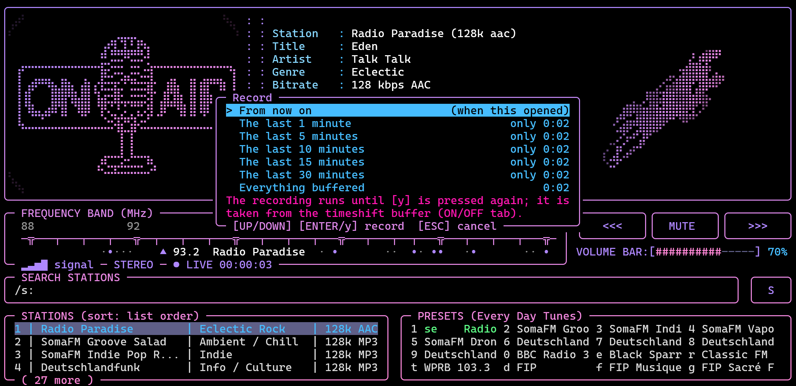

*The RECORD overlay: where the recording starts.*

### 11.11 Listening history (`h`)

The radio keeps its own listening history, shaped like the player's (chapter 8) but with **channels** instead of tracks. Three tabs (`1` `2` `3`, `←/→`, `TAB`), `↑/↓` move, `HOME/END` jump to the ends, `ESC`, `q` or `h` close. The bottom border shows the line count or the sort direction.


*HISTORY tab with the "Find on YouTube + download" overlay open.*

- **HISTORY.** WHEN / CHANNEL / ARTIST / TITLE / HEARD. A new line starts whenever the channel, artist or title changes; lines heard for less than 3 seconds are dropped.
  Hover a line and press **`y`**: a small overlay searches YouTube for "artist title" (the player's own online search). `ENTER` downloads the hovered result (yt-dlp, opus) into the download folder; `[..]` means downloading, `[ok]` done, `[!!]` failed. `TAB` edits the search query, `ESC` closes the overlay.
- **TOP CHANNELS.** Channels by time listened; `r` flips most / least first.
- **HABITS.** Sessions (a gap of 30 minutes starts a new one), time per day, channels, and listening by hour of the day and by weekday.


*TOP CHANNELS.*


*HABITS.*

Like the player's, the history is light-weight: the newest 10 000 lines are kept in memory and in `history_radio.txt`; beyond that the oldest line is folded into `archive_radio.txt` (totals per channel, per day, per hour and per weekday), so TOP CHANNELS and HABITS stay lifetime figures.

### 11.12 Radio settings

`s` opens the radio's settings with the same frame, tab strip and editing keys as the player's (chapter 10): `TAB` next tab, `↑/↓` rows, `←/→` or `ENTER` change a switch, `ENTER` edits a colour, a folder or a key. **`s` saves and closes, `ESC` / `q` / `CTRL+c` discard** what was changed meanwhile and close. The settings always open on the first tab. They are stored in `radio_config.txt`; colours from the player's `config.txt` are not carried over. While a colour, folder or key is being edited (after `ENTER`), `←` / `→` move the caret (`SHIFT+←/→` marks, `HOME` / `END`, `CTRL+C/X/V` work as in every other field) and `TAB` stays in the field; only `ENTER` (apply) or `ESC` (cancel) leave it. Colour fields take digits only.

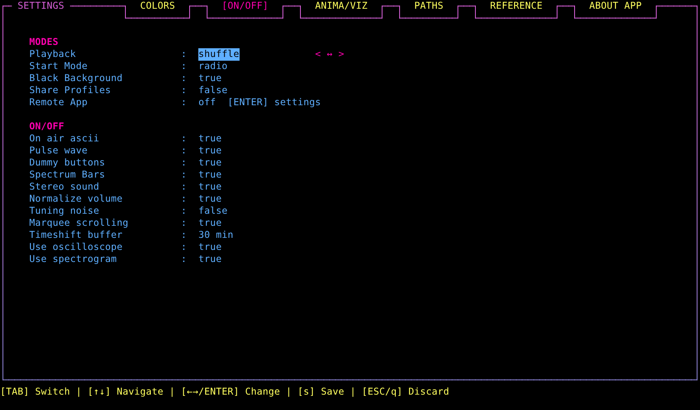

*The radio's settings, ON/OFF tab (Remote App opens its own overlay).*

**COLORS.** Cells hold palette numbers 0 to 255 (empty or 0 = the terminal's own colour). The rows that exist only in the radio:

| Row | Cells | What it colours |
|---|---|---|
| ON_AIR | UPPER_LEFT, BOTTOM_RIGHT | The ON AIR sign's diagonal gradient (also needle, lamp, LIVE text) |
| OSCI | LEFT, RIGHT | The oscilloscope |
| FREQUENCY_BAR | LINE, MHz | The dial's line and ticks / the numbers and the small dots |
| VOLUME | CURRENT, POSSIBLE | The `#` and `-` of the volume bar |
| PRESETS | INACTIVE FG/BG, KEY FG | Unassigned preset slots / the shortcut letters |

BORDER_COLOR, METADATA, VIZ, LIST, HEADER, LEGEND and TAB_NAMES work as in the player. **FOCUS** (`ColorFocus`) colours the pane focus indicator **◀** after the title of the pane that has the keys in the radio's menus; a `radio_config.txt` without it follows the radio's HEADER colour.

**ON/OFF** (the radio's own switches) has two categories, as in the player:

**MODES**

| Row | What it does |
|---|---|
| Playback | `shuffle` or `list` for the station surf (same as `m`). Saved as `PlaybackMode=`. |
| Start Mode | `player` or `radio`: which of the two Mousiki opens with. The same value as in the player's Settings (`StartMode=` in the player's `config.txt`; the radio reads and writes that one line). |
| Black Background | `true` (default) / `false`: the terminal's background is black while Mousiki runs and is given back on exit. The same value as in the player's Settings (`BlackBackground=` in the player's `config.txt`). |

**ON/OFF**

| Row | What it does |
|---|---|
| On air ascii | The ON AIR sign and its colour wave |
| Pulse wave | The faint circle burst behind the sign |
| Dummy buttons | The `<<< MUTE >>>` boxes next to the dial (the volume bar stays) |
| Spectrum Bars | The spectrum under the station info (config key `Visualizer=`) |
| Stereo sound | Off folds left and right into mono (the dial's footer then says MONO) |
| Normalize volume | Loudness normalization, as `v` |
| Tuning noise | Off by default. On: static with crackle fades in while another station is tuned and stays until the new stream plays. It follows volume, mute and the sleep-timer fade and is not recorded. |
| Marquee scrolling | On (default): a station name that is too long for its column scrolls while the row is hovered (and the tuned preset). Off: it is cut off with `...`. (`MarqueeScrolling=` in `radio_config.txt`.) |
| Timeshift buffer | How many minutes of the tuned station are kept for pause / rewind and recording from the past: 5, 15, 30 (default), 45 or 60 min (see 11.10). Saved as `TimeshiftMinutes=`. |
| Use oscilloscope / Use spectrogram | `false` leaves that visual out of the scope block: `.` skips it (the sphere is always there). Full screen (`SHIFT+u`) and the windows `)` / `(` still work. (`UseOscilloscope=`, `UseSpectrogram=`) |

**ANIMA/VIZ** (the tab used to be called ANIMATION) has three categories and, like the player's, a note at the bottom about `SHIFT+o`, `SHIFT+i`, `SHIFT+u`, `)` and `(`:

| Category | Rows |
|---|---|
| ON AIR SIGN | **Gradient wave speed** (cycles per second of the ON AIR sign's colour wave) and **Pulse wave speed** (loops per second of the circle burst) |
| SPECTRUM BARS | Bars Fluidity, Bars Degradation and Bars Viscosity, as in the player (before: Wave …) |
| MODES | **Osci/sphere** (right of the station info: oscilloscope, sphere, off, or spectrogram (`spectro`)) and **Osci style** (`braille` or `image`) and **Scope mode** (`XY`, `YT`, `XY + YT (overlap)`, `XY + YT (row)` or `XY + YT (col)`, set in the `SHIFT+o` overlay; `OsciMode=` in `radio_config.txt`). The oscilloscope full screen (`SHIFT+0`, with grid `SHIFT+a`, axis values `SHIFT+v` and grid colour `SHIFT+c`) is there too (`ScopeBig`, `ScopeGrid=`, `ScopeValues=`, `ScopeGridColor=`) |

The player's Waveform Style, Disk Speed, Lyrics Alignment and Lyrics Animation do not exist in the radio, so those categories are missing.

**PATHS.** The radio's files live below these folders. The layout is the player's: the name of the setting in the header colour, its value in the list colour. Every path is a *base*; the radio creates its own sub-folders below it.

| Row | Result |
|---|---|
| STATION LISTS PATH | `<path>/stations/stations.txt` (the overall list) and `<path>/station_lists/stationlists.txt` |
| PRESETS PATH | `<path>/presets/presets.txt` |
| DOWNLOAD PATH | `<path>/radio_downloads/`: recordings (`y`) and YouTube downloads from the history. Below the path: *SAME PATH AS THE MUSIC PLAYER IS USED* while the next row is on. |
| Same folder as music player | On = use the player's download folder instead of DOWNLOAD PATH |
| HISTORY PATH | `<path>/radio_history/` (`history_radio.txt`, `archive_radio.txt`) |

An empty path shows the default folder in effect. When folder paths are changed, the respective files are **only copied, never moved, and no deletions are performed**; playback is stopped and everything is reloaded from the new place.

**REFERENCE.** The keys that are not hard coded, grouped like the player's. `ENTER` edits the hovered key: type one character (case matters) or `SPACE` / `TAB` / `BACKSPACE`; `DEL` restores the default. A key already in use is refused (the fixed keys count too: the preset slot keys and `j` / `k`). The first line, *Reset all keys to default*, sits under the cheat-sheet note; `CTRL+SHIFT+u` undoes the last five key changes. Keys are stored as `HKey<Action>=` lines. The cheat sheet always lists the default keys.

**ABOUT APP.** The same text as the player's.

### 11.13 The radio's files

| File | What it holds | Default place |
|---|---|---|
| `radio_config.txt` | The radio's settings, colours, equalizer and oscilloscope values | The config folder (`~/.config/mousiki/`, on Windows `%USERPROFILE%\.config\mousiki\`) |
| `stations.txt` | Your station list | Config folder, or next to the executable |
| `presets.txt` | The presets and the active one | Config folder |
| `stationlists.txt` | The saved station lists | Config folder |
| `preset_names.txt` | The preset names (`url<TAB>name`) | Next to `stations.txt` |
| `radio_history/` | `history_radio.txt` and `archive_radio.txt` | Config folder |
| `radio_timeshift.pcm` | The timeshift buffer (raw audio, about 11.5 MB per minute; deleted when the radio closes) | `~/.cache/mousiki/` |
| Recordings and downloads | MP3 recordings, YouTube downloads | The player's download folder, otherwise `<path>/radio_downloads/` |

`stations.txt` has one station per line: `name | genre | country | codec | kbps | url | [*] | [dial MHz]`. A `*` fills the first preset slots of the preset "Default" until a `presets.txt` exists. The URL `lavfi:chords`, `lavfi:tone` or `lavfi:noise` is an offline test signal generated by ffmpeg.

`presets.txt` is plain text and can be edited by hand:

```
@keys 1234567890ertdfg
@active Morning
[Default]
1 | https://stream.radioparadise.com/aac-128 | Radio Paradise
[Morning]
1 | https://st01.sslstream.dlf.de/dlf/01/128/mp3/stream.mp3 | Deutschlandfunk
```

The `@keys` line names the letters of the slots the file was written with (slot 1 = first letter … slot 16 = last), so presets keep their slots if the key letters ever change.

### 11.14 Not done yet

- Station lists steer `n` / `b` / `#`, but not yet the presets: the presets always refer to the overall station list.
- The PRESETS menu has no page-jump keys (arrows only).
- The radio is untested on macOS and Windows beyond what is described here.

---

## 12. Remote control and key bindings

A running Mousiki (player **or** radio) can be controlled from outside with the same program:

```
mousiki --cmd next             mousiki --cmd volume 60       mousiki --cmd seek +10
mousiki --status               what is playing (state, title, artist, volume, playback mode ...)
mousiki --cmd --help           the list of commands (also: mousiki --cmd help, mousiki --remote-help)
mousiki --remote-info          address and PIN of the remote app (12.1)
mousiki --help / --version     the command line options / the version
```

Commands: `play-pause`, `play`, `pause`, `stop`, `next`, `prev`, `shuffle` (player: shuffle next; radio: a random station), `volume-up`, `volume-down` (optional number, default 5), `volume <0-100>` (`+10` / `-10` change it), `mute`, `unmute`, `toggle-mute`, `seek <seconds>` (`-30` jumps back; in the radio inside the timeshift buffer), `live` (radio), `playback-mode` (player: the next play mode like `m`; radio: S ↔ L like `m`), `wizard` (opens / closes the help wizard), `switch-mode`, `quit`. Exit code: 0 sent, 1 nothing running, 2 wrong command or value.

**Keyboards without media keys.** Mousiki itself only sees keys while its terminal has the focus. For keys that work everywhere, bind **any key combination you like** in your system to a `mousiki --cmd ...` line:

| System | Where |
|---|---|
| GNOME | Settings -> Keyboard -> Custom Shortcuts: name *Mousiki next*, command `mousiki --cmd next`, shortcut e.g. `Ctrl+Alt+Right` |
| KDE Plasma | System Settings -> Shortcuts -> Add Command |
| i3 / sway | `bindsym Ctrl+Mod1+Right exec mousiki --cmd next` in the config file |
| Hyprland | `bind = CTRL ALT, Right, exec, mousiki --cmd next` |
| Windows | AutoHotkey: `^!Right::Run "mousiki.exe" --cmd next, , Hide` |
| macOS | Shortcuts app (action *Run Shell Script*, then a keyboard shortcut) or skhd: `ctrl + alt - right : mousiki --cmd next` |

How it works: the program keeps a small folder `control/` in the config folder. The client writes one command file; the running Mousiki reads and deletes it (about ten times a second) and writes `status` once a second. Only the fixed command names above with a short number are accepted; anything else is ignored.

### 12.1 The remote app (Android / phone browser)

Mousiki can be controlled from a phone in the same network. It is part of the program itself: it works the same with a Mousiki you built yourself and with an installed one -- nothing else has to be installed on the computer.

**Setting it up:** Settings (`s`) -> ON/OFF -> MODES -> **Remote App** -> `ENTER` (or `←`/`→`) opens the **REMOTE APP** overlay (player or radio; one setting for both):

* **REMOTE APP** `< ON >` / `< OFF >` (`←`/`→`/`ENTER`): switches the small web server on; the first time a 6-digit PIN is made.
* **PORT** (`ENTER`, type, `ENTER`): 1024-65535, default 4747. **PIN** (`ENTER`, type 4-8 digits, `ENTER`); `n` makes a new random PIN.
* **ADDRESS** and **SERVER** (running / off / why it does not run, e.g. the port is in use) are shown, and a **QR code**: scan it with the phone camera and the remote opens in the phone's browser, already logged in (the code carries the PIN). The QR code needs a window of about 70 x 27; in a smaller one the address is written out instead.
* `ESC` closes the overlay; `s` on the settings screen saves (as for every setting). `mousiki --remote-info` prints the address and the PIN as well.


*The REMOTE APP overlay: switch, port, PIN, address and the QR code for the phone.*

* **Android app** (`remote_app/android`, APK from the GitHub workflow *Remote app (Android)*, see `remote_app/README.md`): enter the address (or tap *FIND MOUSIKI IN THIS NETWORK*) and the PIN once; it connects by itself from then on.
* **Any phone browser:** open the address, enter the PIN ("Add to home screen" makes it look like an app).

The phone shows a narrow version of the main screen, **drawn by Mousiki itself** in the colours of the theme in use (the border gradient included), and follows the mode:

* **Player:** the spinning braille disk (speed 0.10; tap it: play / pause), the meta data, the waveform progress bar (tap: jump there), the dummy buttons -- working here: `<<<` / `>>>` seek 5 s, PLAY / PAUSE -- the volume bar (tap: mute), and boxes for PREV (`b`), RANDOM (`#`), NEXT (`n`), VOL - / VOL +, MUTE, the playback mode (`m`, shows the current one), LISTS and MANUAL (opens this manual on the phone).
* **LISTS** (player) opens two lists. On top **LOCAL AUDIO FILES**, the local list as it is sorted and filtered on the computer (the playing title marked ▶; it opens on its page): tap a title and it plays (`mousiki --cmd track <n>`). Below it, smaller, **PLAYLISTS**, your saved playlists (A-Z, with the number of titles): tap one and its titles go into the queue; when nothing was playing, the first one starts (`mousiki --cmd playlist <n>`).
  * One list has the focus (▶ and the colour of the current tab in its title). A tap on the other list only gives it the focus; then its titles can be tapped. ▲ UP / ▼ DOWN move the list in focus by a whole page, BACK returns to the main screen.
  * **CLEAR QUEUE (n)** at the very bottom clears the queue: tap it, then tap again within 5 seconds (`TAP AGAIN TO CLEAR`). `CTRL+SHIFT+Z` on the computer brings it back (`mousiki --cmd clear-queue` clears at once).
* **Radio:** the ON AIR / OFF AIR sign with its colour wave (tap: pause / resume), the station, the state (LIVE, PAUSED, how far behind live), `<<<` / `>>>` previous / next station, PLAY / PAUSE, the volume bar, RANDOM, MUTE, STOP, VOL - / VOL +, LIVE, MODE S / L, STATIONS, MANUAL.
* **STATIONS** (radio) opens the whole station list (number, name, genre, bitrate / codec, country; the tuned one is marked ▶): tap a station and it is tuned. ▲ UP / ▼ DOWN page, BACK returns. Same as `mousiki --cmd tune <n>`.
* **[RADIO] / [PLAYER]** at the top (or `[*] switch`) changes the mode, like `*`.
* Long-press anywhere or tap the title: the remote's own settings -- the 16 base colours (pick the scheme of your terminal: Windows Terminal, xterm, GNOME), the size of the braille dots (thick / normal / small), the PIN, the manual.

<p align="center"> &nbsp; </p>
<p align="center">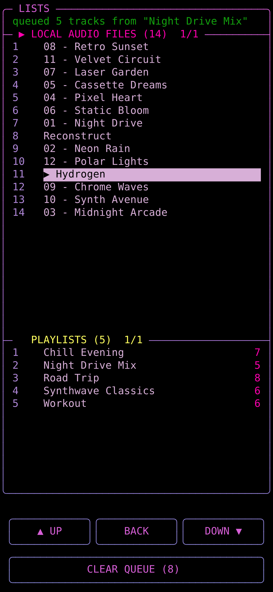 &nbsp; 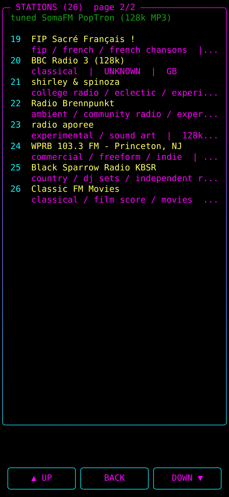</p>

*The phone remote in the music player (theme SeriousMeowerShell) and in the radio (theme Cyberpunk).*

**No connection?** Check, in this order:

1. **Same network:** the phone in the same Wi-Fi as the computer (not the mobile network, not a guest Wi-Fi that keeps devices apart).
2. **VPN on the computer (or the phone):** most VPN apps send everything through the VPN and block the home network. Switch on *allow local network / LAN access* (the name differs: "Local network sharing", "Allow LAN", "Split tunneling" ...) in the VPN app, or switch the VPN off. With a VPN the overlay marks it in red and lists the computer's other addresses (**ALSO**): the phone needs the home-network one (usually `192.168.x.x`), which the overlay puts first.
3. **Windows firewall:** if Windows' question was answered with "cancel", or the network is marked *public*, incoming connections are blocked. `f` in the REMOTE APP overlay adds a rule that opens the port (Windows asks for administrator rights); by hand: `netsh advfirewall firewall add rule name="Mousiki Remote" dir=in action=allow protocol=TCP localport=4747 profile=any` in an administrator terminal.
4. **Port:** another program on 4747 (the overlay's SERVER line says so): choose another PORT.
5. **Test on the computer:** open `http://127.0.0.1:4747` in its browser. If that page loads, Mousiki works and the block is between the phone and the computer (points 1-3).

The boxes are labelled with the keys of the computer (your own key bindings). Settings rows `RemoteApp=`, `RemoteAppPort=` (default 4747) and `RemoteAppPin=` are in `config.txt`. **Security:** off by default; only the home network can reach it (nothing is forwarded to the internet unless you set that up in your router); every command needs the PIN, and after 10 wrong PINs it answers nothing for a minute; only the fixed remote commands exist. On Windows the firewall asks once whether Mousiki may accept connections: allow *private networks*.

## 13. Automated tests

`cmake -DMOUSIKI_BUILD_TESTS=ON ..` then `make mousiki_tests && ./mousiki_tests` (Windows: `cmake --build . --config Release --target mousiki_tests`, then `Release\mousiki_tests.exe`) runs the checks of the text editor and fuzzy search, themes, settings files and their upgrade backup, the shared oscilloscope settings, Share Profiles, the remote control, the remote app's server and phone screen, the oscilloscope drawing, the JSON reader, the lyrics text helpers, saved playlists, and the listening history of the player and of the radio (91 tests). On GitHub the workflow *Tests* builds and runs them on Linux, macOS and Windows with every push. `./mousiki_tests remote` runs only the tests whose name contains "remote". The tests use a temporary config folder and never touch yours.

## 14. Upgrades and your settings

Installing a new version never deletes your settings (`config.txt`, `radio_config.txt` ... live in the config folder, not in the program folder). The first time a new version saves a settings file, the previous file is kept as **`config.txt.bak`** / **`radio_config.txt.bak`** next to it (one backup, replaced at the next upgrade), so you can go back if something looks wrong. The files carry a `# Written by Mousiki v...` line for that.

---

## About this app

### Original developer of v1.0

| | | | |
|---|---|---|---|
| **Developer** | ender | **GitHub** | [itzender5820](https://github.com/itzender5820) |
| **Email** | itz.ender5820@gmail.com | **Version** | original and final v1.0 |
| | | **Licence** | Apache Licence 2.0 |

### Windows port, incl. extensive modifications up to v4.4.0 (including the radio mode)

| | | | |
|---|---|---|---|
| **Developer** | Steffen Schwerdtfeger | **GitHub** | [StSchwerdtfeger](https://github.com/StSchwerdtfeger) |
| **Email** | fanti.blub@gmail.com | **Version** | current v4.4.0 |
| | | **Licence** | Apache Licence 2.0 |

### Third-party software and licences

Mousiki is licensed under the Apache Licence 2.0 (file `LICENSE`). It contains or uses the following third-party software; the full licence texts are in `THIRD_PARTY_LICENSES.txt`, which is next to the program in every installer and portable package (and in the repository root).

| Component | Used for | Licence | How |
|---|---|---|---|
| miniaudio 0.11.25 | Audio output and decoding of MP3 / FLAC / WAV | Public domain (Unlicense) or MIT-0 | Compiled in |
| KISS FFT | Spectrum visualizer, spectrogram | BSD-3-Clause | Compiled in |
| miniz 3.1.2 | Compresses the image-style pictures (Kitty graphics) | MIT | Compiled in |
| Roseus colour map | Default spectrogram colours | CC0 1.0 | Compiled in |
| Chromaprint 1.6.1 (with its own KISS FFT) | `fpcalc`, the AcoustID fingerprint helper | MIT (upstream treats the full project as LGPL-2.1 because of FFmpeg parts that are not included here) | Compiled into `fpcalc` |
| SDL2 | Scope window and spectrogram window | zlib | Loaded at run time; `SDL2.dll` is included in the Windows packages |
| FFmpeg (`ffmpeg`, `ffprobe`) | Decoding, metadata, tag writing, radio streams, recordings | GPL-3.0 (bundled builds) | Separate program; bundled on Windows and in the Linux portable zip |
| yt-dlp | YouTube / SoundCloud / Bandcamp streams and downloads | Unlicense | Separate program; bundled in the packages |
| Python (embeddable, Windows) and `requests`, `urllib3`, `idna`, `certifi`, `charset-normalizer` | Lyrics, fast search, AcoustID and Bandcamp scripts | PSF / Apache-2.0 / MIT / BSD-3-Clause / MPL-2.0 | Bundled in the packages |
| sidplayfp, libopenmpt, libgme | C64 SID tunes, tracker modules, game music | GPL-2.0+ / BSD-3-Clause / LGPL-2.1+ | Optional, not bundled (sidplayfp runs as a program, the others through FFmpeg) |
| curl | The radio's Radio Browser search | curl licence | Separate program (part of Windows 10+, macOS and most Linux systems) |

Each package also has a `THIRD-PARTY.txt` that lists the tools bundled in exactly that package, with their download sources.
