<div align="center">
    
# 📻 Mousiki Plus v4.7.1 - Music, Radio and Audio Book Player 🎵 
(Windows · Linux · macOS)  

<p align="center">
  <a href="https://opensource.org/" target="_blank">
    </a>
&nbsp;
  <a href="https://www.apache.org/" target="_blank">
    </a>
</p>


> [!NOTE]
> **Developer note:** Mousiki is released under the Apache License 2.0.
> You are free to use, modify, fork, re-distribute, and sell the software,
> subject to the terms of the license.

[](LICENSE)
[](https://github.com/StSchwerdtfeger/mousiki-plus/tree/main)
[](https://github.com/StSchwerdtfeger/mousiki-plus/tree/main) [](https://github.com/StSchwerdtfeger/mousiki-plus/tree/main) [](https://github.com/StSchwerdtfeger/mousiki-plus/tree/main)
</div>

Mousiki is a terminal music player that was originally built for macOS/Linux by the amazing [itzender5820/mousiki, v1.0](https://github.com/itzender5820/mousiki) for people who prefer control, simplicity, and a keyboard (mousi-**key**). This Mousiki fork lets it also run natively on Windows (including quite a bunch of modifications and additions; code grew 6-7x the original length; design maintained for obvious reasons). All credits for the design, main feature set, and the core code goes to the original author. Since v2.5.0 the code base builds natively on **Linux and macOS** again (see [Build it yourself (Linux / macOS)](#build-it-yourself-linux--macos) or use the [setup packages or portable versions for all three platforms in the latest release](https://github.com/StSchwerdtfeger/mousiki-plus/releases/latest)). Windows remains the primary and most tested platform (only tested Linux via WSL and works fine so far, a few bugs were recently fixed; not much tested for macOS and non-WSL Linux systems). Feel free to give feedback in the discussions and report issues you might experience using this modified port. 

Build yourself (see [prerequisites](#prerequisites-windows) below) **or use the installer/portable (x64) version** that is included in every new release (since v2.1.0). A full **[user manual](Mousiki_User_Manual/Mousiki_User_Guide.md)** (also as [PDF](Mousiki_User_Manual/Mousiki_User_Guide.pdf)) walks through every entry of the in-app cheat sheet, every settings tab and every overlay.

This fork exists because the original targets POSIX (Linux/macOS/Termux) and had no Windows build path at all. The Windows build uses no WSL, no MSYS runtime, no POSIX emulation layer, just a plain `mousiki.exe` built against the Win32 API and WASAPI. All Windows-specific code is guarded by `_WIN32`, so the very same sources also build on Linux (PulseAudio/PipeWire/ALSA) and macOS (CoreAudio) with the included `setup.sh`. Porting the original repository surfaced a long list of platform differences beyond the obvious ones, plus a small number of pre-existing bugs in the original codebase that had nothing to do with Windows and got fixed along the way.

Along the Win32 port, **a lot of minor and major additions were made too**. The major ones are a e.g. **radio player mode**, **audio book mode**, **playlist menu** to create playlists from local (or downloaded) tracks, a **meta data editor** including **fetching artist/title via AcoustID/MusicBrainz** (audio fingerprinting done via chromaprint), a **listening history** (incl. the ability to add top tracks to the playback queue), an **XY/YT mode ASCII-Braille / full res. image oscilloscope and Audacity style spectrogram** as an alternative to the lyrics ball and lyrics, a **10 band EQ with 12 presets** and the ability to create and save custom presets, enlarged **list/queue overlays**, **sleep timer**, a **user manual** (.md and .pdf)... Minor changes/additions are e.g. a general key to shuffle to a next title (before only the next title in the list was possible or switching to shuffle mode), stereo audio playback and loudness normalization, adding paths via the settings menu, toggling the lyrics on/off via a hotkey command, an optimized search engine for Windows (searching meta data was very slow and only available 2-3 min. after starting the app), fuzzy search (e.g. "X-Files" didn't show up when searching "X Files" without the dash), a categorized cheat sheet... As mentioned, the design remained the same for obvious reasons; the design assets added are a Braille-ASCII music cassette, shown when no track is loaded, different volume bar symbols (one version acting like the changing ASCII pattern on the disk) and the default image in the audio book player... See [Features at a glance](#features-at-a-glance) below for an overview with screenshots.  

The latest larger feature additions are the mentioned **[radio player mode](#radio-player)** (online radio with a tuning-dial look, presets, Radio Browser search, recording option and its own listening history) and an **[audio book player mode](#audio-book-player)** (books and chapters, showing cover images, auto-marks, bookmarks, notes you write while you listen, chapter marks and cutting of long files, its own look and settings), both part of the very same program: press `SHIFT` and `+` (the `*` character) to go to the next mode (music player → radio → audio books) and `SHIFT` and `-` to go back; the order and the modes that are on are set in the settings. The radio is closed completely when you leave it, while the player and the audio book player only wait in the background (playback paused), so coming back to them is instant.

- **Original:** [github.com/itzender5820/mousiki](https://github.com/itzender5820/mousiki) — ender ([itzender5820](https://github.com/itzender5820))
- **License:** Apache 2.0 — see [LICENSE](LICENSE)
- **Windows port:** Steffen Schwerdtfeger ([StSchwerdtfeger](https://github.com/StSchwerdtfeger)), ported and adjusted with the help of AI tools (at first free chat versions, mostly Sonnet 5.5 set on medium and for some time MiMo V2.6; later also Claude with file and build tools in a sandbox, never on my own computer), then continuously adjusted, extended, tested, and debugged by me. I am not a professional developer of applications like this and I do not fully understand every detail of the original C++ code, but I had a lot of fun thinking my way into it and learned a lot (usually doing more data science / math coding and AI in such an extent makes little sense for me in the context of science). So far it took me around 180h over the last weeks to port it to Windows, design and add new features, test and debug (obsessively and escapistically spent my free time on it and just fell in love with the original design by itzender5820). The code quality seems good so far (from the feedback I got and my own evaluation, as far as I am capable of judging it), but there is surely room to optimize it, and reviews are welcome. So far I mostly smoothed the code to be more readable and similar to each other in general. The code is also scanned by CodeQL and tested via various test workflows, I added dependabot and weekly check on updates on the smaller third_party software that comes directly with Mousiki Plus. See the [Dependencies and security](#dependencies-and-security)chapter further below.  

*In general, a huge shout out for the great work by itzender5820 for this beautiful music player.* <3 It's the best and most fun music player I ever found. Makes me want to listen to music all the time :D 

<p align="center">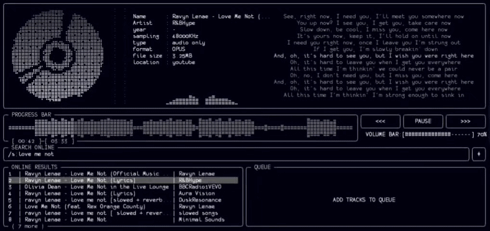</p>

<p align="center">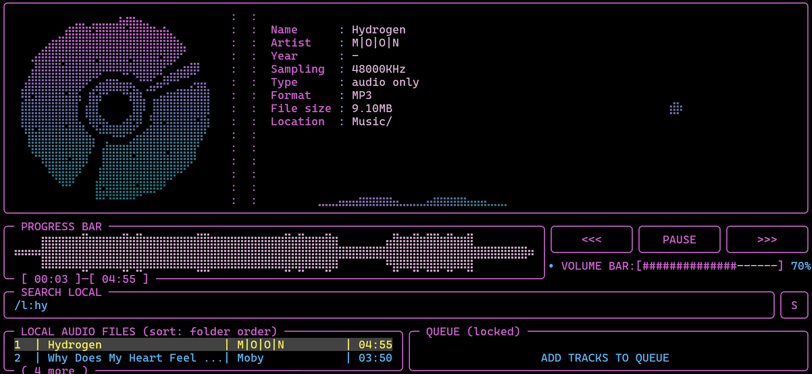</p>

My current setup looks like the last .gif and the below images. The current default config.txt uses the below theme too. It is adjusted to fit my cyber-cat themed **MeowerShell** terminal setup [(see Gihub repository for config files)](https://github.com/StSchwerdtfeger/Meower-Shell), which includes FastFetch, Oh-My-Posh and loads of recommendations for lovers of the terminal, e.g. helpful apps like yazi, fzf fuzzy search ...

<p align="center">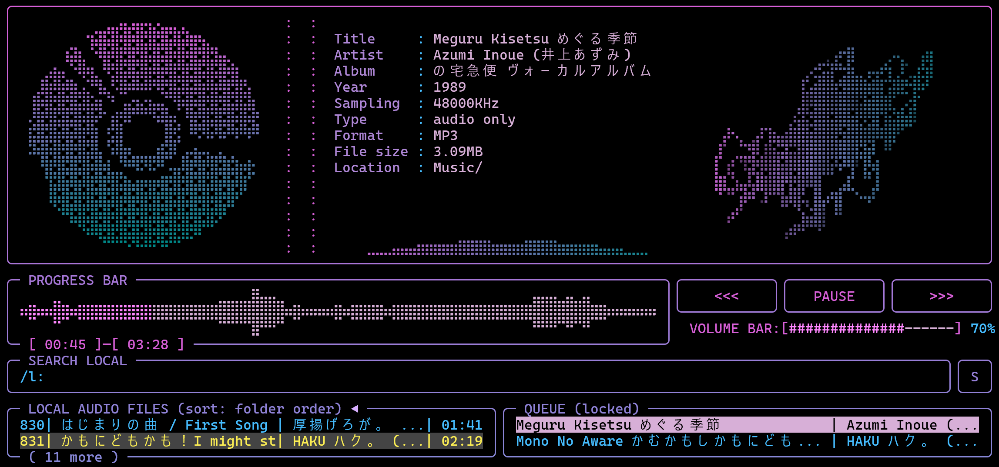</p>

The new main UI of the radio mode looks like the below:

<p align="center">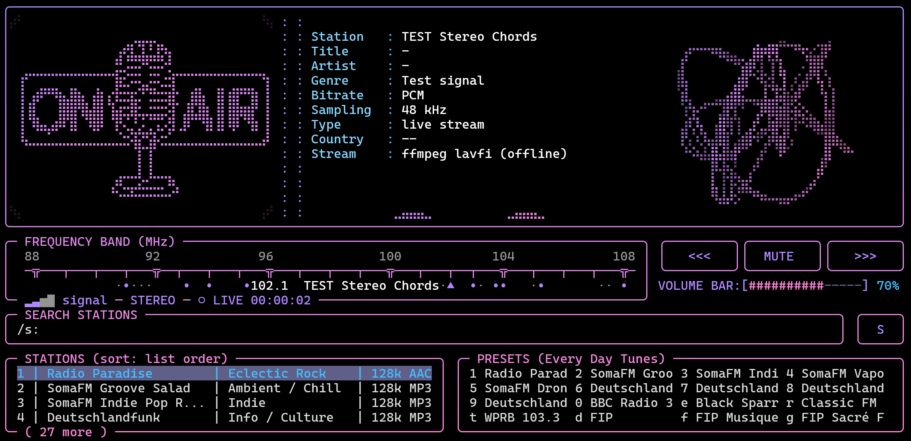</p>

And the audio book mode, the third one, with bookmarks, notes, cutting audio files into chapters...:

<p align="center">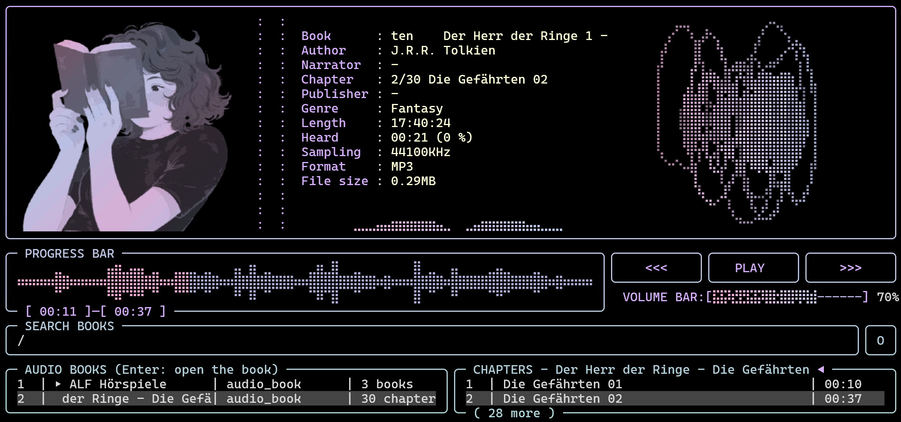</p>


## Table of contents

- [Current Status of the Port and Modification (v4.7.1)](#current-status-of-the-port-and-modification-v471)
- [Features at a glance](#features-at-a-glance)
  - [Music player](#music-player)
  - [Visualizations](#visualizations)
  - [Lyrics and Karaoke mode](#lyrics-and-karaoke-mode)
  - [Playlists, meta data, history, conversion](#playlists-meta-data-history-conversion)
  - [Sound](#sound)
  - [Radio player](#radio-player)
  - [Audio book player](#audio-book-player)
  - [Themes and colours](#themes-and-colours)
    - [Colour-blind friendly themes](#colour-blind-friendly-themes)
  - [Help, settings and keys](#help-settings-and-keys)
  - [Remote control and phone app](#remote-control-and-phone-app)
- [Quick start](#quick-start)
  - [Installers and portables for Windows / macOS / Linux](#installers-and-portables-for-windows--macos--linux)
  - [Build it yourself (Windows)](#build-it-yourself-windows)
    - [Prerequisites (Windows)](#prerequisites-windows)
    - [Use Windows Terminal](#use-windows-terminal)
    - [Where your files go (Windows)](#where-your-files-go-windows)
  - [Build it yourself (Linux / macOS)](#build-it-yourself-linux--macos)
    - [Where your files go (Linux/macOS)](#where-your-files-go-linuxmacos)
- [Verifying downloads](#verifying-downloads)
- [Dependencies and security](#dependencies-and-security)
- [Images](#images)

## Current Status of the Port and Modification (v4.7.1)

For now the Mousiki port works well and also includes everything I at least wanted and made sense to me for a music player, so there might be no further major releases that add new features, except of bug-fixes that might appear to me or others in the future (feel free to start discussions or report issues!!). I might adjust the code to be more polished / robust and might optimize the setup release (Win version results currently in ~250MB size, setup itself ~80MB, portable .zip ~100MB)... Since v2.5.0 my version of Mousiki also builds on macOS/Linux again (`setup.sh`), which is a first step towards making it potentially integratable into the main branch of the original project (which still seems way too hard after dozens of comments in the last two weeks, at least from my perspective). The Linux/macOS builds are less tested than the Windows one, so reports from users on those platforms would help finalize it more. 
Concerning potential new features: the online-radio function is now included (see [radio mode](#radio-player)); a mixtape creator would be cool, but I'll see. Again, feel free to give feedback in the discussions, report issues you might experience using this modified port or contributing in any other way...

## Features at a glance

Everything below is in the current version (v4.7.1) and works the same on Windows, Linux and macOS but was only tested on Windows and WSL. The **[user manual](Mousiki_User_Manual/Mousiki_User_Guide.md)** describes every key and every setting; inside the app `?` opens the cheat sheet, `<` (German keyboard; `SHIFT+,` on an English one) a list of all menus and overlays to choose from, and `SHIFT+w` the help wizard. All pictures of this README are in the folder **[readme_images/](readme_images/)**.

### Music player

- **Local library** from as many folders as you like (MP3, FLAC, WAV, ALAC, M4A, OGG, OPUS, AAC, tracker modules, console and C64 music ...), sorted by folder, title, artist or length, with **fuzzy search** over file names and tags (`/` and the prefixes `/a:` artist, `/r:` ... ).
- **Online:** search, stream and **download** from YouTube, SoundCloud and Bandcamp (yt-dlp), whole YouTube playlists in one go (bulk add), with a shared download archive.
- **Queue** with lock, undo and "save as playlist", big list / folder / queue overlays (the queue overlay has its own search bar), play modes list, repeat, shuffle, stop and queue-then-stop, and a shuffle-next key.
- **Meta data panel** with the spinning braille disk, waveform progress bar, spectrum bars and the dummy buttons of the original design.
- **Album covers** in the disk's place (Settings → GENERAL → *Album Cover*, off by default): the picture inside the audio file or a picture in its folder whose name is close to the track's title or album (a fuzzy match, so one folder can hold the covers of several albums), shown as a real image in Kitty / Sixel terminals (braille dots otherwise): just the cover, the cover under the disk's moving gradient, or the grey cover in full resolution **behind the turning disk** (dark parts of a cover are lifted so the disk's silhouette never disappears), whose braille dots become pinholes the cover shines through (also with the dots themselves turning, or with the disk's full animation, the dots that come and go); the phone remote shows the cover too. Folder pictures can be jpg, png, webp, bmp, gif, tiff, avif, heic, jxl and more. *Cover Contrast* adds contrast to the picture, *Cover Search* sets where to look first (file or folder, or only one of them; any picture in the folder is the last resort). **Cover fetch** (`ALT+c`): a menu that lists the albums of your library (missing covers highlighted), fetches the front cover of the albums you put on its list from MusicBrainz / the Cover Art Archive once per album and saves it in a `fetched_covers` folder inside the album's folders (filters for missing, failed and recently fetched covers; `SHIFT+r` rescans the library); the meta editor shows the cover of the track and its *Cover Options* button picks another picture for a single track. Its *Style Option* button sets the look, contrast, brightness and colors per track (with a live preview); `SHIFT+s` opens it for the playing track straight from the main screen. On wide terminals the GENERAL and ANIMA/VIZ settings tabs show a **live preview of the highlighted option** (lyrics, disk/cover, volume bar, bars, waveform, oscilloscope, spectrogram, sphere, transliteration, emoji, marquee).

| |
|:---:|
| 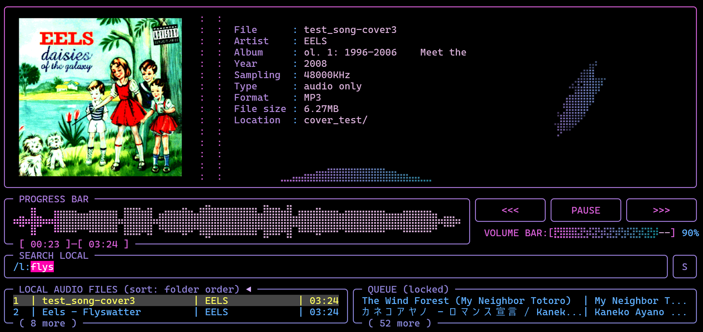<br>**Just Cover** |
| 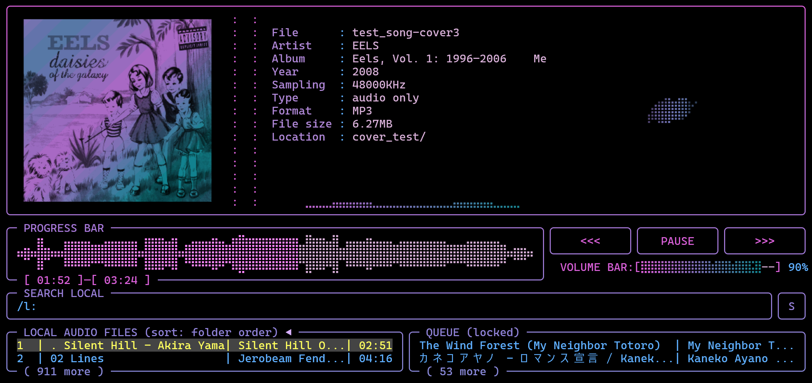<br>**Cover with Gradient** |
| 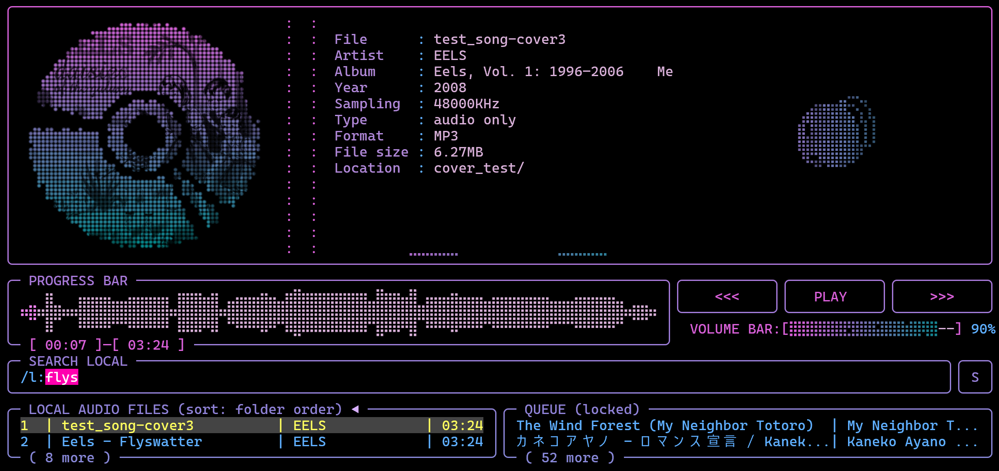<br>**Cover behind Disk** |

### Visualizations

<p align="center">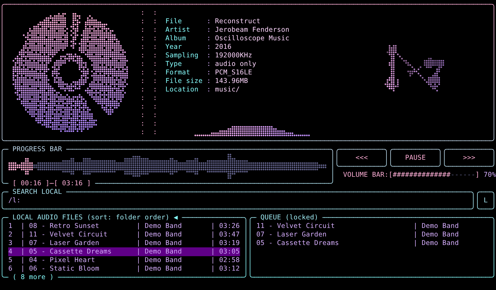</p>
<p align="center">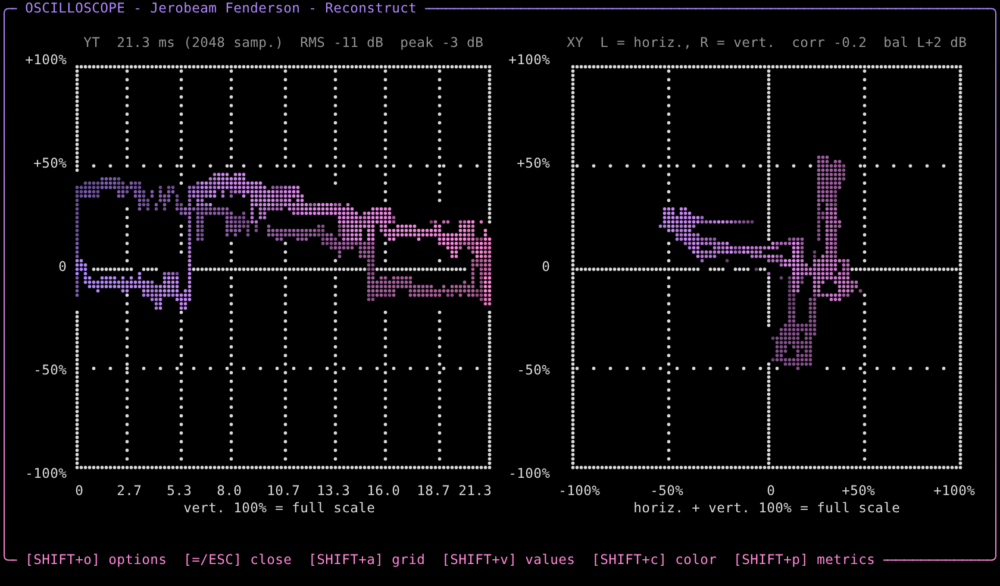</p>
<p align="center">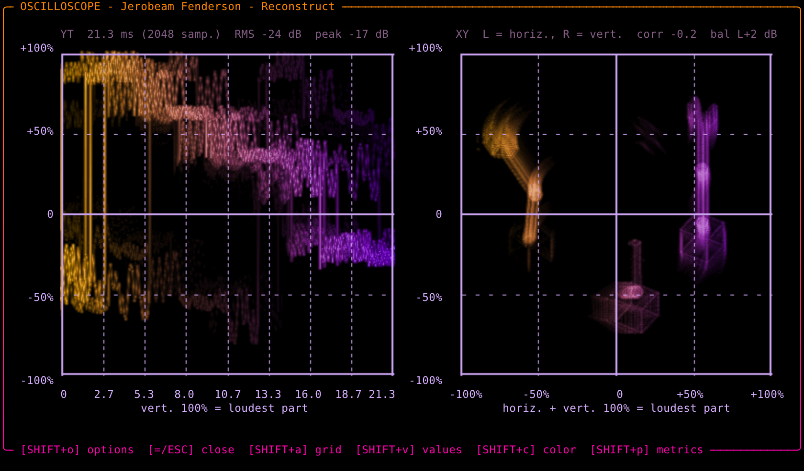</p>

- **Oscilloscope** in braille or as a real picture (Kitty / Sixel terminals): XY, YT and both together, a CRT beam with afterglow for **oscilloscope music**, grid, metrics and many tuning rows (`SHIFT+o`); full screen (`=`) and its own window (`)`).
- **Creator** (`^`): turns a text into sound – **oscilloscope music** that draws the text on the XY scope, or a **spectrogram sound** that plays it as notes of a musical scale (so it always sounds pleasant) – saved as a WAV, played in a looping full-screen preview, and listed under *Created files* to open again. The folder with creations is excluded from the library scan, since at the oscilloscope version don't sound pleasent :D A second mode shows your **microphone live** (spectrogram or oscilloscope XY / YT, grid optional) and records it with `ENTER`.
- **Spectrogram** in the field, over the whole screen (`SHIFT+u`) and in its own window (`(`), with its own options (`SHIFT+i`).
- **Lyric sphere** and **spectrum bars**; the visualization field cycles with `.`.


<p align="center">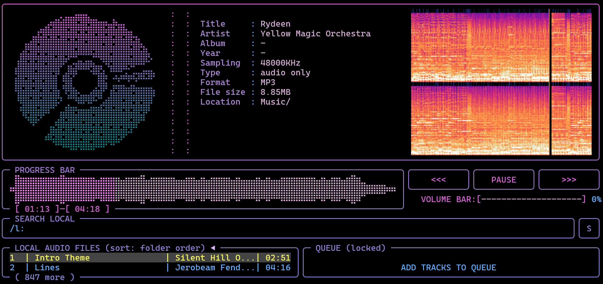</p>
<p align="center">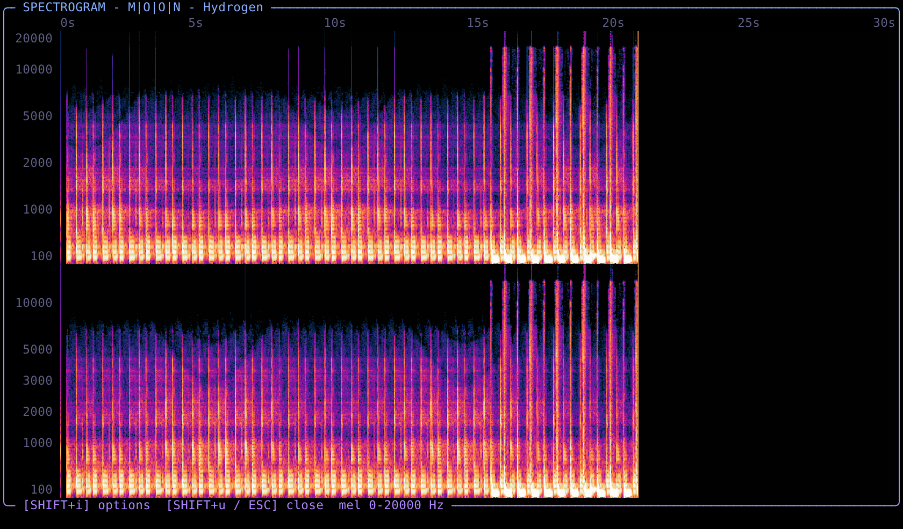</p>

### Lyrics and Karaoke mode

- **Synchronized lyrics** fetched for local and online tracks, word-by-word animations, a timing editor for the offset (`ALT+L`), several versions kept per song.

<p align="center">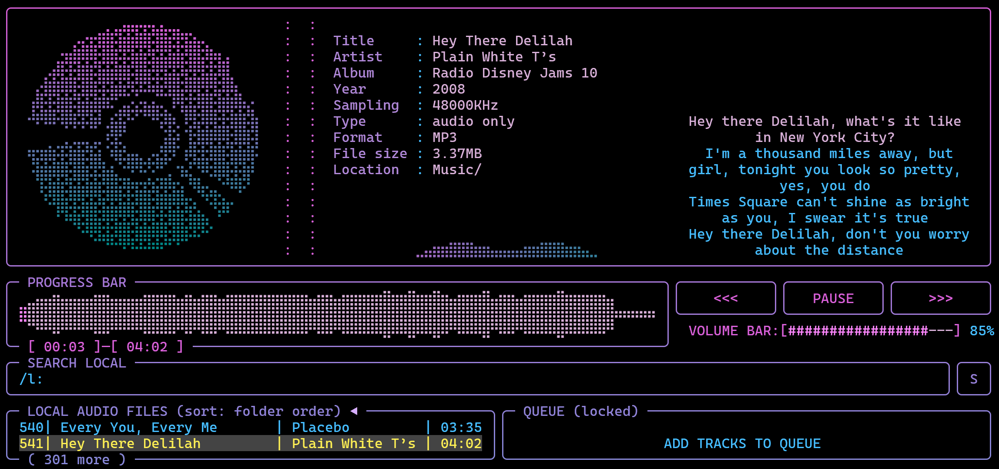</p>

- **Read lyrics** with **translations** (`CTRL+L`) and a full-screen **karaoke mode** with big braille letters (also Japanese, Chinese and Korean).

- **Karaoke mode** open via `k`.
  
<p align="center">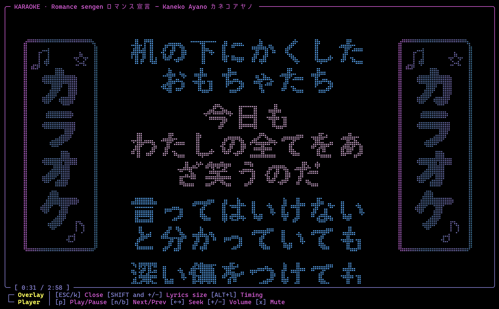</p>

### Playlists, meta data, history, conversion
- **Playlist editor** (`SHIFT+p`): create and edit playlists from local or downloaded tracks (library sortable with `SHIFT+t`, `/f:` searches folders), import and export M3U / M3U8.

<p align="center">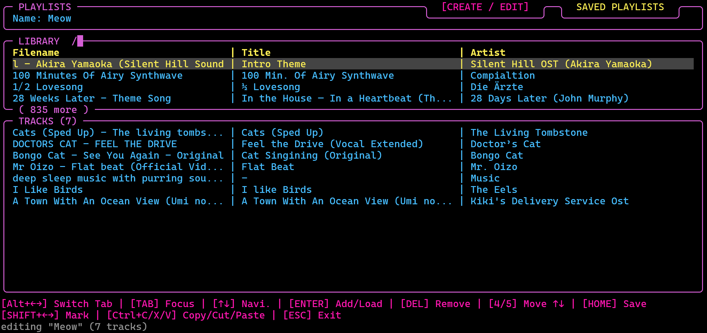</p>

- **Latin letters** (`"`, i.e. `SHIFT+'` on a US keyboard; in the radio mode too, for station names and titles): shows Japanese, Korean and Chinese titles, tags, file names, lyrics and karaoke in Latin letters (romaji, Revised Romanization, pinyin) and back. Kanji are only converted when the text is known to be Chinese; a name written both ways (`Kaneko Ayano カネコアヤノ`) shows its Latin part; pairs are learned from your own folder and file names, and the search finds such titles by their Latin spelling. Optional and local: with the separate `pykakasi` package installed, kanji in Japanese text are read too; an opt-in setting (Settings → GENERAL → MODES → *Latin Name Lookup*, off by default) asks MusicBrainz for the Latin name of artists written in Chinese characters (it sends those artist names, and so your IP address, to musicbrainz.org - nothing else).
- **Meta data editor** (`SHIFT+m`): edit tags, rename files, and **fetch missing tags by audio fingerprint** (AcoustID / MusicBrainz) for one title or a whole list.
  
<p align="center">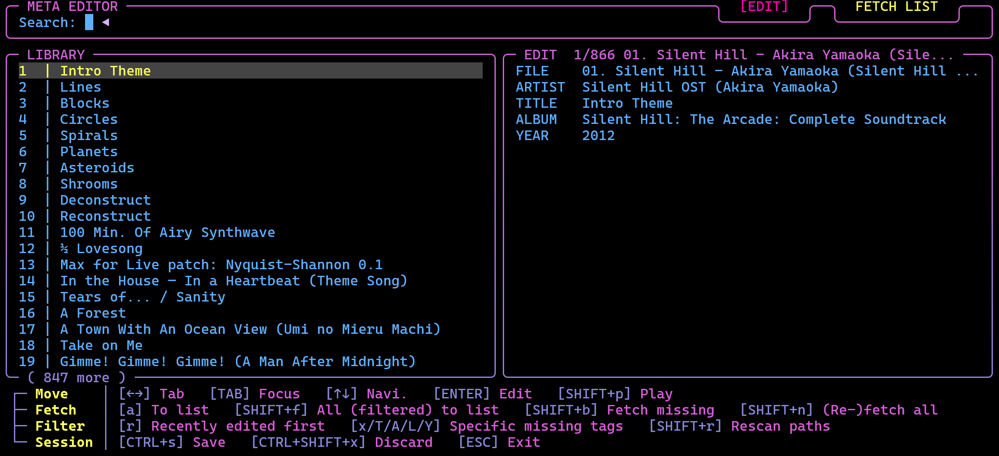</p>
<p align="center">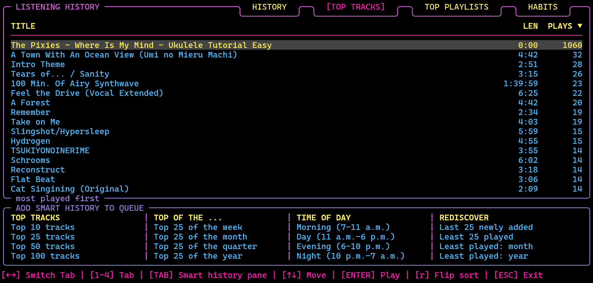</p>

- **File conversion** between audio formats.
- **Listening history** (`SHIFT+h`): history, top tracks, top playlists and listening habits, plus **smart lists** to queue (top 25 of the week, by time of day ...).

### Sound

- **10-band equalizer** with 12 presets and your own presets, **loudness normalization**, stereo / mono, a **sleep timer**.

<p align="center">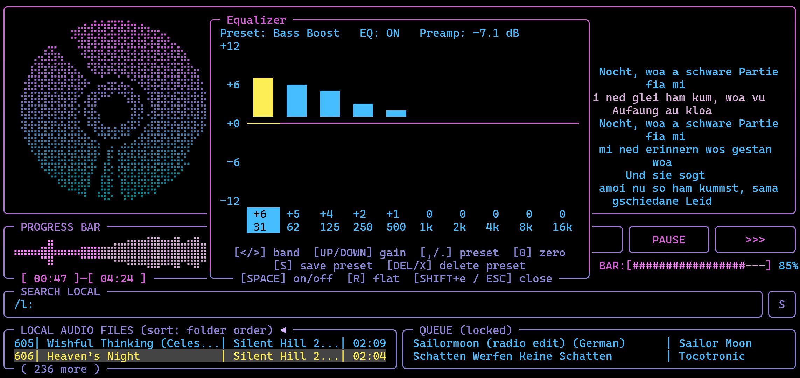</p>

### Radio player

The radio is part of the same program: `*` (`SHIFT` and `+` on a German keyboard, the `'` key on an English one) goes to the next mode, `_` (`SHIFT` and `-`; the `;` key on an English one) to the previous one.

- An **ON AIR / OFF AIR sign** with a colour wave, a tuning-dial frequency band, its own oscilloscope, spectrogram and equalizer.
- **Radio Browser** search through tens of thousands of stations, **16 presets** in several preset lists, **station lists**, a big stations overlay.
- **Timeshift** (pause, jump back, back to live), **recording** (also from the past buffer), its own **listening history**, and finding the current song on YouTube to download it.

<p align="center">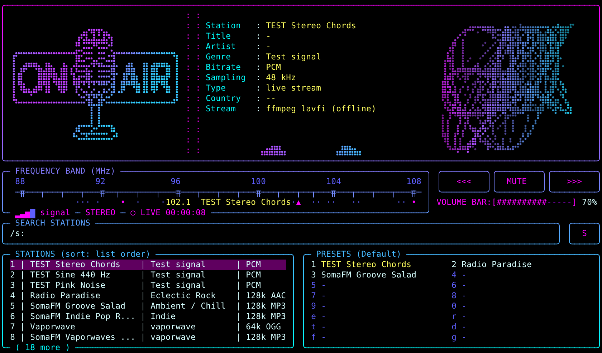</p>

<p align="center">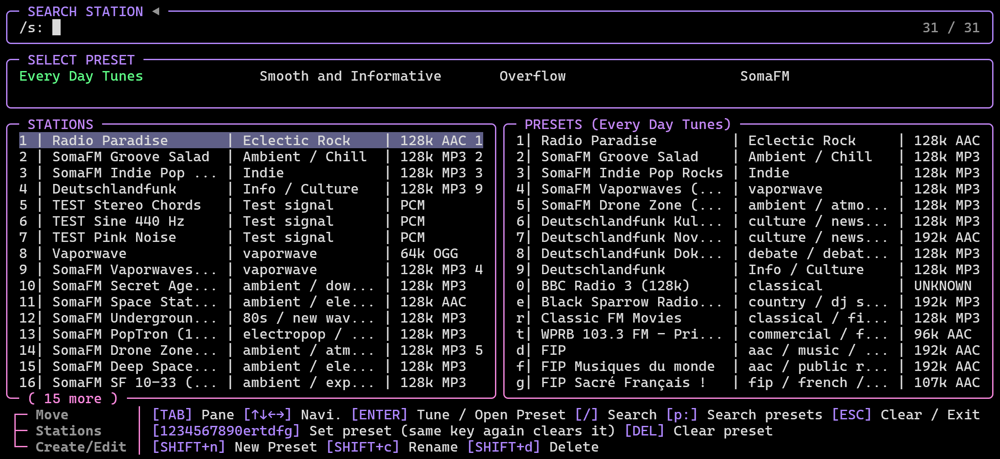</p>

### Audio book player

The audio book player is the third mode, switched to with the same key as to the other modes (`SHIFT` and `+`; `SHIFT` and `-` goes back). **Settings → GENERAL → MODES** switches modes off (one always stays on) and changes their order; **Settings → PATHS → AUDIO BOOK PATH** is the folder of your books (shown in every mode). Files/folders placed there wont show up in the music player mode...

- **Books and chapters:** the left pane of the audio book player lists only the books (folders), the right pane takes the place of the queue and lists the chapters of the open book. `n` / `b` and the end of a chapter walk the chapters.
- **Book covers or a beautiful default image as placeholder** take the place of the disk (a grey version of a colour picture): where the terminal speaks Kitty graphics or Sixel (Windows Terminal 1.22+, Kitty, WezTerm ...) a real transparent pixel image of the book cover or an default image at full resolution will be shown (a terminal without them gets braille dots; Settings → GENERAL → *Book Cover* (`BookCover`) shows the cover image from the book's folder, scaled to fit and centred, with a colour wave or, with *Gradient Wave* off, in its own colours). Original default placeholder image by Kamara Rahmat (iyaniyan) from Unsplash (https://unsplash.com/de/grafiken/young-woman-reading-a-blue-book-on-a-blanket-outdoors-brNfZ1TdBN0).
- **Time stamps:** three kinds are available - the **auto-mark** (written by itself every few seconds while you listen and when you leave: `REM AUTOMARK`), any number of manually set **bookmarks** (`SHIFT+b`, numbered Bookmark 1, 2 …: `REM BOOKMARK`; changing the chapter, switching the mode or quitting first asks whether to set one, the audio pauses meanwhile; can be turned off when it gets annoying) and **notes** (bookmarks with a text of your choice). `ENTER` on a chapter that was left but not bookmarked asks *continue where you left?* (`y` continue - the only answer that starts the chapter, `n` leave and keep the auto-mark, `b` convert the auto-mark to a bookmark and leave); with any bookmark it offers continuing playback on the spot / 10 / 20 / 30 / 60 s before / the start; with several time stamps given it lists them. 
- **Book notes:** `SHIFT+n` writes a note at the current time (title, then the text, in the field of the visualizations), `SHIFT+s` saves it to `<book folder>/<folder>_notes.txt`; `SHIFT+l` opens all notes in a big overlay (list left, the note right; `t` edits and `n` writes a note right there), `SHIFT+p` plays from a note, `SHIFT+e` / `SHIFT+i` export / import. A note appears in the field when playback passes it. 
- **Bookmark list, library, reading history:** `SHIFT+k` lists the auto-marks, bookmarks and notes of every book with a TYPE column (`ENTER` resumes, `SHIFT+p` plays from it, `SHIFT+d` discards one after a warning, `CTRL+SHIFT+u` brings it back, `SHIFT+b` turns an auto-mark into a bookmark, `SHIFT+t` sorts by date or by book and progress); `SHIFT+s` is a big library overlay (search pane + books, `ENTER` inserts the chapters of a book); `SHIFT+h` is the reading history (`reading_history.json`). Notes are stamped at the moment `SHIFT+n` is pressed.
- **Chapter marks and cutting:** `ALT+l` sets chapter marks while you listen (`m`, or by time `h:mm:ss`; standard titles "Chapter N", editable; seeking accelerates), `c` cuts the file at the marks with `ffmpeg -c copy` into `01 Chapter 1.wav`, … and keeps the original as `…mousiki-backup` until you delete it (`SHIFT+d`); bookmark and notes move to the new files.
- The converter works on the books and searches folders, and the visualizations (sphere, oscilloscope, spectrogram), the equalizer, normalization and the sleep timer are the player's.

<p align="center"></p>
<p align="center">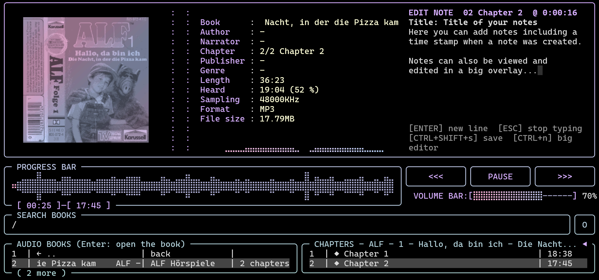</p>

### Themes and colours

Mousiki comes with 32 colour themes, and you can make, edit, export and import your own (Settings → COLORS: CHOOSE THEME, CREATE THEME, `SHIFT+e` / `SHIFT+i`). `SHIFT+p` in the theme list shows a still copy of the main screen in the highlighted theme. The built-in themes use fixed colours, so they look the same in every terminal and colour scheme. Some of them:

| | |
|:---:|:---:|
| 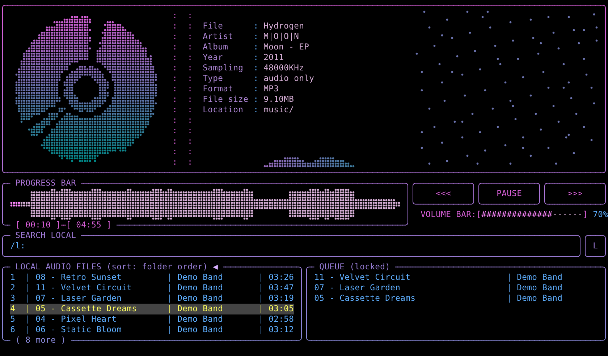<br>**SeriousMeowerShell (Default)** | 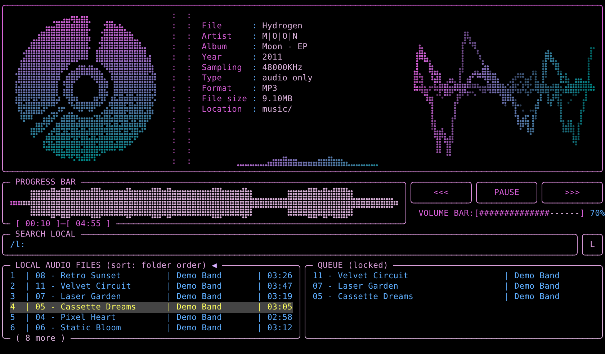<br>**MeowerShell** |
| <br>**Vaporwave** | 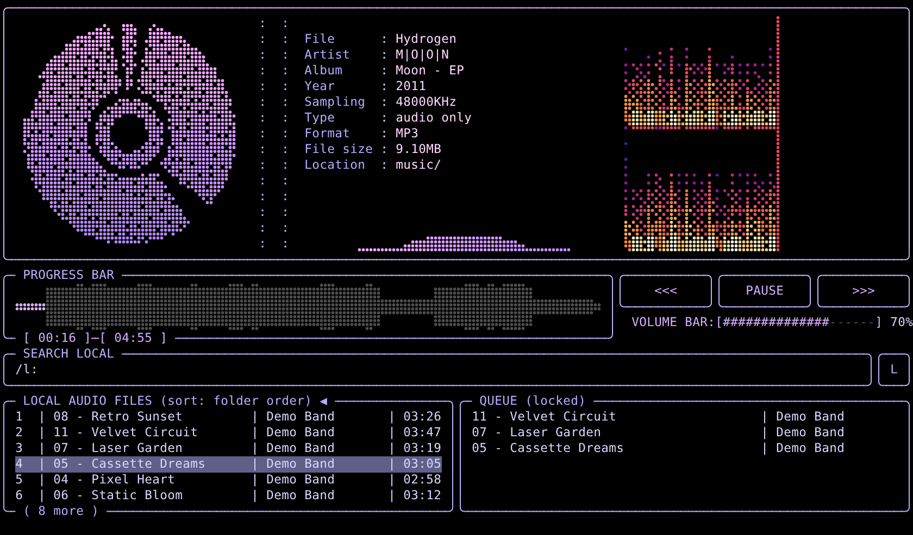<br>**Lavender Haze** |
| <br>**Cyberpunk** (radio) | 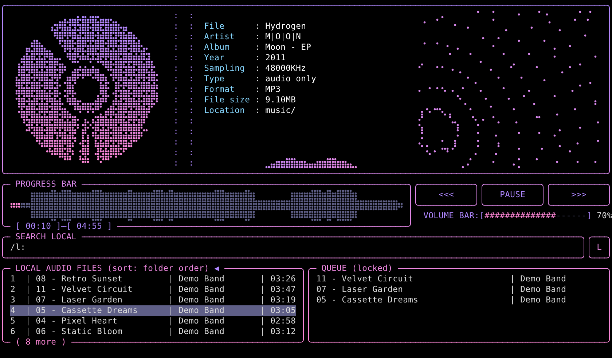<br>**Dracula** |

<p align="center"></p>
<p align="center">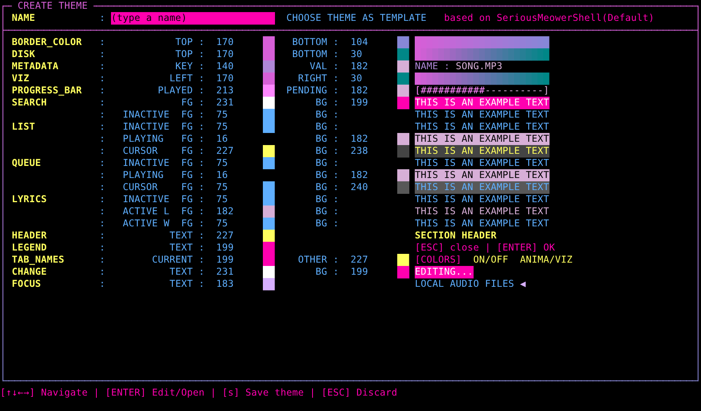</p>

#### Colour-blind friendly themes

Three themes are made for colour vision deficiencies: **Colorblind Deuteranopia** and **Colorblind Protanopia** (red-green: they build on blue / orange / yellow contrasts instead of red against green) and **Colorblind Tritanopia** (blue-yellow: red / cyan contrasts). **High Contrast** helps on dim screens and for low vision. Like every theme they can be a starting point for your own (CREATE THEME → CHOOSE THEME AS TEMPLATE).

<p align="center">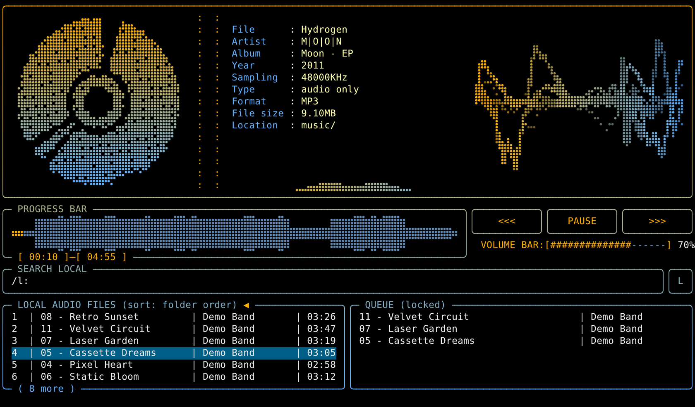</p>

### Help, settings and keys

- A **help wizard** (`SHIFT+w`, opens by itself after the first install), a categorized **cheat sheet** (`?`, shows the keys you actually have bound), a **menus index** (`<`: every menu and overlay by category with its key, ENTER opens one), this **[manual](Mousiki_User_Manual/Mousiki_User_Guide.md)** (also as [PDF](Mousiki_User_Manual/Mousiki_User_Guide.pdf)).

<p align="center">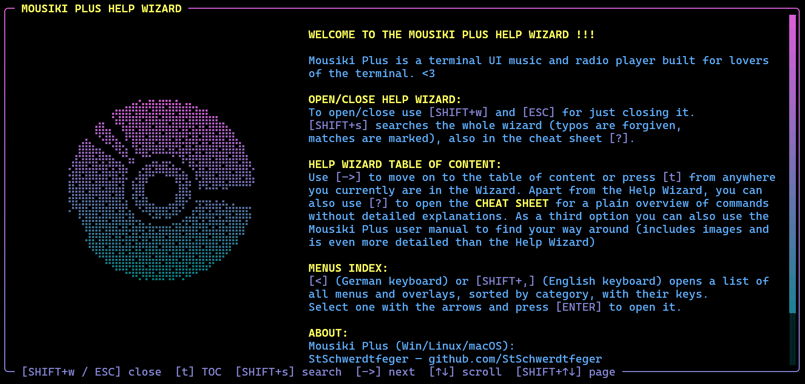</p>

- **Settings** (`s`) for colours, switches, animations, paths and **every key** (most keys can be rebound; a key already in use is refused). German and English keyboard layouts are detected: see [Keyboard layouts](Mousiki_User_Manual/Mousiki_User_Guide.md#keyboard-layouts-german-and-english) in the manual.
- **Black Background**, a re-fontable UI (`A={𝓐,𝓪}` lines in `config.txt`), emoji replacement, marquee scrolling, **Share Profiles** for the visual settings of player and radio, and a backup of your settings (`config.txt.bak`) when a new version first saves them.

### Remote control and phone app

- **Phone remote** (Settings → GENERAL → REMOTE / UPDATES → Remote App): switch it on, scan the QR code and the phone shows a Mousiki screen drawn by Mousiki itself in your theme -- the spinning disk, meta data, working buttons, volume, playback mode, the local list and your playlists (tap: play / into the queue), clear queue, the manual, the radio with its sign, station and the whole station list (tap to tune), and the audio book player with the whole library as a folder tree (tap a chapter to play it). Any phone browser, or the Android app **Mousiki Remote** ([remote_app/](remote_app/)). PIN-protected, home network only, off by default.
- **System media controls:** on Windows Mousiki uses the **System Media Transport Controls** (media pop-up, lock screen, media keys), on Linux it speaks **MPRIS** (media widgets, `playerctl`, media keys and headset buttons work), on macOS it shows **Now Playing** and answers the media keys; player and radio. A quiet **new-version notice** at start-up (checked once a day, a small window once per version with `[o] Go to release`, never installs anything; `UpdateCheck=false` switches it off).
- **Command line remote:** `mousiki --cmd next`, `--cmd volume 60`, `--cmd seek -30`, `mousiki --status` ... (`mousiki --cmd --help` lists all). Bind them to any keys of your system to get global media keys, also on keyboards without them.

| | | |
|:---:|:---:|:---:|
| <br>**Music player** | 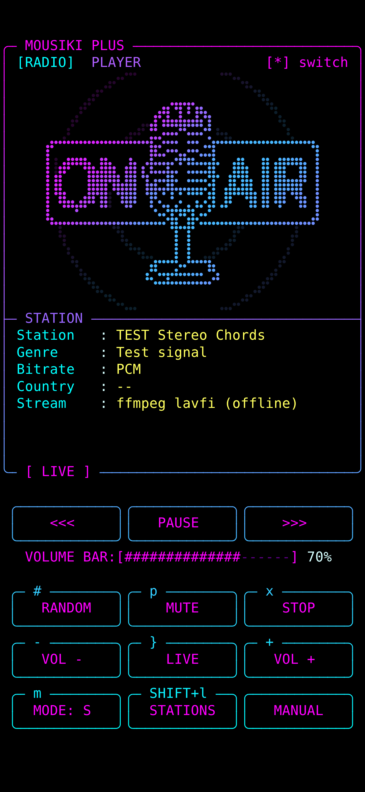<br>**Radio** | 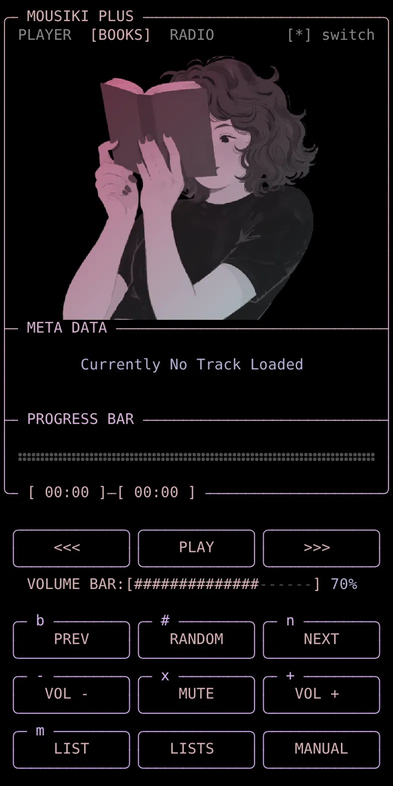<br>**Audio book player** |

<p align="center">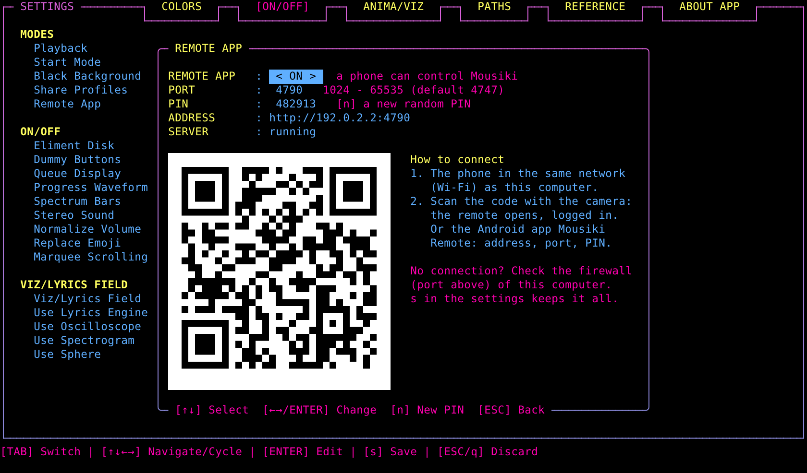</p>

## Quick start

### Installers and portables for Windows / macOS / Linux 

> Note: downloading dependencies (ffmpeg, yt-dlp, Python, pykakasi) during a setup needs an internet connection; see [Dependencies and security](#dependencies-and-security).

Windows (installer, portable zip), Linux (`.deb`, portable) and macOS (`.dmg` with Mousiki.app, portable) from the [latest release](https://github.com/StSchwerdtfeger/mousiki-plus/releases/latest), or build it yourself (below). Release files are signed (GPG) and come with build-provenance attestations; an installer upgrades an existing version and keeps your settings. **Portable versions:** unzip the new version over the old folder (or copy your `data/` folder into the new one) and keep `portable.txt` next to the launcher: it makes Mousiki keep settings, cache, playlists and history in `data/`; without it they are not found. Automated tests (227 unit tests on Linux, macOS and Windows, plus a screen test that runs the real program in a pseudo terminal on Linux and macOS, run by a GitHub workflow): `cmake -DMOUSIKI_BUILD_TESTS=ON`. `mousiki --selftest-fetch` checks that lyrics, covers, the update check and the pinned downloads still work.

**macOS:** open the `.dmg` and drag **Mousiki.app** into *Applications*, like any other Mac app; double-click it to start (it opens Mousiki in a Terminal window). Everything is inside the app, so moving Mousiki.app to the Bin removes Mousiki again (your settings in `~/.config/mousiki` stay, as with every Mac app). The app brings the **Cascadia Mono** font (SIL Open Font License) and copies it into your own font folder (`~/Library/Fonts`) the first time it starts; Mousiki then uses it for its own Terminal window (see *Fonts* below), so the disk and the pictures look like the screenshots here (macOS asks once whether Mousiki may control Terminal: allow it, otherwise the window keeps Terminal's own font). The disk image also has *Install Terminal Commands (optional).command*, which adds the `mousiki` / `lala` commands, and *Remove Old Mousiki (pkg install).command*, which cleans up an installation made by the `.pkg` of v4.7.x and earlier. The app is not notarized: the first time, macOS refuses to open it -- open **System Settings → Privacy & Security** and click **Open Anyway**.

### Build it yourself (Windows)

Setup/portable (x64) version is included in the latest release (since v2.1.0 and since v2.5.0 for all platforms) or build yourself via the commands below. **On Linux or macOS?** Jump to [Build it yourself (Linux / macOS)](#build-it-yourself-linux--macos).

However you install it, the app starts with either of two commands: **`mousiki`** or **`lala`**. The Windows installer puts both on the `PATH` (task *Add Mousiki to PATH*), the `.deb` installs `/usr/bin/mousiki` and `/usr/bin/lala`, on macOS *Install Terminal Commands (optional).command* on the disk image adds `/usr/local/bin/mousiki` and `/usr/local/bin/lala`, the portable zips contain both launchers, and `setup.ps1` / `setup.sh` create both when you build yourself.

```powershell
# from the repo root
.\setup.ps1
```
> [!IMPORTANT]
> `setup.ps1` itself **requires PowerShell 7 or newer** (`#Requires -Version 7.0`); it will refuse to run in Windows PowerShell 5.1. The finished `mousiki.exe` was tested in PowerShell 7.6.6 *and* 5.1. If you only have 5.1, build manually (see below).

Optional parameters: `-SkipDeps` (configure and build only, don't touch winget/pip), `-BuildType Debug` (default is `Release`) and `-NoInstall` (see below).

After the build, `setup.ps1` creates the two commands **`mousiki`** and **`lala`** (both start the app) as small launchers in `%LOCALAPPDATA%\Mousiki\bin` and adds that folder to your user `PATH`; open a new terminal and type either one. `-NoInstall` skips this.

If PowerShell blocks the script, the following temporarily disables script blocking and warning prompts for the current PowerShell session only:

```powershell
Set-ExecutionPolicy -Scope Process -ExecutionPolicy Bypass
.\setup.ps1
```

The setup.ps1 already performs the build. If something didn't work and you want to build manually after debugging (this also works in PowerShell 5.1), use CMake directly:

```powershell
cmake -S . -B build -DCMAKE_BUILD_TYPE=Release
cmake --build build --config Release --parallel
```

The build copies `scripts\` (including the freshly built `fpcalc.exe`) next to `mousiki.exe`. Keep that `scripts\` folder next to the exe if you move it, otherwise lyrics, fast online search and the AcoustID fetch stop working.


Note that you have to add your local files path via the config file `C:\Users\YOURNAME\.config\mousiki\config.txt` or via Settings (`s`) inside the app (more details further below). The `config.txt` in the repo root is a documented template of that file.
See the [user manual](Mousiki_User_Manual/Mousiki_User_Guide.md) on how to use Mousiki Plus.

Start app via the following terminal commands:
```powershell
mousiki
```
or use

```powershell
lala
```

#### Prerequisites (Windows)

*(This section describes the Windows setup; for Linux/macOS see [Build it yourself (Linux / macOS)](#build-it-yourself-linux--macos) below.)*

Note, I had a bunch of the below already installed, so I am not sure how smooth setup.ps1 runs installing the below for the first time using setup.ps1 (such as installing Visual Studio 2022 Build Tools from the terminal...).

`setup.ps1` (PowerShell 7+) installs these via winget, except the compiler "VS 2022 Build tools":

| Tool | Why | Install |
|---|---|---|
| Visual Studio 2022 Build Tools, "Desktop development with C++" | compiles the app (and the `fpcalc` helper) | `winget install --id Microsoft.VisualStudio.2022.BuildTools`, then tick the C++ workload interactively — winget's silent mode won't pick it. `setup.ps1` only warns if no compiler is found. |
| CMake ≥ 3.16 | build system | `winget install Kitware.CMake` |
| FFmpeg | decodes Opus (miniaudio can't), `ffprobe` supplies metadata, decodes audio for the AcoustID fingerprint and writes tags in the meta editor (`ffmpeg -c copy`) | `winget install Gyan.FFmpeg` |
| curl | radio mode only: the Radio Browser station search (`SHIFT+s` in the radio) | **nothing to install** — ships with Windows 10+ |
| yt-dlp | online search fallback, YouTube playlists (bulk add), streaming, downloads | `winget install yt-dlp.yt-dlp` |
| Python 3 | runs the helper scripts in `scripts/`: fast online search (`fast_yt_search.py`), AcoustID fetch (`fetch_meta.py`) and lyrics (`fetch_lyrics.py`) — the first two use the standard library only | `winget install Python.Python.3.13` |
| `pykakasi` (optional, pip) | reads kanji in Latin letters for the Latin letters display (GPL-3.0, so it is not bundled and not downloaded by the build - Mousiki only calls it) | `pip install pykakasi` |
| `janome` (optional, pip) | cuts Japanese lyrics / titles into words, so the Latin letters get spaces (`watashi wa anata ga ...`); Apache-2.0, pure Python, ~20 MB with its dictionary | `pip install janome` |
| `fpcalc` (Chromaprint) | audio fingerprint for the AcoustID fetch | **nothing to install** — built by CMake from `third_party/chromaprint/` and copied to `scripts\` |
| `SDL2.dll` (optional) | the scope and spectrogram windows (`)` / `(`: German `SHIFT+9` / `SHIFT+8`, English `SHIFT+0` / `SHIFT+9`); loaded at run time, so the build does not need it | **fetched by `setup.ps1`** next to `mousiki.exe` (or `SDL2.dll` from `SDL2-<version>-win32-x64.zip`, [SDL releases](https://github.com/libsdl-org/SDL/releases)) |
| `sidplayfp` (optional) | Commodore 64 SID tunes (`.sid`); tracker modules (`.mod/.xm/.it/.s3m`…) and console music (`.nsf/.spc/.vgm`…) only need an FFmpeg built with libopenmpt / libgme (the Gyan.FFmpeg build `setup.ps1` installs has both; an installed FFmpeg is upgraded with `winget upgrade`, or replaced by that build if it lacks them; `-NoUpgrade` skips this) | the project publishes no Windows build. Easiest way: install [MSYS2](https://www.msys2.org), open its **UCRT64** shell and run `pacman -S mingw-w64-ucrt-x86_64-sidplayfp`; copy `sidplayfp.exe` from `C:\msys64\ucrt64\bin` plus the DLLs it needs (`ldd /ucrt64/bin/sidplayfp.exe \| grep ucrt64` lists them) into one folder such as `C:\tools\sidplayfp`, then run `setup.ps1` again: it finds `sidplayfp.exe` and adds its folder to your user `PATH` (any other win64 build of sidplayfp works as well) |

All of the runtime tools (FFmpeg, yt-dlp, Python) are independent of each other and of the core player. With none of them installed, local playback of MP3/FLAC/WAV etc. still works (Opus/some other formats need FFmpeg); the radio mode cannot play anything without FFmpeg.  

MinGW-w64 (MSYS2 UCRT64) also builds this — configure with `-G "MinGW Makefiles"`. The code guards on `_WIN32`, not on `_MSC_VER`, except where MSVC genuinely differs (noted inline where it matters).

`third_party/` (miniaudio, kissfft, chromaprint for the AcoustID meta data fetch, miniz — MIT — which compresses the pictures of the oscilloscope's image style, and stb_truetype — public domain / MIT — which draws the karaoke overlay's Japanese / Chinese / Korean letters from a font installed on the computer) is vendored in this repo, so configuring and building needs no internet connection — `CMakeLists.txt` no longer downloads anything, it just stops with a clear error if one of them is missing. miniaudio is public domain / MIT-0, kissfft is BSD-3-Clause, stb_truetype is public domain / MIT, Chromaprint's own code is MIT; upstream treats the complete project as LGPL-2.1 because it includes some FFmpeg code, which is not part of the vendored copy (see `third_party/chromaprint/LICENSE.md` and `third_party/chromaprint/README.md`). The licence texts of everything compiled into `mousiki` / `fpcalc`, and the licences of the tools the installers bundle (FFmpeg, yt-dlp, Python, SDL2 …), are collected in [`THIRD_PARTY_LICENSES.txt`](THIRD_PARTY_LICENSES.txt), which is also part of every package. To update one, replace its files in `third_party/` with the newer upstream release and follow the checklist in [`third_party/README.md`](third_party/README.md); the versions in the table above are read from the files. SDL2 (zlib licence, used by the optional scope and spectrogram windows) is **not** vendored and not linked: Mousiki loads it at run time if it is installed (`setup.ps1` places the official `SDL2.dll` together with its `README-SDL.txt` next to `mousiki.exe`, the Windows installer and portable zip include it, the `.deb` recommends `libsdl2-2.0-0`, and `setup.sh` installs it on Linux / macOS).

**Licence compatibility (Apache 2.0).** Mousiki itself is Apache-2.0. Everything compiled into it is permissive and can be combined with Apache-2.0 code: miniaudio (Unlicense / MIT-0), KISS FFT (BSD-3-Clause), miniz (MIT), stb_truetype (Unlicense / MIT), the Roseus colour map (CC0) and Chromaprint's own sources (MIT; the LGPL parts of upstream are not in the vendored copy). SDL2 (zlib) is loaded at run time only. The **fonts** the karaoke overlay reads (Noto Sans CJK, Windows or macOS system fonts …) are neither bundled nor copied: Mousiki only opens a file that is already on the computer and draws dots, so their licences (SIL OFL, the operating system's) do not touch Mousiki's. The installers and portable zips also ship **separate programs**: FFmpeg (GPL-3.0 builds), yt-dlp (Unlicense), Python and its packages (PSF, Apache-2.0, MIT, BSD-3-Clause, MPL-2.0). They are started as their own processes and never linked, which is mere aggregation and leaves Mousiki's licence alone, but the GPL asks that whoever distributes the FFmpeg binaries also provides its licence text and the way to its source code: `THIRD_PARTY_LICENSES.txt` and the `bin/ffmpeg-*.txt` licence files in the packages do that. Optional programs that are not bundled (sidplayfp, libgme, libopenmpt, curl, ALSA / PulseAudio) are run or loaded from the system. Nothing in the tree is GPL or LGPL code that is linked into `mousiki`. This is a summary of the files in this repository, not legal advice.

#### Fonts: the braille dots

The disk, the pictures, the waveform and the oscilloscope are drawn with **braille characters**. How full and round their dots look depends on the font: the screenshots here are Windows Terminal with **Cascadia Mono**. A font without braille characters makes the terminal borrow them from another font, and the pictures turn into small, scattered dots. A Nerd Font is not needed.

Mousiki therefore uses **its own font**, **Cascadia Mono** (Settings -> *Terminal Default Font* switches that off; `TerminalFont=` in `config.txt` names another font), for its own window only and only where the terminal allows a program to do that -- your terminal settings stay as they are:

- **macOS Terminal:** the font of Mousiki's window (given back when it quits). Mousiki.app brings Cascadia Mono and installs it for you.
- **iTerm2:** a profile *Mousiki* (your profile plus the font) that Mousiki's tab uses while it runs.
- **Windows Terminal:** a profile *Mousiki* that the Mousiki launchers open (Cascadia Mono comes with Windows Terminal); it has its own colour scheme (black, grey status lines).
- **Other terminals** (GNOME Terminal, Konsole, Kitty, WezTerm, Ghostty ...) do not let programs change their font: choose *Cascadia Mono* in the terminal's profile (Linux: the `.deb` recommends `fonts-cascadia-code`). Ghostty draws braille characters itself, in any font.

#### Use Windows Terminal

The entire UI is ANSI escape sequences. `mousiki.exe` enables `ENABLE_VIRTUAL_TERMINAL_PROCESSING` at startup and exits with a clear message if that fails, rather than rendering garbage. Windows Terminal (`wt.exe`) works; the legacy conhost window on pre-1511 Windows builds does not.

#### Where your files go (Windows)

`$HOME` doesn't exist on Windows, and the original codebase looks it up in seven different places to find its directories. Rather than rewrite all seven call sites to be platform-aware, this port points `HOME` at `%USERPROFILE%` for its own process at startup, so every one of those paths resolves exactly the way it does on Linux/macOS:

| | Path |
|---|---|
| Config | `%USERPROFILE%\.config\mousiki\config.txt` |
| Cache (downloaded/streamed tracks) | `%USERPROFILE%\.cache\mousiki\` |
| Log | `%USERPROFILE%\.cache\mousiki\logs\console.log` |
| Session snapshot | `%USERPROFILE%\.cache\mousiki\snapshot\snapshot.json` |
| Listening history | `%USERPROFILE%\.cache\mousiki\history\history.json` (one folder, changeable: `HistoryPath=` or Settings → PATHS → HISTORY PATH) |
| Meta editor session (pending edits) | `%USERPROFILE%\.cache\mousiki\meta_session\session.json` |
| Playlists (default) | `<first LocalMusicPath>\playlists\`; falls back to `%USERPROFILE%\.cache\mousiki\playlists\` if no `LocalMusicPath` is set |
| Fetched lyrics | `<folder of the track>\lyrics\` |
| Radio settings | `%USERPROFILE%\.config\mousiki\radio_config.txt` (its own file; the radio never reads `config.txt`) |
| Radio stations, presets, station lists | `%USERPROFILE%\.config\mousiki\` — `stations.txt`, `presets.txt`, `stationlists.txt`, `preset_names.txt` (defaults, changeable in the radio's Settings → PATHS) |
| Radio listening history | `%USERPROFILE%\.config\mousiki\radio_history\` — `history_radio.txt`, `archive_radio.txt` |
| Radio recordings / downloads | the player's download folder by default, otherwise `<path>\radio_downloads\` |

`LocalMusicPath=`, `PlaylistsPath=` and `DownloadFolder=` entries accept Windows paths, both slash directions should work (`std::filesystem` normalizes them). A leading `~` is expanded to your user profile; **environment variables such as `%USERPROFILE%` are *not* expanded**, so use `~` or a full path:

```
LocalMusicPath=C:\Users\you\Music
LocalMusicPath=~/Music
```
Playlists folder (optional, **one** `PlaylistsPath=` line; further lines are ignored; changing it in the settings copies the existing playlists there). The listening history folder works the same way (`HistoryPath=`: an existing `history.json` in the new folder is used, otherwise the current one is copied). Without it, playlists live in `<first LocalMusicPath>\playlists`. Listing, loading, saving and deleting all use that single folder.
You can also add folders in the settings (`s`). Same goes for the (single) download folder (`DownloadFolder=`, default is `%USERPROFILE%\.cache\mousiki`), which is automatically added to the local music paths.

```
PlaylistsPath=C:\Users\YOUR NAME !!!!!!!\Music\playlists
DownloadFolder=D:\Downloads\mousiki
```

### Build it yourself (Linux / macOS)

Since v2.5.0 the code builds again on Linux and macOS as well (same sources, platform selected at compile time by `CMakeLists.txt`; audio via PulseAudio/PipeWire-pulse or ALSA on Linux and CoreAudio on macOS). **Portable and setup packages can be found under latest release (included since v2.5.0).** Windows remains the primary, most tested platform. `setup.sh` is the counterpart of `setup.ps1`:

```bash
# from the repo root
chmod +x setup.sh   # only needed once, if the executable bit got lost (e.g. after unzipping)
./setup.sh
```

It detects your package manager (apt, dnf, pacman, zypper, apk, or Homebrew on macOS), installs only what is missing (see the table below), then configures and builds with CMake. The binary ends up in `build/mousiki`, with `scripts/` (including the freshly built `fpcalc`) copied next to it. Finally it creates the two commands `mousiki` and `lala` in `~/.local/bin` (both start the app; skip with `--no-install`).

Options:

| Option | Effect |
|---|---|
| `--skip-deps` | configure and build only, don't touch the package manager / pip |
| `--no-upgrade` | don't upgrade an FFmpeg that is already installed (by default it is upgraded, so that libopenmpt / libgme support arrives) |
| `--debug`, `--build-type Release\|Debug` | build type (default `Release`) |
| `--no-install` | don't create the launchers. By default `setup.sh` creates `~/.local/bin/mousiki` and `~/.local/bin/lala`, so you can start the app from anywhere by typing `mousiki` or `lala` (`--install` is still accepted and does the same as the default) |
| `-y`, `--yes` | don't ask before installing packages |
| `-h`, `--help` | show the options |

> [!NOTE]
> Package installation uses `sudo` on Linux when you are not root. On macOS the script needs [Homebrew](https://brew.sh) and the Xcode Command Line Tools (`xcode-select --install`, they provide the C++ compiler); if one is missing, the script tells you and stops. The launcher from `--install` is a small wrapper script on purpose and not a symlink: macOS does not resolve symlinks when the binary looks up its `scripts/` folder.

Run it:

```bash
./build/mousiki
```

The config file is created at `~/.config/mousiki/config.txt` (the `config.txt` in the repo root is a documented template; Linux/macOS paths such as `LocalMusicPath=~/Music` work, the Windows examples in it do not apply). Any UTF-8 terminal works.

| Tool | Why | Installed by `setup.sh` as |
|---|---|---|
| C++17 compiler, CMake ≥ 3.16 | builds the app and the `fpcalc` helper | `build-essential` / `gcc-c++` / `base-devel` / `build-base` + `cmake`; Xcode CLT on macOS |
| curl | radio mode: Radio Browser station search | `curl` (macOS has it built in) |
| ALSA + PulseAudio libraries (Linux) | audio output (miniaudio loads them at runtime; PipeWire works through `pipewire-pulse` / `pipewire-alsa`) | `libasound2-dev libpulse-dev` (apt), `alsa-lib-devel pulseaudio-libs-devel` (dnf), … |
| FFmpeg (incl. `ffprobe`) | Opus decoding, metadata, AcoustID decoding, tag writing; radio streams (needed) and MP3 recordings (`libmp3lame`; `setup.sh` warns if it is missing) | `ffmpeg` (on Fedora from RPM Fusion; `setup.sh` falls back to `ffmpeg-free` and prints a hint) |
| yt-dlp | online search fallback, playlists, streaming, downloads | `yt-dlp` from the package manager, otherwise `pip install --user yt-dlp` (then `~/.local/bin` has to be on your `PATH`) |
| Python 3 | lyrics, fast online search, AcoustID fetch (standard library only, no pip packages), cover fetch, artist-name lookup | `python3` |
| `pykakasi` (optional, pip) | reads kanji in Latin letters for the Latin letters display (`pip install pykakasi`; GPL-3.0, so it is not bundled - Mousiki only calls it) | `pip install pykakasi` |
| `janome` (optional, pip) | cuts Japanese text into words for the spaces of the Latin letters display (Apache-2.0, pure Python) | `pip install janome` |
| `xclip` / `wl-clipboard` (Linux, optional) | pasting into the search field; macOS uses the built-in `pbpaste` | `xclip` on X11, `wl-clipboard` on Wayland |
| `fpcalc` (Chromaprint) | audio fingerprint for the AcoustID fetch | **nothing to install** — built by CMake from `third_party/chromaprint/` and copied to `scripts\` |
| SDL2 (optional) | the scope and spectrogram windows (`)` / `(`: German `SHIFT+9` / `SHIFT+8`, English `SHIFT+0` / `SHIFT+9`); loaded at run time, so the build does not need it | `libsdl2-2.0-0` (apt), `SDL2` (dnf), `sdl2` (pacman / apk), `brew install sdl2` |
| `sidplayfp` (optional) | Commodore 64 SID tunes (`.sid`); tracker modules and console music go through FFmpeg (libopenmpt / libgme, included in the distro builds) | **done by `setup.sh`**: `sidplayfp` from the package manager (built from the official source tarball on macOS when Homebrew has no `sidplayfp`), linked into `~/.local/bin` if it sits outside the `PATH`; an installed ffmpeg is upgraded, and on macOS rebuilt with `--with-libopenmpt --with-game-music-emu` from the `homebrew-ffmpeg/ffmpeg` tap when Homebrew's own lacks them |

Just like on Windows, FFmpeg, yt-dlp and Python are independent of each other and of the core player: without them, local playback of MP3/FLAC/WAV etc. still works (the radio mode needs FFmpeg). The radio is built into the same binary (sources in `src_radio/`), so there is nothing extra to build or run; like the player it has only been tested on Linux so far. If you prefer to install everything yourself, build manually:

```bash
cmake -S . -B build -DCMAKE_BUILD_TYPE=Release
cmake --build build --parallel
```

Keep the `scripts/` folder next to the binary if you move it, otherwise lyrics, fast online search and the AcoustID fetch stop working.

#### Where your files go (Linux/macOS)

| | Path |
|---|---|
| Config | `~/.config/mousiki/config.txt` |
| Cache (downloaded/streamed tracks) | `~/.cache/mousiki/` |
| Log | `~/.cache/mousiki/logs/console.log` |
| Session snapshot | `~/.cache/mousiki/snapshot/snapshot.json` |
| Listening history | `~/.cache/mousiki/history/history.json` (one folder, changeable: `HistoryPath=` or Settings → PATHS → HISTORY PATH) |
| Meta editor session (pending edits) | `~/.cache/mousiki/meta_session/session.json` |
| Playlists (default) | `<first LocalMusicPath>/playlists/`; falls back to `~/.cache/mousiki/playlists/` if no `LocalMusicPath` is set |
| Fetched lyrics | `<folder of the track>/lyrics/<name>.lrc`; older versions next to it as `<name>.v<YYYYmmdd-HHMMSS>.<source>.lrc` (max 10 kept); translations (READ LYRICS) in `<folder of the track>/lyrics/translations/<name>.<lang>.txt` |
| Radio settings | `~/.config/mousiki/radio_config.txt` (its own file; the radio never reads `config.txt`) |
| Radio stations, presets, station lists | `~/.config/mousiki/` — `stations.txt`, `presets.txt`, `stationlists.txt`, `preset_names.txt` (defaults, changeable in the radio's Settings → PATHS) |
| Radio listening history | `~/.config/mousiki/radio_history/` — `history_radio.txt`, `archive_radio.txt` |
| Radio recordings / downloads | the player's download folder by default, otherwise `<path>/radio_downloads/` (`~/Music/radio_downloads` if the toggle is off and the path empty) |

## Verifying downloads

Every release file (installer, `.deb`, `.dmg`, portable zips) is built by the public GitHub Actions workflow in this repository and comes with:

- `SHA256SUMS.txt` plus a GPG signature (`SHA256SUMS.txt.asc`), and a `.asc` signature next to every package
- a GitHub build-provenance attestation (proves which commit and workflow built the file)

**Release signing key** (GPG, ed25519, expires 2031-10-06)
Fingerprint: `0C8F 861B 48F4 7145 EE64  30F6 DE24 4FF4 9A0F 0902`

```bash
gpg --import mousiki-release-key.asc
gpg --fingerprint 0C8F861B48F47145EE6430F6DE244FF49A0F0902   # must show the fingerprint above
gpg --verify SHA256SUMS.txt.asc SHA256SUMS.txt
sha256sum -c --ignore-missing SHA256SUMS.txt                 # Windows: certutil -hashfile <file> SHA256
gh attestation verify <file> --repo StSchwerdtfeger/mousiki-plus
```

Note: the files are not signed with a purchased code-signing certificate, so Windows SmartScreen and macOS Gatekeeper may still show a warning on first start.

## Dependencies and security

**Fetching dependencies needs an internet connection.** `setup.sh`, `setup.ps1` and the optional steps of the installers download what Mousiki uses from the web: ffmpeg, yt-dlp, Python and CMake (through winget, your package manager or pip), and pykakasi (from pypi.org). Without a connection, install these yourself first and run the setup with `--skip-deps` / `-SkipDeps`. Some features also need the internet while you use them (lyrics, covers, online search, radio, name lookup).

Mousiki uses a small number of third-party components. They are listed here with the version in this release and how they are checked (the table is generated; its date is in the last column). Licence texts are in [`THIRD_PARTY_LICENSES.txt`](THIRD_PARTY_LICENSES.txt), how to report a problem is in [`SECURITY.md`](SECURITY.md).

<!-- vendored-table:start (generated by tools/check_vendored.py --update-readme; do not edit by hand) -->
| Component | Used for | Version here | Newest upstream (checked 2026-10-19) |
|---|---|---|---|
| miniaudio | audio playback and decoding | 0.11.25 | 0.11.25 |
| miniz | compresses the oscilloscope pictures (Kitty graphics) | 3.1.2 | 3.1.2 |
| Chromaprint | AcoustID fingerprint (`fpcalc`) | 1.6.2 | 1.6.2 |
| KISS FFT | spectrum / spectrogram | vendored copy (no version marker; v131 line) | 131.2.0 (build-system changes only) |
| stb_truetype | karaoke letters of Japanese / Chinese / Korean text | 1.26 | 1.26 |
| SDL2 | the optional scope and spectrogram windows (Windows: bundled `SDL2.dll`) | 2.32.10 | 2.32.10 |
| yt-dlp, FFmpeg | online sources, conversion (bundled in the Windows and Linux packages) | the newest at build time, fixed by hash in `packaging/pins.json` | - |
| Python | lyrics and meta data helper scripts (Windows package; standard library only) | 3.13.14 | same |
<!-- vendored-table:end -->

How this is kept in check:

- **Fixed downloads.** The tools the release script bundles are pinned to one exact file each (`packaging/pins.json`). A file that differs from its pin stops the build.
- **Code scanning.** GitHub CodeQL scans Mousiki's own C++ code and the workflows (the vendored libraries in `third_party/` are not scanned: they are unchanged upstream code).
- **Memory-error tests.** The automated tests also run with AddressSanitizer and UndefinedBehaviorSanitizer on every push.
- **Updates.** Libraries are checked against their upstream releases before each release; the table above is updated then. Dependabot proposes newer versions of the GitHub Actions used for building.
- **Third-party findings.** If one of these projects publishes a security fix, a new Mousiki release with the updated component follows. Reports are welcome ([`SECURITY.md`](SECURITY.md)).

## Images

All pictures shown in this README are in **[readme_images/](readme_images/)**; the manual's screenshots are in [Mousiki_User_Manual/images/](Mousiki_User_Manual/images/) and [Mousiki_User_Manual/images_radio/](Mousiki_User_Manual/images_radio/).
