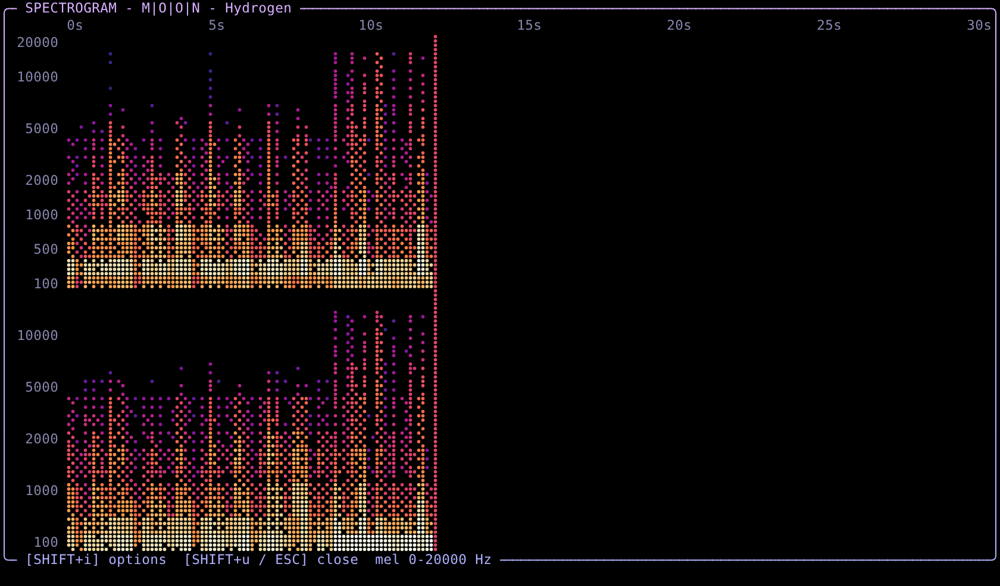
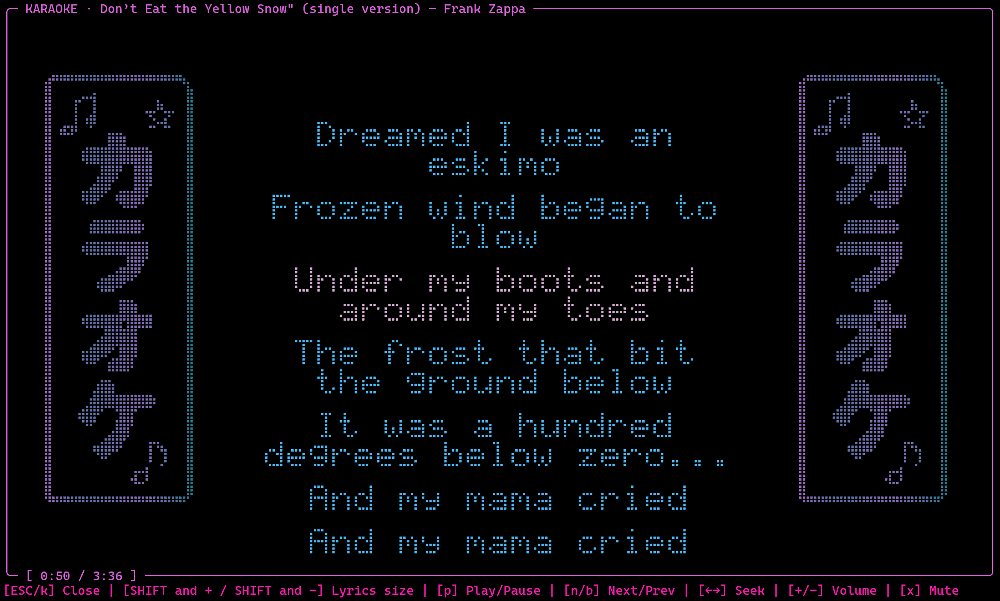
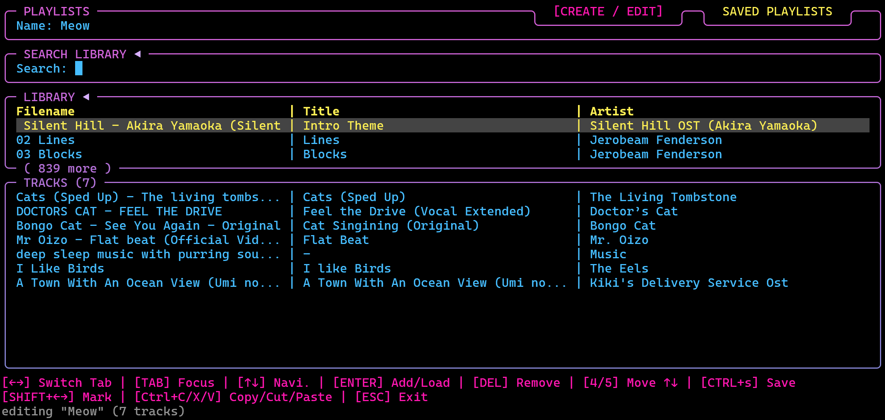
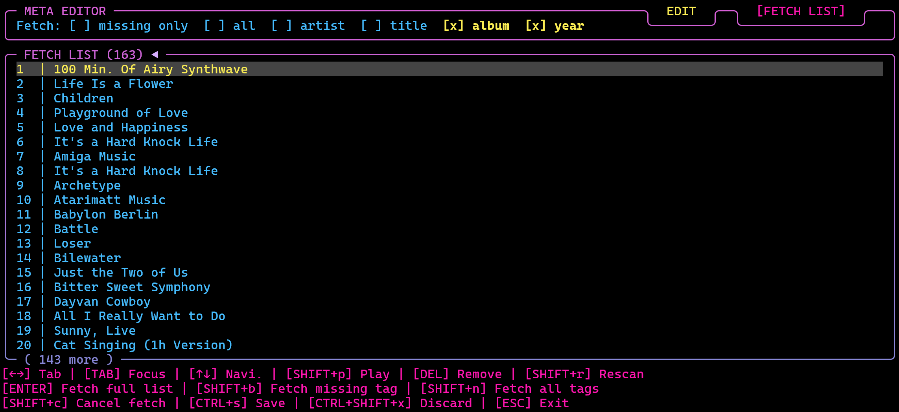

<div align="center">
    
# 📻 Mousiki Plus v4.2.0 - Music and Radio Player 🎵 
(Windows · Linux · macOS)  

<p align="center">
  <a href="https://opensource.org/" target="_blank">
    </a>
&nbsp;
  <a href="https://www.apache.org/" target="_blank">
    </a>
</p>


> [!NOTE]
> **Developer note:** Mousiki is released under the Apache License 2.0.
> You are free to use, modify, fork, re-distribute, and sell the software,
> subject to the terms of the license.

[](LICENSE)
[](https://github.com/StSchwerdtfeger/mousiki-plus/tree/main)
[](https://github.com/StSchwerdtfeger/mousiki-plus/tree/main) [](https://github.com/StSchwerdtfeger/mousiki-plus/tree/main) [](https://github.com/StSchwerdtfeger/mousiki-plus/tree/main)
</div>

Mousiki is a terminal music player that was originally built for macOS/Linux by the amazing [itzender5820/mousiki, v1.0](https://github.com/itzender5820/mousiki) for people who prefer control, simplicity, and a keyboard (mousi-**key**). This Mousiki fork lets it also run natively on Windows (including quite a bunch of modifications and additions; design maintained for obvious reasons). All credits for the design, main feature set, and the vast majority of the code goes to the original author. Since v2.5.0 the same code base builds natively on **Linux and macOS** again (see [Quick start: build it yourself (Linux / macOS)](#quick-start-build-it-yourself-linux--macos) or use the [setup packages or portable versions for all three platforms in the latest release](https://github.com/StSchwerdtfeger/mousiki-plus/releases/latest)). Windows remains the primary and most tested platform (only tested Linux via WSL and works fine so far, a few bugs were recently fixed; not tested for macOS and non-WSL Linux systems). Feel free to give feedback in the discussions and report issues you might experience using this modified port. 

Build yourself (see [prerequisites](#prerequisites-windows) below) **or use the installer/portable (x64) version** that is included in the latest release (since v2.1.0). A full **[user manual](Mousiki_User_Manual/Mousiki_User_Guide.md)** (also as [PDF](Mousiki_User_Manual/Mousiki_User_Guide.pdf)) walks through every entry of the in-app cheat sheet, every settings tab and every overlay.

This fork exists because the original targets POSIX (Linux/macOS/Termux) and had no Windows build path at all. The Windows build uses no WSL, no MSYS runtime, no POSIX emulation layer, just a plain `mousiki.exe` built against the Win32 API and WASAPI. All Windows-specific code is guarded by `_WIN32`, so the very same sources also build on Linux (PulseAudio/PipeWire/ALSA) and macOS (CoreAudio) with the included `setup.sh`. Porting the original repository surfaced a long list of platform differences beyond the obvious ones (see [What had to change](Changes_from_the_Original.md#what-had-to-change-for-the-windows-port) in the separate file *Changes from the Original*), plus a small number of pre-existing bugs in the original codebase that had nothing to do with Windows and got fixed along the way.

Along the Win32 port, **a lot of minor and major additions were made too**. The major ones are a e.g. **radio player mode**, **playlist menu** to create playlists from local (or downloaded) tracks, a **meta data editor** including **fetching artist/title via AcoustID** (audio fingerprinting done via chromaprint), a **listening history** (incl. the ability to add top tracks to the playback queue), an **XY mode ASCII-Braille / image oscilloscope** as an alternative to the lyrics ball and lyrics, a **10 band EQ with 12 presets** and the ability to create and save custom presets, enlarged **list/queue overlays**, **sleep timer**, a **user manual** (.md and .pdf)... Minor changes/additions are e.g. a general key to shuffle to a next title (before only the next title in the list was possible or switching to shuffle mode), stereo audio playback and loudness normalization, adding paths via the settings menu, toggling the lyrics on/off via a hotkey command, an optimized search engine for Windows (searching metadata was very slow and only available 2-3 min. after starting the app), fuzzy search (e.g. "X-Files" didn't show up when searching "X Files" without the dash), a categorized cheat sheet... As mentioned, the design remained the same for obvious reasons; the design asset added is a Braille-ASCII music cassette, shown when no track is loaded... See [Changes from the Original](Changes_from_the_Original.md#added-features-beyond-the-port) for a full detailed list of modifications and added features, and [Features at a glance](#features-at-a-glance) below for an overview with screenshots.  

The latest addition is the mentioned **[radio player mode](#radio-player)** (online radio with a tuning-dial look, presets, Radio Browser search, recording option and its own listening history) that is part of the very same program: press `SHIFT` and `+` (the `*` character) to switch between the music player and the radio; the radio is closed completely when you leave it, while the player only waits in the background (playback paused), so coming back to it is instant.

- **Original:** [github.com/itzender5820/mousiki](https://github.com/itzender5820/mousiki) — ender ([itzender5820](https://github.com/itzender5820))
- **License:** Apache 2.0 — see [LICENSE](LICENSE)
- **Windows port:** Steffen Schwerdtfeger ([StSchwerdtfeger](https://github.com/StSchwerdtfeger)), ported and adjusted with the help of AI tools (only free versions, mostly MiMo V2.6 and Sonnet 5 set on medium). Therefore take some of the below with a grain of salt, since I am not a developer for applications like this and I do not fully understand how the porting and the original C++ code actually works. Still took me >80h in the last weeks to perform porting to Win, modify (feature design) and debug this version... The repo code could also be optimized in that respect, but apparently is supposed to be done quite well (from feedback I got so far and evaluated myself, as far as I am capable to do so). Even though I am not that big fan of using AI for scientific applications (which I usually do), e.g. in the context of data science - since someone has to understand how sh** works and understanding is beautiful and mind blowing - I still liked this music player way too much the first time I saw it on social media to not want to use it on my Windows setup... Sooooo, I went this path and vibe coded a lot to create a port for Windows and still learned a lot as well (especially on UI and feature design).

*In general, a huge shout out for the great work by itzender5820 for this beautiful music player.* <3 It's the best and most fun music player I ever found. Makes me want to listen to music all the time :D 

<p align="center"></p>

<p align="center"></p>

My current setup looks like the last .gif and the below below. The current default config.txt uses the below theme too. It is adjusted to fit my cyber-cat themed **MeowerShell** terminal setup [(see Gihub repository for config files)](https://github.com/StSchwerdtfeger/Meower-Shell), which includes FastFetch, Oh-My-Posh and loads of recommendations for lovers of the terminal, e.g. helpful apps like yazi, fzf fuzzy search ...

<p align="center"></p>

The new main UI of the radio mode looks like the below:

<p align="center"></p>


## Current Status of the Port and Modification (v4.2.0)

For now the Mousiki port works well and also includes everything I at least wanted and made sense to me for a music player, so there might be no further major releases that add new features, except of bug-fixes that might appear to me or others in the future (feel free to start discussions or report issues!!). I might adjust the code to be more polished / robust and might optimize the setup release (Win version results currently in ~250MB size, setup itself ~80MB, portable .zip ~100MB)... Since v2.5.0 my version of Mousiki also builds on macOS/Linux again (`setup.sh`), which is a first step towards making it potentially integratable into the main branch of the original project (which still seems way too hard after dozens of comments in the last two weeks, at least from my perspective). The Linux/macOS builds are less tested than the Windows one, so reports from users on those platforms would help finalize it more. 
Concerning potential new features: the online-radio function is now included (see [radio mode](#radio-player)); a mixtape creator would be cool, but I'll see. Again, feel free to give feedback in the discussions, report issues you might experience using this modified port or contributing in any other way...

## Features at a glance

Everything below is in the current version (v4.2.0) and works the same on Windows, Linux and macOS but was only tested on Windows and WSL. The **[user manual](Mousiki_User_Manual/Mousiki_User_Guide.md)** describes every key and every setting; inside the app `?` opens the cheat sheet and `SHIFT+w` the help wizard. All pictures of this README are in the folder **[readme_images/](readme_images/)**.

### Music player

<p align="center"></p>

- **Local library** from as many folders as you like (MP3, FLAC, WAV, ALAC, M4A, OGG, OPUS, AAC, tracker modules, console and C64 music ...), sorted by folder, title, artist or length, with **fuzzy search** over file names and tags (`/` and the prefixes `/a:` artist, `/r:` ... ).
- **Online:** search, stream and **download** from YouTube, SoundCloud and Bandcamp (yt-dlp), whole YouTube playlists in one go (bulk add), with a shared download archive.
- **Queue** with lock, undo and "save as playlist", big list / folder / queue overlays, play modes list, repeat, shuffle, stop and queue-then-stop, and a shuffle-next key.
- **Meta data panel** with the spinning braille disk, waveform progress bar, spectrum bars and the dummy buttons of the original design.

### Visualizations

<p align="center"></p>
<p align="center"></p>
<p align="center"></p>

- **Oscilloscope** in braille or as a real picture (Kitty / Sixel terminals): XY, YT and both together, a CRT beam with afterglow for **oscilloscope music**, grid, metrics and many tuning rows (`SHIFT+o`); full screen (`=`) and its own window (`)`).
- **Spectrogram** in the field, over the whole screen (`SHIFT+u`) and in its own window (`(`), with its own options (`SHIFT+i`).
- **Lyric sphere** and **spectrum bars**; the visualization field cycles with `.`.

<p align="center"></p>
<p align="center"></p>
<p align="center"></p>

### Lyrics and karaoke

<p align="center"></p>

- **Synchronized lyrics** fetched for local and online tracks, word-by-word animations, a timing editor for the offset (`ALT+L`), several versions kept per song.
- **READ LYRICS** with **translations** (`CTRL+L`) and a full-screen **karaoke mode** with big braille letters (also Japanese, Chinese and Korean).

<p align="center"></p>

### Playlists, meta data, history, conversion

<p align="center"></p>

- **Playlist editor** (`SHIFT+p`): create and edit playlists from local or downloaded tracks, import and export M3U / M3U8.
- **Meta data editor** (`SHIFT+m`): edit tags, rename files, and **fetch missing tags by audio fingerprint** (AcoustID / MusicBrainz) for one title or a whole list.
- **Listening history** (`SHIFT+h`): history, top tracks, top playlists and listening habits, plus **smart lists** to queue (top 25 of the week, by time of day ...).
- **File conversion** between audio formats.

<p align="center"></p>
<p align="center"></p>

### Sound

<p align="center"></p>

- **10-band equalizer** with 12 presets and your own presets, **loudness normalization**, stereo / mono, a **sleep timer**.

### Radio player

<p align="center"></p>

The radio is part of the same program: `*` (`SHIFT` and `+` on a German keyboard, `SHIFT+8` on an English one) switches between music player and radio.

- An **ON AIR / OFF AIR sign** with a colour wave, a tuning-dial frequency band, its own oscilloscope, spectrogram and equalizer.
- **Radio Browser** search through tens of thousands of stations, **16 presets** in several preset lists, **station lists**, a big stations overlay.
- **Timeshift** (pause, jump back, back to live), **recording** (also from the past buffer), its own **listening history**, and finding the current song on YouTube to download it.

<p align="center"></p>

### Themes and colours

Mousiki comes with 32 colour themes, and you can make, edit, export and import your own (Settings → COLORS: CHOOSE THEME, CREATE THEME, `SHIFT+e` / `SHIFT+i`). `SHIFT+p` in the theme list shows a still copy of the main screen in the highlighted theme. The built-in themes use fixed colours, so they look the same in every terminal and colour scheme. Some of them:

| | |
|:---:|:---:|
| <br>**SeriousMeowerShell (Default)** | <br>**MeowerShell** |
| <br>**Vaporwave** | <br>**Lavender Haze** |
| <br>**Cyberpunk** (radio) | <br>**Dracula** |

<p align="center"></p>
<p align="center"></p>

#### Colour-blind friendly themes

Three themes are made for colour vision deficiencies: **Colorblind Deuteranopia** and **Colorblind Protanopia** (red-green: they build on blue / orange / yellow contrasts instead of red against green) and **Colorblind Tritanopia** (blue-yellow: red / cyan contrasts). **High Contrast** helps on dim screens and for low vision. Like every theme they can be a starting point for your own (CREATE THEME → CHOOSE THEME AS TEMPLATE).

<p align="center"></p>

### Help, settings and keys

<p align="center"></p>

- A **help wizard** (`SHIFT+w`, opens by itself after the first install), a categorized **cheat sheet** (`?`, shows the keys you actually have bound), this **[manual](Mousiki_User_Manual/Mousiki_User_Guide.md)** (also as [PDF](Mousiki_User_Manual/Mousiki_User_Guide.pdf)).
- **Settings** (`s`) for colours, switches, animations, paths and **every key** (most keys can be rebound; a key already in use is refused). German and English keyboard layouts are detected: see [Keyboard layouts](Mousiki_User_Manual/Mousiki_User_Guide.md#keyboard-layouts-german-and-english) in the manual.
- **Black Background**, a re-fontable UI (`A={𝓐,𝓪}` lines in `config.txt`), emoji replacement, marquee scrolling, **Share Profiles** for the visual settings of player and radio, and a backup of your settings (`config.txt.bak`) when a new version first saves them.

### Remote control and phone app

| | | |
|:---:|:---:|:---:|
|  |  |  |

- **Phone remote** (Settings → ON/OFF → Remote App): switch it on, scan the QR code and the phone shows a Mousiki screen drawn by Mousiki itself in your theme -- the spinning disk, meta data, working buttons, volume, playback mode, the local list and your playlists (tap: play / into the queue), clear queue, the manual, and the radio with its sign, station and the whole station list (tap to tune). Any phone browser, or the Android app **Mousiki Remote** ([remote_app/](remote_app/)). PIN-protected, home network only, off by default.
- **Command line remote:** `mousiki --cmd next`, `--cmd volume 60`, `--cmd seek -30`, `mousiki --status` ... (`mousiki --cmd --help` lists all). Bind them to any keys of your system to get global media keys, also on keyboards without them.

## quick start: Installers and Portables for Windows / macOS / Linux 

Windows (installer, portable zip), Linux (`.deb`, portable) and macOS (`.pkg`, portable) from the [latest release](https://github.com/StSchwerdtfeger/mousiki-plus/releases/latest), or build it yourself (below). Release files are signed (GPG) and come with build-provenance attestations; an installer upgrades an existing version and keeps your settings. Automated tests: `cmake -DMOUSIKI_BUILD_TESTS=ON`.

## Quick start: build it yourself (Windows)

Setup/portable (x64) version is included in the latest release (since v2.1.0 and since v2.5.0 for all platforms) or build yourself via the commands below. **On Linux or macOS?** Jump to [Quick start: build it yourself (Linux / macOS)](#quick-start-build-it-yourself-linux--macos).

However you install it, the app starts with either of two commands: **`mousiki`** or **`lala`**. The Windows installer puts both on the `PATH` (task *Add Mousiki to PATH*), the `.deb` installs `/usr/bin/mousiki` and `/usr/bin/lala`, the macOS `.pkg` `/usr/local/bin/mousiki` and `/usr/local/bin/lala`, the portable zips contain both launchers, and `setup.ps1` / `setup.sh` create both when you build yourself.

```powershell
# from the repo root
.\setup.ps1
```
> [!IMPORTANT]
> `setup.ps1` itself **requires PowerShell 7 or newer** (`#Requires -Version 7.0`); it will refuse to run in Windows PowerShell 5.1. The finished `mousiki.exe` was tested in PowerShell 7.6.6 *and* 5.1. If you only have 5.1, build manually (see below).

Optional parameters: `-SkipDeps` (configure and build only, don't touch winget/pip), `-BuildType Debug` (default is `Release`) and `-NoInstall` (see below).

After the build, `setup.ps1` creates the two commands **`mousiki`** and **`lala`** (both start the app) as small launchers in `%LOCALAPPDATA%\Mousiki\bin` and adds that folder to your user `PATH`; open a new terminal and type either one. `-NoInstall` skips this.

If PowerShell blocks the script, the following temporarily disables script blocking and warning prompts for the current PowerShell session only:

```powershell
Set-ExecutionPolicy -Scope Process -ExecutionPolicy Bypass
.\setup.ps1
```

The setup.ps1 already performs the build. If something didn't work and you want to build manually after debugging (this also works in PowerShell 5.1), use CMake directly:

```powershell
cmake -S . -B build -DCMAKE_BUILD_TYPE=Release
cmake --build build --config Release --parallel
```

The build copies `scripts\` (including the freshly built `fpcalc.exe`) next to `mousiki.exe`. Keep that `scripts\` folder next to the exe if you move it, otherwise lyrics, fast online search and the AcoustID fetch stop working.

Run app e.g. via the command below (adjust username in the path before executing!!).
Note that you have to add your local files path via the config file `C:\Users\YOURNAME\.config\mousiki\config.txt` or via Settings (`s`) inside the app (more details further below). The `config.txt` in the repo root is a documented template of that file.
See the [user manual](Mousiki_User_Manual/Mousiki_User_Guide.md) or the original repo by itzender5820 for an introduction on how to use Mousiki.
```powershell
& 'C:\Users\YOURNAME\mousiki\build\Release\mousiki.exe'
```
Personally, I recommend writing a function in your PowerShell profile.ps1 in order to be able to run the app via a command (in my case I set the command to be "lala"):
To do so, open your profile file via:

```powershell
notepad $PROFILE
```

Then add the following (as said, I called the function lala but you can choose whatever you want; there is certainly a bunch of already existing commands, such as e.g. python, but you should be safe for most of the cases). 
Again, add your Username in the path!

```powershell
function lala {
    & 'C:\Users\YOURNAME\mousiki\build\Release\mousiki.exe'
}
```
Save your profile.ps1 via Ctrl + S and open a new terminal in order to be able to test your new function.
Voilà, you can now open Mousiki from any folder you're at using the command "lala", or whatever you set as command respectively...

## Prerequisites (Windows)

*(This section describes the Windows setup; for Linux/macOS see [Quick start: build it yourself (Linux / macOS)](#quick-start-build-it-yourself-linux--macos) below.)*

Note, I had a bunch of the below already installed, so I am not sure how smooth setup.ps1 runs installing the below for the first time using setup.ps1 (such as installing Visual Studio 2022 Build Tools...).

`setup.ps1` (PowerShell 7+) installs these via winget (and pip for `requests`), except the compiler "VS 2022 Build tools":

| Tool | Why | Install |
|---|---|---|
| Visual Studio 2022 Build Tools, "Desktop development with C++" | compiles the app (and the `fpcalc` helper) | `winget install --id Microsoft.VisualStudio.2022.BuildTools`, then tick the C++ workload interactively — winget's silent mode won't pick it. `setup.ps1` only warns if no compiler is found. |
| CMake ≥ 3.16 | build system | `winget install Kitware.CMake` |
| FFmpeg | decodes Opus (miniaudio can't), `ffprobe` supplies metadata, decodes audio for the AcoustID fingerprint and writes tags in the meta editor (`ffmpeg -c copy`) | `winget install Gyan.FFmpeg` |
| curl | radio mode only: the Radio Browser station search (`SHIFT+s` in the radio) | **nothing to install** — ships with Windows 10+ |
| yt-dlp | online search fallback, YouTube playlists (bulk add), streaming, downloads | `winget install yt-dlp.yt-dlp` |
| Python 3 | runs the helper scripts in `scripts/`: fast online search (`fast_yt_search.py`), AcoustID fetch (`fetch_meta.py`) and lyrics (`fetch_lyrics.py`) — the first two use the standard library only | `winget install Python.Python.3.12` |
| Python package `requests` | lyrics only (`fetch_lyrics.py` / `lrc.py`) | `py -3 -m pip install requests` (done by `setup.ps1`) |
| `fpcalc` (Chromaprint) | audio fingerprint for the AcoustID fetch | **nothing to install** — built by CMake from `third_party/chromaprint/` and copied to `scripts\` |
| `SDL2.dll` (optional) | the scope and spectrogram windows (`)` / `(`: German `SHIFT+9` / `SHIFT+8`, English `SHIFT+0` / `SHIFT+9`); loaded at run time, so the build does not need it | **fetched by `setup.ps1`** next to `mousiki.exe` (or `SDL2.dll` from `SDL2-<version>-win32-x64.zip`, [SDL releases](https://github.com/libsdl-org/SDL/releases)) |
| `sidplayfp` (optional) | Commodore 64 SID tunes (`.sid`); tracker modules (`.mod/.xm/.it/.s3m`…) and console music (`.nsf/.spc/.vgm`…) only need an FFmpeg built with libopenmpt / libgme (the Gyan.FFmpeg build `setup.ps1` installs has both; an installed FFmpeg is upgraded with `winget upgrade`, or replaced by that build if it lacks them; `-NoUpgrade` skips this) | the project publishes no Windows build: unzip a win64 build of sidplayfp anywhere (Downloads, `C:\tools\sidplayfp`, …) and run `setup.ps1` again, which finds `sidplayfp.exe` and adds its folder to your user `PATH` |

All of the runtime tools (FFmpeg, yt-dlp, Python) are independent of each other and of the core player. With none of them installed, local playback of MP3/FLAC/WAV etc. still works (Opus/some other formats need FFmpeg); the radio mode cannot play anything without FFmpeg.  

MinGW-w64 (MSYS2 UCRT64) also builds this — configure with `-G "MinGW Makefiles"`. The code guards on `_WIN32`, not on `_MSC_VER`, except where MSVC genuinely differs (noted inline where it matters).

`third_party/` (miniaudio v0.11.25, kissfft, chromaprint 1.6.1 for the AcoustID meta data fetch, miniz 3.0.2 — MIT — which compresses the pictures of the oscilloscope's image style, and stb_truetype 1.26 — public domain / MIT — which draws the karaoke overlay's Japanese / Chinese / Korean letters from a font installed on the computer) is vendored in this repo, so configuring and building needs no internet connection — `CMakeLists.txt` no longer downloads anything, it just stops with a clear error if one of them is missing. miniaudio is public domain / MIT-0, kissfft is BSD-3-Clause, stb_truetype is public domain / MIT, Chromaprint's own code is MIT; upstream treats the complete project as LGPL-2.1 because it includes some FFmpeg code, which is not part of the vendored copy (see `third_party/chromaprint/LICENSE.md` and `third_party/chromaprint/README.md`). The licence texts of everything compiled into `mousiki` / `fpcalc`, and the licences of the tools the installers bundle (FFmpeg, yt-dlp, Python, SDL2 …), are collected in [`THIRD_PARTY_LICENSES.txt`](THIRD_PARTY_LICENSES.txt), which is also part of every package. To update either, replace the files in `third_party/` with a newer upstream copy (not tested if it is that ease now that chromaprint is also included). SDL2 (zlib licence, used by the optional scope and spectrogram windows) is **not** vendored and not linked: Mousiki loads it at run time if it is installed (`setup.ps1` places the official `SDL2.dll` together with its `README-SDL.txt` next to `mousiki.exe`, the Windows installer and portable zip include it, the `.deb` recommends `libsdl2-2.0-0`, and `setup.sh` installs it on Linux / macOS).

**Licence compatibility (Apache 2.0).** Mousiki itself is Apache-2.0. Everything compiled into it is permissive and can be combined with Apache-2.0 code: miniaudio (Unlicense / MIT-0), KISS FFT (BSD-3-Clause), miniz (MIT), stb_truetype (Unlicense / MIT), the Roseus colour map (CC0) and Chromaprint's own sources (MIT; the LGPL parts of upstream are not in the vendored copy). SDL2 (zlib) is loaded at run time only. The **fonts** the karaoke overlay reads (Noto Sans CJK, Windows or macOS system fonts …) are neither bundled nor copied: Mousiki only opens a file that is already on the computer and draws dots, so their licences (SIL OFL, the operating system's) do not touch Mousiki's. The installers and portable zips also ship **separate programs**: FFmpeg (GPL-3.0 builds), yt-dlp (Unlicense), Python and its packages (PSF, Apache-2.0, MIT, BSD-3-Clause, MPL-2.0). They are started as their own processes and never linked, which is mere aggregation and leaves Mousiki's licence alone, but the GPL asks that whoever distributes the FFmpeg binaries also provides its licence text and the way to its source code: `THIRD_PARTY_LICENSES.txt` and the `bin/ffmpeg-*.txt` licence files in the packages do that. Optional programs that are not bundled (sidplayfp, libgme, libopenmpt, curl, ALSA / PulseAudio) are run or loaded from the system. Nothing in the tree is GPL or LGPL code that is linked into `mousiki`. This is a summary of the files in this repository, not legal advice.

## Use Windows Terminal

The entire UI is ANSI escape sequences. `mousiki.exe` enables `ENABLE_VIRTUAL_TERMINAL_PROCESSING` at startup and exits with a clear message if that fails, rather than rendering garbage. Windows Terminal (`wt.exe`) works; the legacy conhost window on pre-1511 Windows builds does not.

## Where your files go (Windows)

`$HOME` doesn't exist on Windows, and the original codebase looks it up in seven different places to find its directories. Rather than rewrite all seven call sites to be platform-aware, this port points `HOME` at `%USERPROFILE%` for its own process at startup, so every one of those paths resolves exactly the way it does on Linux/macOS:

| | Path |
|---|---|
| Config | `%USERPROFILE%\.config\mousiki\config.txt` |
| Cache (downloaded/streamed tracks) | `%USERPROFILE%\.cache\mousiki\` |
| Log | `%USERPROFILE%\.cache\mousiki\logs\console.log` |
| Session snapshot | `%USERPROFILE%\.cache\mousiki\snapshot\snapshot.json` |
| Listening history | `%USERPROFILE%\.cache\mousiki\history\history.json` (one folder, changeable: `HistoryPath=` or Settings → PATHS → HISTORY PATH) |
| Meta editor session (pending edits) | `%USERPROFILE%\.cache\mousiki\meta_session\session.json` |
| Playlists (default) | `<first LocalMusicPath>\playlists\`; falls back to `%USERPROFILE%\.cache\mousiki\playlists\` if no `LocalMusicPath` is set |
| Fetched lyrics | `<folder of the track>\lyrics\` |
| Radio settings | `%USERPROFILE%\.config\mousiki\radio_config.txt` (its own file; the radio never reads `config.txt`) |
| Radio stations, presets, station lists | `%USERPROFILE%\.config\mousiki\` — `stations.txt`, `presets.txt`, `stationlists.txt`, `preset_names.txt` (defaults, changeable in the radio's Settings → PATHS) |
| Radio listening history | `%USERPROFILE%\.config\mousiki\radio_history\` — `history_radio.txt`, `archive_radio.txt` |
| Radio recordings / downloads | the player's download folder by default, otherwise `<path>\radio_downloads\` |

`LocalMusicPath=`, `PlaylistsPath=` and `DownloadFolder=` entries accept Windows paths, both slash directions should work (`std::filesystem` normalizes them). A leading `~` is expanded to your user profile; **environment variables such as `%USERPROFILE%` are *not* expanded**, so use `~` or a full path:

```
LocalMusicPath=C:\Users\you\Music
LocalMusicPath=~/Music
```
Playlists folder (optional, **one** `PlaylistsPath=` line; further lines are ignored; changing it in the settings copies the existing playlists there). The listening history folder works the same way (`HistoryPath=`: an existing `history.json` in the new folder is used, otherwise the current one is copied). Without it, playlists live in `<first LocalMusicPath>\playlists`. Listing, loading, saving and deleting all use that single folder.
You can also add folders in the settings (`s`). Same goes for the (single) download folder (`DownloadFolder=`, default is `%USERPROFILE%\.cache\mousiki`), which is automatically added to the local music paths.

```
PlaylistsPath=C:\Users\YOUR NAME !!!!!!!\Music\playlists
DownloadFolder=D:\Downloads\mousiki
```

## Quick start: build it yourself (Linux / macOS)

Since v2.5.0 the code builds again on Linux and macOS as well (same sources, platform selected at compile time by `CMakeLists.txt`; audio via PulseAudio/PipeWire-pulse or ALSA on Linux and CoreAudio on macOS). Portable and setup packages can be found under latest release (included since v2.5.0). Windows remains the primary, most tested platform. `setup.sh` is the counterpart of `setup.ps1`:

```bash
# from the repo root
chmod +x setup.sh   # only needed once, if the executable bit got lost (e.g. after unzipping)
./setup.sh
```

It detects your package manager (apt, dnf, pacman, zypper, apk, or Homebrew on macOS), installs only what is missing (see the table below), then configures and builds with CMake. The binary ends up in `build/mousiki`, with `scripts/` (including the freshly built `fpcalc`) copied next to it. Finally it creates the two commands `mousiki` and `lala` in `~/.local/bin` (both start the app; skip with `--no-install`).

Options:

| Option | Effect |
|---|---|
| `--skip-deps` | configure and build only, don't touch the package manager / pip |
| `--no-upgrade` | don't upgrade an FFmpeg that is already installed (by default it is upgraded, so that libopenmpt / libgme support arrives) |
| `--debug`, `--build-type Release\|Debug` | build type (default `Release`) |
| `--no-install` | don't create the launchers. By default `setup.sh` creates `~/.local/bin/mousiki` and `~/.local/bin/lala`, so you can start the app from anywhere by typing `mousiki` or `lala` (`--install` is still accepted and does the same as the default) |
| `-y`, `--yes` | don't ask before installing packages |
| `-h`, `--help` | show the options |

> [!NOTE]
> Package installation uses `sudo` on Linux when you are not root. On macOS the script needs [Homebrew](https://brew.sh) and the Xcode Command Line Tools (`xcode-select --install`, they provide the C++ compiler); if one is missing, the script tells you and stops. The launcher from `--install` is a small wrapper script on purpose and not a symlink: macOS does not resolve symlinks when the binary looks up its `scripts/` folder.

Run it:

```bash
./build/mousiki
```

The config file is created at `~/.config/mousiki/config.txt` (the `config.txt` in the repo root is a documented template; Linux/macOS paths such as `LocalMusicPath=~/Music` work, the Windows examples in it do not apply). Any UTF-8 terminal works.

| Tool | Why | Installed by `setup.sh` as |
|---|---|---|
| C++17 compiler, CMake ≥ 3.16 | builds the app and the `fpcalc` helper | `build-essential` / `gcc-c++` / `base-devel` / `build-base` + `cmake`; Xcode CLT on macOS |
| curl | radio mode: Radio Browser station search | `curl` (macOS has it built in) |
| ALSA + PulseAudio libraries (Linux) | audio output (miniaudio loads them at runtime; PipeWire works through `pipewire-pulse` / `pipewire-alsa`) | `libasound2-dev libpulse-dev` (apt), `alsa-lib-devel pulseaudio-libs-devel` (dnf), … |
| FFmpeg (incl. `ffprobe`) | Opus decoding, metadata, AcoustID decoding, tag writing; radio streams (needed) and MP3 recordings (`libmp3lame`; `setup.sh` warns if it is missing) | `ffmpeg` (on Fedora from RPM Fusion; `setup.sh` falls back to `ffmpeg-free` and prints a hint) |
| yt-dlp | online search fallback, playlists, streaming, downloads | `yt-dlp` from the package manager, otherwise `pip install --user yt-dlp` (then `~/.local/bin` has to be on your `PATH`) |
| Python 3 + `requests` | lyrics, fast online search, AcoustID fetch (`requests` is only needed for lyrics) | `python3`, `python3-requests` (or `pip install --user requests`) |
| `xclip` / `wl-clipboard` (Linux, optional) | pasting into the search field; macOS uses the built-in `pbpaste` | `xclip` on X11, `wl-clipboard` on Wayland |
| `fpcalc` (Chromaprint) | audio fingerprint for the AcoustID fetch | **nothing to install** — built by CMake from `third_party/chromaprint/` and copied to `scripts\` |
| SDL2 (optional) | the scope and spectrogram windows (`)` / `(`: German `SHIFT+9` / `SHIFT+8`, English `SHIFT+0` / `SHIFT+9`); loaded at run time, so the build does not need it | `libsdl2-2.0-0` (apt), `SDL2` (dnf), `sdl2` (pacman / apk), `brew install sdl2` |
| `sidplayfp` (optional) | Commodore 64 SID tunes (`.sid`); tracker modules and console music go through FFmpeg (libopenmpt / libgme, included in the distro builds) | **done by `setup.sh`**: `sidplayfp` from the package manager (built from the official source tarball on macOS when Homebrew has no `sidplayfp`), linked into `~/.local/bin` if it sits outside the `PATH`; an installed ffmpeg is upgraded, and on macOS rebuilt with `--with-libopenmpt --with-game-music-emu` from the `homebrew-ffmpeg/ffmpeg` tap when Homebrew's own lacks them |

Just like on Windows, FFmpeg, yt-dlp and Python are independent of each other and of the core player: without them, local playback of MP3/FLAC/WAV etc. still works (the radio mode needs FFmpeg). The radio is built into the same binary (sources in `src_radio/`), so there is nothing extra to build or run; like the player it has only been tested on Linux so far. If you prefer to install everything yourself, build manually:

```bash
cmake -S . -B build -DCMAKE_BUILD_TYPE=Release
cmake --build build --parallel
```

Keep the `scripts/` folder next to the binary if you move it, otherwise lyrics, fast online search and the AcoustID fetch stop working.

## Where your files go (Linux/macOS)

| | Path |
|---|---|
| Config | `~/.config/mousiki/config.txt` |
| Cache (downloaded/streamed tracks) | `~/.cache/mousiki/` |
| Log | `~/.cache/mousiki/logs/console.log` |
| Session snapshot | `~/.cache/mousiki/snapshot/snapshot.json` |
| Listening history | `~/.cache/mousiki/history/history.json` (one folder, changeable: `HistoryPath=` or Settings → PATHS → HISTORY PATH) |
| Meta editor session (pending edits) | `~/.cache/mousiki/meta_session/session.json` |
| Playlists (default) | `<first LocalMusicPath>/playlists/`; falls back to `~/.cache/mousiki/playlists/` if no `LocalMusicPath` is set |
| Fetched lyrics | `<folder of the track>/lyrics/<name>.lrc`; older versions next to it as `<name>.v<YYYYmmdd-HHMMSS>.<source>.lrc` (max 10 kept); translations (READ LYRICS) in `<folder of the track>/lyrics/translations/<name>.<lang>.txt` |
| Radio settings | `~/.config/mousiki/radio_config.txt` (its own file; the radio never reads `config.txt`) |
| Radio stations, presets, station lists | `~/.config/mousiki/` — `stations.txt`, `presets.txt`, `stationlists.txt`, `preset_names.txt` (defaults, changeable in the radio's Settings → PATHS) |
| Radio listening history | `~/.config/mousiki/radio_history/` — `history_radio.txt`, `archive_radio.txt` |
| Radio recordings / downloads | the player's download folder by default, otherwise `<path>/radio_downloads/` (`~/Music/radio_downloads` if the toggle is off and the path empty) |

## Verifying downloads

Every release file (installer, `.deb`, `.pkg`, portable zips) is built by the public GitHub Actions workflow in this repository and comes with:

- `SHA256SUMS.txt` plus a GPG signature (`SHA256SUMS.txt.asc`), and a `.asc` signature next to every package
- a GitHub build-provenance attestation (proves which commit and workflow built the file)

**Release signing key** (GPG, ed25519, expires 2031-10-06)
Fingerprint: `0C8F 861B 48F4 7145 EE64  30F6 DE24 4FF4 9A0F 0902`

```bash
gpg --import mousiki-release-key.asc
gpg --fingerprint 0C8F861B48F47145EE6430F6DE244FF49A0F0902   # must show the fingerprint above
gpg --verify SHA256SUMS.txt.asc SHA256SUMS.txt
sha256sum -c --ignore-missing SHA256SUMS.txt                 # Windows: certutil -hashfile <file> SHA256
gh attestation verify <file> --repo StSchwerdtfeger/mousiki-plus
```

Note: the files are not signed with a purchased code-signing certificate, so Windows SmartScreen and macOS Gatekeeper may still show a warning on first start.

## Changes compared to the original Mousiki

What had to change for the Windows port (console, paths, processes, audio parsing, locale ...) and the complete, detailed list of every feature added on top of the original v1.0 (with screenshots) are in a separate file: **[Changes from the Original](Changes_from_the_Original.md)**.

## Images

All pictures shown in this README are in **[readme_images/](readme_images/)**; the manual's screenshots are in [Mousiki_User_Manual/images/](Mousiki_User_Manual/images/) and [Mousiki_User_Manual/images_radio/](Mousiki_User_Manual/images_radio/).
